# Lab 1 · Your first automated build with AWS CodeBuild

> *"It works on my machine" is not a release strategy. In this lab you hand your code to a robot, watch the robot fail, read its diary, and fix it. That is Continuous Integration.*

| | |
|---|---|
| **Time** | 45 min core path · then 50–90 min of missions (pick your own) |
| **Difficulty** | Beginner · no prior build/CI experience assumed |
| **AWS services** | CodeBuild, S3, IAM, CloudWatch Logs · then Secrets Manager, EventBridge, SNS and Logs Insights in the missions |
| **You will build** | A CodeBuild project that compiles a tiny Java app, runs its unit tests and publishes a `.jar` to S3 · then a build that reads a secret, caches its downloads, emails you when it fails, and can be queried like a database |
| **You will break & fix** | A Java version mismatch · a failing test · a test somebody switched off · a robot that is refused a secret |
| **Handout** | Read **"Why CI/CD?"** and **"Anatomy of a build"** in the [class handout](../docs/index.html) before or after |

> [!IMPORTANT]
> **Your number.** You are signed in as `participant-NN`. Everywhere this guide shows `NN`, type **your own two digits** (participant-07 → `07`). Fifteen people share this AWS account, so every name you create must contain your number.
>
> **Your region.** Everything happens in **US West (Oregon) · `us-west-2`**. Check the region picker in the top-right corner of the console before every step. If you cannot find something you created, you are almost certainly in the wrong region.

---

## Part 0 · The idea in five minutes

> [!NOTE]
> **The story so far.** You have just joined a four-person team. The release build runs on *Dave's laptop*. Dave is on holiday for two weeks, and the last thing he did was write `flaky?? passes on my laptop` next to a unit test and switch it off. Your job today: move the build off Dave's laptop into a machine nobody logs into, then find out what Dave was hiding.

> [!NOTE]
> **How this lab is laid out.** Parts 1–3 are set-up (≈ 15 min: get the code, make a bucket, create the build project). Part 4 runs your first build, which **fails on purpose**, and you fix it. Part 5 tours the results. That is the core path. Part 6 is eight optional *missions*; Part 7 cleans up. You will repeat one small loop (edit → zip → upload → build) many times, so Part 1 sets it up carefully once.

### The problem CI solves

Imagine four developers on one project. Each builds the app on their own laptop with slightly different Java versions, slightly different environment variables, slightly different "I just tweak this one thing before I compile" habits. The app that ships is whichever laptop happened to produce the release. When it breaks in production nobody can reproduce it.

**Continuous Integration (CI)** replaces that with a rule: *every change is built and tested by a machine nobody logs into, from a clean slate, the same way every time.* The machine's verdict (green or red) is the only one that counts.

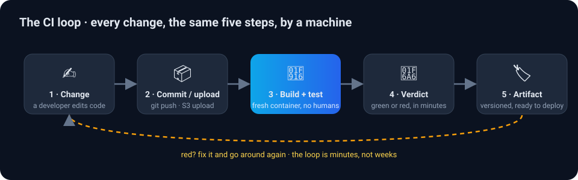

### What a "build" actually is

A build turns *source* (files humans wrote) into an *artifact* (a thing a computer can run or deploy). For our Java app that means:

1. **Install** the tools (a Java compiler, Maven).
2. **Compile** the source files into bytecode.
3. **Test** – run the unit tests; if any fail, stop here with a red light.
4. **Package** the result into one file – a `.jar`.

### What CodeBuild does for you

AWS CodeBuild is a *fully managed build service*: you give it a recipe, it spins up a fresh Linux container, follows the recipe, saves the output, writes down everything that happened, and throws the container away.

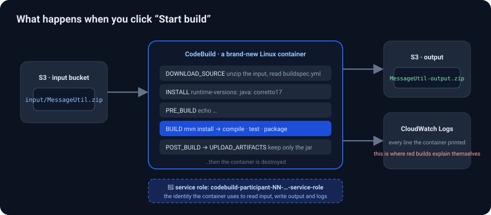

| Word | Meaning in this lab |
|---|---|
| **Source** | A `.zip` of your code, stored in an S3 bucket |
| **Build project** | The CodeBuild configuration: where the source is, which container image to use, where to put the output |
| **buildspec.yml** | The recipe: shell commands grouped into *phases* (`install`, `pre_build`, `build`, `post_build`) plus a list of output files |
| **Artifact** | The build output (`messageUtil-1.0.jar`), zipped and uploaded to S3 |
| **Service role** | The IAM identity CodeBuild *assumes* while working for you. It is what lets the build read your input bucket and write the output. No passwords, no public buckets. |
| **Build log** | Every line the container printed, streamed to CloudWatch Logs. When a build goes red this is where the truth lives. |

> [!TIP]
> **Why not just build on my laptop?** You can. But a laptop build proves only that *your* laptop can build it. A CodeBuild build proves that *a clean machine with nothing but the recipe* can build it. That is the difference between a hope and a guarantee.

---

## Part 1 · Get the sample app

The app is deliberately tiny so the *process* is the star.

```
sample-app/
├── buildspec.yml                      ← the recipe CodeBuild follows
├── pom.xml                            ← Maven project file (dependencies, Java version)
└── src/
    ├── main/java/MessageUtil.java     ← the "application" (prints a message)
    └── test/java/TestMessageUtil.java ← three JUnit tests (one of them switched off…)
```

1. Download **[`MessageUtil.zip`](../lab1-codebuild/MessageUtil.zip)**. Keep this zip as it is: it is your first upload in Part 2.
2. Also unzip a copy and rename the folder it creates to **`sample-app`**. This folder is your *working copy*: every later fix is made here, then re-zipped. (The same files are in the repository folder [`lab1-codebuild/sample-app/`](../lab1-codebuild/sample-app/) if you prefer to clone.)
3. Open `sample-app/buildspec.yml` in any text editor and read it. Here it is with notes:

```yaml
version: 0.2                     # buildspec format version (always 0.2 today)

phases:
  install:
    runtime-versions:
      java: corretto11           # which Java the build container should set up
  pre_build:
    commands:
      - echo "Nothing to do in the pre_build phase..."
  build:
    commands:
      - echo "Build started on $(date)"
      - mvn install              # compile + run tests + package the jar
  post_build:
    commands:
      - echo "Build completed on $(date)"

artifacts:
  files:
    - target/messageUtil-1.0.jar # the ONE file we want to keep when the container dies
```

4. Now open `pom.xml` and find these two lines:

```xml
<maven.compiler.source>17</maven.compiler.source>
<maven.compiler.target>17</maven.compiler.target>
```

Keep both files in mind. Something here is going to matter in Part 4.

### The edit loop (you will do this many times)

Every change in this lab follows the same four steps. When the guide says **"re-zip, re-upload, build"**, this is what it means:

1. **Edit** the file in your `sample-app` folder and save it.
2. **Zip** the *contents* of the folder (not the folder itself) into `MessageUtil.zip`.
3. **Upload** it to `s3://cicd-lab1-participant-NN/input/`, same name as before; S3 simply replaces the old one.
4. **Start build** in CodeBuild.

CodeBuild builds what is **in S3**, not what is on your disk. Skip step 3 and the build behaves exactly as before.

> [!NOTE]
> **How to zip correctly.** CodeBuild expects `buildspec.yml` at the *top level* of the zip, not inside a folder.
>
> - **macOS / Linux terminal**, from inside `sample-app/`:
>   ```bash
>   rm -f MessageUtil.zip                              # start fresh each time
>   zip -r MessageUtil.zip buildspec.yml pom.xml src/
>   unzip -l MessageUtil.zip     # buildspec.yml must appear with no folder in front of it
>   ```
> - **Windows Explorer**: open the `sample-app` folder, select `buildspec.yml`, `pom.xml` and `src` together → right-click → *Send to → Compressed (zipped) folder* → rename to `MessageUtil.zip`. (If an old `MessageUtil.zip` is in the folder, delete it first; do not select it.)
> - **macOS Finder**: select the three items → right-click → *Compress* → rename `Archive.zip` to `MessageUtil.zip`.
>
> **Zipped the folder by mistake?** The build fails almost immediately with `YAML_FILE_ERROR` and *buildspec.yml: no such file or directory*. Run `unzip -l` (or double-click the zip): if every path starts with `sample-app/`, re-zip the three items instead.

<details>
<summary>🖥️ Prefer not to use your laptop? Do the edit loop in CloudShell</summary>

CloudShell is a Linux terminal inside the console (the `>_` icon in the top bar), already signed in as you. It has `zip`, `unzip`, `nano` and the `aws` CLI, so it works the same on every laptop.

```bash
# once
curl -sLO https://varoonsahgal.github.io/cicdcg/downloads/MessageUtil.zip
mkdir sample-app && cd sample-app && unzip ../MessageUtil.zip

# each time round the loop (replace NN)
nano buildspec.yml                                  # Ctrl+O, Enter to save · Ctrl+X to exit
rm -f ../MessageUtil.zip && zip -r ../MessageUtil.zip buildspec.yml pom.xml src/
aws s3 cp ../MessageUtil.zip s3://cicd-lab1-participant-NN/input/MessageUtil.zip
```

Then click **Start build** in the console as usual. (Create the bucket in Part 2 first; the `aws s3 cp` line replaces the console upload.)
</details>

---

## Part 2 · Create the input bucket and upload the source

1. Console → **S3** → **Create bucket**.
2. Bucket name: **`cicd-lab1-participant-NN`** (lowercase, your number). Region: **US West (Oregon)**.
3. Leave **Block all public access = ON**. CodeBuild will read the bucket using its own IAM role; nothing about this lab needs a public bucket. Keep every other default. **Create bucket**.

   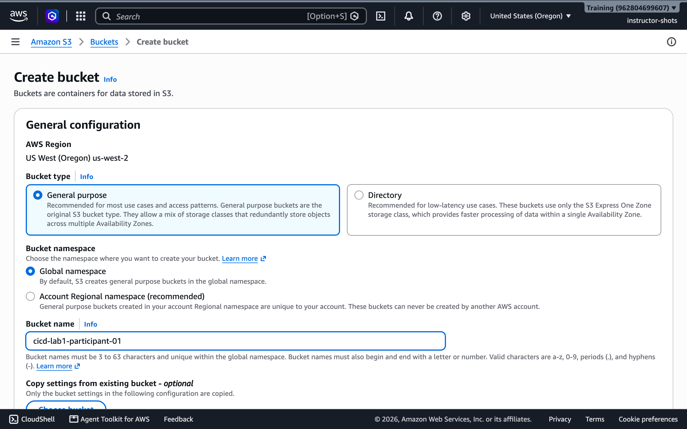
4. Open the bucket → **Create folder** → name `input` → **Create folder**.
5. Open the `input/` folder → **Upload** → **Add files** → choose the `MessageUtil.zip` you downloaded → **Upload**.

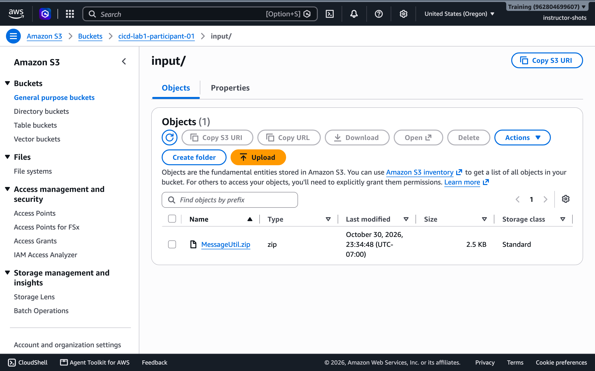

> ✅ **Checkpoint** — `s3://cicd-lab1-participant-NN/input/MessageUtil.zip` exists and is about 2.5 KB.

---

## Part 3 · Create the build project

1. Console → **CodeBuild** (search "CodeBuild" in the top bar) → **Build projects** → **Create build project**.
2. **Project configuration**
   - Project name: **`participant-NN-codebuild-demo`**
   - Project type: **Default project**

   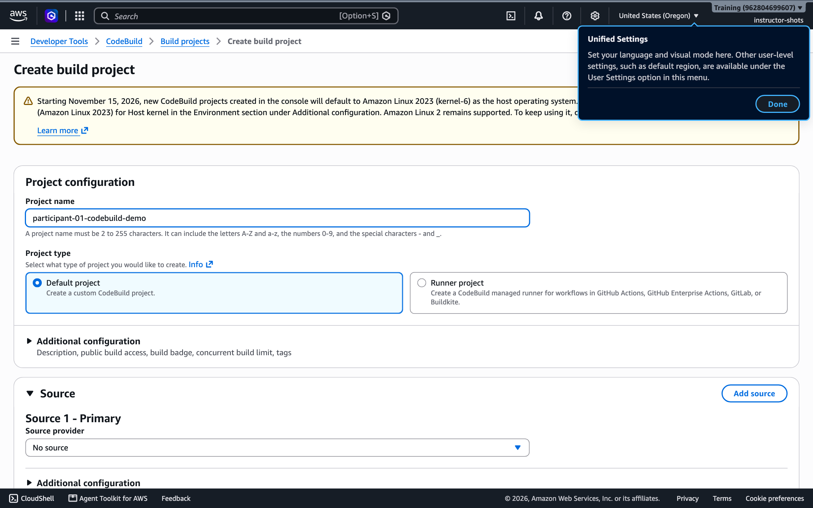

3. **Source**
   - Source provider: **Amazon S3**
   - Bucket: **`cicd-lab1-participant-NN`**
   - S3 object key or S3 folder: **`input/MessageUtil.zip`**

   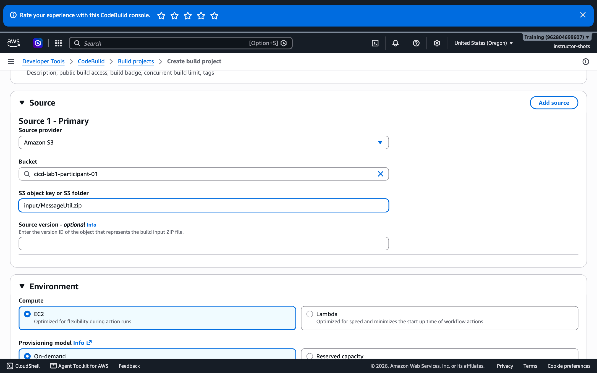

4. **Environment** – this is the container your build runs in.
   - Compute: **EC2** · Provisioning model: **On-demand** · Environment image: **Managed image** · Running mode: **Container**
   - Operating system: **Amazon Linux** · Runtime(s): **Standard**
   - Image: the newest **`aws/codebuild/amazonlinux-x86_64-standard:…`** offered (6.0 at the time of writing) · Image version: **Always use the latest image for this runtime version**
   - **Service role: New service role.** Accept the suggested name (`codebuild-participant-NN-codebuild-demo-service-role`). Leave compute size at its default.

   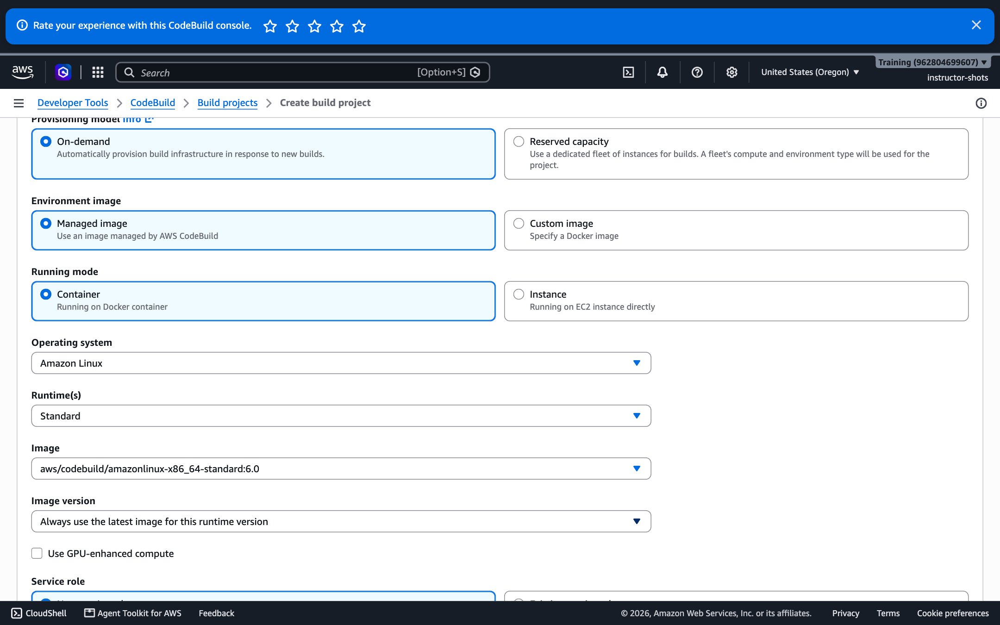

   > [!NOTE]
   > **What just got created for you?** An IAM *role* with a trust policy saying "the CodeBuild service may assume me" and permissions to write logs and read/write the S3 locations you named. This is the single most important security idea in this course: **services act with explicitly granted identities, scoped to the job**. You never type your own credentials into a build.

   > [!TIP]
   > **"Role already exists" when you click Create?** You (or someone with your number in an earlier class) created this project before, and students cannot delete roles in this account. Choose **Existing service role** instead, pick `codebuild-participant-NN-codebuild-demo-service-role`, and leave *Allow AWS CodeBuild to modify this service role* ticked.

5. **Buildspec** → **Use a buildspec file**. Leave the name blank (defaults to `buildspec.yml` at the root of the zip).

   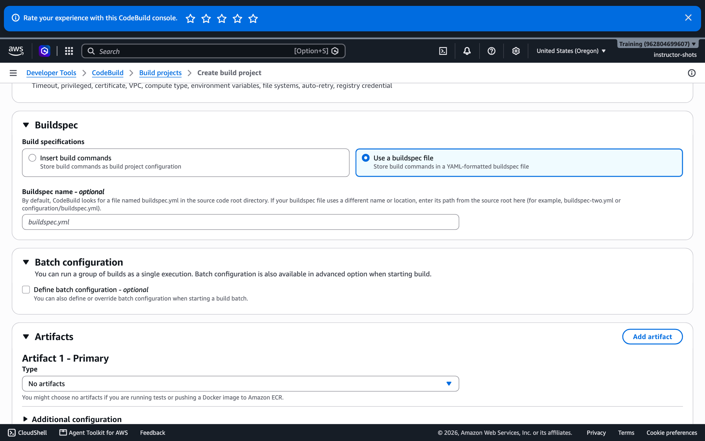

6. **Batch configuration** → leave unchecked.
7. **Artifacts** – where the output goes.
   - Type: **Amazon S3**
   - Bucket name: **`cicd-lab1-participant-NN`**
   - Name: **`MessageUtil-output`**
   - Path: **`output`**
   - Namespace type: **None**
   - Expand **Additional configuration** → Artifacts packaging: **Zip**

   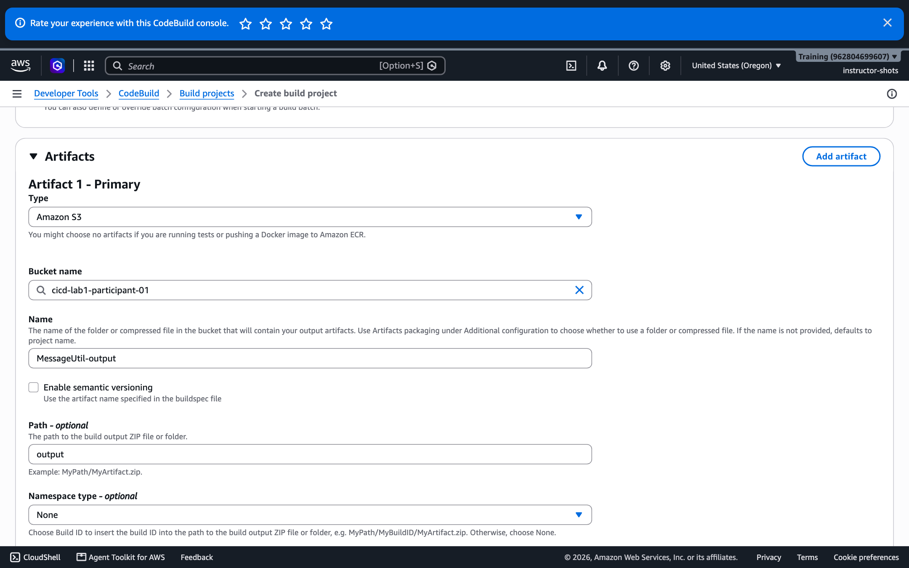

8. **Logs** → keep **CloudWatch logs** checked (group/stream names optional).

   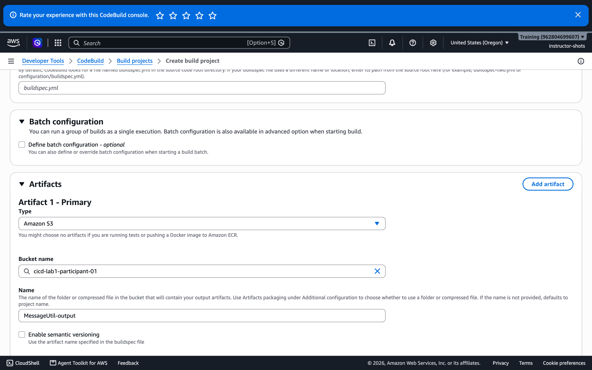
9. **Create build project**.

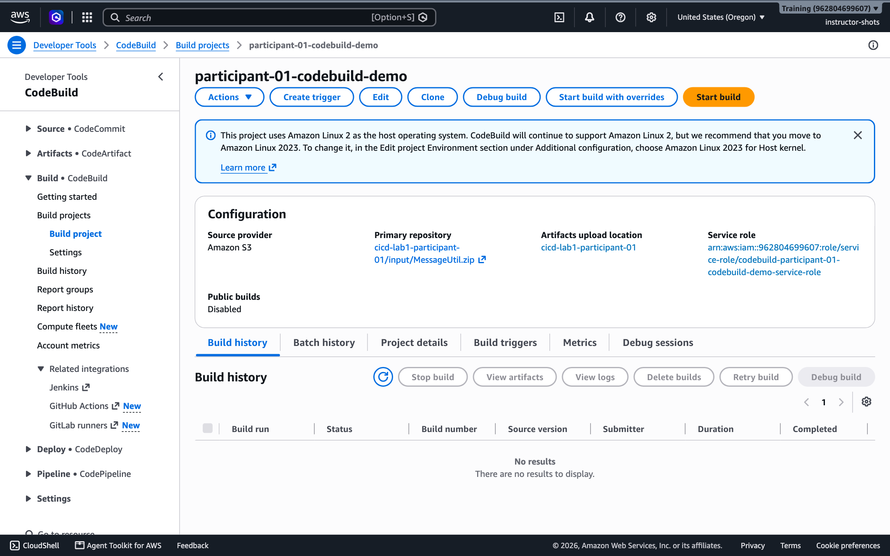

> ✅ **Checkpoint** — The project page shows *Source provider: Amazon S3*, *Primary repository: cicd-lab1-participant-NN/input/MessageUtil.zip*, *Artifacts upload location: cicd-lab1-participant-NN*, and a service role ARN.

---

## Part 4 · Run the build. Watch it fail. Fix it.

> [!WARNING]
> **Your first build is going to fail. That is on purpose.** Nobody learns to read a build log from a green build. Resist the urge to ask for the answer; the hints below are ordered from gentle to blunt.

1. On the project page click **Start build** (top-right, orange).

   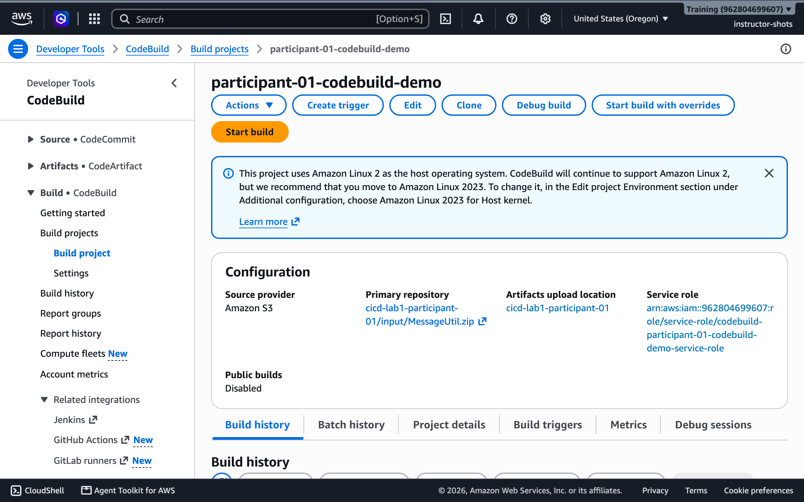
2. You land on the build page. Watch the **Status** field. Within about a minute it turns to **Failed**.

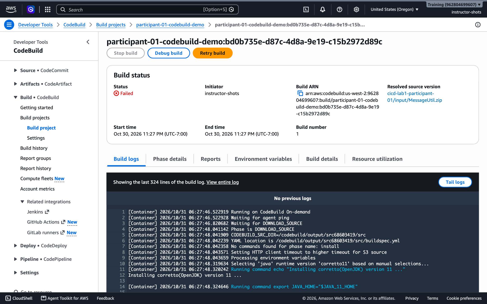

### 🔧 Troubleshooting exercise 1 — "invalid target release"

Your job: find out *why* it failed and make it pass, **without changing `pom.xml`**.

**Where to look, in order:**

- **Phase details** tab – which phase went red? (The phases run top to bottom; the first red one is the culprit. Everything after it is skipped or is just clean-up.)

  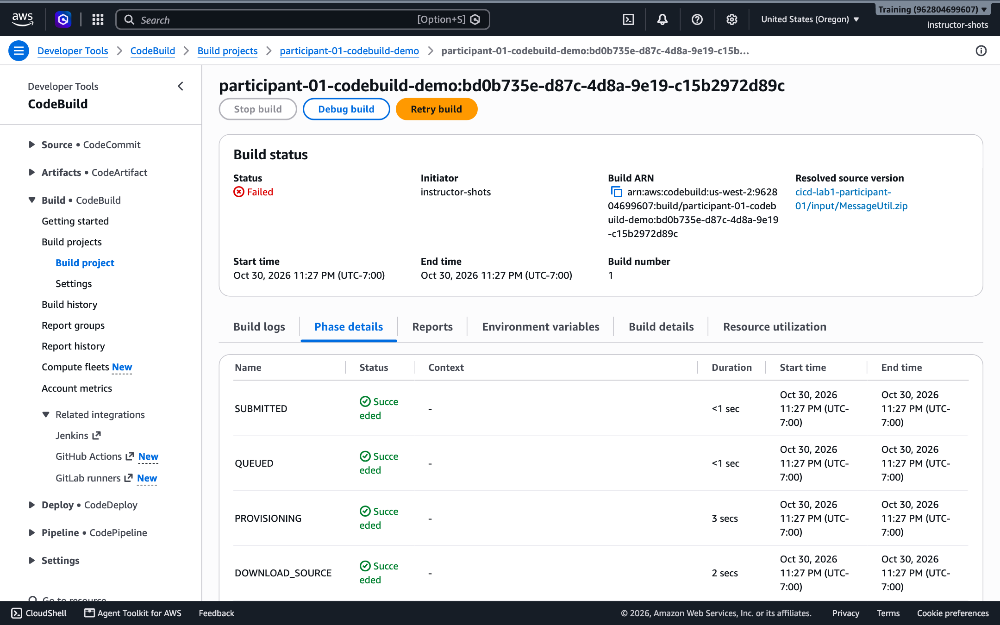

- **Build logs** tab – scroll to the bottom. CodeBuild prints the last few hundred lines; the real error is almost always a few lines *above* the final "Phase context status code" message.

  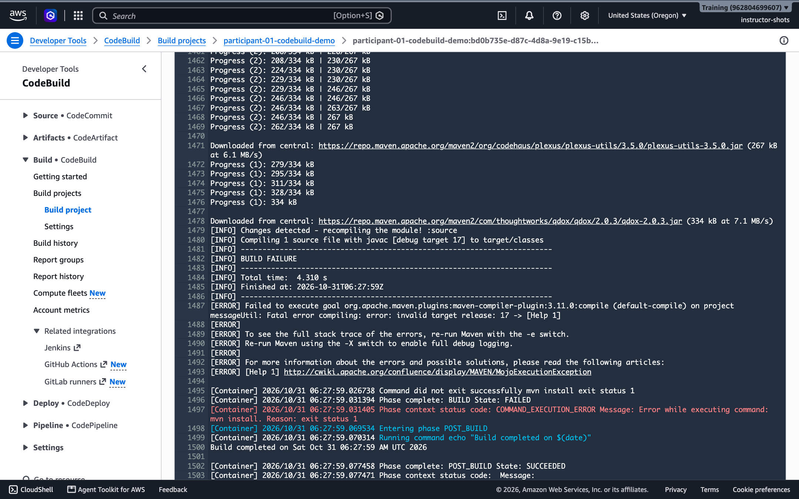

<details>
<summary>💡 Hint 1 — which phase, which command</summary>

The **BUILD** phase failed, and the phase context says `COMMAND_EXECUTION_ERROR … Error while executing command: mvn install. Reason: exit status 1`. So Maven itself failed. Scroll up in the log to find Maven's own `[ERROR]` lines.
</details>

<details>
<summary>💡 Hint 2 — read Maven's complaint</summary>

The key line is:

```
[ERROR] Failed to execute goal org.apache.maven.plugins:maven-compiler-plugin:3.11.0:compile
        (default-compile) on project messageUtil: Fatal error compiling: error: invalid target release: 17
```

Maven was asked to produce Java **17** bytecode (that is what `pom.xml` says) but the Java compiler available in the container is older. Which Java did the container install? Search the log for the word `corretto`.
</details>

<details>
<summary>💡 Hint 3 — the two numbers that disagree</summary>

Near the top of the log: `Selecting 'java' runtime version 'corretto11' based on manual selections…`. The *buildspec* asked for Java 11; the *project file* needs Java 17. One file has to change, and the exercise says not to touch `pom.xml`.
</details>

<details>
<summary>✅ Solution</summary>

In `buildspec.yml` change the runtime version:

```yaml
  install:
    runtime-versions:
      java: corretto17
```

Then go round the edit loop from [Part 1](#part-1-get-the-sample-app) for the first time:

1. Save `buildspec.yml` in your `sample-app` folder.
2. Re-zip (`zip -r MessageUtil.zip buildspec.yml pom.xml src/` from inside `sample-app/`).
3. In S3, open `cicd-lab1-participant-NN/input/` → **Upload** the new `MessageUtil.zip` (same name; S3 simply replaces it).
4. Back in CodeBuild → your project → **Start build**.

The build now reaches `BUILD SUCCESS` and finishes green.

**Why this is a classic:** the build *environment* (the container) and the build *definition* (`pom.xml`) are two separate sources of truth about "which Java". CI makes that disagreement visible on every single run instead of on one unlucky laptop.
</details>

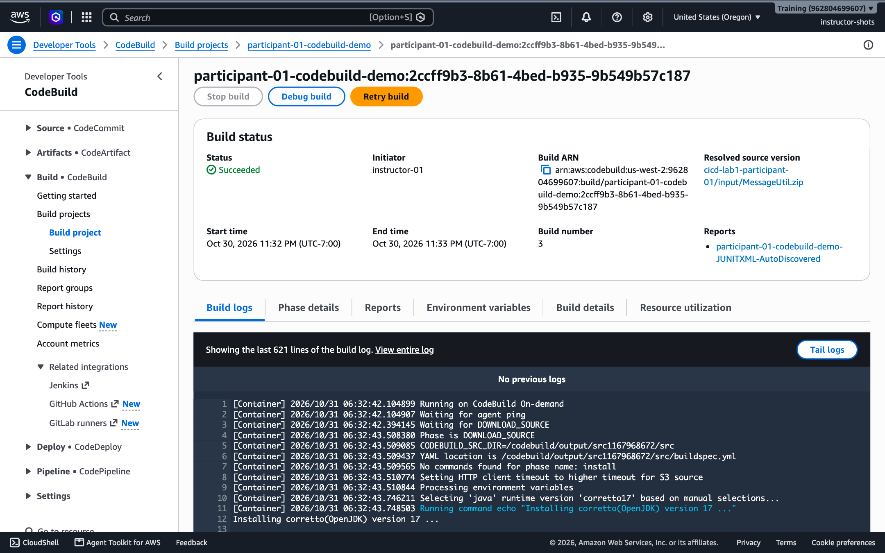

> ✅ **Checkpoint** — Status **Succeeded**, and under *Reports* you see an auto-discovered JUnit report link.

---

## Part 5 · Read the results like a professional

A green build is not the end; it is a pile of evidence. Spend five minutes with each tab.

### Phase details

Every phase, how long it took, and its status. Notice `PROVISIONING` (starting the container) and `DOWNLOAD_SOURCE` happen *before* any of your commands run, and `UPLOAD_ARTIFACTS` happens after. Total build time is what you pay for.

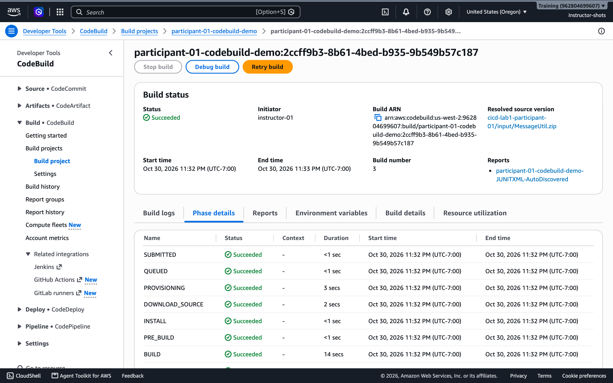

### Reports

CodeBuild noticed Maven's JUnit XML files and turned them into a test report. Click the report link.

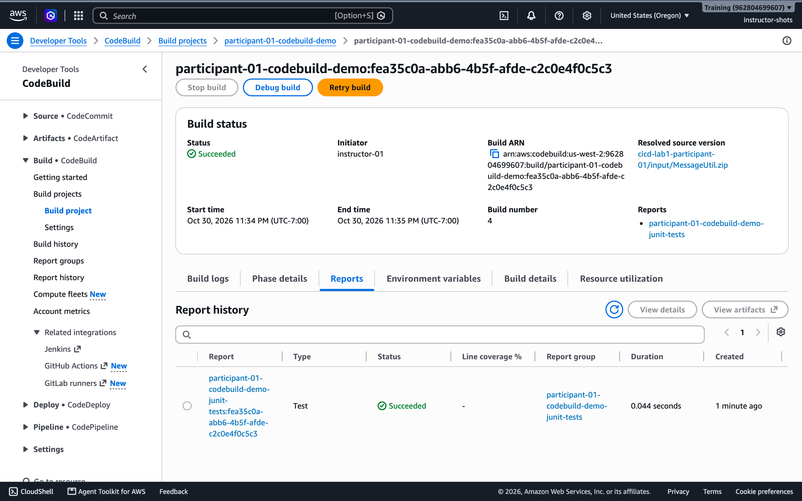

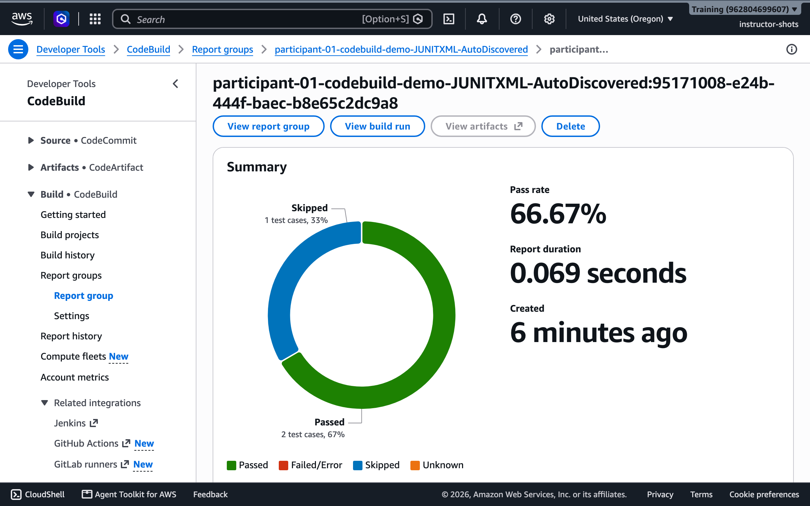

Three tests: **two passed, one skipped**, in a fraction of a second. This report is what a team looks at *instead of* trusting "I ran the tests locally".

> [!TIP]
> **Skipped?** A skipped test is a light that is neither red nor green: somebody turned it off. Remember that. Mission D is about that test.

### The artifact

S3 → `cicd-lab1-participant-NN` → `output/` → `MessageUtil-output.zip`. Download it and look inside: `target/messageUtil-1.0.jar`. That jar is the only thing a deployment needs. Everything else (the source, the compiler, the container) is gone.

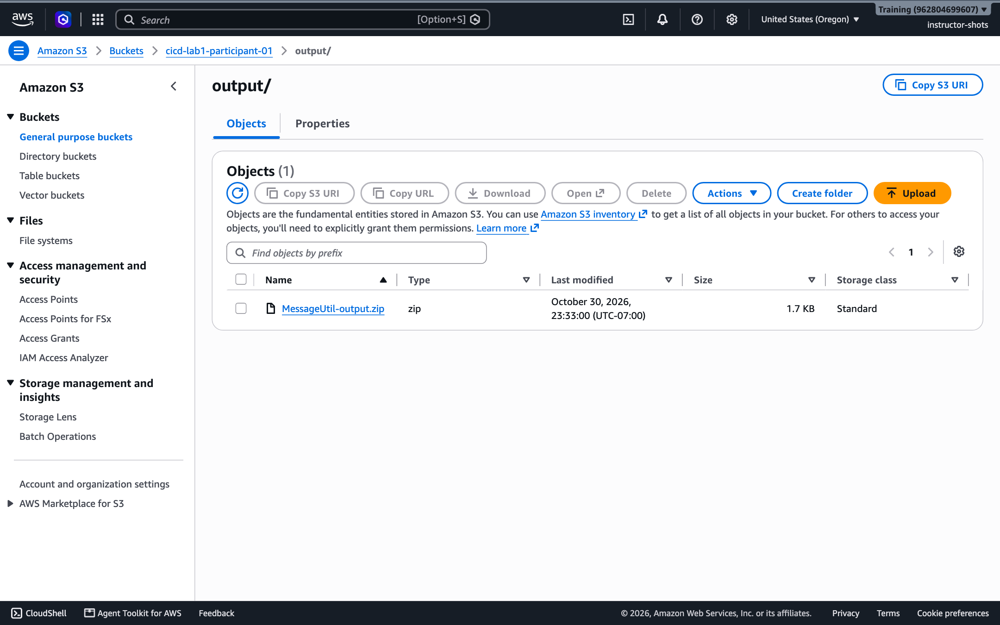

### Build history

The project page keeps every run: who started it, which source version, how long it took. In a real team this is your audit trail.

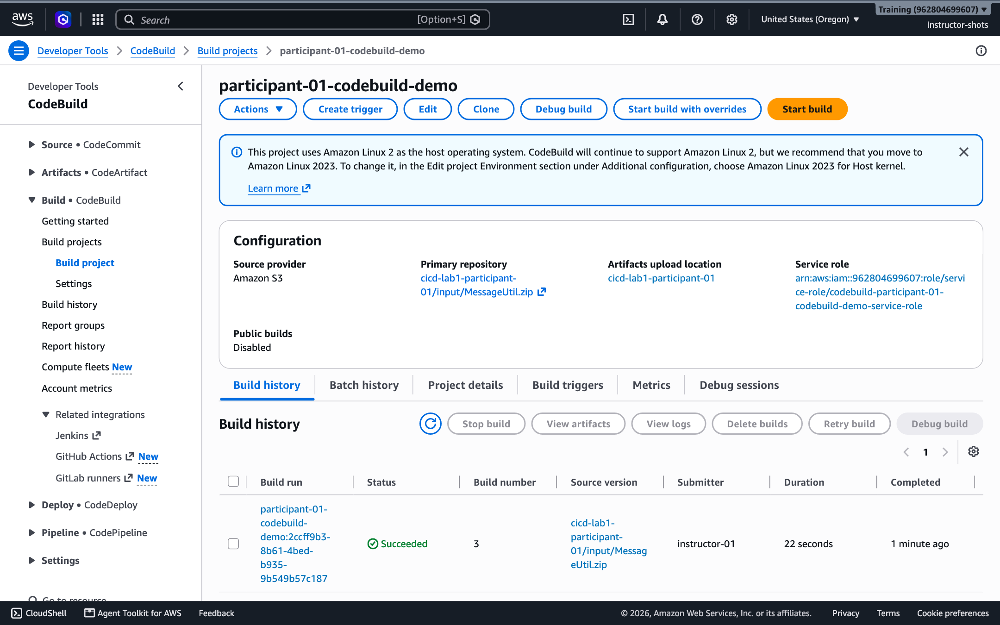

> [!TIP]
> **Where are the logs really?** CodeBuild shows the tail of the log, but the complete log lives in **CloudWatch Logs**, log group `/aws/codebuild/participant-NN-codebuild-demo`. Click **View entire log** on the build page. Logs outlive the container, the build, and even the project.

---

## Part 6 · Missions

The core path is done: Dave's laptop is officially irrelevant. Everything below is a *mission*: self-contained, 10–15 minutes, with escalating hints and a hidden solution. Missions A–C deepen what you just did. **D is a bug hunt.** E–H each wire **one new AWS service** into your build. Do the four marked *recommended* if you are short on time; do all eight for the full set of badges.

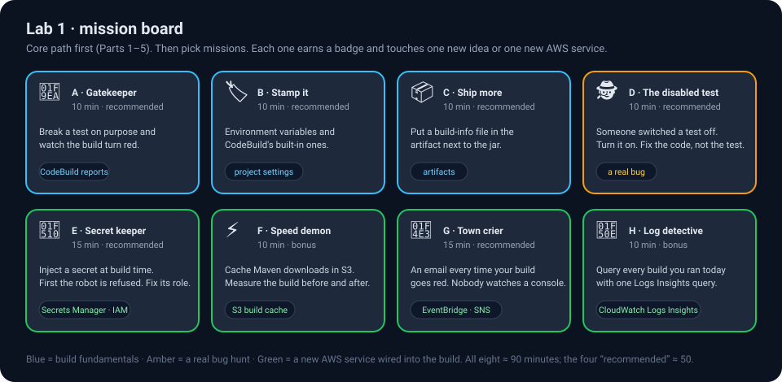

| Mission | Badge | New idea / service | Time |
|---|---|---|---|
| A · Gatekeeper | 🧪 | a failing test is a red build | 10 min · recommended |
| B · Stamp it | 🏷️ | environment variables, built-in variables | 10 min |
| C · Ship more | 📦 | multi-file artifacts | 10 min |
| D · The disabled test | 🕵️ | a real bug hiding behind `@Ignore` | 10 min · recommended |
| E · Secret keeper | 🔐 | **Secrets Manager** + a role fix | 15 min · recommended |
| F · Speed demon | ⚡ | **S3 build cache**, measured | 10 min |
| G · Town crier | 📣 | **EventBridge → SNS** e-mail on failure | 15 min · recommended |
| H · Log detective | 🔎 | **CloudWatch Logs Insights** across all builds | 10 min |

> [!TIP]
> **Keep score.** Each mission ends with a one-line *proof* (a log line, a report, an e-mail, a query result). Paste your proofs into the class chat as you go; the instructor keeps a leaderboard.

### Mission A · 🧪 Gatekeeper — make a test fail on purpose

**Goal:** prove that a failing unit test turns the build red and that the test report tells you exactly which test.

1. In `src/test/java/TestMessageUtil.java`, change the expected salutation in `testSalutationMessage` so it no longer matches what the code produces.
2. Re-zip, re-upload, **Start build**.
3. Predict first: which *phase* will fail? Then check.

<details>
<summary>💡 Hint</summary>

The tests run inside `mvn install`, so the failure surfaces in the **BUILD** phase, not in a separate "test" phase. Open the **Reports** tab afterwards: the report now shows 1 failed test case and the assertion message.
</details>

<details>
<summary>✅ Solution</summary>

Change

```java
message = "Hi!" + "Robert";
```

to

```java
message = "Hello!" + "Robert";
```

Build → **Failed** in `BUILD`. Log shows `Tests run: 3, Failures: 1 … testSalutationMessage … expected:<H[ello]!Robert> but was:<H[i]!Robert>`. The Reports tab shows the failing test by name:

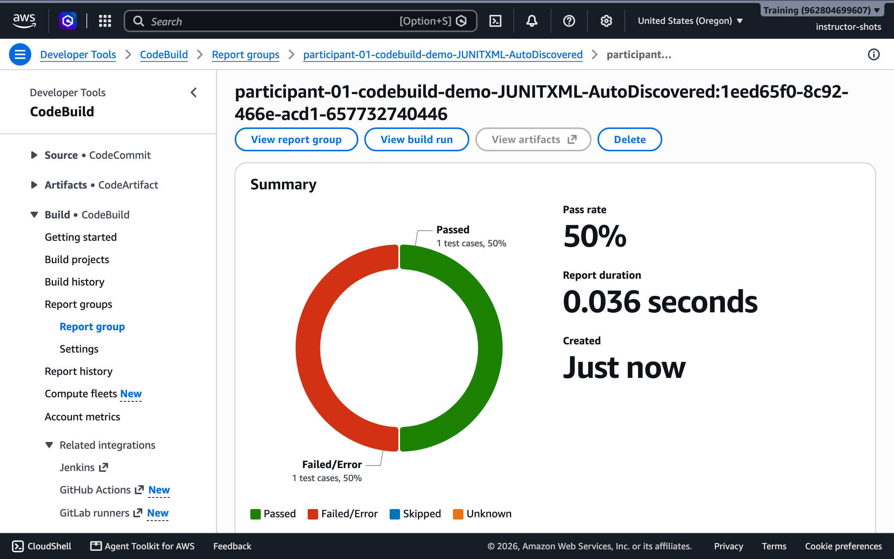

**The lesson:** in CI, tests are not advice, they are a *gate*. Nothing downstream (packaging, deployment) runs while the gate is red. Change the line back, rebuild, and confirm green before moving on.

**Proof:** the report line that names the failed test.
</details>

### Mission B · 🏷️ Stamp it — an environment variable and the build number

**Goal:** customise the build from the *project settings* without editing code, and discover CodeBuild's built-in variables.

1. In the console: project → **Edit** → scroll to **Environment** → expand **Additional configuration** → **Environment variables** → add `GREETING` = `Hello from participant-NN` (type *Plaintext*) → scroll to the bottom → **Update project**.
2. In `buildspec.yml`, make the `pre_build` phase print the greeting **and** the number of this build.
3. Re-zip, re-upload, build, and find your line in the log.

<details>
<summary>💡 Hint 1</summary>

Environment variables are available to every command in every phase as ordinary shell variables: `$GREETING`.
</details>

<details>
<summary>💡 Hint 2</summary>

CodeBuild sets many variables for you. The one you want is `CODEBUILD_BUILD_NUMBER`. (Others worth knowing: `CODEBUILD_BUILD_ID`, `CODEBUILD_SRC_DIR`, `CODEBUILD_RESOLVED_SOURCE_VERSION`.)

**Watch out for `#`.** In YAML, a space followed by `#` starts a comment, so `- echo "build #$CODEBUILD_BUILD_NUMBER"` is silently cut off at the `#` and the shell complains about a missing `"`. If your line needs ` #`, wrap the *whole* command in single quotes.
</details>

<details>
<summary>✅ Solution</summary>

```yaml
  pre_build:
    commands:
      - 'echo "$GREETING — this is build #$CODEBUILD_BUILD_NUMBER"'
```

The outer single quotes are for YAML (so the ` #` is not read as a comment); the inner double quotes are for the shell. In the log you will see `Hello from participant-NN — this is build #6` (your number will differ). Lab 3 hides exactly this YAML trap in a broken pipeline, so remember it.

**The lesson:** configuration that varies (names, flags, secrets) belongs *outside* the code, in the environment. Plaintext is fine for a greeting. For anything secret, see Mission E.

**Proof:** your greeting line in the log, with the build number.
</details>

### Mission C · 📦 Ship more than the jar

**Goal:** make the build write a `build-info.txt` (build number + UTC time) and include it in the artifact next to the jar.

<details>
<summary>💡 Hint 1</summary>

Any command can create files inside the container. `post_build` is a natural place, because by then the build has already succeeded.
</details>

<details>
<summary>💡 Hint 2</summary>

The `artifacts.files` list controls what survives the container. It accepts multiple entries and glob patterns.
</details>

<details>
<summary>✅ Solution</summary>

```yaml
  post_build:
    commands:
      - echo "Build completed on $(date)"
      - echo "build=$CODEBUILD_BUILD_NUMBER time=$(date -u +%Y-%m-%dT%H:%M:%SZ)" > target/build-info.txt

artifacts:
  files:
    - target/messageUtil-1.0.jar
    - target/build-info.txt
```

Download the new `output/MessageUtil-output.zip`; it now contains both files.

**The lesson:** artifacts should be *self-describing*. When something misbehaves in production three weeks from now, the first question is "which build is this?" – and the answer should be inside the artifact, not in someone's memory. (Lab 2's Build stage stamps the build number straight into the web page for the same reason.)

**Proof:** `unzip -l MessageUtil-output.zip` showing two files.
</details>

### Mission D · 🕵️ The disabled test

**Goal:** find out what Dave was hiding. Then fix the *code*, not the test.

1. Open `src/test/java/TestMessageUtil.java` and read the third test, `testSalutationIsStable`. Note the line above it:
   ```java
   @Ignore("flaky?? passes on my laptop, will look at it next sprint -- Dave")
   ```
2. Delete that `@Ignore(...)` line (leave `@Test`). Re-zip, upload, build.
3. **Predict first:** will the build pass? Then look at the **Reports** tab.

<details>
<summary>💡 Hint 1 — what the report says</summary>

The build is red, and the report shows `testSalutationIsStable` failed with:

```
expected:<Hi![]Robert> but was:<Hi![Hi!]Robert>
```

The test calls `salutationMessage()` **twice** and expects the same answer both times. The second call returned `Hi!Hi!Robert`. Why would a method give a different answer the second time?

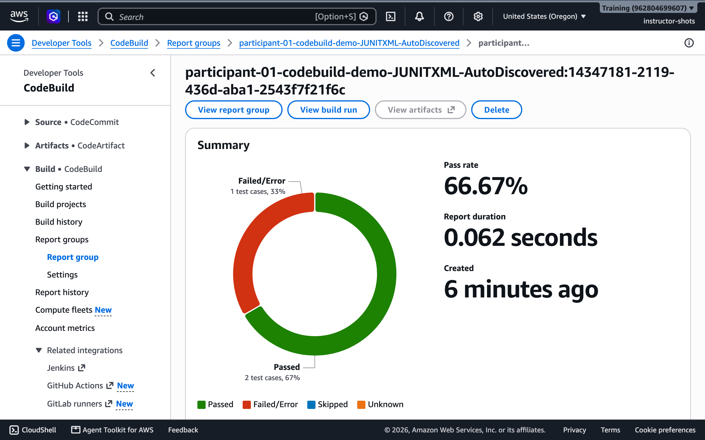
</details>

<details>
<summary>💡 Hint 2 — read the code, not the test</summary>

Look at `MessageUtil.salutationMessage()`:

```java
message = "Hi!" + message;
```

It does not just *return* a greeting; it **overwrites the field** `message` every time it is called. State leaks from one call to the next. The test is right. The code is wrong. "Flaky on my laptop" was Dave running the tests in a different order.
</details>

<details>
<summary>✅ Solution</summary>

In `src/main/java/MessageUtil.java`:

```java
  public String salutationMessage() {
    String salutation = "Hi!" + message;
    System.out.println(salutation);
    return salutation;
  }
```

Re-zip, upload, build → green; the report shows **3 passed, 0 skipped**. The other two tests still pass, so nothing else depended on the bug.

**The lesson:** a skipped test is a red light somebody put a blanket over. When a test fails, the *default* assumption is that the code is wrong, not the test; "fix" a test only when you can explain why its expectation was incorrect. And a test that passes or fails depending on order is almost always leaking state.

**Proof:** a report with 3 passed and 0 skipped.
</details>

### Mission E · 🔐 Secret keeper — Secrets Manager

**Goal:** give the build a secret (say, a deploy token) **without** putting it in the zip, the project settings or the log. Along the way, watch the robot get refused and fix its identity.

1. Console → **Secrets Manager** → **Store a new secret** → Secret type **Other type of secret** → **Plaintext** tab → replace the contents with `orbit-7f3a-launch-code` (ignore the red underline: it is not JSON and does not need to be) → **Next**.
2. Secret name **`participant-NN/lab1/deploy-token`** → **Next** → **Next** → **Store**.

   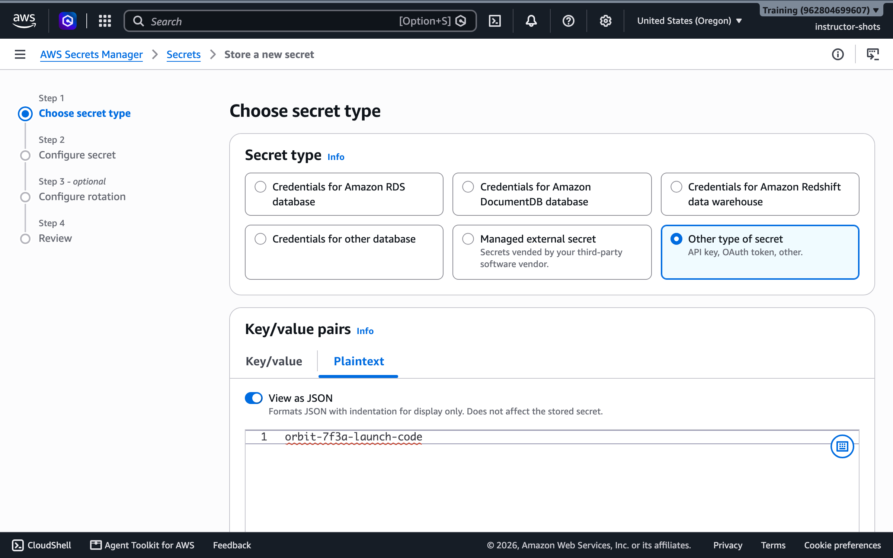

3. In `buildspec.yml`, add an `env` section at the top and print the token in `pre_build`:

   ```yaml
   version: 0.2

   env:
     secrets-manager:
       DEPLOY_TOKEN: participant-NN/lab1/deploy-token

   phases:
     install:
       runtime-versions:
         java: corretto17
     pre_build:
       commands:
         - echo "Deploy token is $DEPLOY_TOKEN"
     # build, post_build and artifacts: leave them exactly as they are
   ```

4. Re-zip, upload, **Start build**. It fails. **Before reading on:** which phase, and what does the message say? Which *robot* was refused?

   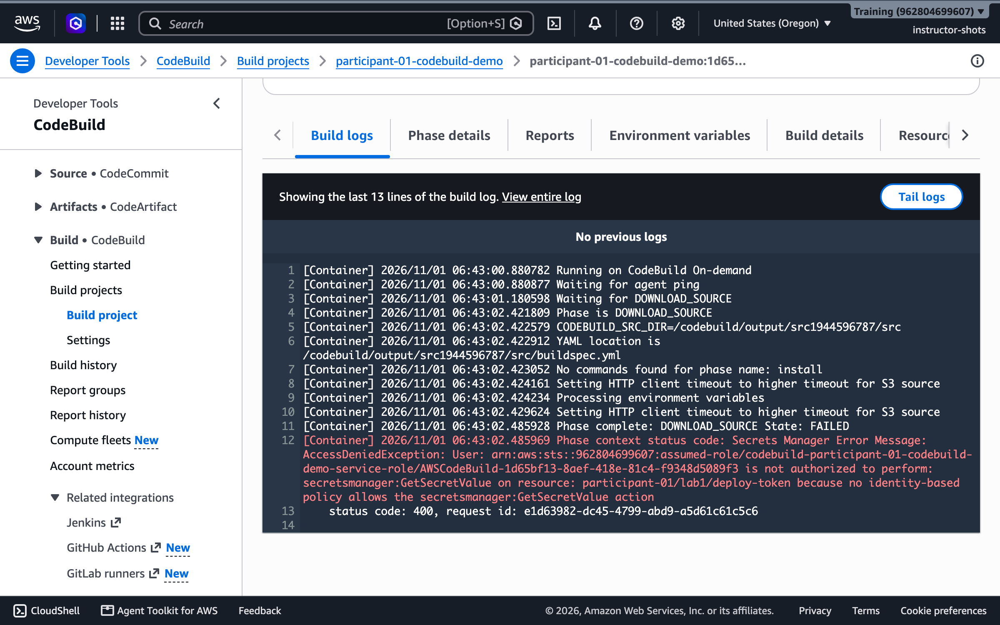

<details>
<summary>💡 Hint 1 — the sentence</summary>

The build fails in **DOWNLOAD_SOURCE**, before any of your commands run, because CodeBuild resolves `env` variables while preparing the container. The message reads like a sentence:

```
Secrets Manager Error Message: AccessDeniedException:
User: arn:aws:sts::…:assumed-role/codebuild-participant-NN-codebuild-demo-service-role/…
is not authorized to perform: secretsmanager:GetSecretValue
on resource: participant-NN/lab1/deploy-token
```

**Who** = the CodeBuild service role. **What** = `secretsmanager:GetSecretValue`. **Which** = your secret. Fix exactly that, nothing more.
</details>

<details>
<summary>💡 Hint 2 — where to fix it</summary>

IAM → **Roles** → `codebuild-participant-NN-codebuild-demo-service-role` → **Add permissions** → **Create inline policy** → **JSON**. You need the secret's ARN: Secrets Manager → your secret → **Secret ARN** (it ends in six random characters; copy the whole thing).
</details>

<details>
<summary>✅ Solution</summary>

Inline policy (name it `read-lab1-secret`):

```json
{
  "Version": "2012-10-17",
  "Statement": [{
    "Effect": "Allow",
    "Action": "secretsmanager:GetSecretValue",
    "Resource": "arn:aws:secretsmanager:us-west-2:962804699607:secret:participant-NN/lab1/deploy-token-XXXXXX"
  }]
}
```

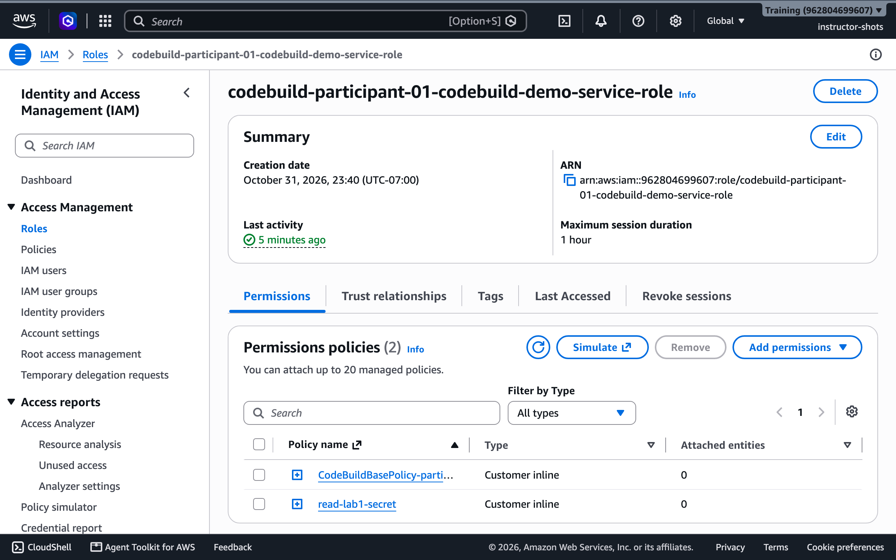

Wait ten seconds, **Start build** again → green. Now read the log:

```
Deploy token is ***
```

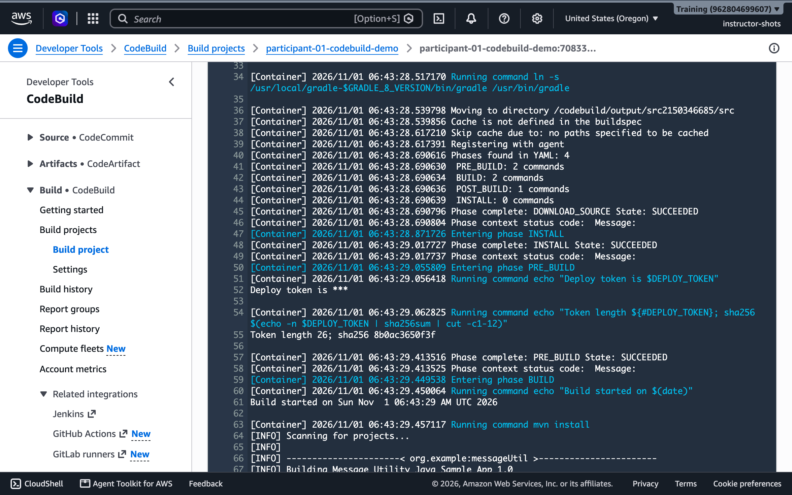

CodeBuild **masked** the value. Was it really there? Add a second command and rebuild:

```yaml
         - echo "Token length ${#DEPLOY_TOKEN}; sha256 $(echo -n $DEPLOY_TOKEN | sha256sum | cut -c1-12)"
```

→ `Token length 22; sha256 …` — the robot had the real value; only the log is masked.

**The lesson, in three parts:**

1. Secrets are fetched **at run time by the robot's role**, never stored in the recipe. The zip, the project settings and S3 never contain the value.
2. The role gets **one verb on one resource**. Not `SecretsManagerReadWrite`, not `*`.
3. Masking is a courtesy, not a safety net. The length and hash just leaked; `echo $DEPLOY_TOKEN > target/token.txt` would ship it in the artifact. Treat the value as radioactive inside the build too.

(SSM **Parameter Store** works the same way with `parameter-store:` instead of `secrets-manager:`; it is free for standard parameters and fine for non-secret config.)

**Proof:** the `***` line and the `Token length 22` line from the same build.
</details>

### Mission F · ⚡ Speed demon — cache the downloads

**Goal:** make the build measurably faster by caching Maven's downloads between runs, and prove it with numbers.

1. Open your last green build → **Build logs** and scroll: most of the log is lines starting with `Downloading from central:` (over two hundred of them). Every build starts from an empty container, so Maven downloads the same plugins and libraries every single time. Note the **BUILD** phase duration in **Phase details** (about 15 s).
2. Project → **Edit** → scroll down to the **Artifacts** section → expand **Additional configuration** (*Cache, encryption key*) → Cache type **Amazon S3** → Cache bucket **`cicd-lab1-participant-NN`** → Cache path prefix **`cache`** → scroll to the bottom → **Update project**.

   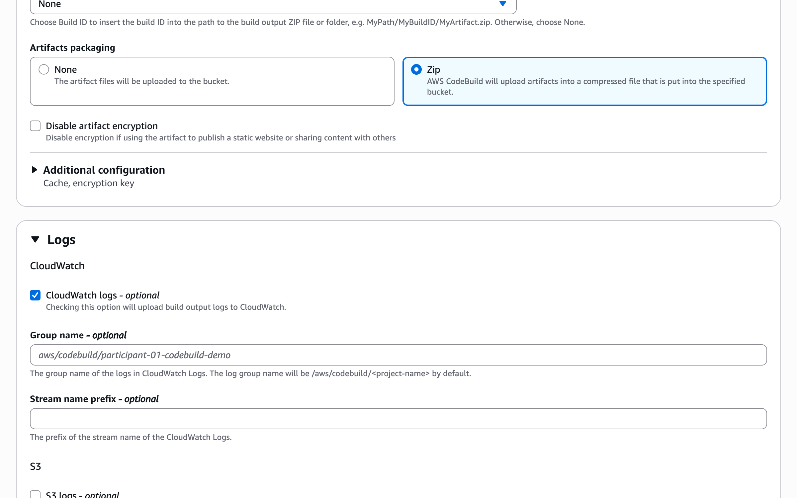

3. Tell the buildspec *what* to cache. Add at the bottom of `buildspec.yml`:

   ```yaml
   cache:
     paths:
       - '/root/.m2/**/*'
   ```

4. Re-zip, upload and build **twice**. Compare the two logs and the two BUILD durations.

<details>
<summary>💡 Hint</summary>

Build 1 after the change: near the top, `Downloading S3 cache… Unable to download cache: AccessDenied … s3:ListBucket` (nothing to download yet; read on), then the usual 200+ downloads, then at the very end `Uploading S3 cache…`. Build 2: `Downloading S3 cache… Unarchiving cache…` and **zero** `Downloading from central:` lines.
</details>

<details>
<summary>✅ Solution &amp; numbers</summary>

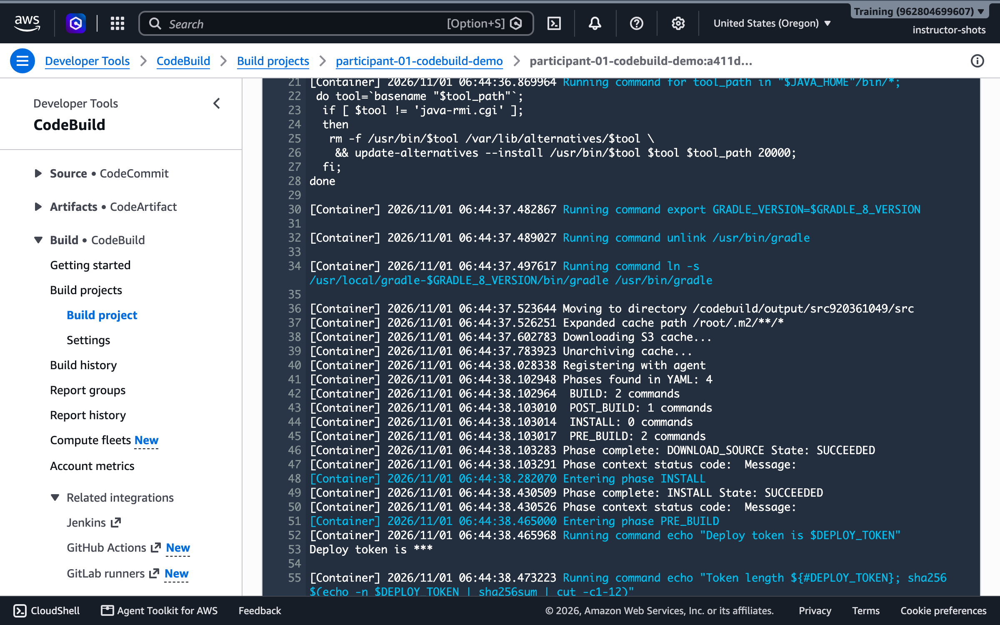

Measured in the class account:

| | Build before cache | First cached build | Second cached build |
|---|---|---|---|
| `Downloading from central:` lines | 242 | 242 | **0** |
| BUILD phase | 16 s | 16 s | **10 s** |

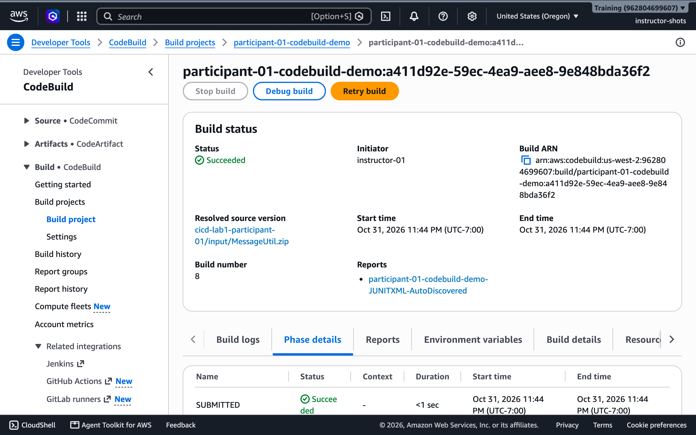

For a 30-line Java app the saving is a few seconds; for a real project with hundreds of dependencies it is minutes per build, times every build, times every developer.

**About that `AccessDenied` line.** On the first cached build CodeBuild tried to *list* the bucket to find an existing cache and the auto-generated role has `GetObject`/`PutObject` but not `s3:ListBucket`. CodeBuild shrugged, built without a cache, and uploaded one at the end. The warning is harmless, but read it like a sentence anyway: who, what, which. If it bothers you, add `s3:ListBucket` on `arn:aws:s3:::cicd-lab1-participant-NN` to the role's inline policy and it disappears.

S3 → your bucket → `cache/` → one object of about 18 MB: that is Maven's `.m2` folder, zipped. **Delete that object to "clear the cache".**

**The lesson:** caching trades a little complexity (and a new class of "works because of a stale cache" bugs) for speed. Cache *dependencies*, never build *outputs*.

**Proof:** two BUILD durations, before and after.
</details>

### Mission G · 📣 Town crier — e-mail on failure (EventBridge + SNS)

**Goal:** nobody should have to watch a console. Make AWS e-mail you the moment one of *your* builds fails.

1. **SNS** → **Topics** → **Create topic** → Type **Standard** → Name **`participant-NN-alerts`** → **Create topic**.
2. On the topic page → **Create subscription** → Protocol **Email** → Endpoint: your e-mail address → **Create subscription**. Open your inbox and click **Confirm subscription** (check spam). The subscription must say *Confirmed* before anything arrives.

   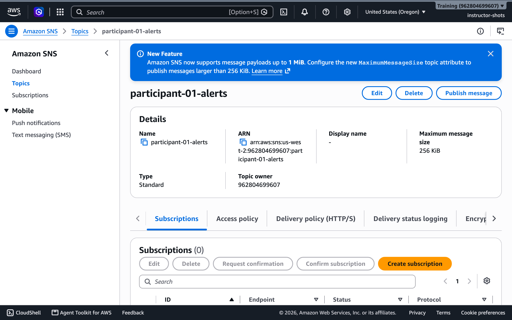

3. **Amazon EventBridge** → **Rules** → **Create rule** → Name **`participant-NN-build-failed`** → Rule type **Rule with an event pattern** → **Next**.
4. Event source **AWS events or EventBridge partner events** → **Creation method: Use pattern form** → AWS service **CodeBuild** → Event type **CodeBuild Build State Change** → **Specific state(s)** → `FAILED` → **Specific project name(s)** → `participant-NN-codebuild-demo` → **Next**.
5. Target: **AWS service** → **SNS topic** → `participant-NN-alerts` → **Next** → **Next** → **Create rule**. (The console grants EventBridge permission to publish to the topic for you.)

   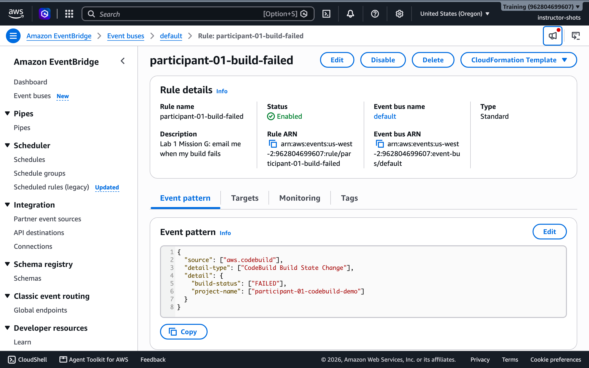

6. Break the build on purpose (Mission A's edit works well), upload, build, and watch your inbox. Undo the break afterwards.

<details>
<summary>💡 Hint 1 — the pattern, as JSON</summary>

If you prefer the **Custom pattern (JSON editor)**, this is the whole thing:

```json
{
  "source": ["aws.codebuild"],
  "detail-type": ["CodeBuild Build State Change"],
  "detail": {
    "build-status": ["FAILED"],
    "project-name": ["participant-NN-codebuild-demo"]
  }
}
```

Every build emits one of these events on every state change; the rule is a filter.
</details>

<details>
<summary>💡 Hint 2 — no e-mail?</summary>

In order: (1) is the subscription *Confirmed*? (2) EventBridge → your rule → **Monitoring** tab: did *TriggeredRules* and *Invocations* go to 1? If TriggeredRules is 0, the pattern did not match (project name typo, or you filtered on `SUCCEEDED`). (3) SNS → topic → **Access policy**: there must be a statement allowing `events.amazonaws.com` to `SNS:Publish`.
</details>

<details>
<summary>✅ Solution &amp; a nicer message</summary>

The raw e-mail is the full JSON event: useful, ugly. On the rule → **Targets** → **Edit** → **Additional settings** → **Configure target input: Input transformer**:

- Input path:
  ```json
  { "project": "$.detail.project-name", "status": "$.detail.build-status", "id": "$.detail.build-id" }
  ```
- Template:
  ```
  "🚨 Build <status> for <project>. Build id: <id>. Open CodeBuild in us-west-2 and read the log."
  ```

Measured in the class account: the rule triggered and SNS published within the same minute the build failed.

**The lesson:** a pipeline that only reports to a console is a pipeline nobody watches. Events (EventBridge) plus a fan-out (SNS: e-mail, SMS, chat webhooks, Lambda) is the standard AWS pattern, and Lab 2 reuses this very topic for deployment alarms.

**Proof:** the e-mail, or the rule's *Invocations = 1* graph.
</details>

### Mission H · 🔎 Log detective — Logs Insights

**Goal:** answer questions about *all* your builds at once instead of opening them one by one.

1. **CloudWatch** → **Logs** → **Logs Insights**. The console may redirect you to the new **Log Analytics** page (a blue banner says so; click **OK**). Either page works.
2. Point the query at your log group and run it:
   - **Log Analytics page:** in *Query scope*, change the **Log group** filter from *All* to **`/aws/codebuild/participant-NN-codebuild-demo`**, click **3h**, then replace everything *after* the first `SOURCE … |` line in the editor with the query below and press **Run**.
   - **Classic Logs Insights page:** *Select log group(s)* → your group → time range **3h** → paste the query → **Run query**.

   ```
   fields @message
   | filter @message like /BUILD SUCCESS|BUILD FAILURE/
   | parse @message "BUILD *" as verdict
   | stats count() as builds by verdict
   ```

   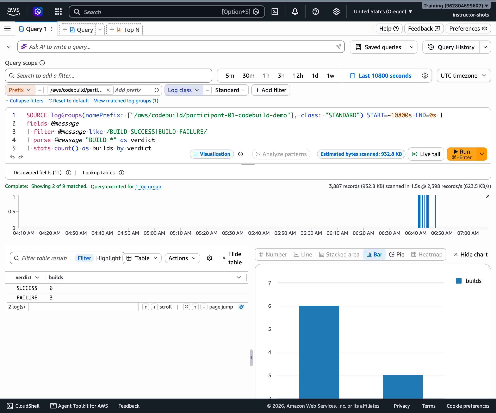

3. Now find every error from every build, newest first:

   ```
   fields @timestamp, @logStream, @message
   | filter @message like /\[ERROR\]/
   | sort @timestamp desc
   | limit 20
   ```

<details>
<summary>💡 Hint</summary>

Each build is one **log stream** inside the group; `@logStream` tells you which build an error came from. Click a row to expand it.
</details>

<details>
<summary>✅ Solution &amp; a bonus question</summary>

Our verdict table after the morning's missions: `FAILURE 3 · SUCCESS 5`. The error query lists the `expected:<…> but was:<…>` lines from Missions A and D with their build streams.

Bonus: *which build was slowest?* Maven prints `Total time:  3.502 s`:

```
fields @logStream, @message
| filter @message like /Total time:/
| parse @message /Total time:\s+(?<secs>[0-9.]+)/
| stats max(secs) as slowest, min(secs) as fastest, avg(secs) as average
```

**The lesson:** build logs are data. Retention outlives containers and projects (set it on the log group), and one query across weeks of builds answers "when did this start failing?" faster than any amount of clicking.

**Proof:** your verdict table.
</details>

---

## Part 7 · Clean up

Builds are billed per minute and storage per GB, so this lab costs cents, but shared accounts fill up with leftovers fast.

1. **CodeBuild** → Build projects → select `participant-NN-codebuild-demo` → **Delete build project**.
2. **S3** → select `cicd-lab1-participant-NN` → **Empty** (this removes the `cache/` object too) → then **Delete**.
3. If you did the missions: **EventBridge** → Rules → delete `participant-NN-build-failed` · **SNS** → Topics → delete `participant-NN-alerts` (skip this one if you are going on to Lab 2 today; it reuses the topic) · **Secrets Manager** → `participant-NN/lab1/deploy-token` → **Actions → Delete secret** (Secrets Manager insists on a 7-day waiting period; that is fine).
4. The IAM service role and its inline policies stay (students cannot delete roles in this account); the instructor removes those in bulk.

> [!NOTE]
> **Going on to Lab 2?** The only thing it reuses is the SNS topic `participant-NN-alerts` (Lab 2, Part 11). Everything else from this lab can go now.

---

## Part 8 · What you learned

- **CI** = a clean, automated, repeatable build of every change, with a binary verdict.
- A **buildspec** is a recipe with phases; the first red phase is the one to read.
- **Logs are the truth.** The error is usually a few lines above the final "exit status" message.
- The build **environment** (container image, runtime versions) is as much a part of your build as the code.
- **Artifacts** are the only thing that leaves the container; make them self-describing.
- CodeBuild acts through a **service role** – explicit, scoped permissions instead of shared credentials or public buckets.
- A **skipped test** is a hidden red light; when a test fails, suspect the code first.
- **Secrets** are fetched at run time by the role, one verb on one resource; the log masks them but masking is not a safety net.
- A **build cache** trades a little complexity for speed; cache dependencies, never outputs.
- Pipelines should **push news to humans** (EventBridge → SNS), and their **logs are data** (Logs Insights).

### Quiz yourself

<details>
<summary>1. The BUILD phase fails with "exit status 1". Where exactly do you look next, and why not just at the last line?</summary>

Scroll *up* from the phase-context message in the Build logs: the last line only says that a command failed; the tool's own error (`[ERROR] …`) is above it. Phase details tells you *which* phase; the log tells you *why*.
</details>

<details>
<summary>2. You changed `buildspec.yml` on your laptop and clicked Start build, but the build behaves exactly as before. What did you forget?</summary>

To re-zip and re-upload to `input/MessageUtil.zip`. CodeBuild builds what is in S3, not what is on your disk. (A pipeline that watches a repo removes this step; that is Lab 2.)
</details>

<details>
<summary>3. Why does CodeBuild need a service role at all? Why can't it just use your permissions?</summary>

The build runs when you are not there – on a schedule, on a push, at 3 a.m. It needs its own identity whose permissions are limited to the job (read one bucket, write one bucket, write logs). Using a human's credentials would be both insecure and fragile.
</details>

<details>
<summary>4. Name two things that are destroyed at the end of every CodeBuild run and one thing that is not.</summary>

Destroyed: the build container and everything inside it (source checkout, compiled classes, downloaded Maven dependencies). Kept: the artifact in S3 and the log in CloudWatch Logs.
</details>

<details>
<summary>5. Mission E's first build failed in DOWNLOAD_SOURCE, before any of your commands ran. Why there, and which of the three words (who / what / which) did you have to change?</summary>

CodeBuild resolves `env` variables (including `secrets-manager:`) while preparing the container, so a refused secret stops the build before `install`. You changed *who* is allowed to do *what*: the service role gained `secretsmanager:GetSecretValue`. The *which* (the secret ARN) was already correct.
</details>

<details>
<summary>6. "The token is safe, CodeBuild masks it in the log." Name two ways it could still leak.</summary>

Writing it to a file that ends up in the artifact; printing a transformation of it (length, hash, base64, first characters); passing it on the command line of a tool that logs its arguments; a build that uploads it somewhere. Masking only covers the literal string in the log.
</details>

<details>
<summary>7. Mission F's second build downloaded nothing from Maven Central and was six seconds faster. What could now go wrong that could not go wrong before?</summary>

A stale cache: if a dependency version changes but the cached copy is used, the build no longer matches a clean machine. Clear the cache object in S3 (or change the cache prefix) whenever you suspect it.
</details>

**Next:** [Lab 2 – From a zip in S3 to a live web page with CodePipeline and CodeDeploy](lab2-codepipeline-codedeploy.md)
