# Lab 3 · The Pipeline Repair Shop — six bugs between you and a working website

> *You just joined the team. A colleague left a note on your desk: "Pipeline is basically done, just needs a tiny fix, back in two weeks." The pipeline is red. Nobody knows why. The site needs to be live by the end of the session. Welcome to operations.*

| | |
|---|---|
| **Time** | 75–100 minutes (≈ 2 minutes of waiting per pipeline run; the rest is thinking) |
| **Difficulty** | Intermediate · you must have done Labs 1 and 2 |
| **AWS services** | CodePipeline, CodeBuild, CodeDeploy, S3, IAM, EC2, Systems Manager |
| **Format** | Troubleshooting. Nothing to create: the instructor built your environment. You diagnose and repair. |
| **Hidden in it** | **Six** independent bugs. Two in files, two in IAM, one in a CodeDeploy setting, one "it says green but it's wrong". |
| **Handout** | **"A triage playbook"** and **"Why green is not the same as correct"** in the [class handout](../docs/index.html) |

> [!IMPORTANT]
> **Your number.** Your environment is named `cicd-lab3-participant-NN-…`. Everything you touch must contain **your** `NN`. Fifteen identical environments exist side by side: if you edit someone else's deployment group, you break their lab and learn nothing about yours.
>
> **Region:** US West (Oregon) · `us-west-2`.

---

## Part 0 · Your handoff note

The instructor will share a table like this (yours has your own values):

| Student | Pipeline | Web URL | Bucket |
|---|---|---|---|
| participant-NN | `cicd-lab3-participant-NN-pipeline` | `http://<your instance public IP>/` | `cicd-lab3-participant-NN-962804699607` |

Everything in your environment follows the pattern **`cicd-lab3-participant-NN-<thing>`**:

| Thing | Name | Purpose |
|---|---|---|
| S3 bucket | `cicd-lab3-participant-NN-962804699607` | holds `source/app.zip` (the pipeline's input) and the pipeline's intermediate artifacts |
| Pipeline | `…-pipeline` | Source (S3) → Build (CodeBuild) → Deploy (CodeDeploy). Polls S3; every new `source/app.zip` starts a run |
| CodeBuild project | `…-build` | runs `buildspec.yml` from the zip: stamps the build number into `index.html`, packages the artifact |
| CodeDeploy app / group | `…-app` / `…-group` | deploys the artifact to EC2 instances selected by tag |
| EC2 instance | `…-web` | Amazon Linux 2023, CodeDeploy agent pre-installed, port 80 open. Apache is *not* installed yet; a hook will do that |
| IAM roles | `…-codebuild-role`, `…-codedeploy-role`, `…-ec2-role`, `…-codepipeline-role` | one per robot (Lab 2!) |

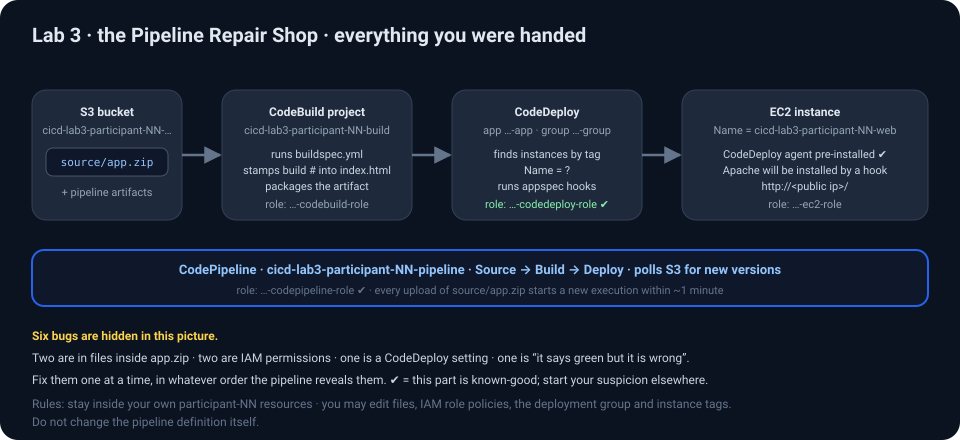

In the console the class looks like this: fifteen pipelines, all red, one of them yours.

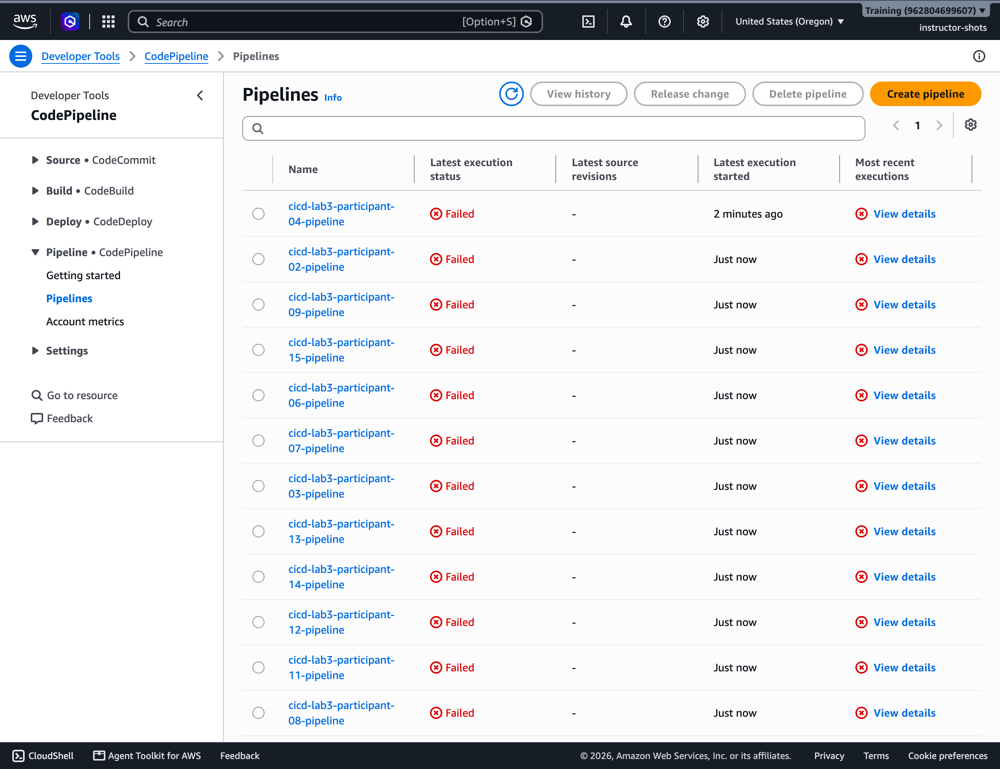

### The app you are deploying

Download it now: S3 → your bucket → `source/` → `app.zip` → **Download**. Unzip it somewhere you can edit.

```
app/
├── appspec.yml                 ← CodeDeploy instructions (files + hooks)
├── buildspec.yml               ← CodeBuild recipe
├── index.html                  ← the page; contains __BUILD_ID__ and __BUILD_TIME__ placeholders
└── scripts/
    ├── install_dependencies.sh ← BeforeInstall
    ├── start_server.sh         ← ApplicationStart
    └── stop_server.sh          ← ApplicationStop
```

When everything works, the page says **"You fixed the pipeline!"** with a real build number and timestamp stamped in by CodeBuild.

### Rules of engagement

1. **Fix one thing, re-run, observe.** Never change two things between runs; you will not know which one mattered.
2. **You may change:** the files inside `app.zip` (edit → re-zip → upload to `source/app.zip`), the policies on **your** IAM roles, **your** deployment group, and tags on **your** instance.
3. **You may not change:** the pipeline's stages, the CodeBuild project settings, anyone else's anything.
4. **Three ways to re-run,** fastest first:
   - **Retry stage** – the ↻ icon on the red stage card → *Retry failed actions*. Use after IAM or deployment-group fixes (nothing in the zip changed).
   - **Release change** (top-right) – re-runs the whole pipeline with the latest `source/app.zip`.
   - **Upload a new `app.zip`** – the pipeline notices on its own within about a minute. Use after file fixes.
5. **Write it down.** Keep the bug tracker below; the debrief uses it.

### Your bug tracker

| # | Symptom (what was red, what it said) | Which robot / which file | Root cause | Fix |
|---|---|---|---|---|
| 1 | | | | |
| 2 | | | | |
| 3 | | | | |
| 4 | | | | |
| 5 | | | | |
| 6 | | | | |

### Triage playbook (keep this open)

| Where it is red | Open this | Look for |
|---|---|---|
| **Build** | CodeBuild build → **Phase details** → first red phase → **Build logs** | Your commands' output; a `COMMAND_EXECUTION_ERROR`; or an `AccessDenied` *after* your commands |
| **Deploy**, fails within seconds | CodeDeploy deployment page → red banner | "no instances were found" → tags |
| **Deploy**, fails after ~30 s | Deployment page → **What failed** → event name | `DownloadBundle` → the instance's permissions. `BeforeInstall` / `ApplicationStart` → your scripts (read the log tail) |
| **All green, site wrong** | The artifact: build log *"Found N file(s)"*, the `BuildArtif/…zip` in your bucket, or `ls /var/www/html` on the server | What was shipped versus what you meant to ship |

<details>
<summary>🔍 How to look inside the server (Session Manager, no SSH)</summary>

EC2 → Instances → `cicd-lab3-participant-NN-web` → **Connect** → **Session Manager** → **Connect**. Useful commands:

```bash
sudo systemctl status codedeploy-agent --no-pager        # is the agent alive?
sudo tail -n 30 /var/log/aws/codedeploy-agent/codedeploy-agent.log
sudo ls /opt/codedeploy-agent/deployment-root/            # one folder per deployment
ls -la /var/www/html/                                     # what did the last deployment put here?
systemctl is-active httpd                                 # is Apache running?
```
</details>

---

## Stop 1 · The pipeline is red at **Build**

Open your pipeline. Source is green, Build is red, Deploy "didn't run".

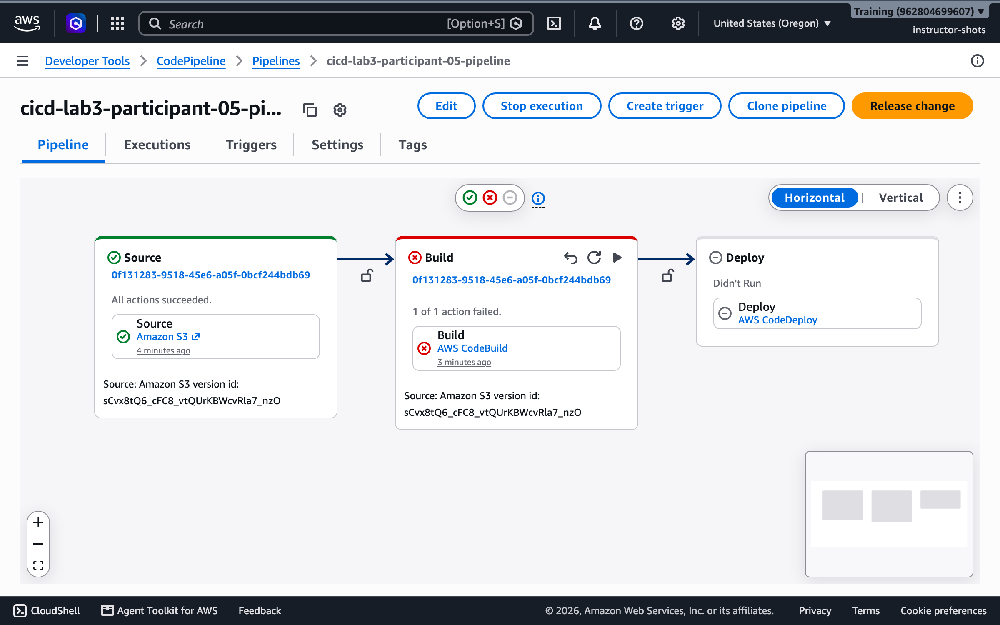

Click **AWS CodeBuild** inside the Build card (or go CodeBuild → Build projects → your project → the latest build).

**Investigate:** Which *phase* failed? What exact command was CodeBuild running? Compare it to what is written in `buildspec.yml`.

<details>
<summary>💡 Hint 1 — the phase and the message</summary>

**Phase details** shows **two** red phases: `BUILD` and, further down, `UPLOAD_ARTIFACTS`. The triage rule is *always fix the first red phase first*: later failures are often consequences, and if they are not, they will still be there on the next run. `BUILD`'s context says: `Error while executing command: grep -q "Build. Reason: exit status 2`. Look at that command carefully. Does it look complete to you?

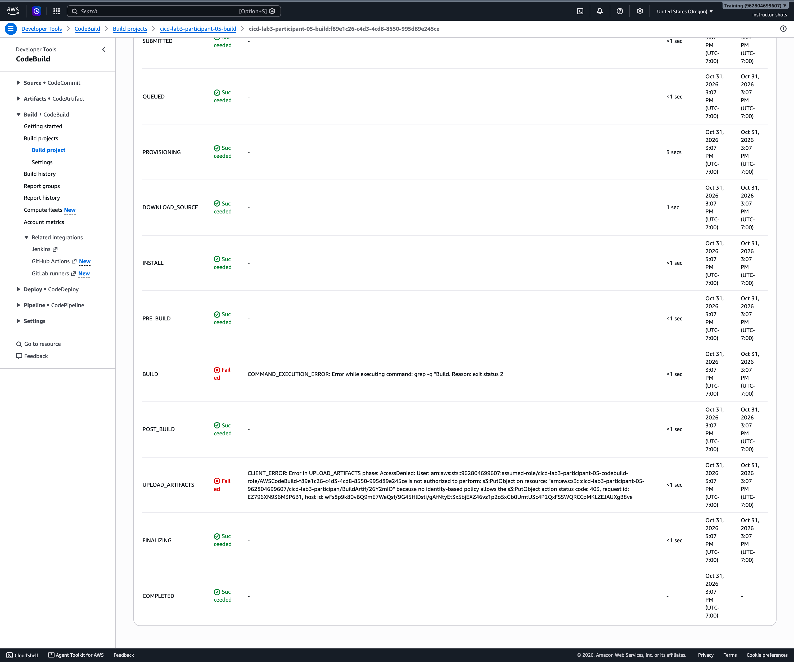
</details>

<details>
<summary>💡 Hint 2 — the log</summary>

In **Build logs**:

```
Running command grep -q "Build
/codebuild/output/tmp/script.sh: line 4: unexpected EOF while looking for matching `"'
Command did not exit successfully grep -q "Build exit status 2
```

The shell got a command that *starts* a quote and never closes it. In `buildspec.yml` the line is

```yaml
      - grep -q "Build #${CODEBUILD_BUILD_NUMBER}" index.html
```

Everything after a certain character vanished before the shell ever saw it. Which character?

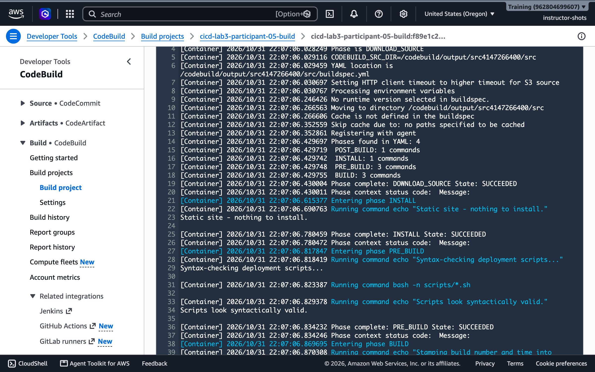
</details>

<details>
<summary>💡 Hint 3 — it is not a shell problem</summary>

`buildspec.yml` is **YAML**, and in YAML a `#` preceded by a space begins a *comment*. The YAML parser threw away ` #${CODEBUILD_BUILD_NUMBER}" index.html` as if it were a note to humans, and handed CodeBuild the fragment `grep -q "Build`. The `bash -n` syntax check in `pre_build` could never catch this: it checks the shell scripts, not the YAML.
</details>

<details>
<summary>✅ Solution</summary>

Quote the whole command so YAML treats it as one string (single quotes are simplest; the double quotes inside are then fine):

```yaml
  build:
    commands:
      - echo "Stamping build number and time into index.html..."
      - sed -i "s/__BUILD_ID__/${CODEBUILD_BUILD_NUMBER}/; s/__BUILD_TIME__/$(date -u +%Y-%m-%dT%H:%M:%SZ)/" index.html
      - 'grep -q "Build #${CODEBUILD_BUILD_NUMBER}" index.html'
```

Re-zip from inside the `app/` folder so the files stay at the top level:

```bash
zip -r app.zip appspec.yml buildspec.yml index.html scripts/
```

Upload to S3 → your bucket → `source/` → replace `app.zip`. Within a minute a new execution starts.

**Bug 1 — the YAML comment trap.** Characters that are harmless in a shell (`#`, `:`, `{`) have meaning in YAML. When a logged command looks *shorter* than what you wrote, suspect the YAML layer, not the tool. Prevention: quote any command containing `#` or `: `, and keep an eye on the build log's *"Running command …"* lines, which show exactly what survived parsing.
</details>

---

## Stop 2 · Still red at **Build** — but your commands all passed

The new run gets further. Build is red again, but this time `BUILD` itself is green: the log shows *"Stamping build number…"* ran and the grep passed. The second red phase from Stop 1 is still there, and it is now the first one.

**Investigate:** Which phase is red now? Is it one of *yours*? Read the error like a sentence: **who** is not authorized to do **what** on **which resource**?

<details>
<summary>💡 Hint 1 — a phase you did not write</summary>

**Phase details:** every phase you control (`INSTALL`, `PRE_BUILD`, `BUILD`, `POST_BUILD`) is green. The red one is **`UPLOAD_ARTIFACTS`** – CodeBuild's own step that pushes the output zip to the pipeline's artifact store.

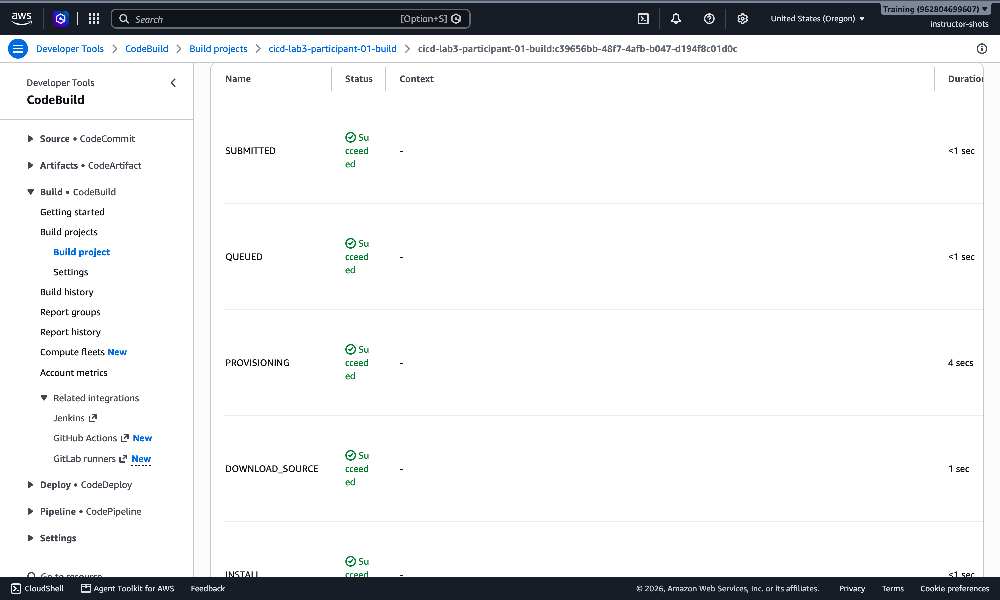
</details>

<details>
<summary>💡 Hint 2 — read the sentence</summary>

```
Error in UPLOAD_ARTIFACTS phase: AccessDenied:
User: arn:aws:sts::962804699607:assumed-role/cicd-lab3-participant-NN-codebuild-role/AWSCodeBuild-…
is not authorized to perform: s3:PutObject
on resource: "arn:aws:s3:::cicd-lab3-participant-NN-962804699607/cicd-lab3-participan/BuildArtif/…"
because no identity-based policy allows the s3:PutObject action
```

- **Who:** the *CodeBuild role* (robot #1 from Lab 2's roles map).
- **What:** `s3:PutObject` – *writing* to S3.
- **Where:** your own bucket.

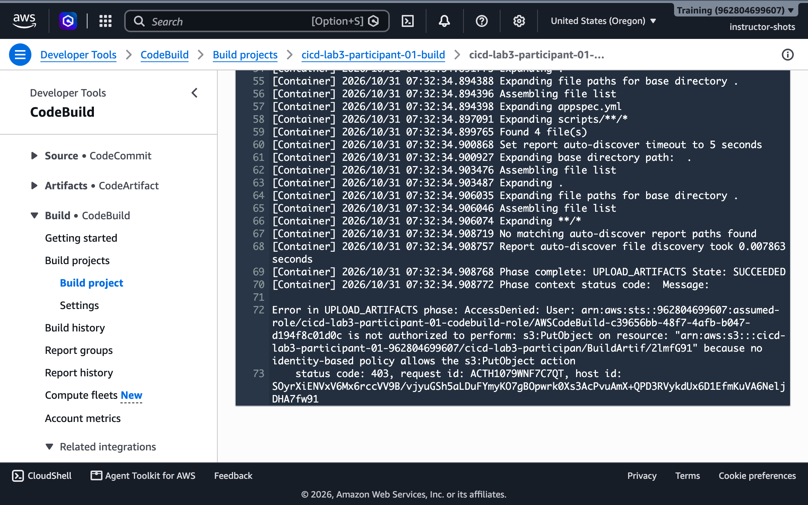

So the build may *read* its source but may not *write* its result. Go look at that role.
</details>

<details>
<summary>💡 Hint 3 — the policy</summary>

IAM → Roles → `cicd-lab3-participant-NN-codebuild-role` → its one inline policy → view the JSON. Compare the list of `s3:` actions against the action named in the error.

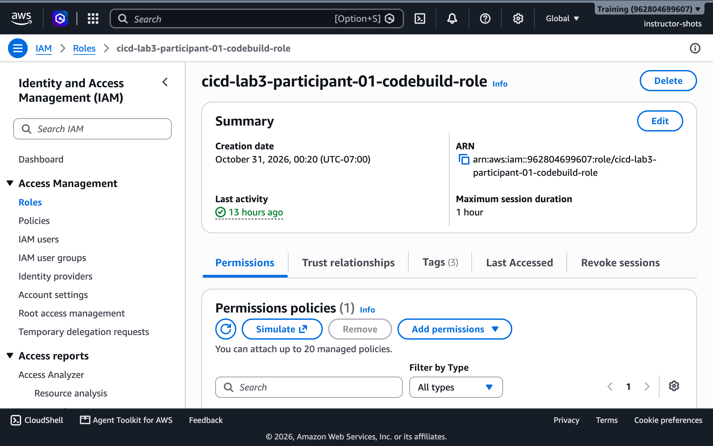
</details>

<details>
<summary>✅ Solution</summary>

Edit the inline policy (IAM → role → policy → **Edit** → **JSON**) and add `s3:PutObject` to the statement that already lists the S3 read actions:

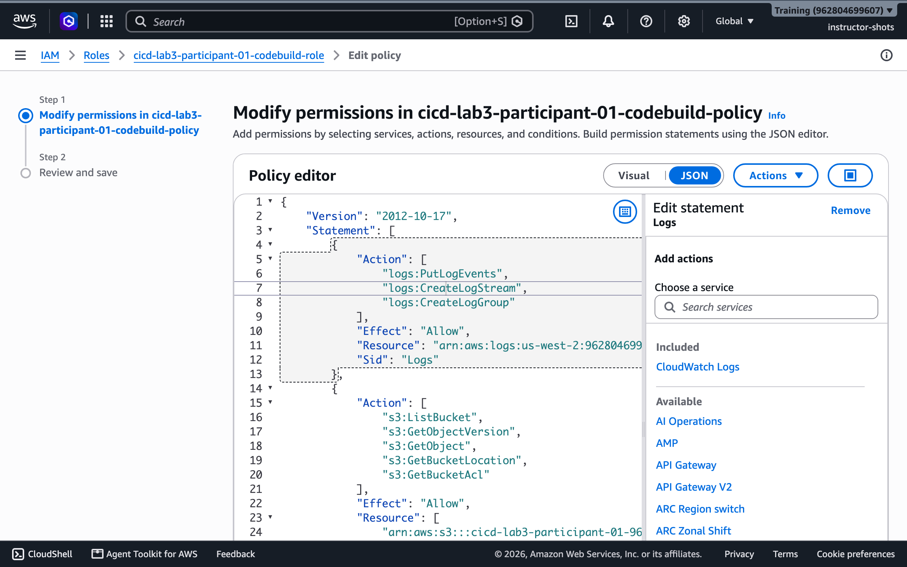

```json
{
  "Sid": "ReadArtifacts",
  "Effect": "Allow",
  "Action": [
    "s3:GetObject",
    "s3:GetObjectVersion",
    "s3:GetBucketAcl",
    "s3:GetBucketLocation",
    "s3:ListBucket",
    "s3:PutObject"
  ],
  "Resource": [
    "arn:aws:s3:::cicd-lab3-participant-NN-962804699607",
    "arn:aws:s3:::cicd-lab3-participant-NN-962804699607/*"
  ]
}
```

**Save**, wait ~15 seconds for IAM to propagate, then on the pipeline click the ↻ on the Build card → **Retry failed actions**. No need to upload anything: nothing in the zip changed.

(Attaching the AWS-managed `AmazonS3FullAccess` also "works". It also lets the build delete every object in every bucket in the account. Prefer the one-line fix.)

**Bug 2 — the robot could read but not write.** A build touches S3 twice: it *reads* the source and *writes* the artifact. The error message always names the principal, the action and the resource; those three words are the whole diagnosis. Prevention: role templates per job type, and a test run before handing a pipeline to anyone.
</details>

---

## Stop 3 · Build is green, **Deploy** is red — instantly

Deploy fails in a few seconds. Click the **AWS CodeDeploy** link in the Deploy card.


**Investigate:** Read the banner. Then compare two things that are supposed to match.

<details>
<summary>💡 Hint 1 — the banner says it all</summary>

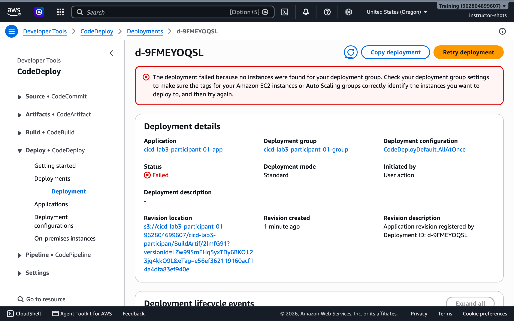

*"The deployment failed because no instances were found for your deployment group. Check your deployment group settings to make sure the tags for your Amazon EC2 instances … correctly identify the instances."*

Which tag is the deployment group looking for, and what tag does your instance actually carry?
</details>

<details>
<summary>💡 Hint 2 — side by side</summary>

Deployment group page → *Environment configuration*:

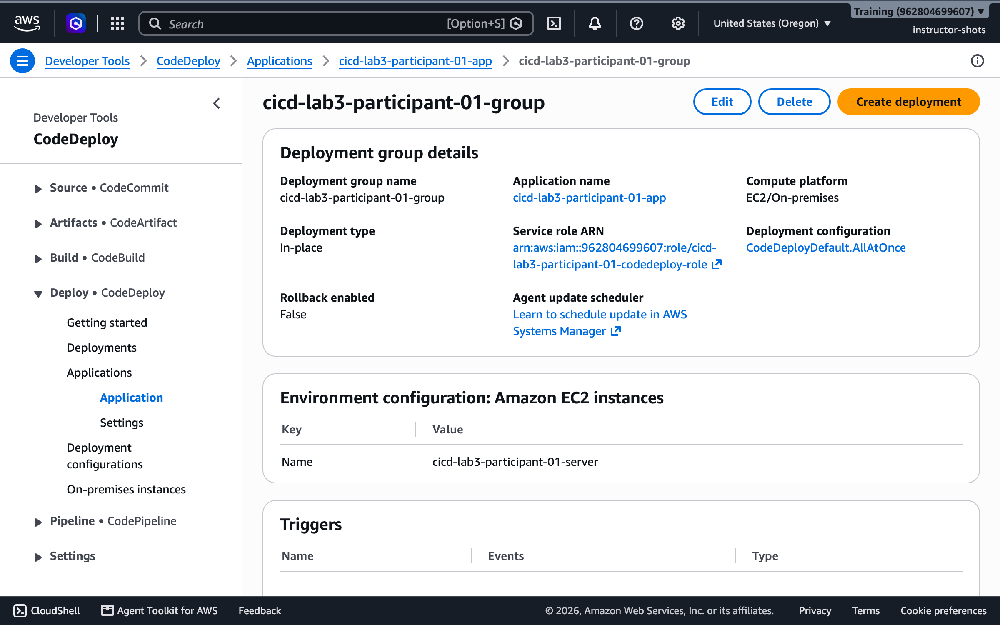

EC2 → Instances → search `cicd-lab3-participant-NN`:

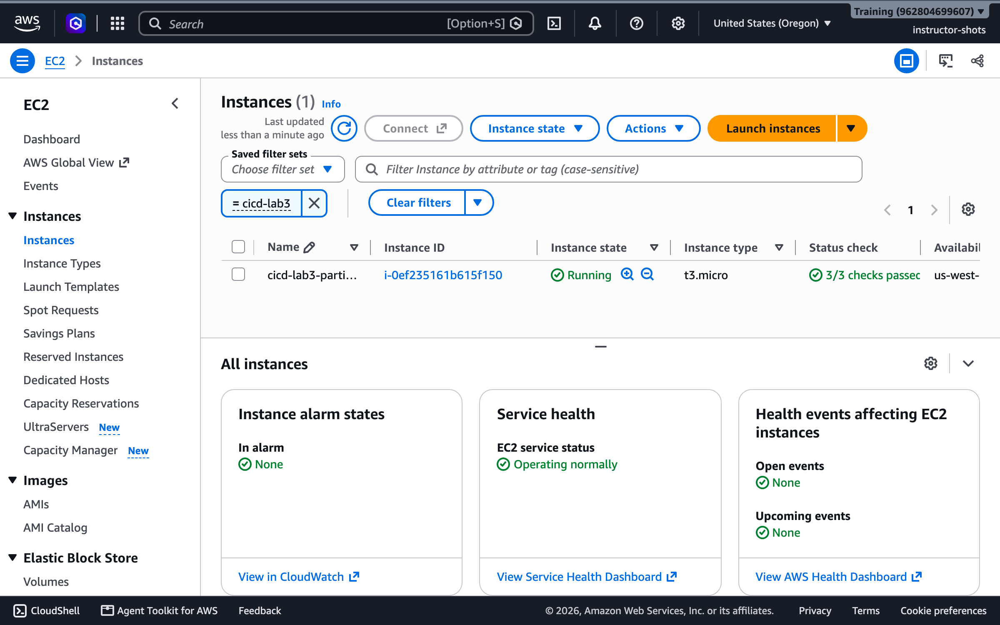

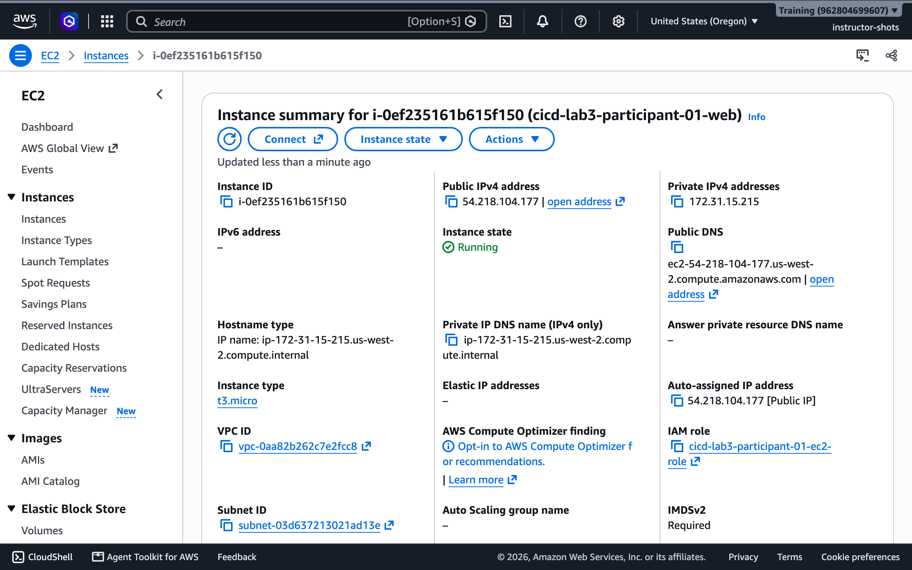

One ends in **`-server`**. The other ends in **`-web`**.
</details>

<details>
<summary>✅ Solution</summary>

Deployment group → **Edit** → *Environment configuration* → change the tag **Value** to `cicd-lab3-participant-NN-web`. The line under the checkbox should change from *0* to **1 unique matched instance** before you save. **Save changes**, then **Retry** the Deploy stage.

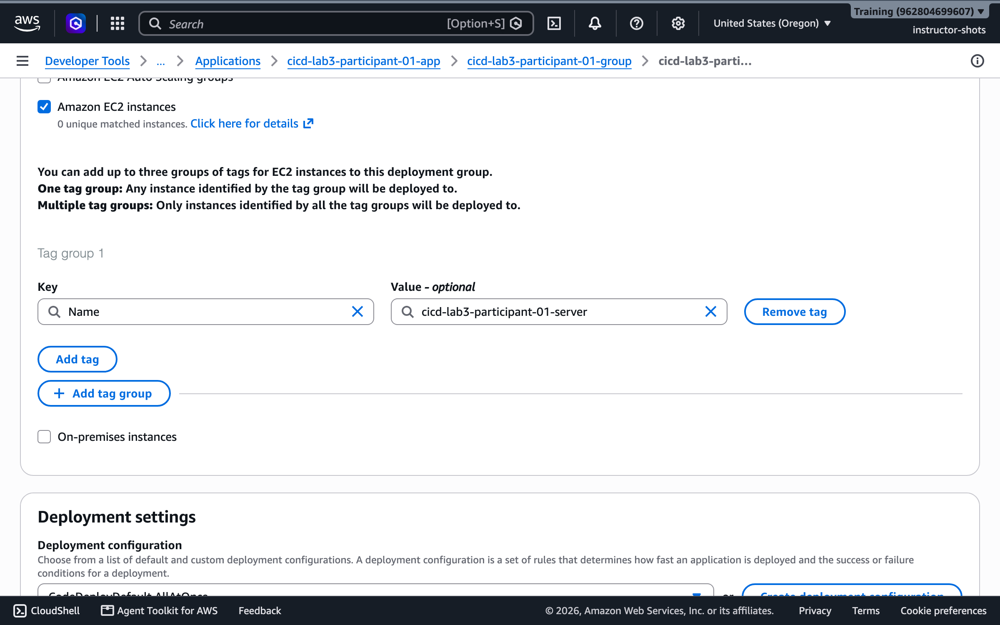

(Re-tagging the *instance* to `…-server` would also work. Changing the deployment group is better: the instance tag is the truth that other systems may rely on – billing, monitoring, Terraform.)

**Bug 3 — a tag is a contract.** CodeDeploy never "knows" your servers; it searches for tags at deployment time. One wrong word = zero matches = instant failure. Prevention: use the console's *"N unique matched instances"* preview before saving, and let one source (infrastructure code) generate both the tag and the filter.
</details>

---

## Stop 4 · **Deploy** red again — now it takes 30 seconds to fail

Progress: CodeDeploy found the instance and talked to the agent. Then something on the server failed. Open the deployment and read **What failed**.

**Investigate:** Which lifecycle event failed? Which *identity* appears in the error? (Careful: it is not the same robot as Stop 2.)

<details>
<summary>💡 Hint 1 — the event</summary>

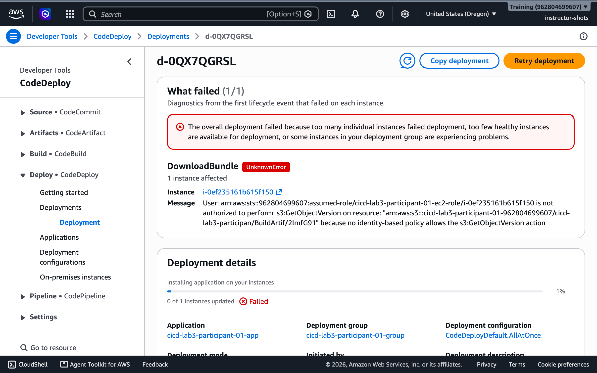

**`DownloadBundle`** – the step where the *agent on the instance* fetches the zip from S3. The hooks after it were skipped.

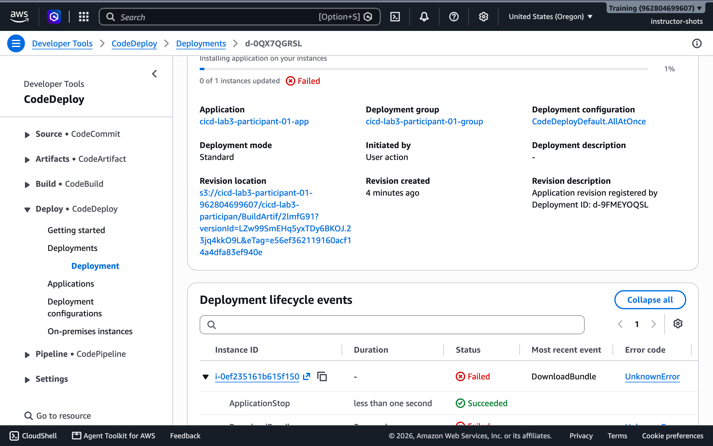
</details>

<details>
<summary>💡 Hint 2 — the sentence, again</summary>

`User: arn:aws:sts::…:assumed-role/cicd-lab3-participant-NN-ec2-role/i-0123… is not authorized to perform: s3:GetObjectVersion …`

The principal is the **EC2 instance role** (the session name is the instance ID). The agent uses the instance's role for everything it does. Go look at what that role is allowed to do.
</details>

<details>
<summary>💡 Hint 3 — the role</summary>

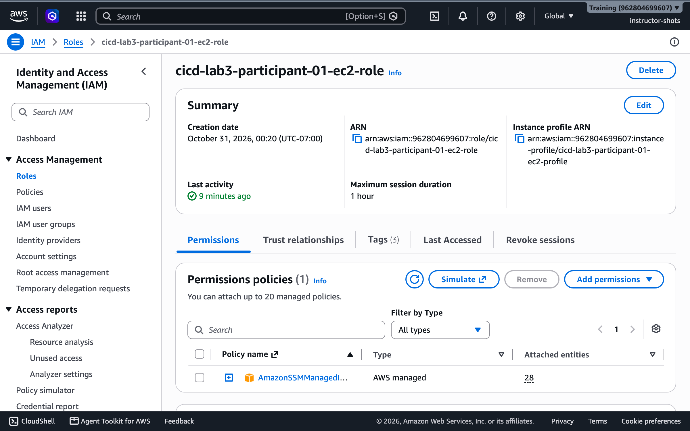

Only `AmazonSSMManagedInstanceCore` is attached. Nothing about S3. The agent can be reached (Systems Manager) but cannot *fetch*.

On the server itself, `/var/log/aws/codedeploy-agent/codedeploy-agent.log` says the same thing:

```
ERROR [codedeploy-agent]: InstanceAgent::Plugins::CodeDeployPlugin::CommandPoller: Error during perform:
Aws::S3::Errors::AccessDenied - User: arn:aws:sts::…:assumed-role/cicd-lab3-participant-NN-ec2-role/i-… is not authorized to perform: s3:GetObjectVersion …
```
</details>

<details>
<summary>✅ Solution</summary>

IAM → Roles → `cicd-lab3-participant-NN-ec2-role` → **Add permissions → Attach policies** → search **`AmazonEC2RoleforAWSCodeDeploy`** → tick → **Add permissions**.

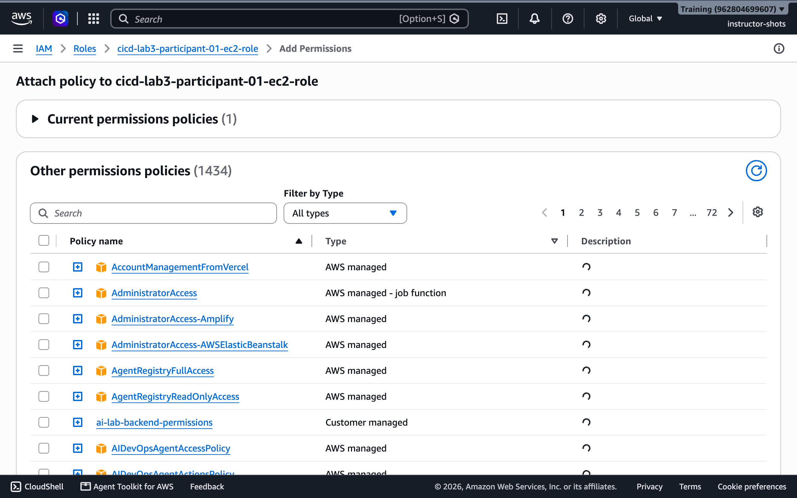

(`AmazonS3ReadOnlyAccess` also works. Challenge B below asks you to do better than either.)

Wait ~30 seconds – the agent refreshes its credentials automatically; no reboot – then **Retry** the Deploy stage.

**Bug 4 — the third robot.** The service (CodeDeploy) had permission; the *agent* did not. Every "download/fetch/pull" step in a deployment runs with the **target machine's** identity. Prevention: a standard instance profile for "CodeDeploy targets", and reading the principal in every AccessDenied before touching any policy.
</details>

---

## Stop 5 · **Deploy** red — this time it is *your* script

The bundle downloaded, Apache got installed, files were copied… and then the deployment failed. Open **What failed**.

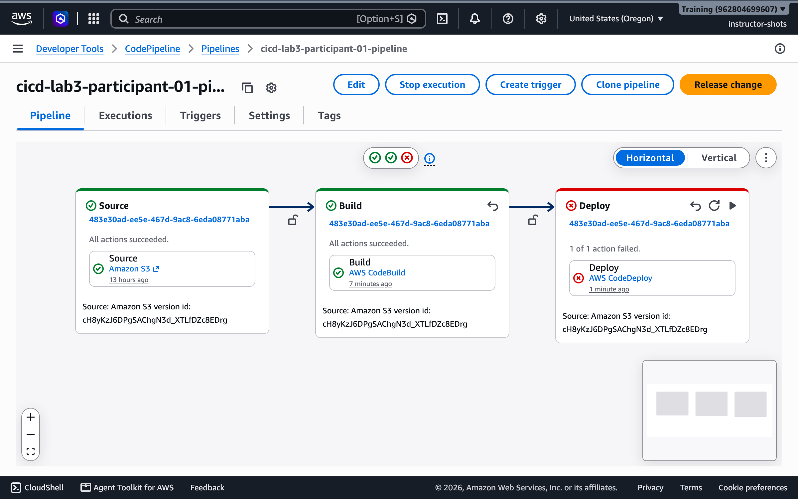

**Investigate:** Which hook, which script, which line of its output?

<details>
<summary>💡 Hint 1</summary>

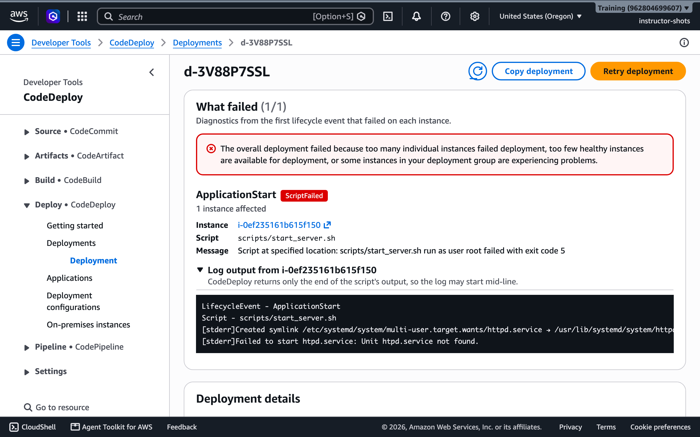

`ApplicationStart` · `ScriptFailed` · `scripts/start_server.sh … failed with exit code 5`. The log tail is right there on the page. Read the last line of it slowly.
</details>

<details>
<summary>💡 Hint 2</summary>

`Failed to start htpd.service: Unit htpd.service not found.` – count the letters in the service name. Then open `scripts/start_server.sh` in your copy of the zip.
</details>

<details>
<summary>✅ Solution</summary>

`scripts/start_server.sh` says `systemctl start htpd`. It should say:

```bash
systemctl start httpd
```

Fix it, re-zip, upload `source/app.zip`. The pipeline runs by itself.

**Bug 5 — syntax is not semantics.** The build's `pre_build` phase proudly printed *"Scripts look syntactically valid"* – `bash -n` only checks that the script *parses*, not that it *works*. A typo in a service name is perfectly valid bash. Prevention: smoke-test the thing the script is supposed to achieve (see Challenge A), and test deployment scripts on a throw-away instance before they reach a pipeline.

Note that your site has been *down* since Stop 4's fix: Apache was installed but never started. That is the Lab 2 lesson again, from the other side.
</details>

---

## Stop 6 · All green! …open the website

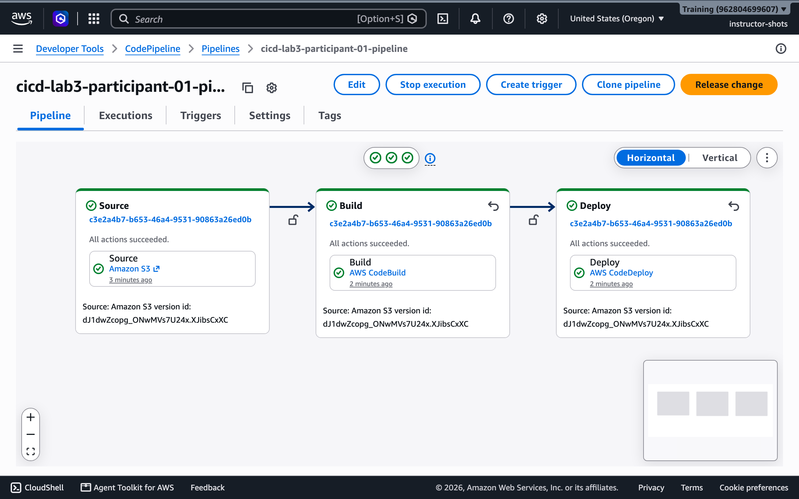

Open `http://<your instance public IP>/`.


That is Apache's *test page*. Every stage of your pipeline is green and the result is wrong. **This is the most important stop in the lab.**

**Investigate:** The pipeline did exactly what it was told. So what was it told? What files did the deployment actually put on the server?

<details>
<summary>💡 Hint 1 — look at the server</summary>

Session Manager → `ls -la /var/www/html/`:

```
appspec.yml
scripts/
```

No `index.html`. Apache shows its test page when there is nothing to serve. CodeDeploy copied everything that was in the artifact. So what was in the artifact?
</details>

<details>
<summary>💡 Hint 2 — look at the build log</summary>

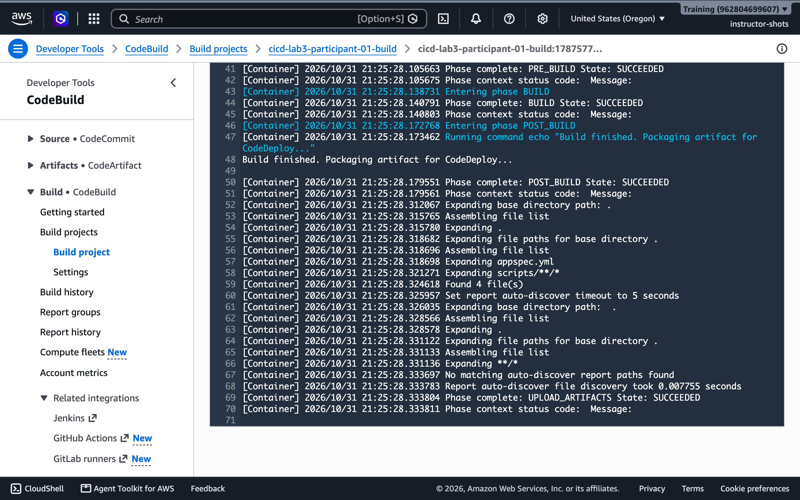

```
Expanding appspec.yml
Expanding scripts/**/*
Found 4 file(s)
```

Four files: `appspec.yml` and three scripts. The file the whole build exists to produce – the freshly stamped `index.html` – was never packed. Where is the list of files that get packed?
</details>

<details>
<summary>✅ Solution</summary>

In `buildspec.yml`, the `artifacts` section forgot the page:

```yaml
artifacts:
  files:
    - appspec.yml
    - index.html
    - scripts/**/*
```

Re-zip, upload, wait. Then refresh the page:

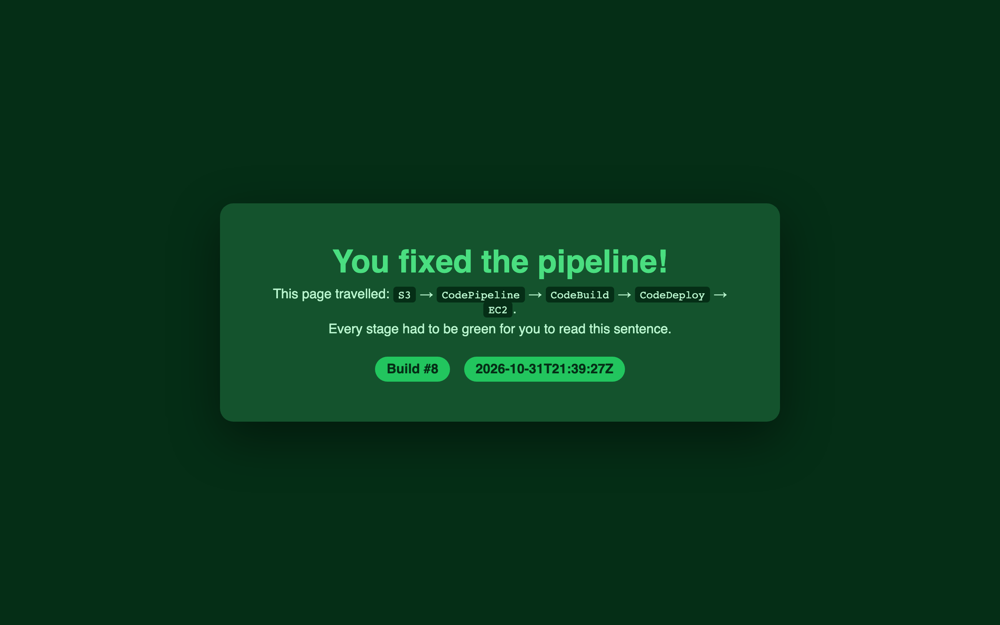

**Bug 6 — green is not correct.** Each stage verified *its own* contract: the build ran without error, the deployment copied every file it was given. Nobody verified the *outcome*. Prevention: make the pipeline check the outcome – a `ValidateService` hook that fetches the page and looks for a sentence, a build step that fails if the artifact lacks a required file, or a synthetic monitor. Challenge A makes you add one.
</details>

### 🏁 Victory lap


- **Execution history** tells the story of your afternoon: every run, its trigger (*PollForSourceChanges* when you uploaded, *Retry* when you retried) and how far it got.

  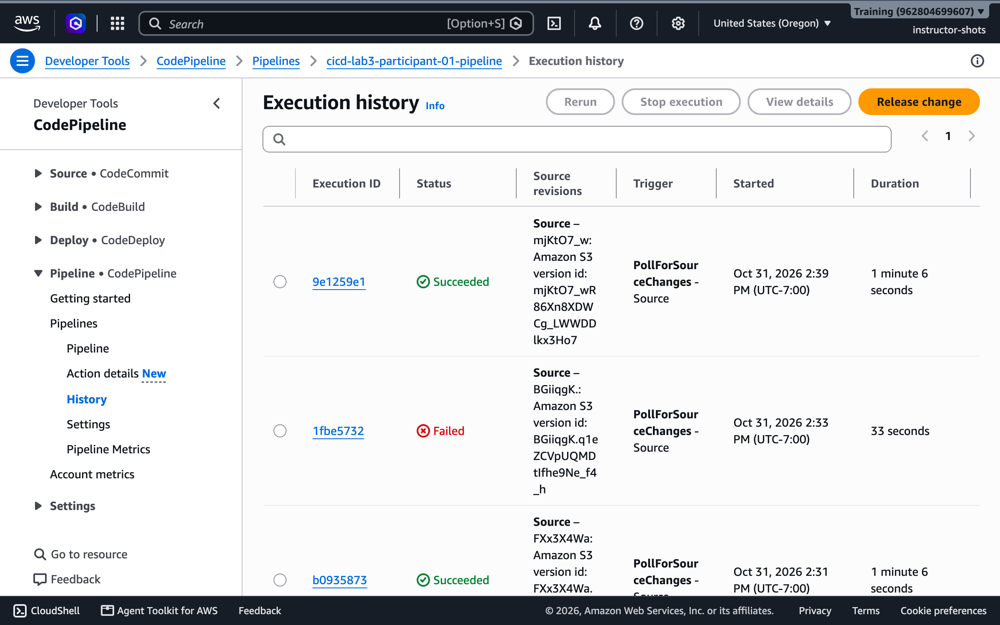

- **CodeDeploy → Deployments** shows the same story from the server's point of view.

  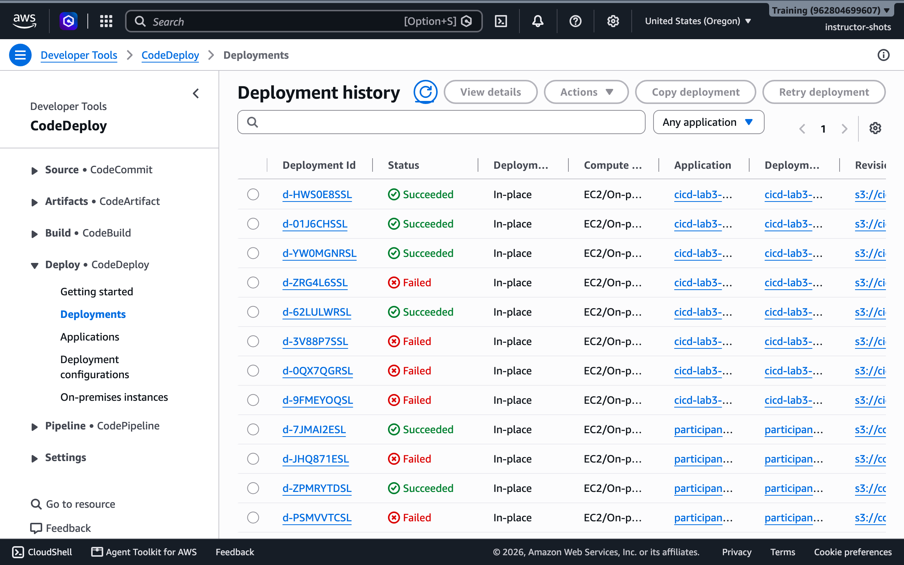

- Your bucket now holds the pristine source, your fixed uploads (as versions of the same key) and every intermediate artifact the pipeline produced. Nothing was overwritten; everything is traceable.

  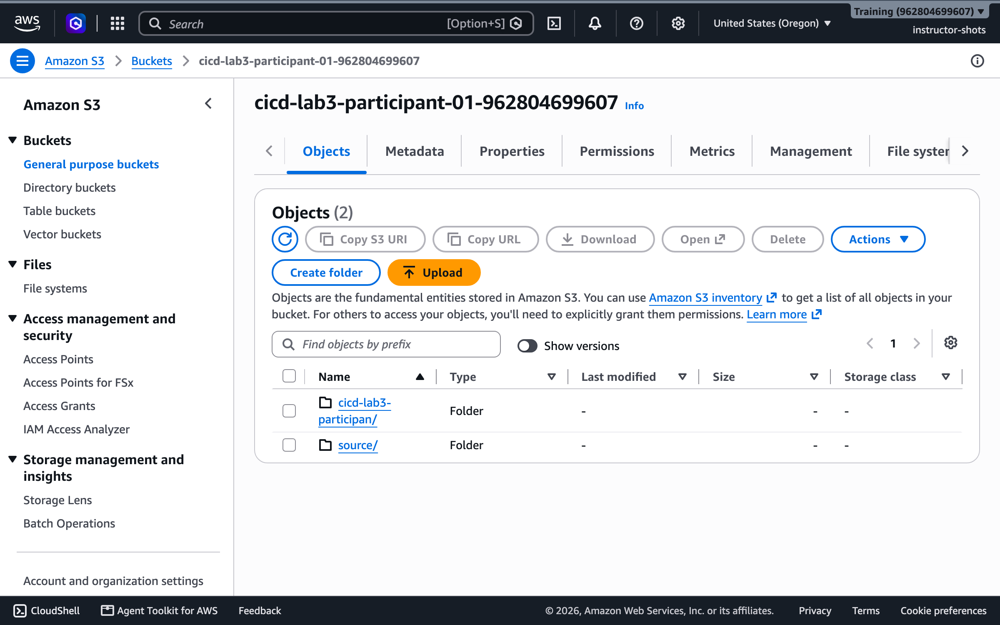

- Upload the zip once more without changing anything. The build number on the page goes up by one. *Every run re-stamps the artifact; the artifact tells you where it came from.*

---

## Debrief · fill in the tracker, then answer these

<details>
<summary>Answer key for the tracker (open only when you are done)</summary>

| # | Symptom | Robot / file | Root cause | Fix |
|---|---|---|---|---|
| 1 | Build red · `BUILD` phase · `grep -q "Build` unexpected EOF | `buildspec.yml` | ` #` starts a YAML comment; command truncated | quote the command |
| 2 | Build red · `UPLOAD_ARTIFACTS` · AccessDenied `s3:PutObject` | CodeBuild role | role can read but not write the bucket | add `s3:PutObject` |
| 3 | Deploy red in seconds · "no instances were found" | deployment group | tag filter `…-server`, instance is `…-web` | fix the filter value |
| 4 | Deploy red · `DownloadBundle` · AccessDenied `s3:GetObjectVersion` | EC2 instance role | no S3 read permission for the agent | attach `AmazonEC2RoleforAWSCodeDeploy` |
| 5 | Deploy red · `ApplicationStart` · `Unit htpd.service not found` | `scripts/start_server.sh` | typo `htpd` | `httpd` |
| 6 | All green · Apache test page | `buildspec.yml` `artifacts.files` | `index.html` not in the artifact | add it |
</details>

1. **Order.** The bugs revealed themselves in a fixed order (build → build permissions → find servers → fetch → run → verify). Why could you *not* have found bug 5 before bug 4?
2. **Cost of each.** Which bug would have been cheapest to catch before the pipeline existed, and with what tool? (Think: a YAML linter, an IAM policy simulator, Terraform producing both the tag and the filter, a test instance, a smoke test.)
3. **Blast radius.** Which bug left the website *down* while being green somewhere else? Which left it *up but wrong*? Which is worse for a real business?
4. **Three robots.** Two bugs were AccessDenied. Without looking, which robot was each? How did you tell them apart in the message?
5. **The sentence.** Write the general shape of every AWS permission error in one line.

---

## Challenges

### Challenge A · Make the pipeline catch bug 6 by itself

Add a `ValidateService` hook that fails the deployment unless the live page contains the words `Pipeline Repair Shop`. Then prove it works by removing `index.html` from the artifact again and watching **Deploy** go red *instead of* silently shipping the wrong page.

<details>
<summary>💡 Hint</summary>

Lab 2, Challenge C. Script: `curl -sf http://localhost/ | grep -q "Pipeline Repair Shop"`. Register it under `hooks: ValidateService:` in `appspec.yml`. Give Apache a second to start. The script must be in the artifact (it is: `scripts/**/*`).
</details>

<details>
<summary>✅ Solution</summary>

`scripts/validate_service.sh`:

```bash
#!/bin/bash
set -e
sleep 2
curl -sf http://localhost/ | grep -q "Pipeline Repair Shop"
echo "Smoke test passed"
```

`appspec.yml`, under `hooks:`:

```yaml
  ValidateService:
    - location: scripts/validate_service.sh
      timeout: 60
      runas: root
```

Make it executable before zipping (`chmod +x scripts/*.sh`). Deploy once (green, ValidateService takes ~2 s). Then remove `- index.html` from `artifacts.files`, upload, and watch Deploy fail at `ValidateService` with your script's exit code. Put the line back.

With this hook in place, bug 6 would have been *impossible* to miss.
</details>

### Challenge B · Least privilege for the agent

In Stop 4 you attached an AWS-managed policy that lets the instance read **every** bucket in the account. Replace it with an inline policy that allows **only** `s3:GetObject` and `s3:GetObjectVersion` on objects in **your** bucket, remove the managed policy, and prove deployments still work.

<details>
<summary>💡 Hint</summary>

IAM → the ec2 role → **Add permissions → Create inline policy → JSON**. Resource ARNs for *objects* end in `/*`. The agent also needs `s3:GetBucketLocation` on the bucket itself for some regions; include it on the bucket ARN. Then remove `AmazonEC2RoleforAWSCodeDeploy` and **Release change**.
</details>

<details>
<summary>✅ Solution</summary>

```json
{
  "Version": "2012-10-17",
  "Statement": [
    {
      "Effect": "Allow",
      "Action": ["s3:GetObject", "s3:GetObjectVersion"],
      "Resource": "arn:aws:s3:::cicd-lab3-participant-NN-962804699607/*"
    },
    {
      "Effect": "Allow",
      "Action": ["s3:GetBucketLocation", "s3:ListBucket"],
      "Resource": "arn:aws:s3:::cicd-lab3-participant-NN-962804699607"
    }
  ]
}
```

The deployment still succeeds, and this instance can no longer read anyone else's bucket. (Students in this account cannot *detach* managed policies themselves – ask the instructor to detach it, or simply confirm the inline policy alone would suffice by reading both.)

**Why it matters:** a compromised web server with `AmazonS3ReadOnlyAccess` can read every backup, every log, every other student's artifacts. Least privilege turns a breach into a nuisance.
</details>

### Challenge C · Sabotage a friend (pair exercise)

Pick **one** of the six bugs and re-plant it in *your own* environment (for example, put the `htpd` typo back and upload, or change your tag filter). Swap seats with a neighbour. Diagnose each other's pipeline using only the triage playbook, no hints. Time yourselves. Then put everything back.

<details>
<summary>💡 Facilitator note</summary>

Good sabotage candidates: the tag filter (fast feedback), the script typo, removing `index.html` from the artifact (the sneaky one). Avoid IAM changes unless you are confident you can revert them – students cannot detach policies in this account.
</details>

### Challenge D (stretch) · Two servers, one deployment, and a gate that was missing

You did a two-server, one-at-a-time rollout in Lab 2 (Part 10). Do it again here, on the pipeline you just repaired, and add the piece this pipeline never had:

1. Launch a second EC2 instance exactly like the first (same AMI, same IAM instance profile `cicd-lab3-participant-NN-ec2-profile`, same user-data script from Lab 2, **same Name tag**). Release a change: the deployment's instance list now shows **two** instances.
2. Switch the deployment group to `CodeDeployDefault.OneAtATime` and release again. Watch the order and timing.
3. Now the new part: this pipeline's Build stage only stamps the page. Borrow the two checks from Lab 2's `buildspec.yml` (syntax-check every script with `bash -n`; fail if `appspec.yml` names a script that is not in the bundle) and add them to *this* buildspec. Re-plant bug 5 (`htpd`): does the gate catch it? Re-plant a wrong script *name* in `appspec.yml`: does it catch that? Explain the difference in one sentence.

Terminate the extra instance when you are done.

---

## Clean up

**Nothing to delete.** The instructor tears all fifteen environments down with one Terraform command. Please do not delete your resources yourself; it confuses the teardown.

---

## What you learned

- **A triage order:** where is it red → which robot was acting → what does the message say (principal, action, resource) → which file/setting owns that.
- **Six families of failure:** config-file syntax (YAML), build permissions, target selection (tags), target permissions, deployment scripts, and artifact contents.
- **Green ≠ correct.** Pipelines verify contracts between stages, not outcomes. Outcomes need explicit checks (`ValidateService`, smoke tests, monitors).
- **Fix one thing at a time** and let the pipeline tell you what is next. It always does.
- **Least privilege is a habit:** fix the missing verb, not "give it everything".

**Next:** [Lab 4 – Ship a container: ECR, CodeBuild and ECS](lab4-ecs-ecr.md)
