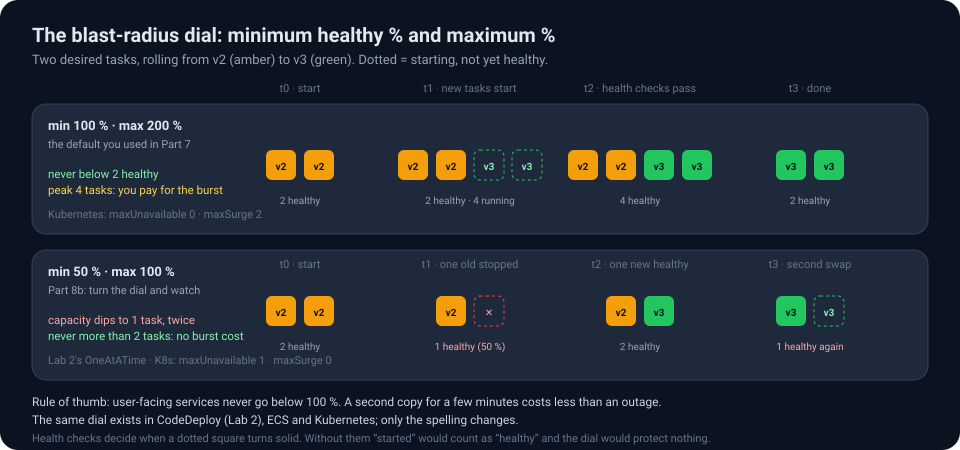
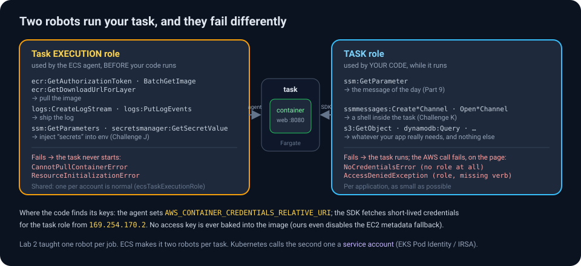
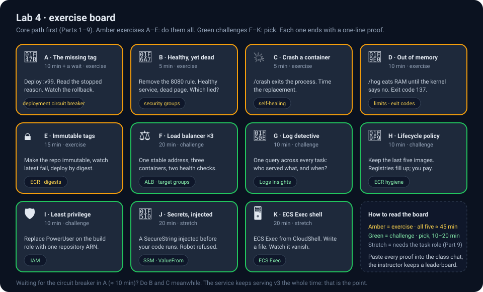
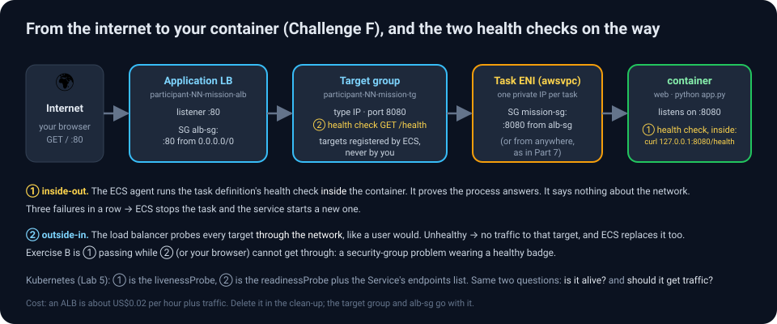

# Lab 4 · Ship a container — ECR, CodeBuild and ECS on Fargate

> *In Lab 2 you copied one HTML file into an Apache you had installed by hand. Today you ship the whole thing: the operating system userland, the runtime, the app, in one immutable image that a robot builds, a registry stores and an orchestrator runs. Then you give the running container an identity of its own, turn the blast-radius dial, and break it in six different ways. Nothing gets installed on your laptop. Not even Docker.*

| | |
|---|---|
| **Time** | Core path (Parts 1–9) ≈ 90 min · Exercises A–E ≈ 45 min · Challenges F–K 10–20 min each, pick your own |
| **Difficulty** | Intermediate, advanced in the challenges. Labs 1–3 first; container experience not required. |
| **AWS services** | Amazon ECR, CodeBuild, Amazon ECS (Fargate), IAM, Systems Manager Parameter Store, CloudWatch Logs and Logs Insights, EC2 (security groups, load balancer), AWS CloudShell |
| **You will build** | A container image built by CodeBuild and pushed to your own ECR repository · an ECS cluster, task definition and service running two copies on Fargate · a rolling update, then the same update with the blast-radius dial turned · a task role so the app can read its configuration from Parameter Store while it runs · a load balancer, a least-privilege build role, a lifecycle policy, a shell inside a running task |
| **You will break & fix** | A build that cannot log in to ECR · an app with no identity, then an identity with no permission · a tag that does not exist · a container you crash · a container that eats all its memory · a push an immutable repository refuses · a secret the execution role may not read |
| **Handout** | **"Containers: ECR, ECS and EKS in one picture"** and **"ECS or EKS?"** in the [class handout](../docs/index.html) |

> [!IMPORTANT]
> **Your number.** Everywhere you see `NN`, type your own two digits. Everything you name today contains it: `participant-NN-mission-control`, `participant-NN-cluster`, `cicd-lab4-participant-NN`, `/participant-NN/mission-control/motd`.
>
> **Your region.** US West (Oregon) · `us-west-2`.
>
> **Your proof.** Every exercise ends with a one-line *proof* (a stopped reason, an exit code, a log line). Paste it into the class chat; the instructor keeps a leaderboard.

---

## Part 0 · The idea in five minutes

### Why containers?

A deployment in Lab 2 assumed a lot about the server: that Apache could be installed, that `systemctl` existed, that nothing else was listening on port 80. Containers remove the assumptions by shipping the environment *with* the app. A **container image** is a read-only stack of filesystem layers (an OS userland, a Python runtime, your code) plus a little metadata (which command to run, which port to expose, which user to run as). A **container** is a running copy of an image with its own isolated filesystem, network and process tree, and with **limits**: a slice of CPU and a ceiling on memory that the kernel enforces. Any machine with a container runtime can run it, identically.


### The four places an image goes

| Step | Service | What happens |
|---|---|---|
| **Build** | CodeBuild | Reads a `Dockerfile`, executes it line by line in a throw-away container, produces an image. Your laptop is not involved. |
| **Store** | Amazon ECR (Elastic Container Registry) | A private, per-account registry. Images are pushed with a **tag** (`v3`) and identified precisely by a **digest** (`sha256:…`). Scans images for known vulnerabilities; can expire old ones; can refuse to overwrite a tag. |
| **Orchestrate** | Amazon ECS (Elastic Container Service) | You declare "run 2 copies of this task definition"; ECS finds room, starts them, replaces them when they die, rolls out new versions without downtime, and gives each one an identity. |
| **Run** | AWS Fargate | Serverless compute for containers: you specify CPU and memory per task and never see, patch or pay for an idle server. |

### ECS vocabulary (there are only six words)

| Word | Meaning |
|---|---|
| **Cluster** | A logical group for tasks and services. With Fargate it holds no servers; it is a namespace with a bill. |
| **Task definition** | The versioned recipe for one unit of work: image, CPU/memory, ports, environment variables, secrets, health check, logging, IAM roles. Every edit creates a new **revision**; revisions are immutable. |
| **Task** | One running instance of a task definition (one or more containers). Ephemeral: when it stops, it is gone, together with every file it wrote. |
| **Service** | "Keep N tasks of revision R running, behind this load balancer, and replace them gracefully when I change R." Owns the rolling update, the **blast-radius dial** (minimum healthy % / maximum %) and the **circuit breaker**. |
| **Task execution role** | Robot #1. What the ECS *agent* uses to pull your image, ship logs and fetch secrets *before* your code runs. One shared role per account is normal. |
| **Task role** | Robot #2. What *your code* uses to call AWS APIs *while* it runs. One per application, as small as possible. Part 9 gives Mission Control one. |

### The app: Mission Control

A tiny Python web app whose only job is to tell you **where and how it is running**: container hostname, image version, uptime, a per-container hit counter, the CPU and memory limits the orchestrator gave it, which user it runs as, whether it is *ready*, and (on ECS) the task ID and availability zone. It can also show a **message of the day** read from Parameter Store using the task role. That makes everything an orchestrator does *visible*: refresh behind a load balancer and watch the hostname change; ship a new version and watch the badge flip while the old tasks drain; change a parameter and watch the message change without a deployment.

| Endpoint | What it does | Used in |
|---|---|---|
| `/` | The page | everywhere |
| `/api/info` | The same facts as JSON | CLI checks, Logs Insights |
| `/health` | **Liveness**: 200 as long as the process can answer at all | task definition health check, load balancer health check |
| `/ready` · `/ready/off` · `/ready/on` | **Readiness**: 200 or 503, toggled on purpose; the process keeps running | Lab 5 |
| `/crash` | The process exits with code 1 | Exercise C |
| `/hog?mb=N` | Allocates memory until the kernel kills the container (exit code 137) | Exercise D |

> [!NOTE]
> **Students, read the Dockerfile.** Every line teaches something:
>
> ```dockerfile
> FROM public.ecr.aws/docker/library/python:3.12-slim   # base layers from the public ECR gallery (no Docker Hub rate limits)
> ARG APP_VERSION=dev                                   # a value passed in at build time…
> ENV APP_VERSION=$APP_VERSION PORT=8080 PYTHONUNBUFFERED=1 \
>     AWS_EC2_METADATA_DISABLED=true                    # …baked in as env vars. The last one: never borrow the host's identity
> LABEL org.opencontainers.image.version=$APP_VERSION   # metadata travels with the image; the registry shows it
> RUN apt-get update && apt-get install -y --no-install-recommends curl \
>     && rm -rf /var/lib/apt/lists/*                    # one OS package, installed AND cleaned in ONE layer
> WORKDIR /app
> COPY requirements.txt .
> RUN pip install --no-cache-dir -r requirements.txt    # dependencies first: this layer is cached until requirements change
> COPY app.py .                                          # code last: changes here rebuild only this thin layer
> RUN useradd --system --no-create-home mission && chown -R mission /app
> USER mission                                           # never run a web app as root
> EXPOSE 8080
> HEALTHCHECK … CMD curl -fsS http://127.0.0.1:8080/health || exit 1
> CMD ["python", "app.py"]
> ```
>
> Why does the `apt-get` line do three things at once? Because every `RUN` is a layer, and a layer never shrinks: if you cleaned the package cache in a *second* `RUN`, the cache would still be inside the image, in the layer below. Order and grouping in a Dockerfile are size and speed decisions.

---

## Part 1 · Get the app

Download **[`lab4-ecs/app.zip`](../lab4-ecs/app.zip)** (or the folder [`lab4-ecs/app/`](../lab4-ecs/app/)). Contents:

```
app/
├── Dockerfile          ← how to build the image (above)
├── app.py              ← the web app (Flask, ~250 lines, heavily commented; read the docstring at the top)
├── requirements.txt    ← flask and boto3, pinned
├── buildspec.yml       ← the CodeBuild recipe: log in to ECR, build, inspect, push, describe
└── .dockerignore       ← keep the buildspec and zips out of the image
```

Read `buildspec.yml`:

```yaml
version: 0.2
phases:
  pre_build:
    commands:
      - ACCOUNT_ID=$(aws sts get-caller-identity --query Account --output text)
      - REGISTRY=${ACCOUNT_ID}.dkr.ecr.${AWS_DEFAULT_REGION}.amazonaws.com
      - REPO_URI=${REGISTRY}/${REPO_NAME}            # REPO_NAME comes from a project environment variable
      - IMAGE_TAG=v${CODEBUILD_BUILD_NUMBER}          # v1, v2, v3 … one immutable tag per build
      - aws ecr get-login-password --region ${AWS_DEFAULT_REGION} | docker login --username AWS --password-stdin ${REGISTRY}
  build:
    commands:
      - docker build --build-arg APP_VERSION=${IMAGE_TAG} -t ${REPO_URI}:${IMAGE_TAG} -t ${REPO_URI}:latest .
      - docker history --format 'table {{.Size}}\t{{.CreatedBy}}' ${REPO_URI}:${IMAGE_TAG}      # the layers, newest first
      - docker image inspect --format 'Image ID {{.Id}} · {{.Size}} bytes · {{len .RootFS.Layers}} layers …' ${REPO_URI}:${IMAGE_TAG}
  post_build:
    commands:
      - docker push ${REPO_URI}:${IMAGE_TAG}
      - docker push ${REPO_URI}:latest               # a moving pointer; Exercise E asks you to delete this line
      - aws ecr describe-images --repository-name ${REPO_NAME} --image-ids imageTag=${IMAGE_TAG} … --output table   # the digest
      - printf '{"image":"%s:%s"}\n' "${REPO_URI}" "${IMAGE_TAG}" > image.json
artifacts:
  files: [image.json]
```

Four things to notice: the build *logs in* to ECR with a short-lived token obtained through its IAM role (no password anywhere); the image gets **two** tags, a permanent `vN` and a moving `latest`; the build number becomes the app's version string via `--build-arg`; and after the push the build asks the registry what it stored, so the **digest** ends up in the log. `image.json` is the kind of file a Deploy stage would read (Lab 2's "self-describing artifact" idea, applied to images).

---

## Part 2 · Create your ECR repository

1. Console → **Elastic Container Registry** (search "ECR") → **Private registry → Repositories** → **Create repository**.
2. Repository name: **`participant-NN-mission-control`**.
3. Image tag mutability: **Mutable** (we re-point `latest` on every build; Exercise E flips this switch and shows you why it exists). Encryption: default.
4. If an **Image scanning settings** section is shown, enable **Scan on push**. *(This account uses registry-level "enhanced" scanning through Amazon Inspector, so the repository-level switch may not appear; that is fine.)*
5. **Create repository**. Open it: it is empty, and the **View push commands** button shows what a laptop would run. We will let CodeBuild run the equivalent.


> ✅ **Checkpoint** — The repository URI is `962804699607.dkr.ecr.us-west-2.amazonaws.com/participant-NN-mission-control`. You will paste that URI (plus a tag) into a task definition later.

---

## Part 3 · Source bucket

1. **S3** → **Create bucket** → **`cicd-lab4-participant-NN`**, Oregon, defaults. (Versioning is not needed: we start builds by hand in this lab.)
2. Upload **`app.zip`** to the root of the bucket.

---

## Part 4 · The build project, and its first failure

1. **CodeBuild** → **Create build project**.
2. Project name **`participant-NN-image-build`**.
3. **Source:** Amazon S3 · bucket `cicd-lab4-participant-NN` · key `app.zip`.
4. **Environment:** Managed image · Amazon Linux · Standard · newest `aws/codebuild/amazonlinux-x86_64-standard:…` image · **Service role: New service role** (accept the name).
   - Expand **Additional configuration** and tick **Privileged** ("Enable this flag if you want to build Docker images"). *Building an image needs a Docker daemon inside the build container; this flag allows it.*
   - Still under Additional configuration → **Environment variables** → add **`REPO_NAME`** = **`participant-NN-mission-control`** (Plaintext).
5. **Buildspec:** Use a buildspec file (default name).
6. **Artifacts:** No artifacts. **Logs:** CloudWatch on.
7. **Create build project** → **Start build**.

The build fails in about 30 seconds.


### 🔧 Troubleshooting exercise 1 — "not authorized to perform: ecr:GetAuthorizationToken"

Find out why and fix it without editing any file.

<details>
<summary>💡 Hint 1 — which phase, which command</summary>

**Phase details:** `PRE_BUILD` failed on the `aws ecr get-login-password … | docker login …` command. So the build could not *log in* to the registry. Who was trying to log in?
</details>

<details>
<summary>💡 Hint 2 — the sentence</summary>


```
AccessDeniedException … User: arn:aws:sts::…:assumed-role/codebuild-participant-NN-image-build-service-role/…
is not authorized to perform: ecr:GetAuthorizationToken on resource: *
```

The principal is the build project's **service role** (robot #1 from Lab 2's map). The wizard gave it permission to read S3 and write logs, and nothing about ECR. Which robot, which verb, which resource: that is the whole diagnosis.
</details>

<details>
<summary>✅ Solution</summary>

IAM → Roles → `codebuild-participant-NN-image-build-service-role` → **Add permissions → Attach policies** → search **`AmazonEC2ContainerRegistryPowerUser`** → attach. (It grants login, pull and push to any repository in the account. Challenge I asks you to scope it to *your* repository.)


Wait ~15 s, then **Retry build** (or Start build). This time:


The log ends with layer pushes and `Pushed …/participant-NN-mission-control:v2`. **Your tag is `v<build number>`**, so if your first build failed your first image is `v2`. Write your tag down.

**The lesson:** CI that produces container images needs *registry* permissions in addition to source and log permissions. The error names the role; add the verb to the role.

**Proof:** the `Pushed …:v2` line.
</details>

### Read the build log like an engineer

Scroll up in the successful build's log. Three things the buildspec printed for you, in order:

1. **The layer table** (`docker history`). Newest layer first. Read it bottom-up: the Debian base, Python, then *your* lines. Find the ~15 MB `apt-get` layer, the ~40 MB `pip install` layer, and the tiny `COPY app.py` layer. Which layer will be rebuilt when you change `app.py` in Part 8? Which ones will be reused from cache?
2. **The image ID** (`docker image inspect`): a `sha256:…` that is a hash of the image's configuration, the number of layers, and the `org.opencontainers.image.version` label (`v2`) that the Dockerfile stamped in.
3. **What the registry stored** (`aws ecr describe-images`): the **digest**, the list of tags that point at it (`v2` and `latest`), and the compressed size in bytes.

> [!NOTE]
> **Tag vs digest.** A tag is a name somebody *chose* and can move (`latest` moves on every build). A digest is computed from the bytes and *cannot* move: `…mission-control@sha256:3f1a…` means exactly one image, forever, in any registry. Pipelines that care about reproducibility deploy by digest (Exercise E shows how). The image ID and the registry digest differ because the registry hashes the *compressed* manifest; both are stable.

### Look at what you built

ECR → your repository. One image, two tags (`latest`, `v2`), roughly 60–70 MB (ECR shows compressed sizes; on disk the image is about three times that), a digest, and (after a minute) a vulnerability scan.


Click the image → **Vulnerabilities**. Scanning runs in the background and can take several minutes to report; a freshly rebuilt `python:3.12-slim` base may show zero findings, an older one a handful of low/medium CVEs inherited from Debian packages, and `curl` adds a few more candidates. Either way the point stands: most of an image's vulnerabilities come from layers you did not write, which is why teams rebuild images on a schedule even when their own code has not changed, and why every extra package is a decision.

> [!TIP]
> **Build time.** Build 2 took about a minute. Most of it was pulling the base image, `apt-get` and `pip install`. Because the Dockerfile copies `requirements.txt` *before* `app.py`, a change to the app alone reuses the cached dependency layer. Order in a Dockerfile is a performance decision.

---

## Part 5 · ECS cluster

1. **Elastic Container Service** → **Clusters** → **Create cluster**.
2. Cluster name **`participant-NN-cluster`**. Infrastructure: **AWS Fargate (serverless)** only. Leave monitoring off. **Create**.


> ✅ **Checkpoint** — Clusters list shows yours with 0 services, 0 tasks. You will also see fourteen other students' clusters; leave them alone.


---

## Part 6 · Task definition (the recipe)

1. ECS → **Task definitions** → **Create new task definition** (not "with JSON").
2. **Task definition family:** `participant-NN-mission-control`.
3. **Infrastructure requirements:** Launch type **AWS Fargate** · OS/Architecture **Linux/X86_64** · Network mode **awsvpc** · **Task size: 0.25 vCPU, 0.5 GB** · **Task role: none** (for now; Part 9 changes this) · **Task execution role: `ecsTaskExecutionRole`** (it already exists in this account; `cicd-lab4-task-execution-role` also works).


4. **Container 1:**
   - Name **`web`** · Image URI **`962804699607.dkr.ecr.us-west-2.amazonaws.com/participant-NN-mission-control:v2`** (your tag!) · Essential container: Yes
   - Port mappings: container port **8080**, TCP, port name `web-8080`, app protocol HTTP
   - **Environment variables:** `MISSION_NAME` = `Artemis-NN` · `APP_COLOR` = `#22C55E`
   - **Logging:** keep **Use log collection** ticked (Amazon CloudWatch; the default log group name `/ecs/participant-NN-mission-control` is fine)
   - Expand **HealthCheck** → Command:
     ```
     CMD-SHELL, curl -fsS http://127.0.0.1:8080/health || exit 1
     ```
     Interval 15 · Timeout 5 · Start period 10 · Retries 3. *(The screenshot shows an older Python one-liner; either works. `curl -f` turns any non-2xx answer into a non-zero exit code, which is all a health check is: a command whose exit code ECS trusts.)*


5. Leave storage, monitoring and tags alone → **Create**.


> ✅ **Checkpoint** — `participant-NN-mission-control:1` exists. The `:1` is the **revision**. You will never edit it; you will create `:2`.

> [!NOTE]
> **Why a health check in the recipe?** Without it ECS considers a task healthy the moment the process starts. With it, a task is only *healthy* once `/health` answers 200, and a task whose health check fails three times is killed and replaced. The service's rolling update waits for *healthy*, not merely *running*. This is the Lab 3 "green is not correct" lesson built into the platform.

---

## Part 7 · Service (keep two running)

1. Your cluster → **Services** tab → **Create**.
2. **Environment:** Compute options **Launch type** · Launch type **FARGATE** · Platform version LATEST.
3. **Deployment configuration:** Application type **Service** · Family `participant-NN-mission-control` · Revision **1 (LATEST)** · Service name **`participant-NN-svc`** · Desired tasks **2**.
   - Expand **Deployment options**: Rolling update · Min running 100 % · Max running 200 % · **Deployment failure detection: use the Amazon ECS deployment circuit breaker, with Rollback on failures** (both ticked).
4. **Networking:** default VPC · all four default subnets · Security group **Create a new security group** named **`participant-NN-mission-sg`** · inbound rule **Custom TCP, port 8080, Anywhere (0.0.0.0/0)** · **Public IP: Turned on**.
5. Leave Load balancing **off** for now (Challenge F adds one). → **Create**.


ECS now provisions two tasks: each gets its own network interface and public IP (that is what `awsvpc` mode means), pulls the image, starts, and waits for the health check.


6. **Find a task's public IP:** Tasks tab → click a task → **Configuration** → *Public IP*. Open **`http://<public IP>:8080/`**.


7. Read the page slowly once. Beyond the hostname and the version badge (the screenshot predates a few rows): **Running as** `mission · pid 1` (the non-root user from the Dockerfile; your app *is* the container's only process), **Memory** (what the kernel will enforce; on Fargate the task's 512 MiB, unless the row says the limit sits one level up), **CPU limit** `0.25 vCPU`, a green **READY** badge, and the **ECS task · AZ · task definition** rows read from the task metadata endpoint. There is no message of the day yet; Part 9 adds one.

8. Open the **second** task's IP too. Different hostname, different hit counter, different availability zone. Two containers from one image share nothing at runtime.

9. **Logs** tab on a task: your app's request log, streamed to CloudWatch by the execution role, **one JSON line per request** (`event`, `path`, `status`, `hostname`, `version`). The `/health` lines every 15 s are the container health check; they carry `"probe": true` so you can filter them out later (Challenge G).


The **Health and metrics** tab shows the service's view: desired vs running, and CPU/memory per task.


> ✅ **Checkpoint** — Service shows *2 running / 2 desired*, Deployment status *Success*; both IPs serve the page with the badge **v2** and a green READY.

### 7b · The same view from the command line

Everything you just clicked is an API. Open **CloudShell** (the `>_` icon in the console's top bar; it opens a Linux shell signed in as you) and ask ECS and ECR directly. Replace `NN` in each command:

```bash
aws ecs describe-services --cluster participant-NN-cluster --services participant-NN-svc \
  --query 'services[0].{status:status,desired:desiredCount,running:runningCount,taskDef:taskDefinition,deployments:deployments[].{status:status,running:runningCount,rev:taskDefinition}}' --output table

aws ecs list-tasks --cluster participant-NN-cluster --service-name participant-NN-svc --output text

TASK=$(aws ecs list-tasks --cluster participant-NN-cluster --service-name participant-NN-svc --query 'taskArns[0]' --output text)
aws ecs describe-tasks --cluster participant-NN-cluster --tasks $TASK \
  --query 'tasks[0].{lastStatus:lastStatus,health:healthStatus,az:availabilityZone,cpu:cpu,memory:memory,image:containers[0].image,digest:containers[0].imageDigest,stoppedReason:stoppedReason}'

aws ecr describe-images --repository-name participant-NN-mission-control \
  --query 'sort_by(imageDetails,&imagePushedAt)[].{tags:imageTags,digest:imageDigest,pushed:imagePushedAt}' --output table
```

<details>
<summary>What to look at</summary>

- `describe-services` is the **Deployments** tab as data: one `PRIMARY` deployment, running count 2. During a rollout you will see two deployments here.
- `describe-tasks` is the task page: note `imageDigest`, which the console does not show. The task is running *that* image, whatever the tag says now. `stoppedReason` is `null` for a healthy task; in Exercise A it is where the truth lives.
- `describe-images` is the registry's own list: tags and digests, oldest first.

You will use these three commands again in the exercises. Lab 5 is entirely command-line; this is your warm-up.
</details>

---

## Part 8 · Ship v3 with a rolling update

The whole point of the pipeline is that v3 is cheap. Three steps: rebuild, new revision, update service.

1. **Change the app.** In `app.py` change the rocket emoji in the `<h1>` to a satellite (`🛰️`) and add a line to the `FACTS` list, for example `"v3 shipped by a rolling update: a new task started, passed its health check, then the old one was stopped."`. Re-zip (from inside `app/`: `zip -r app.zip Dockerfile app.py requirements.txt buildspec.yml .dockerignore`), upload to S3, **Start build**. Note the new tag (`v3`). Look at the layer table: the `pip install` layer says *CACHED*; only `COPY app.py` and everything after it were rebuilt.


2. **New task definition revision.** Task definitions → your family → select revision 1 → **Create new revision**. Change the image tag to **`:v3`** and `APP_COLOR` to **`#F59E0B`** → **Create**. You now have `:2`.


3. **Update the service.** Cluster → service → **Update service** → Revision **2 (LATEST)** → **Update**. Go to the **Deployments** tab and watch.


What you are seeing: ECS starts **two new tasks** (max 200 %) with revision 2, waits for their health checks, then stops the two old ones (never below 100 %). At no moment were there fewer than two healthy tasks. The new tasks have **new public IPs**; find one and open it:


> [!TIP]
> **Config vs code.** Changing `APP_COLOR` did not need a rebuild: it lives in the task definition, not the image. Changing the HTML did. Teams push *configuration* into task definitions (or Parameter Store / Secrets Manager references) so that the same image can run in dev, test and prod. Part 9 goes one step further: configuration the app reads *while it runs*, with no deployment at all.

### 8b · Turn the blast-radius dial

Lab 2 taught you that a deployment configuration is a dial between speed, cost and safety (`AllAtOnce` versus `OneAtATime`). ECS has the same dial with two numbers. You just used the default position; now try the other end.



1. Create revision **3**: Task definitions → family → latest revision → **Create new revision** → `APP_COLOR` = **`#38BDF8`** → **Create**. (A config-only change: no rebuild.)
2. Cluster → service → **Update service** → Revision **3 (LATEST)** → expand **Deployment options** → **Min running tasks 50 %** · **Max running tasks 100 %** → **Update**.
3. Open the **Tasks** tab and keep refreshing. **Predict first:** in what order will tasks stop and start, and how many will be running at the lowest point?

<details>
<summary>✅ What you see, and why</summary>

One old task is **stopped first** (ECS may go down to 50 % = 1 task), then one new task starts (it may not exceed 100 % = 2 tasks), passes its health check, then the second old task stops and the second new task starts. For two short windows your service ran on **one** container. Compare Part 8: four tasks at the peak, never fewer than two healthy.

Which is right? Neither. *Min 100 / max 200* buys zero capacity loss with a temporary doubling of cost; *min 50 / max 100* never pays for extra tasks but halves your capacity twice per rollout. User-facing services take the first; batch workers and tight budgets often take the second. The point is that it is **a decision you make per service**, written down in the service definition, not something that happens to you.

4. Put it back: **Update service** → Min **100 %** · Max **200 %** → Update (no new revision needed).

**Proof:** a screenshot of the Tasks tab with only one task Running during the rollout, or the `describe-services` output showing `running: 1`.
</details>

---

## Part 9 · The second robot: give the app a task role

Until now the container has had **no AWS identity at all**. The execution role pulled the image and ships the logs, but that is the *agent's* identity, not your code's. Real apps read parameters, write to S3, call other services; they need robot #2.



### 9a · Something for the app to read

1. Console → **Systems Manager** → **Parameter Store** (under *Application Management*) → **Create parameter**.
2. Name **`/participant-NN/mission-control/motd`** · Tier **Standard** · Type **String** · Data type **text** · Value: `Hello from Parameter Store. Change me and refresh.` → **Create parameter**.

Mission Control reads the parameter named in the `MOTD_PARAMETER` environment variable on **every page load** and shows it as the message of the day. If the read fails, it shows the error instead. That is on purpose.

### 9b · No identity

1. Task definitions → family → latest revision → **Create new revision** → container **web** → **Environment variables** → add **`MOTD_PARAMETER`** = **`/participant-NN/mission-control/motd`** → **Create** (revision **4**). Leave the task role at *none*.
2. **Update service** → revision 4 → Update. Wait for the rollout (≈ 2 min), find a new task's IP, open the page.

The message-of-the-day panel is red:

```
Message of the day · SSM parameter /participant-NN/mission-control/motd
NoCredentialsError: Unable to locate credentials
```

The AWS SDK inside the container looked everywhere a credential can live (environment variables, a credentials file, the container credentials endpoint, the EC2 metadata service, which the image disables) and found nothing. **No task role means your code has no identity.** It cannot even be *denied*; there is nobody to deny.

### 9c · An identity with no permissions

1. **IAM** → **Roles** → **Create role** → Trusted entity type **AWS service** → Use case: search **Elastic Container Service** → choose **Elastic Container Service Task** → **Next**.
2. Attach **no** policies → **Next** → Role name **`participant-NN-task-role`** → **Create role**. Open the role and read its **Trust relationships**: `ecs-tasks.amazonaws.com` may assume it. That trust policy is why the role will appear in the ECS console's *Task role* dropdown.
3. Task definitions → **Create new revision** from revision 4 → **Task role: `participant-NN-task-role`** → **Create** (revision **5**). **Update service** → revision 5. Wait, open a new task's IP.

### 🔧 Troubleshooting exercise 2 — read the sentence, fix exactly that

The panel is still red. Read it before you read the hint.

<details>
<summary>💡 Hint</summary>

```
ClientError: An error occurred (AccessDeniedException) when calling the GetParameter operation:
User: arn:aws:sts::962804699607:assumed-role/participant-NN-task-role/<task id>
is not authorized to perform: ssm:GetParameter
on resource: arn:aws:ssm:us-west-2:962804699607:parameter/participant-NN/mission-control/motd
because no identity-based policy allows the ssm:GetParameter action
```

Compare with 9b. This time there *is* an identity: the task role, assumed by a session named after your task ID. It was refused one verb on one resource. Lab 1 Mission E, Lab 3 Stop 2, and now this: the sentence always has the same four parts.
</details>

<details>
<summary>✅ Solution</summary>

IAM → Roles → `participant-NN-task-role` → **Add permissions → Create inline policy → JSON**:

```json
{
  "Version": "2012-10-17",
  "Statement": [{
    "Effect": "Allow",
    "Action": "ssm:GetParameter",
    "Resource": "arn:aws:ssm:us-west-2:962804699607:parameter/participant-NN/mission-control/*"
  }]
}
```

Name it `read-mission-parameters` → **Create policy**. Now **just refresh the page**. Within a few seconds the panel turns green with your message. No new revision, no deployment: the role's credentials were already in the container; only IAM's answer changed.

**Proof:** the green panel, and the `assumed-role/participant-NN-task-role` sentence from before it.
</details>

### 9d · Three speeds of change

Parameter Store → your parameter → **Edit** → change the value → Save. Refresh the page: the new text is there immediately. You have now changed Mission Control in three ways today:

| You changed… | Needed a… | Took | Example |
|---|---|---|---|
| the code (HTML, a fact) | rebuild + new revision + rollout | ~4 min | Part 8 |
| an environment variable | new revision + rollout | ~2 min | `APP_COLOR` in Parts 8 and 8b |
| a value the app reads at run time | nothing | seconds | the message of the day |

Each step down the table is cheaper and also **less controlled**: a parameter change has no deployment record, no circuit breaker, no rollback. Teams put feature flags and tunables in the bottom row and keep anything that could break the app in the top two, where the pipeline guards it.

> [!NOTE]
> **Where did the credentials come from?** The ECS agent gives every task with a task role a tiny private HTTP endpoint (`169.254.170.2`) and tells the SDK where it is through `AWS_CONTAINER_CREDENTIALS_RELATIVE_URI`. The SDK fetches short-lived keys for the role from there and refreshes them before they expire. Nothing in the image, nothing in the task definition, nothing to rotate. Challenge K lets you see that variable from inside the task.

> ✅ **Checkpoint** — Revision 5 runs with `participant-NN-task-role`; the page shows a green message of the day; editing the parameter changes the page on refresh.

---

## Part 10 · Exercises and challenges



| | Badge | What it teaches | Time |
|---|---|---|---|
| A · The missing tag | 👻 | stopped reasons, the deployment circuit breaker | 10 min + a wait |
| B · Healthy, yet dead | 🚧 | health ≠ reachability | 5 min |
| C · Crash a container | 💥 | self-healing | 5 min |
| D · Out of memory | 🧠 | limits, exit code 137 | 10 min |
| E · Immutable tags | 🔒 | why `latest` is not a version; deploying by digest | 15 min |
| F · Load balancer, scale to 3 | ⚖️ | one address, two health checks | 20 min |
| G · Log detective | 🔎 | Logs Insights across every task | 10 min |
| H · Lifecycle policy | 🧹 | registry hygiene | 10 min |
| I · Least privilege | 🛡️ | scoping the build role | 10 min |
| J · Secrets, injected | 🔐 | the execution role fetches secrets before your code runs | 20 min · stretch |
| K · A shell inside Fargate | 🖥️ | ECS Exec, ephemeral filesystems | 20 min · stretch |

### Exercise A · 👻 Deploy an image that does not exist

Create a new revision of the task definition with the tag **`:v99`** and update the service to it. Then investigate.

<details>
<summary>💡 Hint 1 — where to look</summary>

Service → **Tasks** → change the filter to *Desired status: Stopped*. Click a stopped task. The **Stopped reason** says why. The **Deployments** tab and **Events** tab show the service's side of the story. From CloudShell: `aws ecs describe-tasks … --query 'tasks[0].stoppedReason'` on a stopped task ARN.
</details>

<details>
<summary>💡 Hint 2 — read it</summary>


`CannotPullContainerError: … participant-NN-mission-control:v99: not found`. The **execution role** could log in (unlike Part 4), the repository exists, but the *tag* does not. ECS keeps trying new tasks; each one fails the same way.
</details>

<details>
<summary>✅ Solution &amp; what the circuit breaker does</summary>


Because you enabled the **deployment circuit breaker with rollback**, ECS counts consecutive failed task launches and, after the threshold (about ten launches, several minutes), marks the deployment **Failed** and **rolls back to revision 5** by itself. Your working tasks were never stopped: the rollout never reached the "stop old tasks" step because no new task ever became healthy.


If you do not want to wait, fix it yourself: **Update service** → revision 5 → Update. Do B and C while you wait; the service keeps serving the whole time.

**The lesson:** a rolling update with health checks and a circuit breaker turns "we deployed a broken image" from an outage into a log entry. Compare Lab 2, where a failed in-place deploy took the site down.

**Proof:** the `not found` stopped reason and the *Rolled back* deployment.
</details>

### Exercise B · 🚧 Healthy but unreachable

EC2 → Security Groups → `participant-NN-mission-sg` → remove the inbound 8080 rule. Refresh the page: it hangs. Now look at the service: still *2 running*, health *Healthy*, deployment *Success*.

<details>
<summary>✅ Explanation</summary>

The container health check runs *inside* the task against `127.0.0.1`; it proves the process answers, not that the internet can reach it. Reachability is a network property (security groups, routing, load balancer health checks). Put the rule back. Challenge F's load balancer adds the outside-in view, and the diagram there shows both checks on one picture.

**Proof:** the service page saying *Healthy* while your browser says nothing.
</details>

### Exercise C · 💥 Crash a container and watch ECS replace it

Open `http://<task IP>:8080/crash`. The app logs one last JSON line and calls `os._exit(1)`.

<details>
<summary>✅ What happens</summary>

The browser gets no response (the process died). Within a minute or two the task shows **Stopped**, reason *Essential container in task exited*, exit code 1 (it sits in *Deprovisioning* a little longer if a load balancer has to deregister it first). The service notices *running < desired* and launches a replacement with a **new task ID and IP**.


Nobody paged anyone. That is the "supervise" job of an orchestrator. Note what did *not* happen: ECS did not restart the process inside the same task; it threw the task away and made a new one. Kubernetes (Lab 5) restarts in place first. Different philosophy, same outcome.

**Proof:** the stopped task's exit code 1 and the replacement's start event.
</details>

### Exercise D · 🧠 Out of memory

Open a task's page and note the **Memory** row. Then open `http://<task IP>:8080/hog`. The app allocates memory in 32 MiB chunks, logging as it goes, until something stops it. **Predict:** what stops it, and what will the stopped reason say?

<details>
<summary>💡 Hint</summary>

The task was given 0.5 GB. The kernel enforces that with a cgroup limit; the page's Memory row showed you the number. When a process in the cgroup tries to go past it, the kernel's OOM killer sends `SIGKILL` (signal 9). A process killed by signal *n* exits with code 128 + *n*.
</details>

<details>
<summary>✅ Solution</summary>

The browser hangs for ~10–20 s, then the connection drops. Service → Tasks → *Stopped* → the task: **Stopped reason** `OutOfMemoryError: Container killed due to memory usage`, container **exit code 137**. The service launches a replacement, as in Exercise C.

Open the stopped task's **Logs**: the last lines are `hog-progress` entries with `allocated_mib` climbing and `memory_used_mib` approaching the limit, then nothing. An OOM kill leaves no goodbye message; the *absence* of a shutdown line plus exit code 137 is the signature. Remember it: 137 in any container system means "the memory limit", nine times out of ten.

**The lesson:** limits are real. They are what lets fifteen students share a cluster in Lab 5 without one runaway process taking the node down. Right-size them from the Health and metrics tab, not from guesses.

**Proof:** `exit code 137` and the `OutOfMemoryError` stopped reason.
</details>

### Exercise E · 🔒 Immutable tags, and deploying by digest

A registry can refuse to let a tag move. Turn that on and see what it breaks.

1. ECR → your repository → **Edit** → Image tag mutability: **Immutable** → **Save**.
2. Make any small change to `app.py` (another fact), re-zip, upload, **Start build**. **Predict:** which phase fails, on which line?

<details>
<summary>💡 Hint</summary>

Every build produces a *different* image (the version string is baked in), so every build also tries to re-point `latest` at a new digest. Which push is that?
</details>

<details>
<summary>✅ Solution, part 1 — the failure</summary>

The `v4` push succeeds; the `latest` push fails and takes `POST_BUILD` with it:

```
tag invalid: The image tag 'latest' already exists in the 'participant-NN-mission-control' repository
and cannot be overwritten because the repository is immutable.
```

The registry did exactly what you asked: it protected the meaning of every tag. `latest` has no stable meaning, so it cannot survive in an immutable repository. Fix the buildspec: delete the `docker push …:latest` line and the `-t ${REPO_URI}:latest` from the `docker build` line. Re-zip, upload, build: green, `v5`.

**The lesson:** a tag you can overwrite is a tag you cannot trust. Immutable repositories plus one tag per build give you the same guarantee an S3 object version gave you in Lab 2.
</details>

<details>
<summary>✅ Solution, part 2 — deploy by digest</summary>

Even an immutable tag is still a *name*. Copy the `v5` image's digest from ECR (or from the build log's `describe-images` table) and create a new task definition revision whose image URI is

```
962804699607.dkr.ecr.us-west-2.amazonaws.com/participant-NN-mission-control@sha256:<your digest>
```

(no tag; `@` instead of `:`). Update the service. The page shows **v5**, and `aws ecs describe-tasks … --query 'tasks[0].containers[0].{image:image,digest:imageDigest}'` shows that the image reference and the digest are the same thing. This is the reference a pipeline should write into a task definition: it is what `image.json` would carry from the Build stage to the Deploy stage.

**Proof:** the `cannot be overwritten` log line, then a running task whose image reference contains `@sha256:`.
</details>

### Challenge F · ⚖️ Put a load balancer in front and scale to three

Right now each task has its own IP and users would have to know them. Give the service one stable address.



<details>
<summary>💡 Hint 1 — the pieces</summary>

An **Application Load Balancer** (internet-facing, its own security group allowing port 80) → a **listener** on port 80 → a **target group** of type **IP** on port 8080 with health check path `/health`. Then **Update service**: attach the target group to container `web` port 8080 and set desired tasks to 3. The ALB's security group must be allowed into the task security group on 8080 (your rule already allows anywhere).
</details>

<details>
<summary>💡 Hint 2 — console path</summary>

EC2 → Load balancers → Create → Application Load Balancer, name `participant-NN-mission-alb`, all four subnets, new SG `participant-NN-alb-sg` with HTTP 80 from anywhere; under Listeners → "Create target group" (name `participant-NN-mission-tg`, target type **IP addresses**, protocol HTTP 8080, health check `/health`), do **not** register targets by hand (ECS will). Back in ECS: service → Update → Load balancing → Application Load Balancer → use existing → pick the listener and target group → Desired tasks 3.
</details>

<details>
<summary>✅ Solution</summary>

After the update settles, Target groups shows **3 healthy** IP targets, and the ALB DNS name serves the page. Refresh it a dozen times: the **hostname rotates** across three containers while the URL stays the same.


Two health checks now guard the service: the container's own (`/health` from inside) and the target group's (`/health` from the ALB). A task failing the second is deregistered *and* replaced. Repeat Exercise C through the ALB: the crashed task leaves the rotation in seconds and users never see an error.

**Tighten the network while you are here:** edit `participant-NN-mission-sg` and replace *port 8080 from anywhere* with *port 8080 from `participant-NN-alb-sg`* (type the security group's name in the source field). The tasks' public IPs stop answering; the ALB still works. That is how production looks: nothing but the load balancer can talk to the containers.

**Cost note:** an ALB costs about US$0.02 per hour plus traffic. Delete it in the clean-up.

**Proof:** three healthy targets and two different hostnames from the same URL.
</details>

### Challenge G · 🔎 Log detective, containers edition

Lab 1's Mission H queried one build project. Now you have a log group with one stream per task that ever ran, and every line is JSON. Answer questions about *all* of them at once.

1. **CloudWatch** → **Logs** → **Logs Insights** (the console may redirect you to **Log Analytics**; either page works).
2. Log group **`/ecs/participant-NN-mission-control`**, time range **3h**. On the Log Analytics page replace everything *after* the generated `SOURCE … |` line with each query below; on the classic page just paste it.

```
fields @timestamp, hostname, path, status
| filter event = "request" and path = "/"
| stats count(*) as page_loads by hostname, version
| sort page_loads desc
```

<details>
<summary>💡 Hint</summary>

Logs Insights discovers the JSON fields by itself: `event`, `path`, `status`, `hostname`, `version` are all queryable without `parse`. `@logStream` is the task ID, if you prefer that to the hostname.
</details>

<details>
<summary>✅ Solution &amp; two more questions</summary>

One row per container that ever served the page, with its version: the v2 pair, the v3 pair, the Part 8b pair, the Part 9 pairs, Exercise E's… Your morning as a table. If you did Challenge F, the three current containers have nearly equal counts: that is the ALB spreading load.

*When did things go wrong today?*

```
fields @timestamp, hostname, event, @message
| filter event in ["startup", "crash", "hog-start", "readiness-changed"]
| sort @timestamp desc
| limit 30
```

Every `startup` is a container being born; a `crash` or `hog-start` right before one explains why.

*How busy is the service, per minute?*

```
filter event = "request" and path = "/"
| stats count(*) as hits by bin(1m)
```

**The lesson:** structured logs (one JSON object per line) turn "grep through fifteen task logs" into one query. Design log lines for the question you will ask at 3 a.m.

**Proof:** your page-loads table.
</details>

### Challenge H · 🧹 A lifecycle policy: keep the last five

Every build pushes ~65 MB that nobody will ever delete by hand. Make the registry do it.

1. ECR → your repository → **Lifecycle policy** (in the left menu, or under *Actions*) → **Create rule**.
2. Rule priority **1** · description `keep the last five version tags` · Image status **Tagged (wildcard matching)** · tag pattern **`v*`** · Match criteria **Image count more than 5** → **Save**.
3. Add rule priority **2**: Image status **Untagged** · **Since image pushed more than 1 day** → Save.
4. Use the console's **test** (dry run) if offered: it lists which images *would* expire. With four or five images, none yet.

<details>
<summary>✅ The same policy as JSON (for the CLI or Terraform)</summary>

```json
{
  "rules": [
    { "rulePriority": 1, "description": "keep the last five version tags",
      "selection": { "tagStatus": "tagged", "tagPatternList": ["v*"], "countType": "imageCountMoreThan", "countNumber": 5 },
      "action": { "type": "expire" } },
    { "rulePriority": 2, "description": "untagged images are build leftovers",
      "selection": { "tagStatus": "untagged", "countType": "sinceImagePushed", "countUnit": "days", "countNumber": 1 },
      "action": { "type": "expire" } }
  ]
}
```

`aws ecr put-lifecycle-policy --repository-name participant-NN-mission-control --lifecycle-policy-text file://policy.json`, and `aws ecr start-lifecycle-policy-preview` to dry-run it.

**The lesson:** a registry is storage with a bill. Keep enough history to roll back (five versions is a common choice), and never keep untagged layers. Note the tension with Exercise E: a lifecycle policy can expire an image that a task definition still references by digest, so pipelines pin *and* keep.

**Proof:** the policy with two rules on your repository page.
</details>

### Challenge I · 🛡️ Least privilege for the build role

Replace `AmazonEC2ContainerRegistryPowerUser` on the CodeBuild role with an inline policy that allows `ecr:GetAuthorizationToken` on `*` and push/pull/describe actions only on **your** repository ARN.

<details>
<summary>✅ Solution</summary>

```json
{
  "Version": "2012-10-17",
  "Statement": [
    { "Effect": "Allow", "Action": "ecr:GetAuthorizationToken", "Resource": "*" },
    { "Effect": "Allow",
      "Action": ["ecr:BatchCheckLayerAvailability", "ecr:InitiateLayerUpload", "ecr:UploadLayerPart",
                 "ecr:CompleteLayerUpload", "ecr:PutImage", "ecr:BatchGetImage", "ecr:GetDownloadUrlForLayer",
                 "ecr:DescribeImages"],
      "Resource": "arn:aws:ecr:us-west-2:962804699607:repository/participant-NN-mission-control" }
  ]
}
```

`GetAuthorizationToken` is registry-wide by nature (it issues the login token); everything else can be pinned to one repository. `DescribeImages` is there because the buildspec asks the registry for the digest after pushing. Students cannot detach the managed policy in this account; ask the instructor, or verify the inline policy alone is sufficient by reading both.

**Proof:** the inline policy JSON on the role.
</details>

### Challenge J · 🔐 Secrets, injected by the execution role (stretch)

Part 9 had your *code* read a parameter at run time with the task role. There is a second pattern: ECS itself fetches a secret **before the container starts** and hands it over as an environment variable. Different robot, different moment, different failure. Mission Control shows a `LAUNCH_CODE` variable, masked, if it has one.

1. Parameter Store → **Create parameter** → Name **`/participant-NN/mission-control/launch-code`** · Type **SecureString** · KMS key `alias/aws/ssm` (the default) · Value `orbit-7f3a-launch-code` → Create. Copy its **ARN**.
2. Task definitions → **Create new revision** → container **web** → Environment variables → **Add** → Key **`LAUNCH_CODE`** · Value type **ValueFrom** · Value = the parameter ARN → Create. Keep the execution role as `ecsTaskExecutionRole`. **Update service** to the new revision. **Predict** before you look: will the task start?

<details>
<summary>💡 Hint</summary>

Tasks → *Stopped* → the newest stopped task → Stopped reason. Which role is named in it? It is not the task role.
</details>

<details>
<summary>✅ Solution</summary>

```
ResourceInitializationError: unable to pull secrets or registry auth: execution resource retrieval failed:
unable to retrieve secrets from ssm: … AccessDeniedException: User: arn:aws:sts::…:assumed-role/ecsTaskExecutionRole/…
is not authorized to perform: ssm:GetParameters on resource: arn:aws:ssm:…:parameter/participant-NN/mission-control/launch-code
```

The **execution role** fetches `ValueFrom` secrets, before your code exists, and the shared `ecsTaskExecutionRole` may not read your parameter. (Note the verb: `GetParameters`, plural; Part 9's code used `GetParameter`. IAM is exact.) The circuit breaker will eventually roll this back; do not wait for it.

The fix is your own execution role, because the shared one belongs to everybody:

1. IAM → Create role → AWS service → **Elastic Container Service Task** → attach **`AmazonECSTaskExecutionRolePolicy`** → name **`participant-NN-task-execution-role`** → Create.
2. Add an inline policy allowing **`ssm:GetParameters`** on `arn:aws:ssm:us-west-2:962804699607:parameter/participant-NN/mission-control/*`. (A SecureString under the default `aws/ssm` key needs no extra KMS permission.)
3. Task definitions → new revision from the failing one → **Task execution role: `participant-NN-task-execution-role`** → Create → Update service.

The page now shows **Launch code (from a Secret): `orbi…••••••••`**. The value itself never appears in the task definition, the console or the logs; only its ARN does.

**The lesson:** two robots, two moments. *Before* the container: the execution role (image, logs, injected secrets). *During*: the task role (whatever the code calls). A secret that must be present at start-up goes through the first; data the app reads on demand goes through the second. The error message always tells you which robot was refused.

**Proof:** the `ssm:GetParameters` denial naming `ecsTaskExecutionRole`, then the masked launch code on the page.
</details>

### Challenge K · 🖥️ A shell inside a running Fargate task (stretch)

There is no server to SSH into, and that is a feature. But sometimes you need to look inside. **ECS Exec** opens a shell in a running container through Systems Manager, using the task role.

1. IAM → `participant-NN-task-role` → edit the inline policy and add a statement allowing **`ssmmessages:CreateControlChannel`, `ssmmessages:CreateDataChannel`, `ssmmessages:OpenControlChannel`, `ssmmessages:OpenDataChannel`** on `*`.
2. In **CloudShell**, switch the service on for exec and roll the tasks (the flag only applies to tasks started after it):

```bash
aws ecs update-service --cluster participant-NN-cluster --service participant-NN-svc \
  --enable-execute-command --force-new-deployment --query 'service.enableExecuteCommand'
aws ecs wait services-stable --cluster participant-NN-cluster --services participant-NN-svc     # ~2 min
TASK=$(aws ecs list-tasks --cluster participant-NN-cluster --service-name participant-NN-svc --query 'taskArns[0]' --output text)
aws ecs describe-tasks --cluster participant-NN-cluster --tasks $TASK \
  --query 'tasks[0].{exec:enableExecuteCommand,agent:containers[0].managedAgents[0].lastStatus}'
aws ecs execute-command --cluster participant-NN-cluster --task $TASK --container web --interactive --command "/bin/bash"
```

3. You are inside. Try:

```bash
hostname; id                                       # the container's hostname; user "mission", not root
env | grep -E '^(APP_|MISSION|MOTD|AWS_|ECS_)' | sort  # your config, and AWS_CONTAINER_CREDENTIALS_RELATIVE_URI: the task role's door
curl -s "$ECS_CONTAINER_METADATA_URI_V4/task" | head -c 300; echo   # what the page reads its ECS rows from
curl -s localhost:8080/api/info | python -m json.tool | head -25
echo "I was here" > /tmp/note.txt && ls -l /tmp     # write a file…
exit
```

4. Now stop that task and look for your file in its replacement:

```bash
aws ecs stop-task --cluster participant-NN-cluster --task $TASK --reason "lab: ephemeral filesystem demo" >/dev/null
sleep 90
TASK=$(aws ecs list-tasks --cluster participant-NN-cluster --service-name participant-NN-svc --query 'taskArns[0]' --output text)
aws ecs execute-command --cluster participant-NN-cluster --task $TASK --container web --interactive --command "ls -l /tmp"
```

<details>
<summary>✅ What you learn, and the usual snags</summary>

The file is gone. A task's filesystem lives exactly as long as the task; anything that must survive goes to S3, a database, or an EFS volume mounted in the task definition. That is also why Mission Control's hit counter resets on every replacement.

What made the shell possible: the **task role** (the SSM agent inside the task uses it to open the channel; hence the `ssmmessages` verbs), the service flag, and your own `ecs:ExecuteCommand` permission. No port was opened, no key was issued, and CloudTrail recorded the session.

Snags: *"SessionManagerPlugin is not found"* → install it in CloudShell with `curl -sS https://s3.amazonaws.com/session-manager-downloads/session-manager-plugin/linux_64bit/session-manager-plugin.rpm -o /tmp/smp.rpm && sudo yum install -y /tmp/smp.rpm`. *"execute command was not enabled when the task was run"* → the task predates step 2; wait for the new deployment and re-read `$TASK`. Agent status not `RUNNING` → the task role is missing the `ssmmessages` verbs.

Kubernetes spells the same thing `kubectl exec` (Lab 5, Part 6).

**Proof:** the `AWS_CONTAINER_CREDENTIALS_RELATIVE_URI` line from inside the task, and an empty `/tmp` in the replacement.
</details>

---

## Part 11 · Clean up (please do this; Fargate bills by the second)

In this order:

1. ECS → cluster → service → **Delete service** (tick *Force delete*). Wait until it is gone.
2. ECS → cluster → **Delete cluster**.
3. If you did Challenge F: EC2 → Load balancers → delete `participant-NN-mission-alb`; Target groups → delete `participant-NN-mission-tg`; Security groups → delete `participant-NN-alb-sg`.
4. EC2 → Security groups → delete `participant-NN-mission-sg` (after the tasks are gone).
5. ECS → Task definitions → your family → select all revisions → **Deregister** (then *Delete* if offered).
6. ECR → repository → select all images → **Delete**; then delete the repository (switch it back to *Mutable* first if deletion complains, or just use *Force delete*).
7. CodeBuild → delete `participant-NN-image-build`. CloudWatch → Log groups → delete `/aws/codebuild/participant-NN-image-build` and `/ecs/participant-NN-mission-control`.
8. Systems Manager → Parameter Store → delete `/participant-NN/mission-control/motd` and, if you did Challenge J, `…/launch-code`.
9. S3 → empty and delete `cicd-lab4-participant-NN`.
10. IAM roles stay (`participant-NN-task-role`, `participant-NN-task-execution-role`, the CodeBuild role); the instructor removes them.

---

## Part 12 · What you learned

- An **image** is built once, from a Dockerfile, by CI; it carries its runtime with it; every `RUN` is a layer, layers are cached and never shrink; it is tagged per build and identified by **digest**.
- A **registry** (ECR) stores images privately, scans them, expires them by policy, can refuse to overwrite a tag, and is accessed through IAM roles with short-lived tokens.
- ECS separates the **recipe** (task definition, immutable revisions) from the **intent** (service: how many, how to roll, how far down the dial) from the **runtime** (tasks on Fargate).
- **Two roles, two moments:** the execution role works *before* your code (pull, logs, injected secrets) and fails as a task that never starts; the task role works *during* (your code's API calls) and fails as an error your app can show. No task role means no identity at all.
- **Rolling updates** start new before stopping old, or not, depending on the **min/max dial**; **health checks** decide what "ready" means; the **circuit breaker** turns a bad image into an automatic rollback.
- **Healthy ≠ reachable** (B), orchestrators **self-heal** (C), **limits are enforced by the kernel** and announce themselves as exit code 137 (D).
- **Three speeds of change:** code (rebuild), configuration (new revision), run-time values (no deployment); each faster and less guarded than the one above.
- **Everything is an API:** the console, CloudShell and a pipeline see the same `describe-*` data; a task's filesystem is as ephemeral as the task.

### Quiz yourself

<details>
<summary>1. A task stops with CannotPullContainerError. Name three different root causes and how you would tell them apart.</summary>

(a) Tag does not exist – message says `not found`; (b) the execution role lacks ECR permissions – message says `AccessDenied`/`not authorized`; (c) the task has no route to ECR – message mentions a timeout / `ResourceInitializationError` (tasks in private subnets without NAT or VPC endpoints, or *Public IP: off* in the default VPC). The *text* of the stopped reason differs in each case.
</details>

<details>
<summary>2. You changed an environment variable. Do you need a new image, a new task definition revision, or both? And a Parameter Store value?</summary>

A new revision only. Images are for code; task definitions are for configuration. A Parameter Store value that the app reads at run time needs neither; it also gets no deployment record and no rollback, so keep it for tunables, not for things that can break the app.
</details>

<details>
<summary>3. Why does the service never drop below two healthy tasks during an update, and when would you let it?</summary>

Min running 100 % and max 200 %: ECS may add tasks up to double the desired count but may not remove any until replacements are healthy. Health is defined by the task definition's health check (and the target group's, if attached). You would turn the dial down (min 50 / max 100) for workloads where a temporary capacity dip is cheaper than temporary extra tasks: batch workers, dev environments, tight budgets.
</details>

<details>
<summary>4. Why is `latest` a bad tag to put in a task definition, and what should go there instead?</summary>

It is a moving pointer: the revision would deploy whatever was pushed last, so two deployments of "the same" revision can run different code, and rollback becomes meaningless. Use `vN` in an immutable repository, or better a digest (`@sha256:…`), which cannot be moved by anyone.
</details>

<details>
<summary>5. Your page shows NoCredentialsError. Your colleague's shows AccessDeniedException. Who is closer to done, and what does each of you do next?</summary>

Your colleague: they have a task role (an identity) and need one more verb on one resource (read the sentence, add it to the role's inline policy, refresh; no deployment). You have no task role at all: create one trusted by `ecs-tasks.amazonaws.com`, attach it in a new revision, roll the service.
</details>

<details>
<summary>6. A task is Stopped with exit code 137 and no error in its last log lines. What happened, and what is the one-line proof?</summary>

The kernel killed it for exceeding its memory limit: 137 = 128 + 9 (SIGKILL). The proof is the stopped reason `OutOfMemoryError: Container killed due to memory usage`. Fix the leak or raise the task's memory; look at Health and metrics before guessing a number.
</details>

<details>
<summary>7. The execution role and the task role each need to read Parameter Store for Mission Control. Why are the verbs different, and what breaks if you swap them?</summary>

ECS fetches `ValueFrom` secrets with `ssm:GetParameters` (plural, batch) on the execution role before the container starts; the app calls `ssm:GetParameter` (singular) with the task role at run time. Swap them and IAM denies both: a task that never starts (`ResourceInitializationError`) and a red panel on the page. IAM matches action names exactly.
</details>

<details>
<summary>8. You wrote a file in /tmp inside a task with ECS Exec. Two days later it is gone. Nobody deleted it. Why?</summary>

The task was replaced (a deployment, a crash, a scaling event, an AZ rebalance) and a task's filesystem lives only as long as the task. Anything that must persist goes to S3, a database or an EFS volume declared in the task definition. The same is true of a Kubernetes Pod.
</details>

**Next:** [Lab 5 – Kubernetes on EKS: the same ideas with different words](lab5-eks.md) · **Advanced follow-up:** [Lab 6 – Ship it safely: blue/green, canary and linear on ECS](lab6-ecs-advanced.md)
