# Lab 4 · Ship a container — ECR, CodeBuild and ECS on Fargate

> *In Lab 2 you copied one HTML file into an Apache you had installed by hand. Today you ship the whole thing: the operating system userland, the runtime, the app, in one immutable image that a robot builds, a registry stores and an orchestrator runs. Nothing gets installed on your laptop. Not even Docker.*

| | |
|---|---|
| **Time** | 90–110 minutes (core ≈ 65, exercises ≈ 35) |
| **Difficulty** | Intermediate. Labs 1–3 first; container experience not required. |
| **AWS services** | Amazon ECR, CodeBuild, Amazon ECS (Fargate), CloudWatch Logs, EC2 (security groups, optional load balancer), IAM |
| **You will build** | A container image of a small web app, built by CodeBuild and pushed to your own ECR repository · an ECS cluster, task definition and service running two copies on Fargate · a rolling update to a new version |
| **You will break & fix** | A build that cannot log in to ECR · a deployment of an image tag that does not exist · a container you crash on purpose |
| **Handout** | **"Containers: ECR, ECS and EKS in one picture"** and **"ECS or EKS?"** in the [class handout](../docs/index.html) |

> [!IMPORTANT]
> **Your number.** Everywhere you see `NN`, type your own two digits. Everything you name today contains it: `participant-NN-mission-control`, `participant-NN-cluster`, `cicd-lab4-participant-NN`.
>
> **Your region.** US West (Oregon) · `us-west-2`.

---

## Part 0 · The idea in five minutes

### Why containers?

A deployment in Lab 2 assumed a lot about the server: that Apache could be installed, that `systemctl` existed, that nothing else was listening on port 80. Containers remove the assumptions by shipping the environment *with* the app. A **container image** is a read-only stack of filesystem layers (an OS userland, a Python runtime, your code) plus a little metadata (which command to run, which port to expose). A **container** is a running copy of an image with its own isolated filesystem, network and process tree. Any machine with a container runtime can run it, identically.

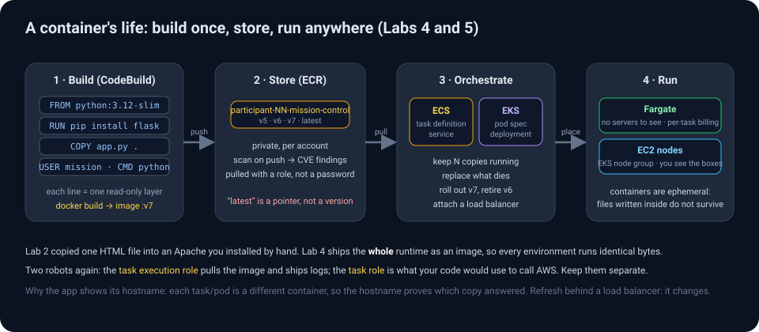

### The four places an image goes

| Step | Service | What happens |
|---|---|---|
| **Build** | CodeBuild | Reads a `Dockerfile`, executes it line by line in a throw-away container, produces an image. Your laptop is not involved. |
| **Store** | Amazon ECR (Elastic Container Registry) | A private, per-account registry. Images are pushed with a **tag** (`v3`) and identified precisely by a **digest** (`sha256:…`). Can scan images for known vulnerabilities. |
| **Orchestrate** | Amazon ECS (Elastic Container Service) | You declare "run 2 copies of this task definition"; ECS finds room, starts them, replaces them when they die, rolls out new versions without downtime. |
| **Run** | AWS Fargate | Serverless compute for containers: you specify CPU and memory per task and never see, patch or pay for an idle server. |

### ECS vocabulary (there are only five words)

| Word | Meaning |
|---|---|
| **Cluster** | A logical group for tasks and services. With Fargate it holds no servers; it is a namespace with a bill. |
| **Task definition** | The versioned recipe for one unit of work: image, CPU/memory, ports, environment variables, health check, logging, IAM roles. Every edit creates a new **revision**; revisions are immutable. |
| **Task** | One running instance of a task definition (one or more containers). Ephemeral: when it stops, it is gone. |
| **Service** | "Keep N tasks of revision R running, behind this load balancer, and replace them gracefully when I change R." Owns the rolling update and the **circuit breaker**. |
| **Task execution role / task role** | Two different robots. The **execution role** is what ECS uses to pull your image and ship logs *before* your code runs. The **task role** is what your code would use to call AWS APIs *while* it runs (this app needs none). |

### The app: Mission Control

A tiny Python web app whose only job is to tell you **where it is running**: container hostname, image version, uptime, a per-container hit counter and, on ECS, the task ID and availability zone. That makes everything an orchestrator does *visible*: refresh the page and watch the hostname change as a load balancer spreads requests; ship a new version and watch the version badge flip while the old tasks drain.

> [!NOTE]
> **Students, read the Dockerfile.** It is twelve lines and every line teaches something:
>
> ```dockerfile
> FROM public.ecr.aws/docker/library/python:3.12-slim   # base layer from the public ECR gallery (no Docker Hub rate limits)
> ARG APP_VERSION=dev                                   # a value passed in at build time…
> ENV APP_VERSION=$APP_VERSION PORT=8080 PYTHONUNBUFFERED=1   # …baked into the image as an env var
> WORKDIR /app
> COPY requirements.txt .
> RUN pip install --no-cache-dir -r requirements.txt    # dependencies first: this layer is cached until requirements change
> COPY app.py .                                          # code last: changes here rebuild only this thin layer
> RUN useradd --system --no-create-home mission && chown -R mission /app
> USER mission                                           # never run a web app as root
> EXPOSE 8080
> HEALTHCHECK … CMD python -c "…urlopen('http://127.0.0.1:8080/health')…"
> CMD ["python", "app.py"]
> ```

---

## Part 1 · Get the app

Download **[`lab4-ecs/app.zip`](../lab4-ecs/app.zip)** (or the folder [`lab4-ecs/app/`](../lab4-ecs/app/)). Contents:

```
app/
├── Dockerfile          ← how to build the image (above)
├── app.py              ← the web app (Flask, ~120 lines, heavily commented)
├── requirements.txt    ← flask, pinned
├── buildspec.yml       ← the CodeBuild recipe: log in to ECR, docker build, docker push
└── .dockerignore       ← keep the buildspec and zips out of the image
```

Read `buildspec.yml`:

```yaml
version: 0.2
phases:
  pre_build:
    commands:
      - ACCOUNT_ID=$(aws sts get-caller-identity --query Account --output text)
      - REGISTRY=${ACCOUNT_ID}.dkr.ecr.${AWS_DEFAULT_REGION}.amazonaws.com
      - REPO_URI=${REGISTRY}/${REPO_NAME}            # REPO_NAME comes from a project environment variable
      - IMAGE_TAG=v${CODEBUILD_BUILD_NUMBER}          # v1, v2, v3 … one immutable tag per build
      - aws ecr get-login-password --region ${AWS_DEFAULT_REGION} | docker login --username AWS --password-stdin ${REGISTRY}
  build:
    commands:
      - docker build --build-arg APP_VERSION=${IMAGE_TAG} -t ${REPO_URI}:${IMAGE_TAG} -t ${REPO_URI}:latest .
  post_build:
    commands:
      - docker push ${REPO_URI}:${IMAGE_TAG}
      - docker push ${REPO_URI}:latest
      - printf '{"image":"%s:%s"}\n' "${REPO_URI}" "${IMAGE_TAG}" > image.json
artifacts:
  files: [image.json]
```

Three things to notice: the build *logs in* to ECR with a short-lived token obtained through its IAM role (no password anywhere); the image gets **two** tags, a permanent `vN` and a moving `latest`; and the build number becomes the app's version string via `--build-arg`.

---

## Part 2 · Create your ECR repository

1. Console → **Elastic Container Registry** (search "ECR") → **Private registry → Repositories** → **Create repository**.
2. Repository name: **`participant-NN-mission-control`**.
3. Image tag mutability: **Mutable** (we re-point `latest` on every build; `vN` tags are never reused anyway). Encryption: default.
4. If an **Image scanning settings** section is shown, enable **Scan on push**. *(This account uses registry-level "enhanced" scanning through Amazon Inspector, so the repository-level switch may not appear; that is fine.)*
5. **Create repository**. Open it: it is empty, and the **View push commands** button shows what a laptop would run. We will let CodeBuild run the equivalent.

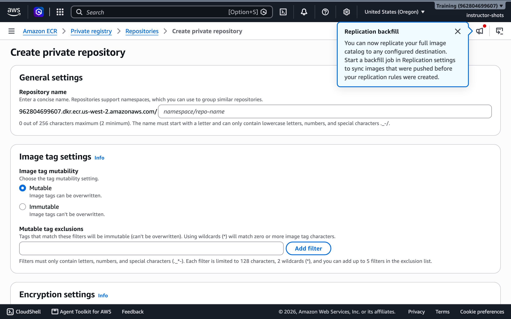

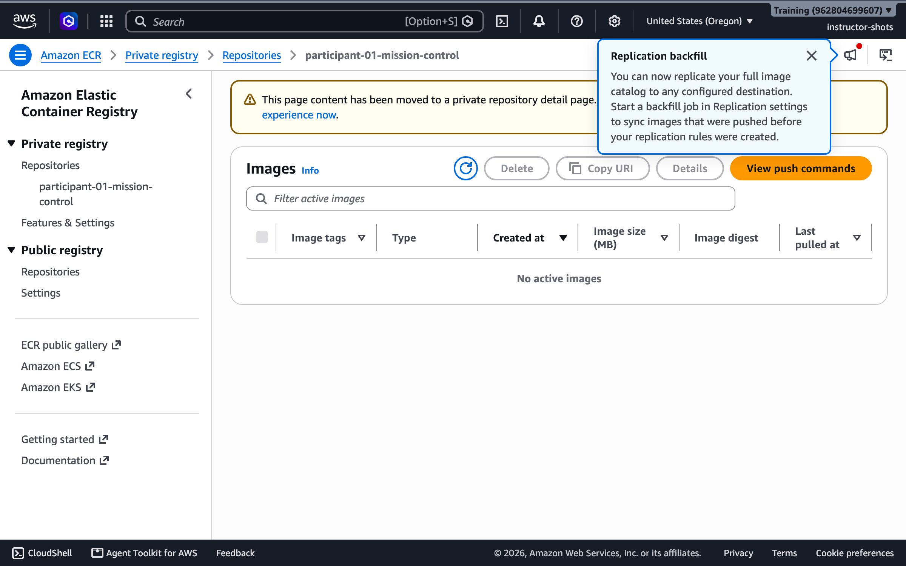

> ✅ **Checkpoint** — The repository URI is `962804699607.dkr.ecr.us-west-2.amazonaws.com/participant-NN-mission-control`. You will paste that URI (plus a tag) into a task definition later.

---

## Part 3 · Source bucket

1. **S3** → **Create bucket** → **`cicd-lab4-participant-NN`**, Oregon, defaults. (Versioning is not needed: we start builds by hand in this lab.)
2. Upload **`app.zip`** to the root of the bucket.

---

## Part 4 · The build project — and its first failure

1. **CodeBuild** → **Create build project**.
2. Project name **`participant-NN-image-build`**.
3. **Source:** Amazon S3 · bucket `cicd-lab4-participant-NN` · key `app.zip`.
4. **Environment:** Managed image · Amazon Linux · Standard · newest `aws/codebuild/amazonlinux-x86_64-standard:…` image · **Service role: New service role** (accept the name).
   - Expand **Additional configuration** and tick **Privileged** ("Enable this flag if you want to build Docker images"). *Building an image needs a Docker daemon inside the build container; this flag allows it.*
   - Still under Additional configuration → **Environment variables** → add **`REPO_NAME`** = **`participant-NN-mission-control`** (Plaintext).
5. **Buildspec:** Use a buildspec file (default name).
6. **Artifacts:** No artifacts. **Logs:** CloudWatch on.
7. **Create build project** → **Start build**.

The build fails in about 30 seconds.

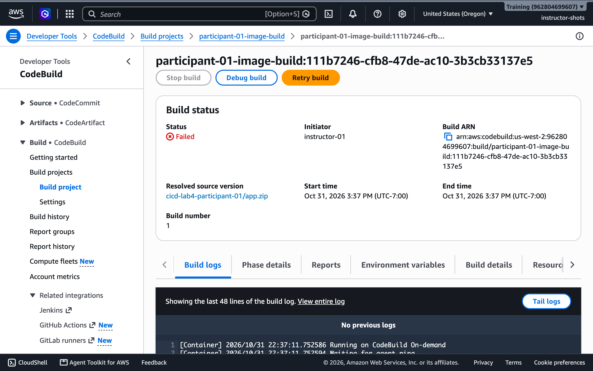

### 🔧 Troubleshooting exercise 1 — "not authorized to perform: ecr:GetAuthorizationToken"

Find out why and fix it without editing any file.

<details>
<summary>💡 Hint 1 — which phase, which command</summary>

**Phase details:** `PRE_BUILD` failed on the `aws ecr get-login-password … | docker login …` command. So the build could not *log in* to the registry. Who was trying to log in?
</details>

<details>
<summary>💡 Hint 2 — the sentence</summary>

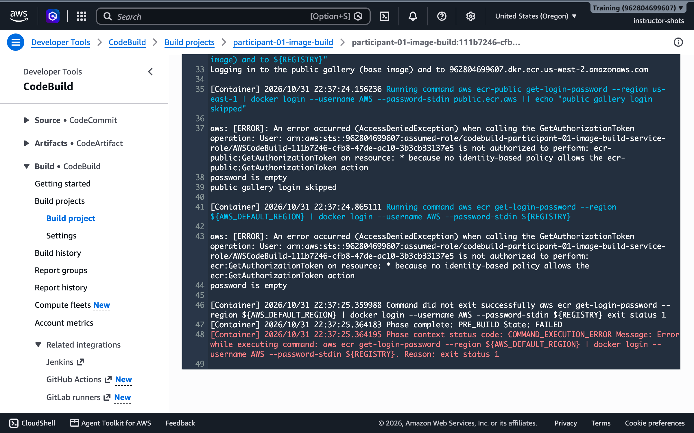

```
AccessDeniedException … User: arn:aws:sts::…:assumed-role/codebuild-participant-NN-image-build-service-role/…
is not authorized to perform: ecr:GetAuthorizationToken on resource: *
```

The principal is the build project's **service role** (robot #1 from Lab 2's map). The wizard gave it permission to read S3 and write logs, and nothing about ECR. Which robot, which verb, which resource: that is the whole diagnosis.
</details>

<details>
<summary>✅ Solution</summary>

IAM → Roles → `codebuild-participant-NN-image-build-service-role` → **Add permissions → Attach policies** → search **`AmazonEC2ContainerRegistryPowerUser`** → attach. (It grants login, pull and push to any repository in the account. Challenge D below asks you to scope it to *your* repository.)

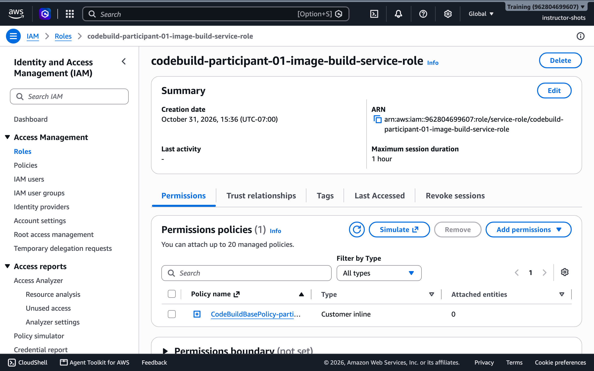

Wait ~15 s, then **Retry build** (or Start build). This time:

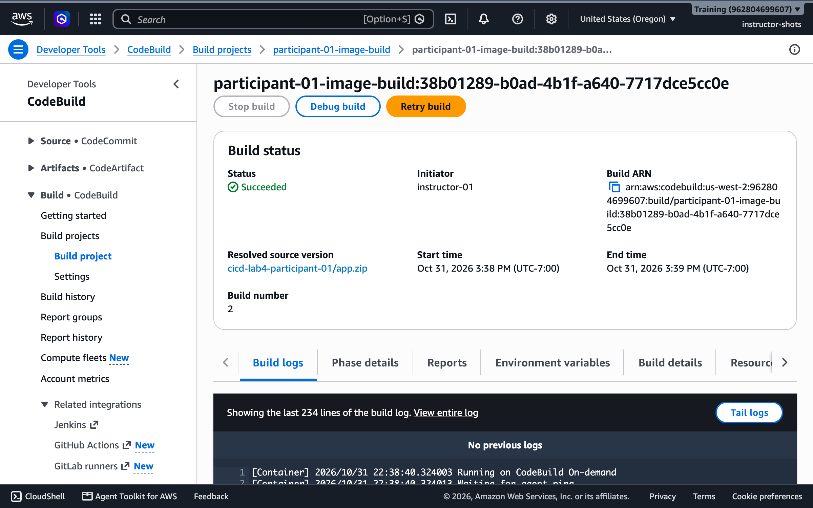

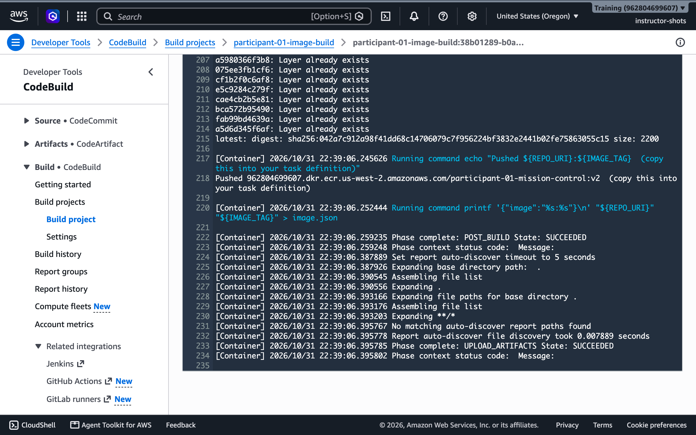

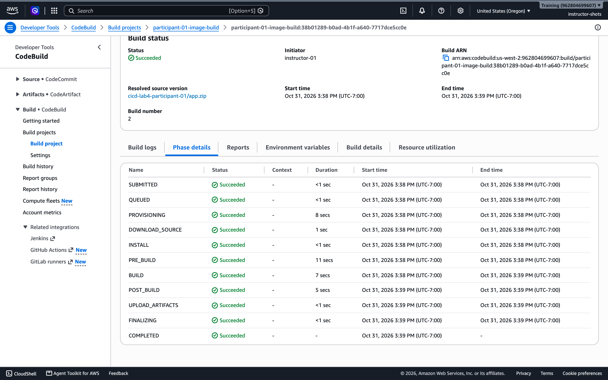

The log ends with layer pushes and `Pushed …/participant-NN-mission-control:v2`. **Your tag is `v<build number>`**, so if your first build failed your first image is `v2`. Write your tag down.

**The lesson:** CI that produces container images needs *registry* permissions in addition to source and log permissions. The error names the role; add the verb to the role.
</details>

### Look at what you built

ECR → your repository. One image, two tags (`latest`, `v2`), ~49 MB, a digest, and (after a minute) a vulnerability scan.

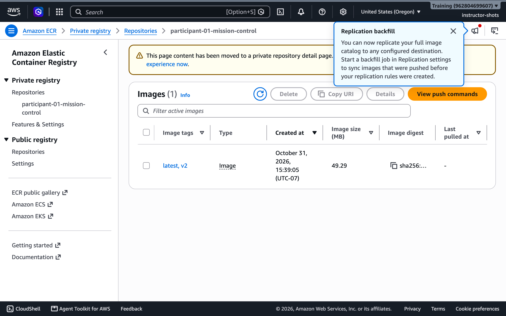

Click the image → **Vulnerabilities**. Scanning runs in the background and can take several minutes to report; a freshly rebuilt `python:3.12-slim` base may show zero findings, an older one a handful of low/medium CVEs inherited from Debian packages. Either way the point stands: most of an image's vulnerabilities come from layers you did not write, which is why teams rebuild images on a schedule even when their own code has not changed.

> [!TIP]
> **Build time.** Build 2 took ~35 s. Most of it was pulling the base image and `pip install`. Because the Dockerfile copies `requirements.txt` *before* `app.py`, a change to the app alone reuses the cached dependency layer. Order in a Dockerfile is a performance decision.

---

## Part 5 · ECS cluster

1. **Elastic Container Service** → **Clusters** → **Create cluster**.
2. Cluster name **`participant-NN-cluster`**. Infrastructure: **AWS Fargate (serverless)** only. Leave monitoring off. **Create**.

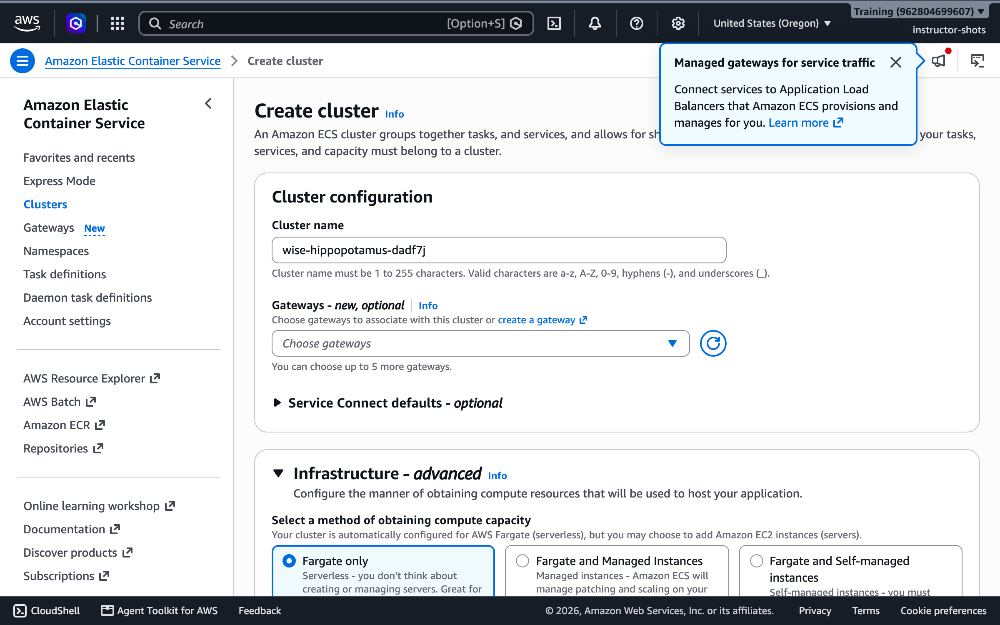

> ✅ **Checkpoint** — Clusters list shows yours with 0 services, 0 tasks. You will also see fourteen other students' clusters; leave them alone.

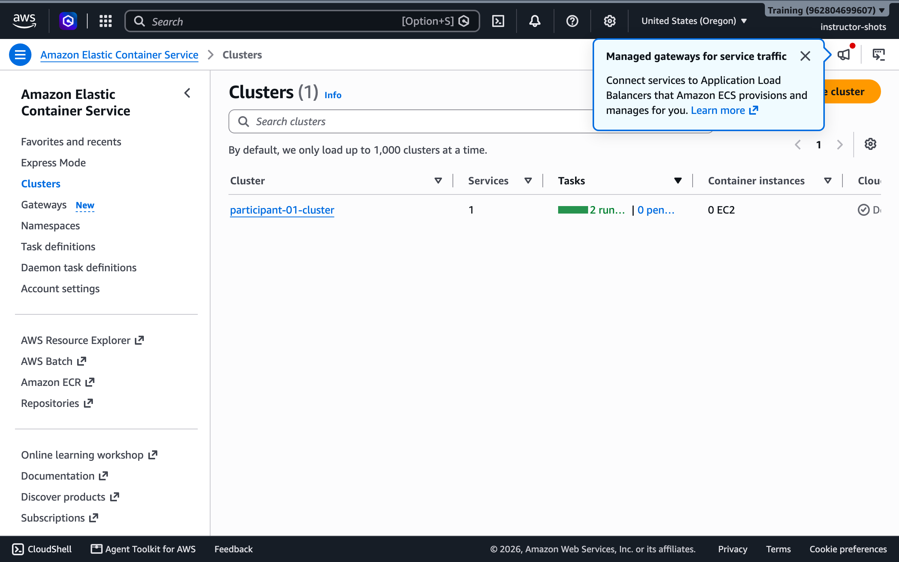

---

## Part 6 · Task definition (the recipe)

1. ECS → **Task definitions** → **Create new task definition** (not "with JSON").
2. **Task definition family:** `participant-NN-mission-control`.
3. **Infrastructure requirements:** Launch type **AWS Fargate** · OS/Architecture **Linux/X86_64** · Network mode **awsvpc** · **Task size: 0.25 vCPU, 0.5 GB** · **Task role: none** · **Task execution role: `ecsTaskExecutionRole`** (it already exists in this account; `cicd-lab4-task-execution-role` also works).

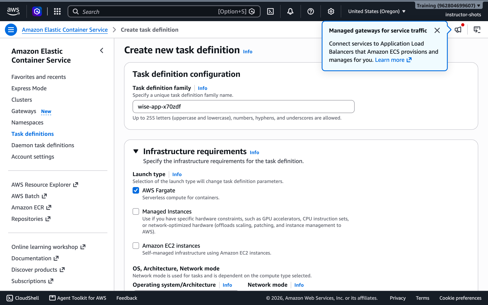

4. **Container 1:**
   - Name **`web`** · Image URI **`962804699607.dkr.ecr.us-west-2.amazonaws.com/participant-NN-mission-control:v2`** (your tag!) · Essential container: Yes
   - Port mappings: container port **8080**, TCP, port name `web-8080`, app protocol HTTP
   - **Environment variables:** `MISSION_NAME` = `Artemis-NN` · `APP_COLOR` = `#22C55E`
   - **Logging:** keep **Use log collection** ticked (Amazon CloudWatch; the default log group name `/ecs/participant-NN-mission-control` is fine)
   - Expand **HealthCheck** → Command:
     ```
     CMD-SHELL, python -c "import urllib.request,sys; sys.exit(0 if urllib.request.urlopen('http://127.0.0.1:8080/health', timeout=2).status==200 else 1)"
     ```
     Interval 15 · Timeout 5 · Start period 10 · Retries 3.

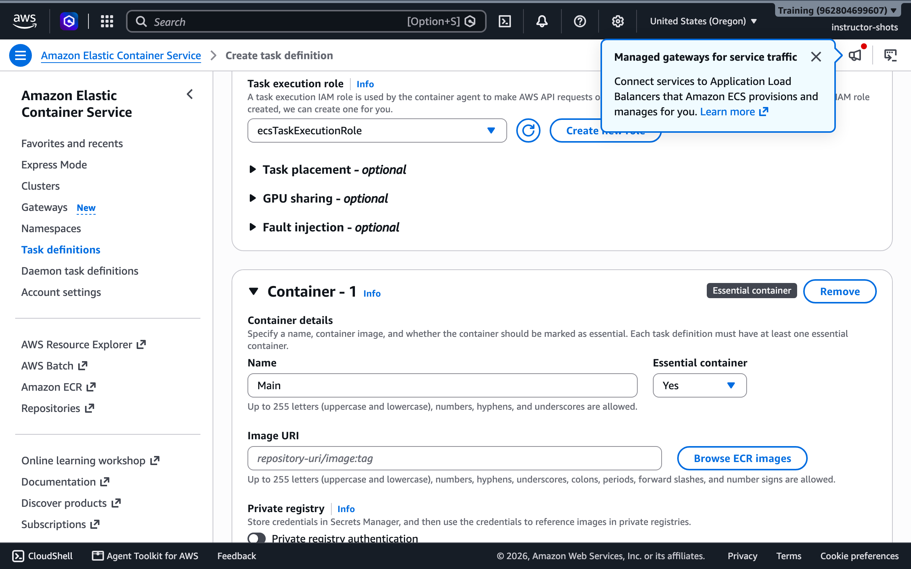

5. Leave storage, monitoring and tags alone → **Create**.

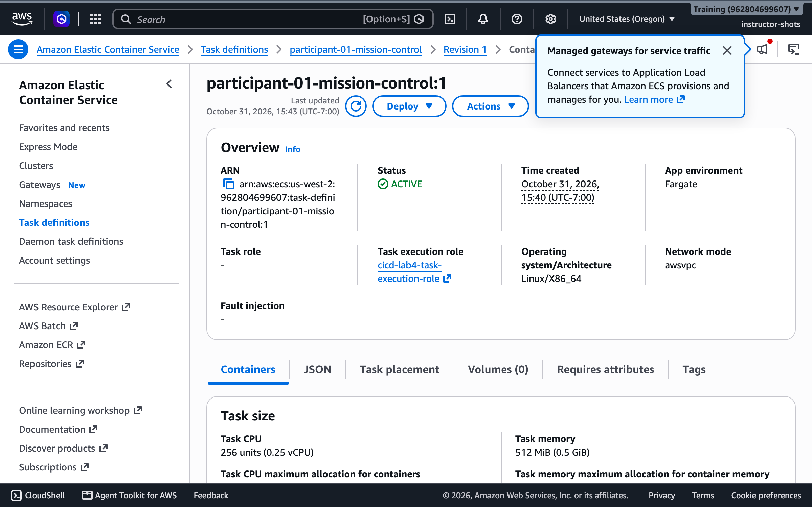

> ✅ **Checkpoint** — `participant-NN-mission-control:1` exists. The `:1` is the **revision**. You will never edit it; you will create `:2`.

> [!NOTE]
> **Why a health check in the recipe?** Without it ECS considers a task healthy the moment the process starts. With it, a task is only *healthy* once `/health` answers 200, and a task whose health check fails three times is killed and replaced. The service's rolling update waits for *healthy*, not merely *running*. This is the Lab 3 "green is not correct" lesson built into the platform.

---

## Part 7 · Service (keep two running)

1. Your cluster → **Services** tab → **Create**.
2. **Environment:** Compute options **Launch type** · Launch type **FARGATE** · Platform version LATEST.
3. **Deployment configuration:** Application type **Service** · Family `participant-NN-mission-control` · Revision **1 (LATEST)** · Service name **`participant-NN-svc`** · Desired tasks **2**.
   - Expand **Deployment options**: Rolling update · Min running 100 % · Max running 200 % · **Deployment failure detection: use the Amazon ECS deployment circuit breaker, with Rollback on failures** (both ticked).
4. **Networking:** default VPC · all four default subnets · Security group **Create a new security group** named **`participant-NN-mission-sg`** · inbound rule **Custom TCP, port 8080, Anywhere (0.0.0.0/0)** · **Public IP: Turned on**.
5. Leave Load balancing **off** for now (Challenge C adds one). → **Create**.

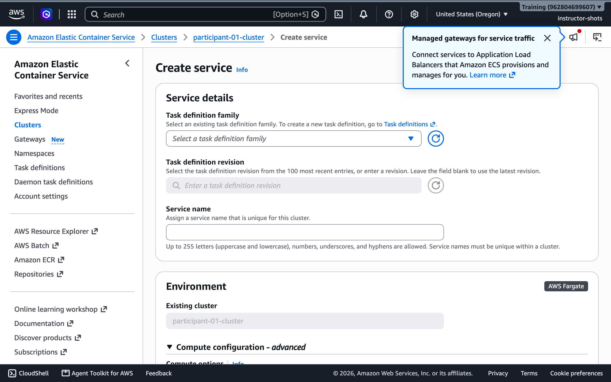

ECS now provisions two tasks: each gets its own network interface and public IP (that is what `awsvpc` mode means), pulls the image, starts, and waits for the health check.

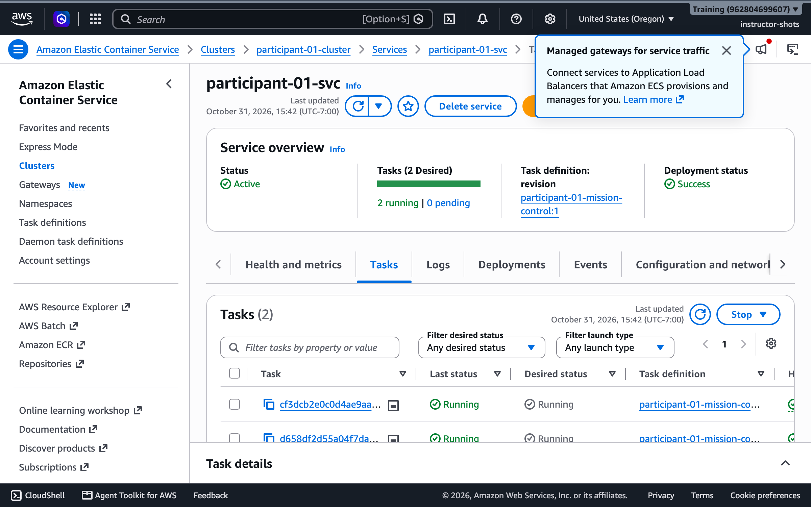

6. **Find a task's public IP:** Tasks tab → click a task → **Configuration** → *Public IP*. Open **`http://<public IP>:8080/`**.

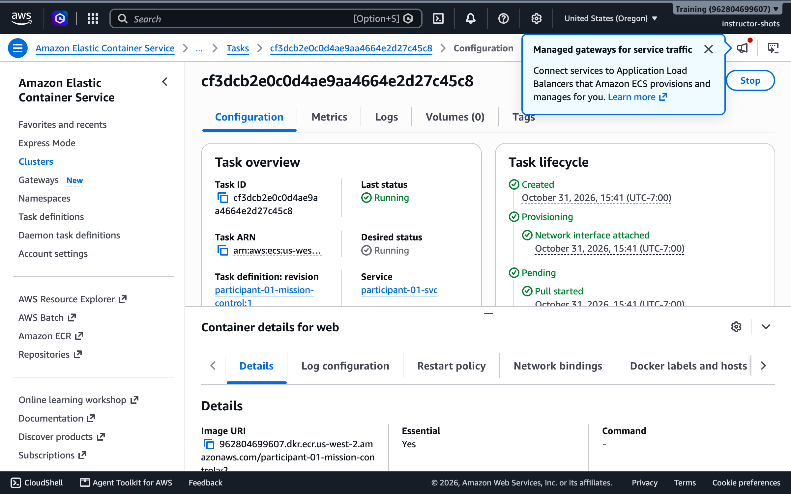

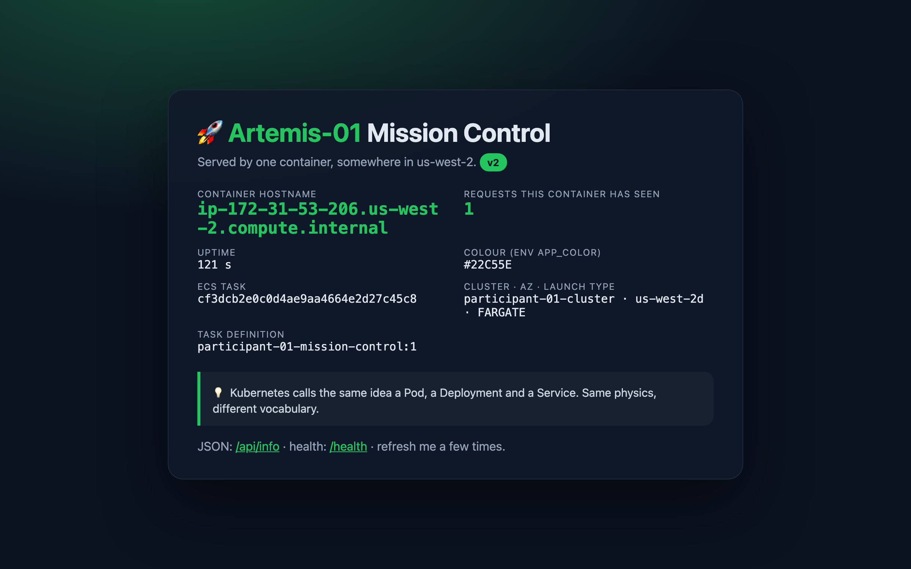

7. Open the **second** task's IP too. Different hostname, different hit counter, different availability zone. Two containers from one image share nothing at runtime.

8. **Logs** tab on a task: your app's request log, streamed to CloudWatch by the execution role. The `/health` lines every 15 s are the container health check.

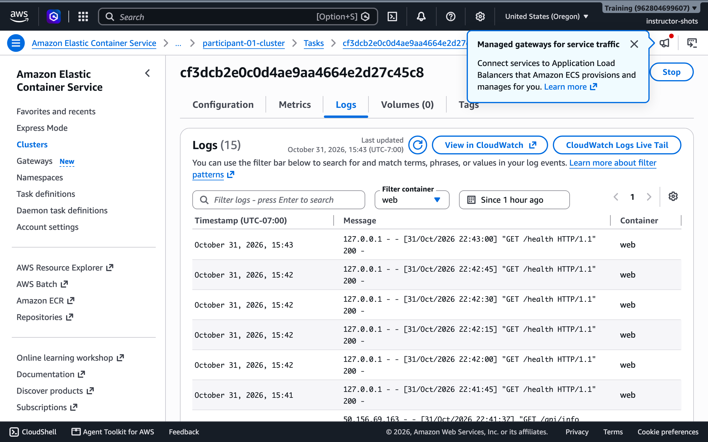

The **Health and metrics** tab shows the service's view: desired vs running, and CPU/memory per task.

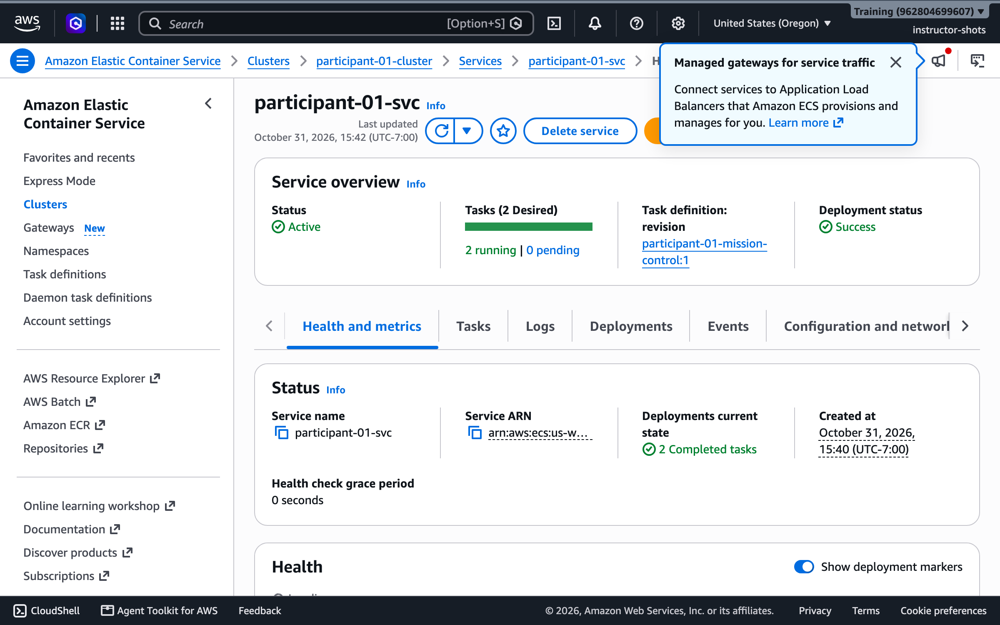

> ✅ **Checkpoint** — Service shows *2 running / 2 desired*, Deployment status *Success*; both IPs serve the page with the badge **v2**.

---

## Part 8 · Ship v3 with a rolling update

The whole point of the pipeline is that v3 is cheap. Three steps: rebuild, new revision, update service.

1. **Change the app.** In `app.py` change the rocket emoji in the `<h1>` to a satellite (`🛰️`) and add a line to the `FACTS` list, for example `"v3 shipped by a rolling update: a new task started, passed its health check, then the old one was stopped."`. Re-zip (from inside `app/`: `zip -r app.zip Dockerfile app.py requirements.txt buildspec.yml .dockerignore`), upload to S3, **Start build**. Note the new tag (`v3`).

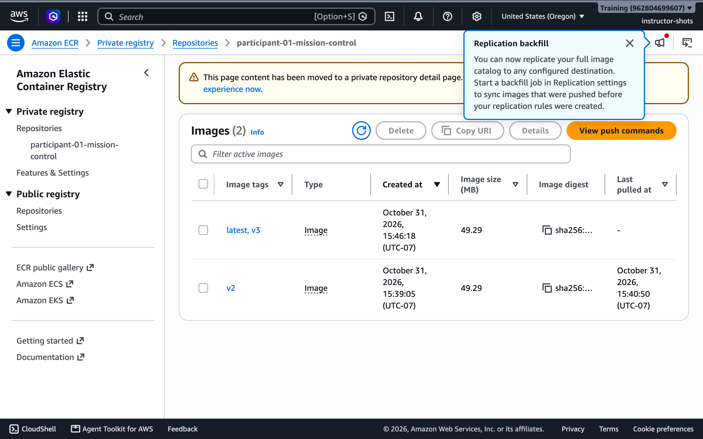

2. **New task definition revision.** Task definitions → your family → select revision 1 → **Create new revision**. Change the image tag to **`:v3`** and `APP_COLOR` to **`#F59E0B`** → **Create**. You now have `:2`.

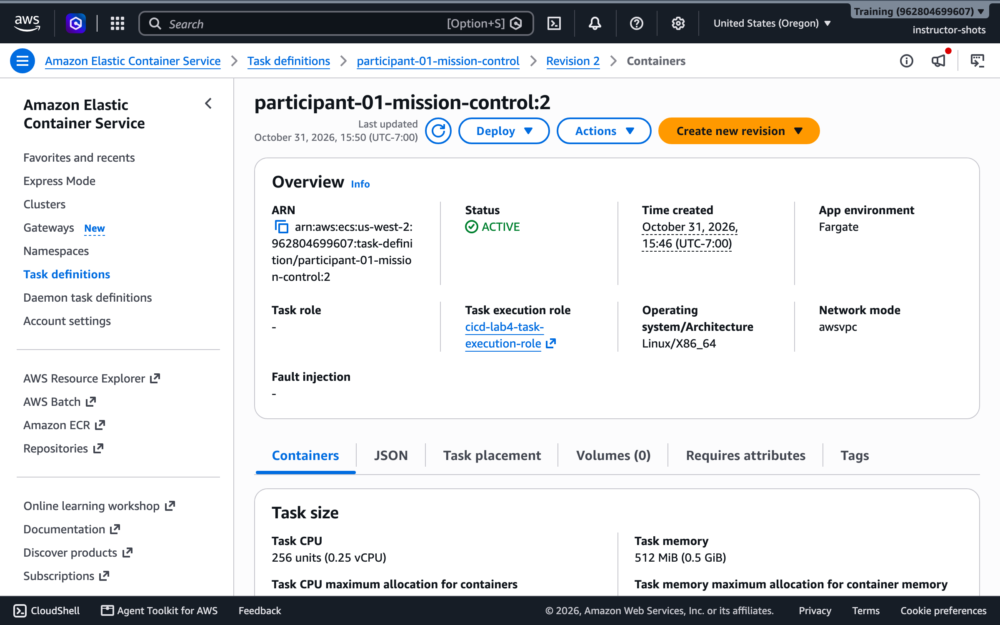

3. **Update the service.** Cluster → service → **Update service** → Revision **2 (LATEST)** → **Update**. Go to the **Deployments** tab and watch.

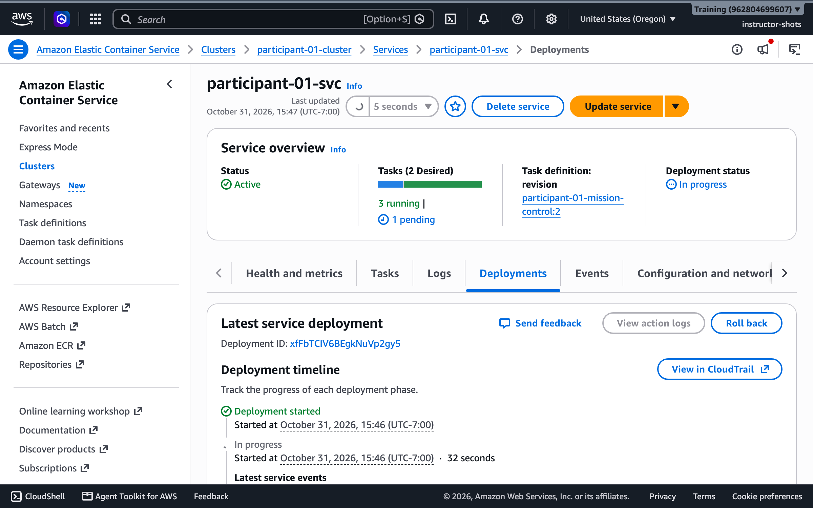

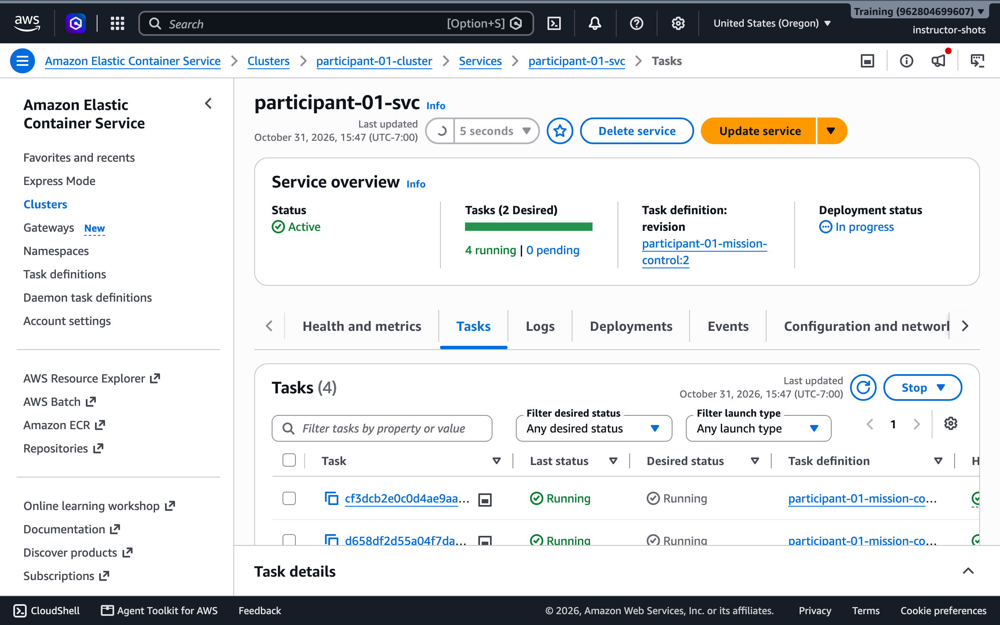

What you are seeing: ECS starts **two new tasks** (max 200 %) with revision 2, waits for their health checks, then stops the two old ones (never below 100 %). At no moment were there fewer than two healthy tasks. The new tasks have **new public IPs**; find one and open it:

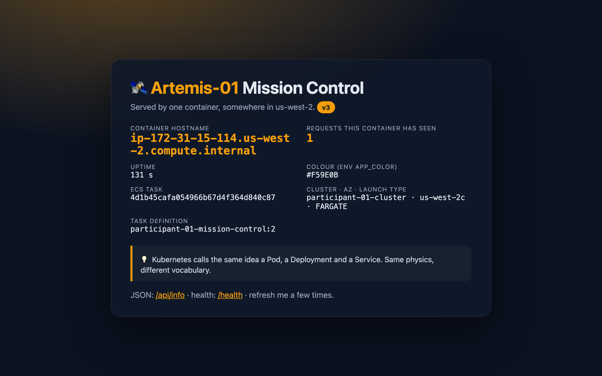

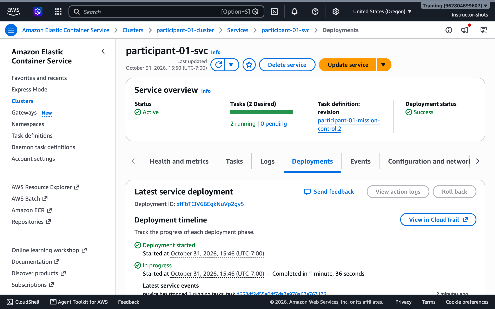

> [!TIP]
> **Config vs code.** Changing `APP_COLOR` did not need a rebuild: it lives in the task definition, not the image. Changing the HTML did. Teams push *configuration* into task definitions (or Parameter Store / Secrets Manager references) so that the same image can run in dev, test and prod.

---

## Part 9 · Exercises

### Exercise A · Deploy an image that does not exist

Create revision **3** of the task definition with the tag **`:v99`** and update the service to it. Then investigate.

<details>
<summary>💡 Hint 1 — where to look</summary>

Service → **Tasks** → change the filter to *Desired status: Stopped*. Click a stopped task. The **Stopped reason** says why. The **Deployments** tab and **Events** tab show the service's side of the story.
</details>

<details>
<summary>💡 Hint 2 — read it</summary>

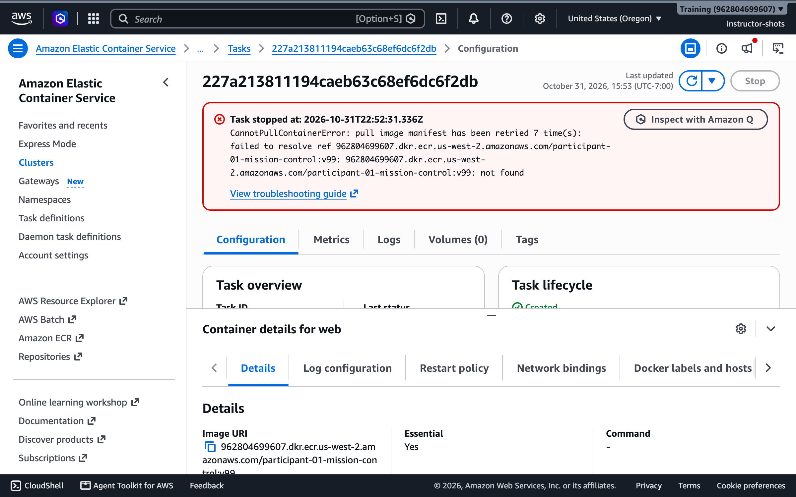

`CannotPullContainerError: … participant-NN-mission-control:v99: not found`. The **execution role** could log in (unlike Part 4), the repository exists, but the *tag* does not. ECS keeps trying new tasks; each one fails the same way.
</details>

<details>
<summary>✅ Solution & what the circuit breaker does</summary>

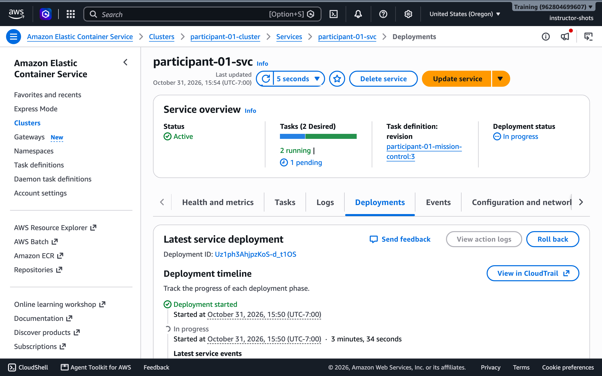

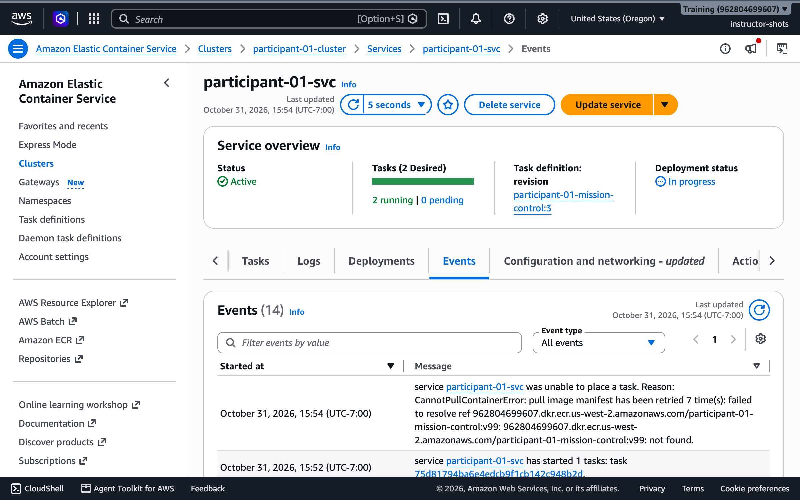

Because you enabled the **deployment circuit breaker with rollback**, ECS counts consecutive failed task launches and, after the threshold (about ten launches, several minutes), marks the deployment **Failed** and **rolls back to revision 2** by itself. Your v3 tasks were never stopped: the rollout never reached the "stop old tasks" step because no new task ever became healthy.

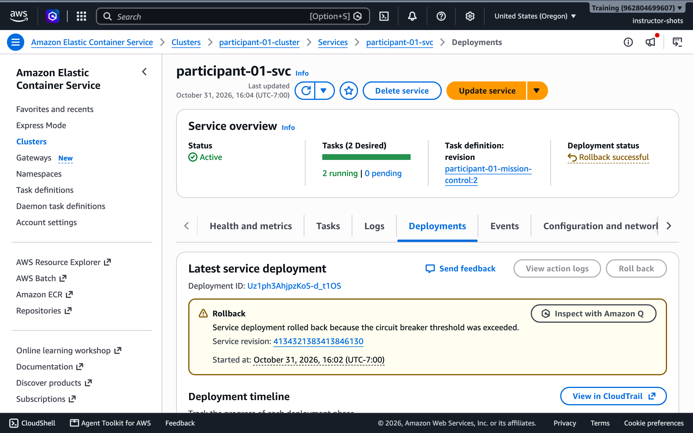

If you do not want to wait, fix it yourself: **Update service** → revision 2 → Update.

**The lesson:** a rolling update with health checks and a circuit breaker turns "we deployed a broken image" from an outage into a log entry. Compare Lab 2, where a failed in-place deploy took the site down.
</details>

### Exercise B · Healthy but unreachable

EC2 → Security Groups → `participant-NN-mission-sg` → remove the inbound 8080 rule. Refresh the page: it hangs. Now look at the service: still *2 running*, health *Healthy*, deployment *Success*.

<details>
<summary>✅ Explanation</summary>

The container health check runs *inside* the task against `127.0.0.1`; it proves the process answers, not that the internet can reach it. Reachability is a network property (security groups, routing, load balancer health checks). Put the rule back. In Challenge C the load balancer's own health check adds the outside-in view.
</details>

### Exercise C · Crash a container and watch ECS replace it

Open `http://<task IP>:8080/crash`. The app calls `os._exit(1)`.

<details>
<summary>✅ What happens</summary>

The browser gets no response (the process died). Within a minute or two the task shows **Stopped**, reason *Essential container in task exited*, exit code 1 (it sits in *Deprovisioning* a little longer if a load balancer has to deregister it first). The service notices *running < desired* and launches a replacement with a **new task ID and IP**.

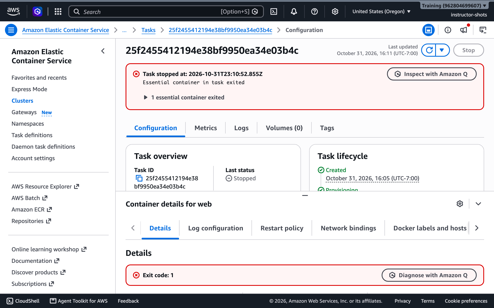

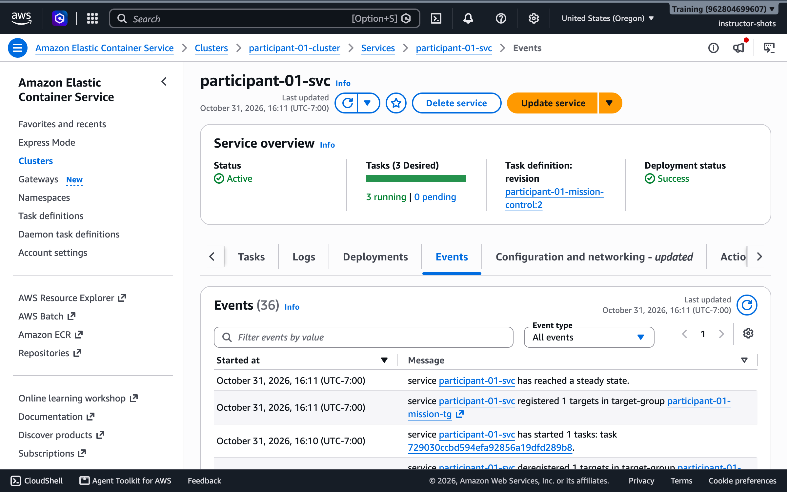

Nobody paged anyone. That is the "supervise" job of an orchestrator; Kubernetes does the same with restarts and ReplicaSets (Lab 5).
</details>

### Challenge D · Put a load balancer in front and scale to three

Right now each task has its own IP and users would have to know them. Give the service one stable address.

<details>
<summary>💡 Hint 1 — the pieces</summary>

An **Application Load Balancer** (internet-facing, its own security group allowing port 80) → a **listener** on port 80 → a **target group** of type **IP** on port 8080 with health check path `/health`. Then **Update service**: attach the target group to container `web` port 8080 and set desired tasks to 3. The ALB's security group must be allowed into the task security group on 8080 (your rule already allows anywhere).
</details>

<details>
<summary>💡 Hint 2 — console path</summary>

EC2 → Load balancers → Create → Application Load Balancer, name `participant-NN-mission-alb`, all four subnets, new SG `participant-NN-alb-sg` with HTTP 80 from anywhere; under Listeners → "Create target group" (target type **IP addresses**, protocol HTTP 8080, health check `/health`), do **not** register targets by hand (ECS will). Back in ECS: service → Update → Load balancing → Application Load Balancer → use existing → pick the listener and target group → Desired tasks 3.
</details>

<details>
<summary>✅ Solution</summary>

After the update settles, Target groups shows **3 healthy** IP targets, and the ALB DNS name serves the page. Refresh it a dozen times: the **hostname rotates** across three containers while the URL stays the same.

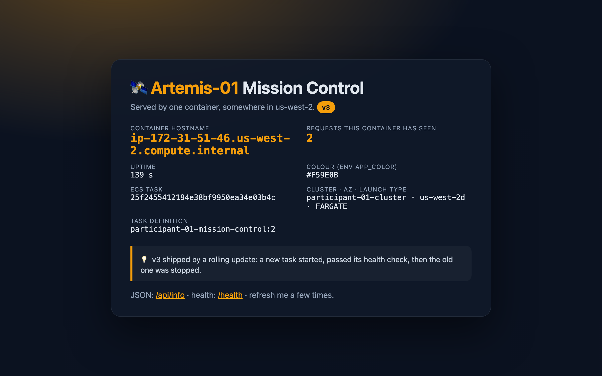

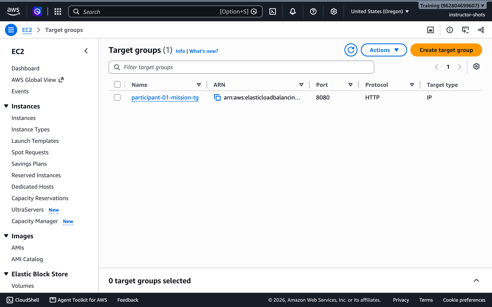

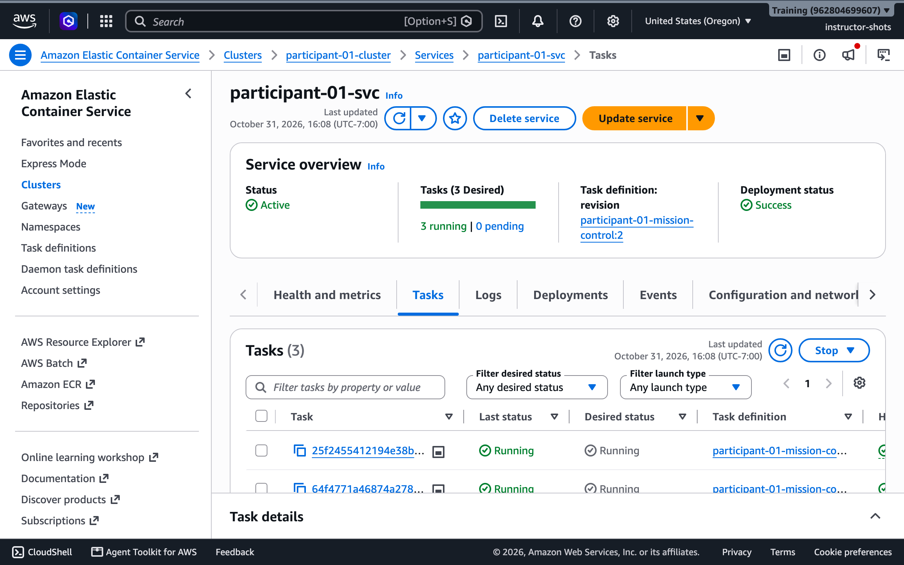

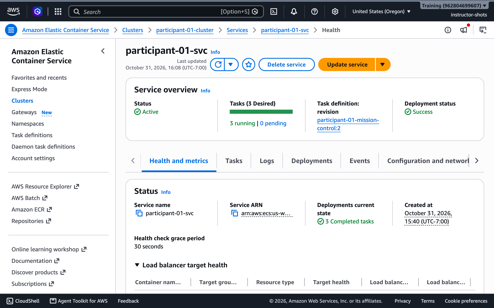

Two health checks now guard the service: the container's own (`/health` from inside) and the target group's (`/health` from the ALB). A task failing the second is deregistered *and* replaced.

**Cost note:** an ALB costs about US$0.02 per hour plus traffic. Delete it in the clean-up.
</details>

### Challenge E · Least privilege for the build role

Replace `AmazonEC2ContainerRegistryPowerUser` on the CodeBuild role with an inline policy that allows `ecr:GetAuthorizationToken` on `*` and push/pull actions only on **your** repository ARN.

<details>
<summary>✅ Solution</summary>

```json
{
  "Version": "2012-10-17",
  "Statement": [
    { "Effect": "Allow", "Action": "ecr:GetAuthorizationToken", "Resource": "*" },
    { "Effect": "Allow",
      "Action": ["ecr:BatchCheckLayerAvailability", "ecr:InitiateLayerUpload", "ecr:UploadLayerPart",
                 "ecr:CompleteLayerUpload", "ecr:PutImage", "ecr:BatchGetImage", "ecr:GetDownloadUrlForLayer"],
      "Resource": "arn:aws:ecr:us-west-2:962804699607:repository/participant-NN-mission-control" }
  ]
}
```

`GetAuthorizationToken` is registry-wide by nature (it issues the login token); everything else can be pinned to one repository. Students cannot detach the managed policy in this account; ask the instructor, or verify the inline policy alone is sufficient by reading both.
</details>

---

## Part 10 · Clean up (please do this; Fargate bills by the second)

In this order:

1. ECS → cluster → service → **Delete service** (tick *Force delete*). Wait until it is gone.
2. ECS → cluster → **Delete cluster**.
3. If you did Challenge D: EC2 → Load balancers → delete `participant-NN-mission-alb`; Target groups → delete `participant-NN-mission-tg`; Security groups → delete `participant-NN-alb-sg`.
4. EC2 → Security groups → delete `participant-NN-mission-sg` (after the tasks are gone).
5. ECS → Task definitions → your family → select all revisions → **Deregister** (then *Delete* if offered).
6. ECR → repository → select all images → **Delete**; then delete the repository.
7. CodeBuild → delete `participant-NN-image-build`. CloudWatch → Log groups → delete `/aws/codebuild/participant-NN-image-build` and `/ecs/participant-NN-mission-control`.
8. S3 → empty and delete `cicd-lab4-participant-NN`.
9. IAM roles stay; the instructor removes them.

---

## Part 11 · What you learned

- An **image** is built once, from a Dockerfile, by CI; it carries its runtime with it; it is tagged per build and identified by digest.
- A **registry** (ECR) stores images privately, scans them, and is accessed through IAM roles with short-lived tokens.
- ECS separates the **recipe** (task definition, immutable revisions) from the **intent** (service: how many, how to roll) from the **runtime** (tasks on Fargate).
- **Two roles:** execution role (pull + logs, before your code) vs task role (your code's AWS access).
- **Rolling updates** start new before stopping old; **health checks** decide what "ready" means; the **circuit breaker** turns a bad image into an automatic rollback.
- **Healthy ≠ reachable** (Exercise B) and **orchestrators self-heal** (Exercise C).
- **Config lives in the task definition**, code lives in the image.

### Quiz yourself

<details>
<summary>1. A task stops with CannotPullContainerError. Name three different root causes and how you would tell them apart.</summary>

(a) Tag does not exist – message says `not found`; (b) the execution role lacks ECR permissions – message says `AccessDenied`/`not authorized`; (c) the task has no route to ECR – message mentions a timeout / `ResourceInitializationError` (tasks in private subnets without NAT or VPC endpoints). The *text* of the stopped reason differs in each case.
</details>

<details>
<summary>2. You changed an environment variable. Do you need a new image, a new task definition revision, or both?</summary>

A new revision only. Images are for code; task definitions are for configuration. (Lab 4 Part 8 changed `APP_COLOR` this way.)
</details>

<details>
<summary>3. Why does the service never drop below two healthy tasks during an update?</summary>

Min running 100 % and max 200 %: ECS may add tasks up to double the desired count but may not remove any until replacements are healthy. Health is defined by the task definition's health check (and the target group's, if attached).
</details>

<details>
<summary>4. Why is `latest` a bad tag to put in a task definition?</summary>

It is a moving pointer: the revision would deploy whatever was pushed last, so two deployments of "the same" revision can run different code, and rollback becomes meaningless. Use `vN` (or a digest).
</details>

<details>
<summary>5. Which two IAM roles were involved in running your task, and what would break if each were missing?</summary>

Execution role missing ECR/logs permissions: task never starts (pull or log-configuration error). Task role: nothing breaks for this app because it calls no AWS APIs; an app that reads S3 would get AccessDenied at run time.
</details>

**Next:** [Lab 5 – Kubernetes on EKS: the same ideas with different words](lab5-eks.md)
