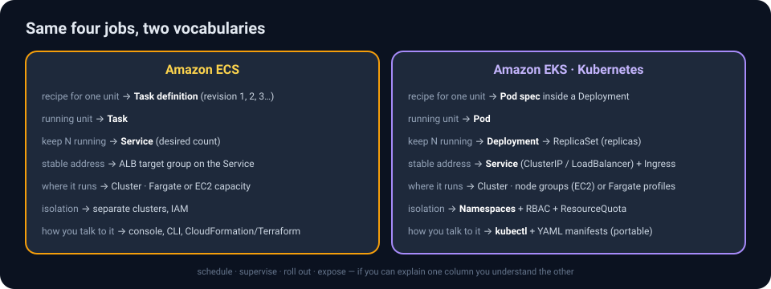
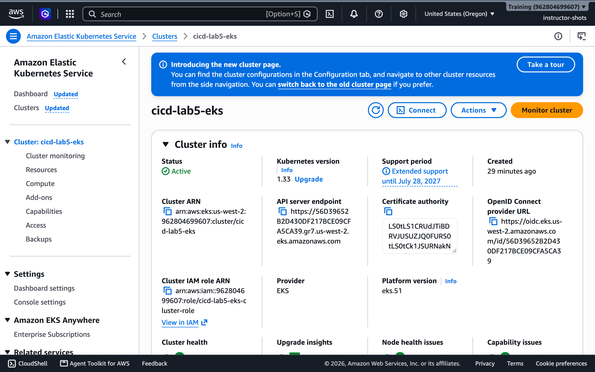
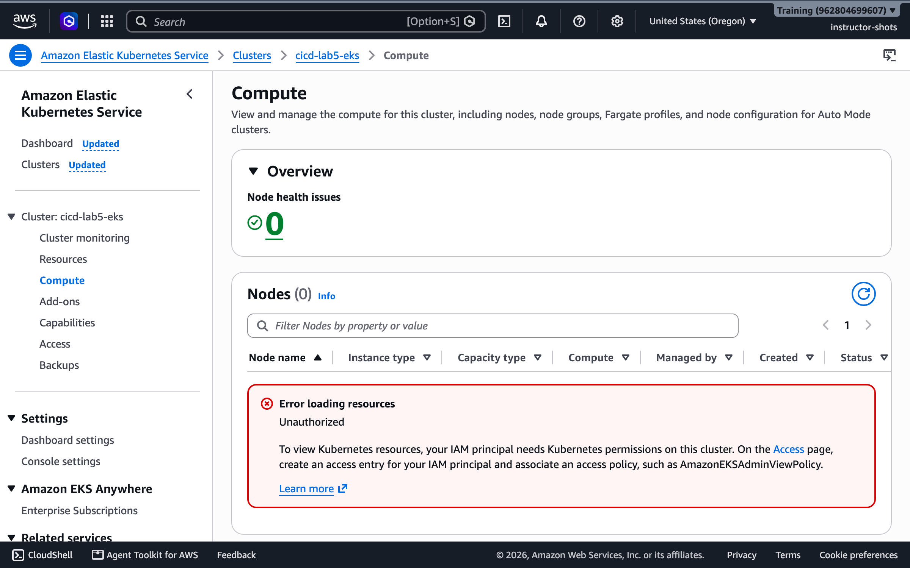
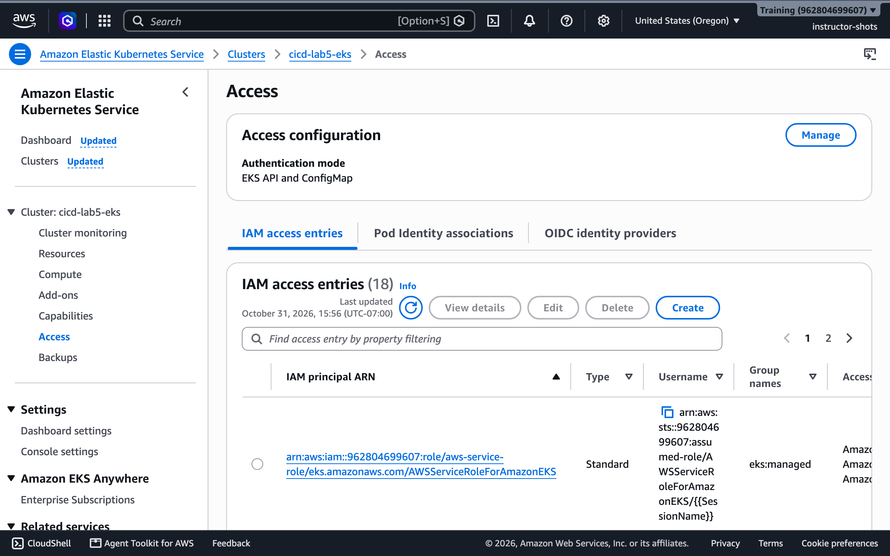
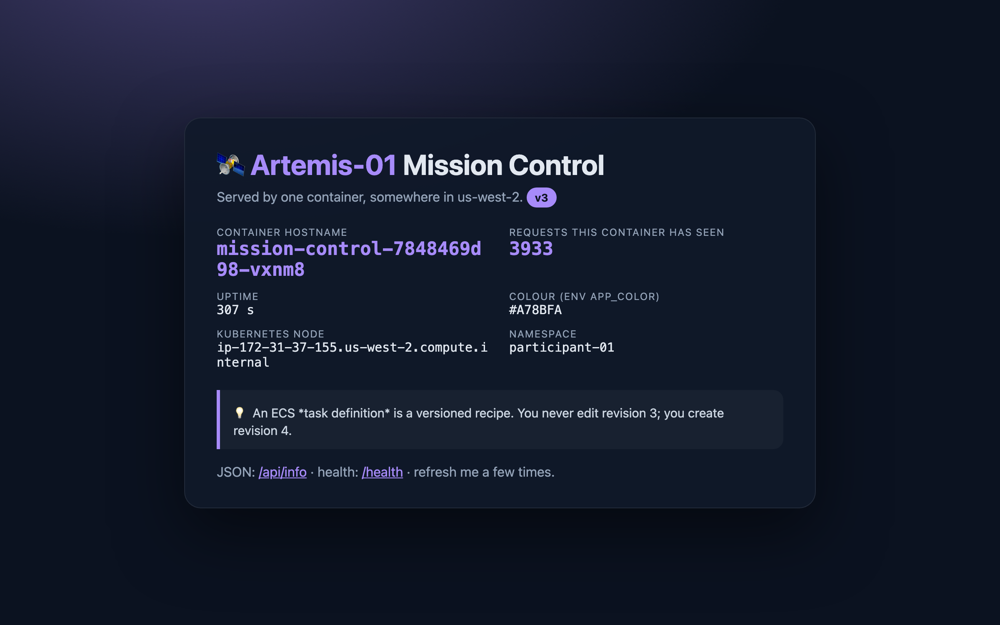
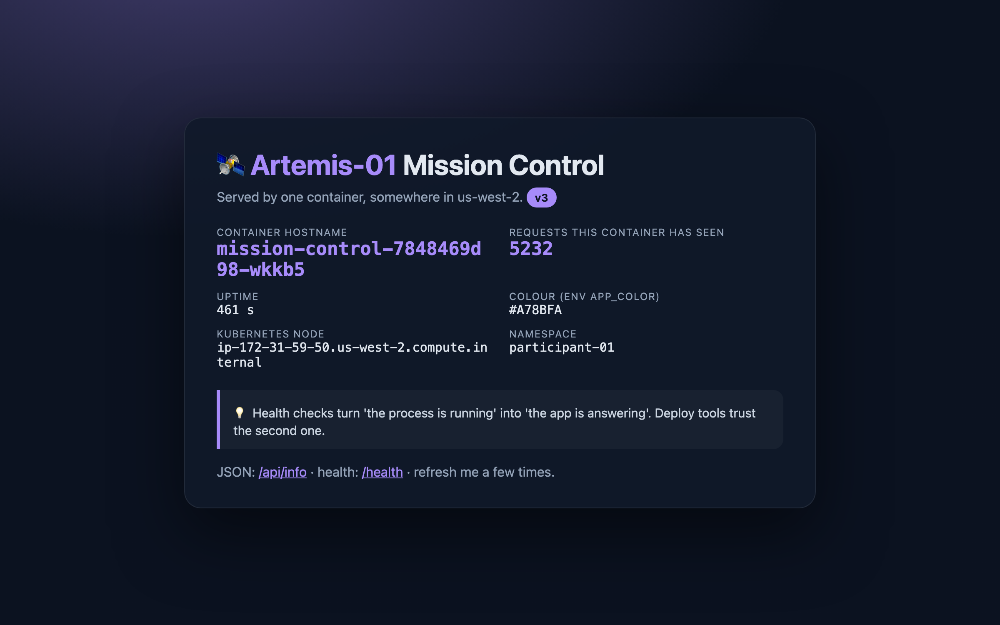

# Lab 5 · Kubernetes on EKS — the same ideas with different words

> *Yesterday's orchestrator was ECS. Today's is Kubernetes, the one the rest of the industry speaks. You will run the exact same Mission Control image, on a cluster the whole class shares, inside a namespace that is yours alone. Every concept from Lab 4 reappears under a new name: that is the point.*

| | |
|---|---|
| **Time** | 80–100 minutes (core ≈ 55, challenges ≈ 35) |
| **Difficulty** | Intermediate. Lab 4 first (you reuse its image). No Kubernetes experience assumed. |
| **AWS services** | Amazon EKS (one cluster, created by the instructor), AWS CloudShell, Amazon ECR, Elastic Load Balancing, CloudWatch |
| **Tools** | `kubectl` – already installed in CloudShell. Nothing on your laptop. |
| **You will build** | A Deployment with two Pods of your image, a Service with an internet-facing load balancer, a rolling update, a rollback, and (challenge) an autoscaler that reacts to load |
| **You will break & fix** | A Pod that cannot pull its image · a scale-up the namespace quota refuses · a peek at a neighbour's namespace that RBAC refuses |
| **Handout** | **"ECS or EKS? The honest comparison"** and the Kubernetes rows of the **triage playbook** in the [class handout](../docs/index.html) |

> [!IMPORTANT]
> **Your namespace is your sandbox.** The cluster `cicd-lab5-eks` is shared by everyone. Each of you has a namespace named after your user (`participant-NN`) with **full rights inside it and none outside it**. Every command below runs in your namespace; if you forget to set it, Kubernetes will politely refuse (you will see this on purpose in Part 2).
>
> **Region:** us-west-2, as always.

---

## Part 0 · The idea in five minutes

### Kubernetes in one paragraph

Kubernetes is a control loop. You hand it a **desired state** written in YAML ("two copies of this image, exposed on port 80") and a set of controllers works continuously to make reality match: scheduling Pods onto nodes, restarting them when they die, adding replicas when you ask, swapping versions one Pod at a time. You never tell it *how*; you tell it *what*, and you watch it converge. Everything you did by clicking in Lab 4 you do here with `kubectl apply -f file.yaml`.



### The translation table (keep it open)

| You did this in Lab 4 (ECS) | Today it is called | Defined in |
|---|---|---|
| Task definition | **Pod spec** (the `template:` inside a Deployment) | `01-deployment.yaml` |
| Task | **Pod** | created for you by the Deployment |
| Service with *desired count 2* | **Deployment** with `replicas: 2` (it manages a **ReplicaSet**) | `01-deployment.yaml` |
| Service + ALB target group | **Service** of `type: LoadBalancer` | `02-service.yaml` |
| Container health check | **readinessProbe** (gates traffic) and **livenessProbe** (triggers restart) | `01-deployment.yaml` |
| Rolling update, circuit breaker, "Update service" | `kubectl set image`, `kubectl rollout status / undo` | commands |
| Cluster per team | **Namespace** per student + **RBAC** + **ResourceQuota** | made by the instructor |
| Fargate | EC2 **nodes** in a managed node group (two `t3.large`), shared by the class | made by the instructor |

### What the instructor built for you



- One EKS cluster, Kubernetes 1.33, two worker nodes, the usual add-ons (networking, DNS, metrics).
- An **access entry** that maps your IAM user to a Kubernetes group named `participant-NN`.
- A **namespace** `participant-NN`, a **Role** granting that group everything inside it, a **ClusterRole** allowing read-only `get nodes`, a **ResourceQuota** (max 12 pods, 2 load balancers, 2 CPU / 3 GiB requested) and a **LimitRange** (default requests/limits for containers that forget to set them).





---

## Part 1 · Open CloudShell and connect kubectl

1. In the console's top bar click the **CloudShell** icon (the `>_` terminal icon, or the *CloudShell* link in the bottom-left). A Linux shell opens in your browser, already signed in as **you** (`participant-NN`), with the AWS CLI and `kubectl` pre-installed. First start takes about a minute.
2. Point `kubectl` at the class cluster and make your namespace the default:

```bash
aws eks update-kubeconfig --region us-west-2 --name cicd-lab5-eks
kubectl config set-context --current --namespace participant-NN      # ← your number
kubectl version --client
kubectl get nodes
```

<details>
<summary>Expected output</summary>

```
Client Version: v1.36.2-eks-8f14419
Added new context arn:aws:eks:us-west-2:962804699607:cluster/cicd-lab5-eks to /home/cloudshell-user/.kube/config
NAME                                          STATUS   ROLES    AGE   VERSION
ip-172-31-37-155.us-west-2.compute.internal   Ready    <none>   22m   v1.33.13-eks-6e7947a
ip-172-31-59-50.us-west-2.compute.internal    Ready    <none>   22m   v1.33.13-eks-6e7947a
```

Two nodes, both `Ready`. That `get nodes` worked because of the read-only ClusterRole; it is the only cluster-wide thing you may see.

If instead you get `error: You must be logged in to the server (the server has asked for the client to provide credentials)`, your IAM identity has no **access entry** on the cluster: check that CloudShell shows your own user (`aws sts get-caller-identity`) and ask the instructor to confirm the cluster module has been applied for your number.
</details>

> ✅ **Checkpoint** — `kubectl config view --minify | grep namespace` prints `namespace: participant-NN`.

<details>
<summary>🔍 How did kubectl know who I am? (identity, briefly)</summary>

`update-kubeconfig` wrote a kubeconfig whose credential plugin runs `aws eks get-token`. Every `kubectl` call presents a short-lived token signed by your IAM credentials; EKS maps your IAM user ARN (via the access entry) to the Kubernetes group `participant-NN`; Kubernetes RBAC then decides what that group may do. IAM authenticates, Kubernetes authorises. No kubeconfig secrets, nothing to rotate.
</details>

---

## Part 2 · RBAC says no (on purpose)

Before you build anything, test the fence:

```bash
kubectl get pods -n participant-02        # or any neighbour that is not you
kubectl get pods -n kube-system
kubectl get pods                          # your own namespace: empty, but allowed
```

<details>
<summary>What you see, and why</summary>

```
Error from server (Forbidden): pods is forbidden: User "participant-01" cannot list resource "pods" in API group "" in the namespace "participant-02"
Error from server (Forbidden): pods is forbidden: User "participant-01" cannot list resource "pods" in API group "" in the namespace "kube-system"
No resources found in participant-01 namespace.
```

Read the first message like the IAM errors of Lab 3: **who** (`User "participant-01"`), **verb** (`list`), **resource** (`pods`), **where** (`namespace "participant-02"`). A RoleBinding exists only in *your* namespace, so every other namespace is a wall. This is multi-tenancy with one cluster and fifteen tenants.
</details>

---

## Part 3 · Deploy Mission Control

Download **[`lab5-eks/lab5-manifests.zip`](../lab5-eks/lab5-manifests.zip)** (or the folder [`lab5-eks/manifests/`](../lab5-eks/manifests/)) and upload the four YAML files to CloudShell (**Actions → Upload file**), or create them with `nano`. Then edit `01-deployment.yaml`:

- replace `IMAGE` with **your Lab 4 image URI**, e.g. `962804699607.dkr.ecr.us-west-2.amazonaws.com/participant-NN-mission-control:v2` (if you deleted it already, use the shared `…/participant-01-mission-control:v2`);
- replace `Artemis-NN` with your number.

The Deployment, annotated:

```yaml
apiVersion: apps/v1
kind: Deployment
metadata: { name: mission-control, labels: { app: mission-control } }
spec:
  replicas: 2                                    # desired count (ECS: desired tasks)
  selector: { matchLabels: { app: mission-control } }
  template:                                      # the Pod spec (ECS: task definition)
    metadata: { labels: { app: mission-control } }
    spec:
      containers:
        - name: web
          image: IMAGE                           # ← your ECR URI with a vN tag
          ports: [{ containerPort: 8080 }]
          env:
            - { name: MISSION_NAME, value: "Artemis-NN" }
            - { name: APP_COLOR,    value: "#A78BFA" }
            - name: NODE_NAME                    # the Downward API: the page shows which node served you
              valueFrom: { fieldRef: { fieldPath: spec.nodeName } }
            - name: POD_NAMESPACE
              valueFrom: { fieldRef: { fieldPath: metadata.namespace } }
          resources:
            requests: { cpu: 100m, memory: 128Mi }   # what the scheduler reserves (counts against your quota)
            limits:   { cpu: 250m, memory: 256Mi }   # the ceiling; exceeding memory = OOMKilled
          readinessProbe: { httpGet: { path: /health, port: 8080 }, initialDelaySeconds: 3, periodSeconds: 5 }
          livenessProbe:  { httpGet: { path: /health, port: 8080 }, initialDelaySeconds: 10, periodSeconds: 10 }
```

And the Service:

```yaml
apiVersion: v1
kind: Service
metadata: { name: mission-control }
spec:
  type: LoadBalancer                  # ask AWS for a load balancer (ECS: ALB + target group)
  selector: { app: mission-control }  # send traffic to Pods with this label
  ports: [{ port: 80, targetPort: 8080 }]
```

Apply both and watch:

```bash
kubectl apply -f 01-deployment.yaml -f 02-service.yaml
kubectl rollout status deployment/mission-control
kubectl get pods -o wide
kubectl get svc mission-control
```

<details>
<summary>Expected output</summary>

```
deployment.apps/mission-control created
service/mission-control created
Waiting for deployment "mission-control" rollout to finish: 0 of 2 updated replicas are available...
deployment "mission-control" successfully rolled out
NAME                               READY   STATUS    RESTARTS   AGE   IP              NODE
mission-control-78fcfc8d89-tc7jc   1/1     Running   0          12s   172.31.60.107   ip-172-31-59-50.us-west-2.compute.internal
mission-control-78fcfc8d89-tjh42   1/1     Running   0          12s   172.31.40.173   ip-172-31-37-155.us-west-2.compute.internal
NAME              TYPE           CLUSTER-IP      EXTERNAL-IP                                        PORT(S)
mission-control   LoadBalancer   10.100.12.34    a2e73277…-2085589031.us-west-2.elb.amazonaws.com   80:31234/TCP
```

Two Pods on two different nodes (the scheduler spreads them). `READY 1/1` means the readiness probe passed. The Service's `EXTERNAL-IP` is a load balancer hostname; AWS takes a minute or two to create it and register the nodes.
</details>

Open `http://<EXTERNAL-IP hostname>/` in your browser (it may answer 503 for the first minute). Refresh several times.





The **hostname** is now a Pod name and it alternates between your two Pods; the **Kubernetes node** field shows which EC2 node each runs on; the **namespace** field says `participant-NN`. Same image as Lab 4, different orchestrator.

> ✅ **Checkpoint** — `kubectl get deploy,rs,pods,svc` shows 1 Deployment (2/2), 1 ReplicaSet, 2 Pods, 1 Service with an external hostname. (The EKS console's **Resources** tab can show the same objects filtered to your namespace, but `kubectl` is the tool of this lab.)

---

## Part 4 · Scale, and meet the quota

```bash
kubectl scale deployment/mission-control --replicas=4
kubectl get pods            # four, within seconds
kubectl scale deployment/mission-control --replicas=20
kubectl get deployment mission-control
kubectl get events --field-selector reason=FailedCreate | tail -3
```

<details>
<summary>Expected output</summary>

```
NAME              READY   UP-TO-DATE   AVAILABLE   AGE
mission-control   12/20   12           12          118s
… Error creating: pods "mission-control-78fcfc8d89-dl7rc" is forbidden: exceeded quota: lab-quota, requested: pods=1, used: pods=12, limited: pods=12
```

Twelve Pods started; the thirteenth was refused by the **ResourceQuota**. The Deployment keeps *trying* (that is the control loop), and keeps being told no. Nothing else in the cluster was affected: your blast radius is your namespace.
</details>

Scale back down before moving on:

```bash
kubectl scale deployment/mission-control --replicas=2
```

> [!NOTE]
> **Requests are promises.** The scheduler places a Pod only on a node with enough *unreserved* CPU/memory for its `requests`. Quotas count requests, not actual usage. A Pod with no requests gets the LimitRange defaults, which is why "forgot to set resources" still counts against you.

---

## Part 5 · Rolling update and rollback

Ship your Lab 4 **v3** image (or any other tag you have):

```bash
kubectl set image deployment/mission-control web=962804699607.dkr.ecr.us-west-2.amazonaws.com/participant-NN-mission-control:v3
kubectl rollout status deployment/mission-control
kubectl rollout history deployment/mission-control
```

<details>
<summary>Expected output</summary>

```
Waiting for deployment "mission-control" rollout to finish: 1 out of 2 new replicas have been updated...
Waiting for deployment "mission-control" rollout to finish: 1 old replicas are pending termination...
deployment "mission-control" successfully rolled out
REVISION  CHANGE-CAUSE
1         <none>
2         <none>
```

Exactly Lab 4's rolling update: a new ReplicaSet is created, one new Pod comes up and passes readiness, one old Pod is terminated, repeat. Refresh the page: badge **v3**. `kubectl get rs` shows the old ReplicaSet kept at 0 replicas: that is your rollback target.
</details>

### 🔧 Troubleshooting exercise — a Pod that will never start

```bash
kubectl set image deployment/mission-control web=962804699607.dkr.ecr.us-west-2.amazonaws.com/participant-NN-mission-control:v99
sleep 30; kubectl get pods
```

<details>
<summary>💡 Hint 1 — what is the Pod's STATUS?</summary>

```
NAME                               READY   STATUS             RESTARTS   AGE
mission-control-7559565db7-w8bj8   0/1     ImagePullBackOff   0          41s
mission-control-7848469d98-r2rhq   1/1     Running            0          58s
mission-control-7848469d98-wkkb5   1/1     Running            0          51s
```

`ImagePullBackOff`: the kubelet tried to pull the image, failed, and is backing off between retries. Note the two **old Pods are still Running and serving**. The rollout is stuck, not broken.
</details>

<details>
<summary>💡 Hint 2 — ask the Pod what happened</summary>

```bash
kubectl describe pod -l app=mission-control | grep -A3 Events | tail -5
```

The Events section says `Failed to pull image "…:v99": … not found`. The same diagnosis as Lab 4's `CannotPullContainerError`, with the same three suspects (tag, permissions, network). Here the tag is the culprit.
</details>

<details>
<summary>✅ Solution — roll back</summary>

```bash
kubectl rollout undo deployment/mission-control
kubectl rollout status deployment/mission-control
curl -s http://<EXTERNAL-IP>/api/info | grep version       # "v3" again
```

`rollout undo` re-activates the previous ReplicaSet. Because the broken Pod never became *ready*, the Deployment never scaled the old ReplicaSet down: zero user impact, exactly as ECS's circuit breaker behaved in Lab 4. Kubernetes does not time out a stuck rollout by itself unless you set `progressDeadlineSeconds`; a human (or a pipeline step that watches `rollout status`) decides to undo.
</details>

---

## Part 6 · Self-healing and logs

```bash
POD=$(kubectl get pods -l app=mission-control -o jsonpath='{.items[0].metadata.name}')
kubectl delete pod $POD
kubectl get pods
kubectl logs deployment/mission-control --tail=5
```

<details>
<summary>Expected output</summary>

```
pod "mission-control-7848469d98-r2rhq" deleted
NAME                               READY   STATUS    RESTARTS   AGE
mission-control-7848469d98-nx24b   1/1     Running   0          47s     ← brand new
mission-control-7848469d98-wkkb5   1/1     Running   0          101s
172.31.59.50 - - [31/Oct/2026 22:50:15] "GET /health HTTP/1.1" 200 -
```

You deleted a Pod; the ReplicaSet noticed *1 < 2* and created another within seconds. The `/health` lines in the log are the probes; the source IP is the node's kubelet. (Lab 4's Exercise C, with a different verb.)
</details>

---

## Part 7 · Challenges

### Challenge A · Autoscale on CPU

Apply the HorizontalPodAutoscaler and a load generator, then watch:

```bash
kubectl apply -f 03-hpa.yaml -f 04-load-generator.yaml
kubectl get hpa mission-control --watch        # Ctrl-C to stop
```

<details>
<summary>💡 Hint</summary>

The HPA targets 50 % average CPU of the Pods' *requests* (100m). The load generator is a busybox loop hammering the Service from inside the cluster. Metrics arrive every 15–30 s, so give it two minutes.
</details>

<details>
<summary>✅ What you will see</summary>

```
NAME              REFERENCE                    TARGETS        MINPODS   MAXPODS   REPLICAS   AGE
mission-control   Deployment/mission-control   cpu: 1%/50%    2         6         2          22s
mission-control   Deployment/mission-control   cpu: 209%/50%  2         6         2          42s
mission-control   Deployment/mission-control   cpu: 122%/50%  2         6         6          63s
mission-control   Deployment/mission-control   cpu: 104%/50%  2         6         6          2m5s
```

Utilisation shoots past the target, the HPA scales the Deployment to its maximum of 6 within a minute, and per-Pod utilisation falls. Delete the load generator (`kubectl delete pod load-generator`) and, after the five-minute stabilisation window, it scales back to 2. `kubectl top pods` shows the live numbers (that is the metrics-server add-on).

**ECS equivalent:** Service Auto Scaling with a target-tracking policy on `ECSServiceAverageCPUUtilization`.
</details>

### Challenge B · Config without a rebuild

Change `APP_COLOR` and `MISSION_NAME` without touching the image.

<details>
<summary>✅ Solution</summary>

Edit `01-deployment.yaml` (new values) and `kubectl apply -f 01-deployment.yaml`. Any change to the Pod template triggers a rolling update: new ReplicaSet, same image, new environment. `kubectl rollout history` now shows revision 3. Production teams move such values into a **ConfigMap** (`kubectl create configmap mission --from-literal=APP_COLOR=#22C55E`) referenced with `envFrom`, so configuration and Deployment definition change independently.
</details>

### Challenge C · Make the liveness probe fire

Mission Control has a `/crash` endpoint that exits the process. Call it through the load balancer a few times and watch `kubectl get pods`.

<details>
<summary>✅ What happens</summary>

The container exits with code 1; the kubelet restarts it **in place** (same Pod name, `RESTARTS` column increments) because a Pod's restart policy defaults to `Always`. Contrast with Part 6, where deleting the Pod produced a *new* Pod. If the process hung instead of exiting, the **livenessProbe** would fail three times and the kubelet would restart it too; the readinessProbe meanwhile pulls the Pod out of the Service's endpoints so no traffic reaches it. Two probes, two jobs.
</details>

### Challenge D · Read the YAML Kubernetes actually stores

```bash
kubectl get deployment mission-control -o yaml | less
```

Find three fields you did not write (`strategy.rollingUpdate.maxSurge`, `revisionHistoryLimit`, `status.conditions`). Those defaults are the ECS "min 100 % / max 200 %" and the deployment history you saw in Lab 4, expressed as data.

---

## Part 8 · Clean up (your namespace only)

```bash
kubectl delete -f 04-load-generator.yaml -f 03-hpa.yaml -f 02-service.yaml -f 01-deployment.yaml
kubectl get all        # should be empty
```

Deleting the Service deletes the AWS load balancer it created (give it a minute). The instructor destroys the cluster and namespaces after class.

---

## Part 9 · What you learned

- Kubernetes is **declarative**: you apply desired state; controllers converge reality to it, forever.
- **Deployment → ReplicaSet → Pod** is ECS's service → task definition → task with the names changed.
- **Readiness** gates traffic; **liveness** restarts; both are what makes rolling updates and self-healing safe.
- **Namespaces + RBAC + ResourceQuota** turn one cluster into fifteen sandboxes with a known blast radius.
- `rollout status`, `rollout history`, `rollout undo` are the whole deployment story; `describe` and `logs` are the whole debugging story.
- A broken image **stalls** a rollout rather than breaking the service; a human or a pipeline decides to undo.
- IAM authenticates you to EKS; Kubernetes RBAC authorises what you may do. Two systems, one identity.

### Quiz yourself

<details>
<summary>1. A Pod shows 0/1 READY but STATUS Running. What does that mean and what would you check?</summary>

The container process is up but the **readinessProbe** is failing, so the Pod receives no Service traffic. `kubectl describe pod` → Events shows the probe failures; `kubectl logs` shows why `/health` is not 200.
</details>

<details>
<summary>2. You scale to 20 and only 12 start. Is the cluster full?</summary>

Not necessarily: check `kubectl get events` first. "exceeded quota" means your namespace's ResourceQuota, not the nodes. A genuinely full cluster shows Pods `Pending` with `Insufficient cpu/memory` in their events.
</details>

<details>
<summary>3. What is the Kubernetes equivalent of ECS's deployment circuit breaker?</summary>

There is no automatic rollback by default. A stuck rollout stays stuck (old Pods keep serving) until `kubectl rollout undo`; `progressDeadlineSeconds` makes the Deployment *report* failure, and CI pipelines typically watch `rollout status` and undo on timeout.
</details>

<details>
<summary>4. Why could you run `kubectl get nodes` but not `kubectl get pods -n kube-system`?</summary>

Your group is bound to a ClusterRole that allows only `nodes`/`namespaces` reads cluster-wide, and to a Role with full rights that exists only in your namespace. RBAC is deny-by-default; every allow is explicit.
</details>

**Done.** Back to the [handout](../docs/index.html) for the wrap-up and the triage playbook you can take with you.
