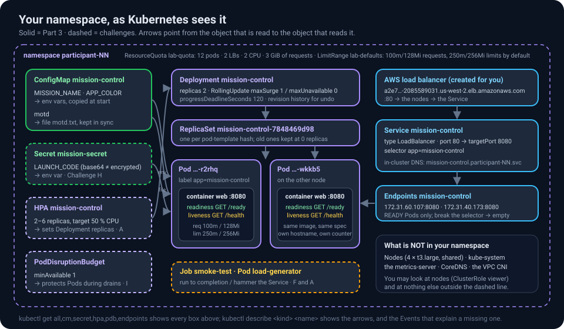
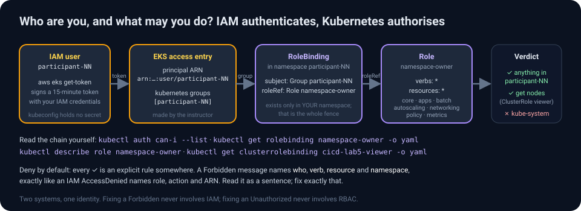
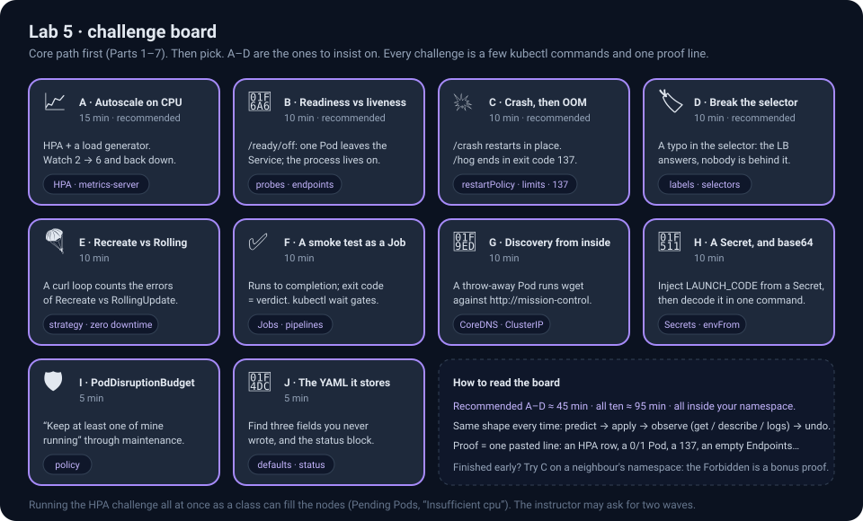
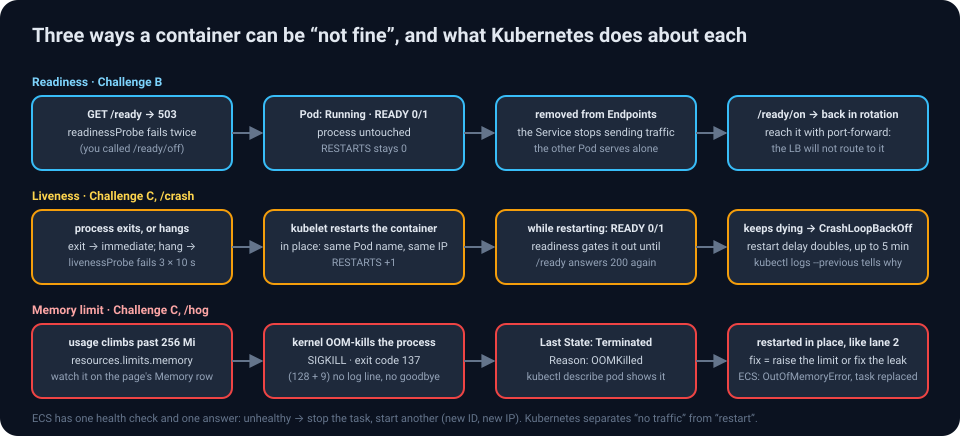

# Lab 5 · Kubernetes on EKS — the same ideas with different words

> *Yesterday's orchestrator was ECS. Today's is Kubernetes, the one the rest of the industry speaks. You will run the exact same Mission Control image, on a cluster the whole class shares, inside a namespace that is yours alone. Every concept from Lab 4 reappears under a new name, and a few new ones appear that ECS does not have words for: readiness versus liveness, configuration that changes under a running container, a Job that runs to completion. That is the point.*

| | |
|---|---|
| **Time** | Core path (Parts 1–7) ≈ 80 min · Challenges A–D ≈ 45 min · all ten challenges ≈ 95 min |
| **Difficulty** | Intermediate, advanced in the challenges. Lab 4 first (you reuse its image). No Kubernetes experience assumed. |
| **AWS services** | Amazon EKS (one cluster, created by the instructor), AWS CloudShell, Amazon ECR, Elastic Load Balancing, CloudWatch |
| **Tools** | `kubectl` – already installed in CloudShell. Nothing on your laptop. |
| **You will build** | A ConfigMap, a Deployment with two Pods of your image and a Service with an internet-facing load balancer · a rolling update you can prove had no downtime, a rollback, a stuck rollout you diagnose two different ways · configuration that changes without a restart · a shell inside a Pod · and, in the challenges, an autoscaler, a smoke-test Job, a Secret, a PodDisruptionBudget |
| **You will break & fix** | A Pod that cannot pull its image · a Pod that runs but is never ready · a scale-up the namespace quota refuses · a Service whose selector matches nobody · a container that eats its memory limit · a peek at a neighbour's namespace that RBAC refuses |
| **Handout** | **"ECS or EKS? The honest comparison"** and the Kubernetes rows of the **triage playbook** in the [class handout](../docs/index.html) |

> [!IMPORTANT]
> **Your namespace is your sandbox.** The cluster `cicd-lab5-eks` is shared by everyone. Each of you has a namespace named after your user (`participant-NN`) with **full rights inside it and none outside it**. Every command below runs in your namespace; if you forget to set it, Kubernetes will politely refuse (you will see this on purpose in Part 2).
>
> **Region:** us-west-2, as always. **Proofs:** every challenge ends with one line to paste into the class chat.

---

## Part 0 · The idea in five minutes

### Kubernetes in one paragraph

Kubernetes is a control loop. You hand it a **desired state** written in YAML ("two copies of this image, exposed on port 80, each allowed 256 MiB") and a set of controllers works continuously to make reality match: scheduling Pods onto nodes, restarting them when they die, adding replicas when you ask, swapping versions one Pod at a time, keeping a mounted file in sync with the ConfigMap it came from. You never tell it *how*; you tell it *what*, and you watch it converge. Everything you did by clicking in Lab 4 you do here with `kubectl apply -f file.yaml`.


### The translation table (keep it open)

| You did this in Lab 4 (ECS) | Today it is called | Defined in |
|---|---|---|
| Task definition | **Pod spec** (the `template:` inside a Deployment) | `01-deployment.yaml` |
| Task | **Pod** | created for you by the Deployment |
| Service with *desired count 2* | **Deployment** with `replicas: 2` (it manages a **ReplicaSet**) | `01-deployment.yaml` |
| Min running % / max running % (the blast-radius dial) | `strategy.rollingUpdate.maxUnavailable` / `maxSurge` | `01-deployment.yaml` |
| Service + ALB target group | **Service** of `type: LoadBalancer` (+ its **Endpoints**) | `02-service.yaml` |
| Container health check (one check, one answer: replace) | **readinessProbe** (gates traffic) and **livenessProbe** (triggers a restart in place) | `01-deployment.yaml` |
| Environment variables in the task definition | **ConfigMap** → env vars, or → a **mounted file** that stays in sync | `00-configmap.yaml` |
| `ValueFrom` secrets, execution role | **Secret** → env var (Challenge H) | `kubectl create secret` |
| Rolling update, circuit breaker, "Update service" | `kubectl set image`, `kubectl rollout status / history / undo`, `progressDeadlineSeconds` | commands |
| `ecs execute-command` | `kubectl exec`, `kubectl port-forward`, `kubectl logs` | commands |
| Service Auto Scaling | **HorizontalPodAutoscaler** | `03-hpa.yaml` |
| `ecs run-task` (one-off) | **Job** (run to completion), **CronJob** | `05-smoke-test.yaml` |
| Cluster per team, IAM | **Namespace** per student + **RBAC** + **ResourceQuota** + **LimitRange** | made by the instructor |
| Fargate | EC2 **nodes** in a managed node group (four `t3.large`), shared by the class | made by the instructor |

### What the instructor built for you


- One EKS cluster, Kubernetes 1.33, four worker nodes, the usual add-ons (networking, DNS, metrics).
- An **access entry** that maps your IAM user to a Kubernetes group named `participant-NN`.
- A **namespace** `participant-NN`, a **Role** granting that group everything inside it, a **ClusterRole** allowing read-only `get nodes`, a **ResourceQuota** (max 12 pods, 2 load balancers, 2 CPU / 3 GiB requested) and a **LimitRange** (default requests/limits for containers that forget to set them).


By the end of Part 3 your namespace will contain the solid boxes on this map; the challenges add the dashed ones. Come back to it whenever a name is unfamiliar.



---

## Part 1 · Open CloudShell and connect kubectl

1. In the console's top bar click the **CloudShell** icon (the `>_` terminal icon, or the *CloudShell* link in the bottom-left). A Linux shell opens in your browser, already signed in as **you** (`participant-NN`), with the AWS CLI and `kubectl` pre-installed. First start takes about a minute.
2. Point `kubectl` at the class cluster and make your namespace the default:

```bash
aws eks update-kubeconfig --region us-west-2 --name cicd-lab5-eks
kubectl config set-context --current --namespace participant-NN      # ← your number
kubectl version --client
kubectl get nodes
```

<details>
<summary>Expected output</summary>

```
Client Version: v1.36.2-eks-8f14419
Added new context arn:aws:eks:us-west-2:962804699607:cluster/cicd-lab5-eks to /home/cloudshell-user/.kube/config
NAME                                          STATUS   ROLES    AGE   VERSION
ip-172-31-15-142.us-west-2.compute.internal   Ready    <none>   22m   v1.33.13-eks-6e7947a
ip-172-31-18-109.us-west-2.compute.internal   Ready    <none>   22m   v1.33.13-eks-6e7947a
ip-172-31-41-66.us-west-2.compute.internal    Ready    <none>   22m   v1.33.13-eks-6e7947a
ip-172-31-57-192.us-west-2.compute.internal   Ready    <none>   22m   v1.33.13-eks-6e7947a
```

Four nodes, all `Ready`. That `get nodes` worked because of the read-only ClusterRole; it is the only cluster-wide thing you may see.

If instead you get `error: You must be logged in to the server (the server has asked for the client to provide credentials)`, your IAM identity has no **access entry** on the cluster: check that CloudShell shows your own user (`aws sts get-caller-identity`) and ask the instructor to confirm the cluster module has been applied for your number.
</details>

> ✅ **Checkpoint** — `kubectl config view --minify | grep namespace` prints `namespace: participant-NN`.

### 1b · Read your guard rails

Before you build, look at the fence you are standing in. Everything below is *data* you are allowed to read:

```bash
kubectl auth can-i --list | head -12                 # what may I do here?
kubectl auth can-i list pods -n kube-system          # "no"
kubectl auth can-i delete deployments                # "yes" (in your namespace)
kubectl describe quota lab-quota                     # how much may I use?
kubectl describe limitrange lab-defaults             # what do containers get when they forget to ask?
kubectl get rolebinding namespace-owner -o yaml      # the exact rule that lets you in
```



<details>
<summary>🔍 How did kubectl know who I am? (identity, briefly)</summary>

`update-kubeconfig` wrote a kubeconfig whose credential plugin runs `aws eks get-token`. Every `kubectl` call presents a short-lived token signed by your IAM credentials; EKS maps your IAM user ARN (via the access entry) to the Kubernetes group `participant-NN`; a **RoleBinding** in your namespace binds that group to a **Role** whose rules say `verbs: *` on `resources: *` for the API groups you need. IAM authenticates, Kubernetes authorises. No kubeconfig secrets, nothing to rotate. The `can-i --list` output is the Role, rendered.
</details>

---

## Part 2 · RBAC says no (on purpose)

Before you build anything, test the fence:

```bash
kubectl get pods -n participant-02        # or any neighbour that is not you
kubectl get pods -n kube-system
kubectl get pods                          # your own namespace: empty, but allowed
```

<details>
<summary>What you see, and why</summary>

```
Error from server (Forbidden): pods is forbidden: User "participant-01" cannot list resource "pods" in API group "" in the namespace "participant-02"
Error from server (Forbidden): pods is forbidden: User "participant-01" cannot list resource "pods" in API group "" in the namespace "kube-system"
No resources found in participant-01 namespace.
```

Read the first message like the IAM errors of Lab 3 and Lab 4: **who** (`User "participant-01"`), **verb** (`list`), **resource** (`pods`), **where** (`namespace "participant-02"`). A RoleBinding exists only in *your* namespace, so every other namespace is a wall. This is multi-tenancy with one cluster and fifteen tenants.
</details>

---

## Part 3 · Deploy Mission Control

Download **[`lab5-eks/lab5-manifests.zip`](../lab5-eks/lab5-manifests.zip)** (or the folder [`lab5-eks/manifests/`](../lab5-eks/manifests/)) and upload the YAML files to CloudShell (**Actions → Upload file**, then `unzip lab5-manifests.zip`), or create them with `nano`. Then edit `01-deployment.yaml`:

- replace `IMAGE` with **your Lab 4 image URI**, e.g. `962804699607.dkr.ecr.us-west-2.amazonaws.com/participant-NN-mission-control:v3` (if you deleted it already, use the shared `962804699607.dkr.ecr.us-west-2.amazonaws.com/pipeline-academy/mission-control:v3`);

and in `00-configmap.yaml` replace `Artemis-NN` and the `participant-NN` in the message with your number.

Three files, three kinds of object. **The ConfigMap** holds configuration, outside the image:

```yaml
apiVersion: v1
kind: ConfigMap
metadata: { name: mission-control }
data:
  MISSION_NAME: "Artemis-NN"          # → env vars, copied into the container when it STARTS
  APP_COLOR: "#A78BFA"
  motd: |                             # → a file, kept in sync while the Pod RUNS (Part 7)
    Welcome aboard, participant-NN. This text comes from a ConfigMap mounted as a file.
```

**The Deployment**, annotated:

```yaml
apiVersion: apps/v1
kind: Deployment
metadata: { name: mission-control, labels: { app: mission-control } }
spec:
  replicas: 2                                    # desired count (ECS: desired tasks)
  selector: { matchLabels: { app: mission-control } }
  strategy:
    type: RollingUpdate
    rollingUpdate: { maxSurge: 1, maxUnavailable: 0 }   # the dial: never below 2 ready, at most 3 (ECS: min 100 % / max 150 %)
  progressDeadlineSeconds: 120                   # a rollout stuck for 2 minutes is reported as failed
  template:                                      # the Pod spec (ECS: task definition)
    metadata: { labels: { app: mission-control } }
    spec:
      containers:
        - name: web
          image: IMAGE                           # ← your ECR URI with a vN tag
          ports: [{ containerPort: 8080 }]
          envFrom:
            - configMapRef: { name: mission-control }   # MISSION_NAME and APP_COLOR become env vars
          env:
            - { name: MOTD_FILE, value: /etc/mission/motd.txt }
            - name: POD_NAME                     # the Downward API: facts about this Pod, as env vars
              valueFrom: { fieldRef: { fieldPath: metadata.name } }
            - name: NODE_NAME                    # the page shows which node served you
              valueFrom: { fieldRef: { fieldPath: spec.nodeName } }
            - name: POD_NAMESPACE
              valueFrom: { fieldRef: { fieldPath: metadata.namespace } }
          volumeMounts: [{ name: motd, mountPath: /etc/mission, readOnly: true }]
          resources:
            requests: { cpu: 100m, memory: 128Mi }   # what the scheduler reserves (counts against your quota)
            limits:   { cpu: 250m, memory: 256Mi }   # the ceiling; exceeding memory = OOMKilled, exit code 137
          readinessProbe:                        # gates traffic
            httpGet: { path: /ready, port: 8080 }
            initialDelaySeconds: 3
            periodSeconds: 5
            failureThreshold: 2
          livenessProbe:                         # triggers a restart
            httpGet: { path: /health, port: 8080 }
            initialDelaySeconds: 10
            periodSeconds: 10
      volumes:
        - name: motd
          configMap: { name: mission-control, items: [{ key: motd, path: motd.txt }] }
```

Two probes, two different endpoints, two different jobs. Lab 4's single health check hit `/health`; here `/health` means "alive" and `/ready` means "send me traffic". Challenge B makes the difference visible.

**The Service:**

```yaml
apiVersion: v1
kind: Service
metadata: { name: mission-control }
spec:
  type: LoadBalancer                  # ask AWS for a load balancer (ECS: ALB + target group)
  selector: { app: mission-control }  # send traffic to Pods with this label; nothing else connects the two
  ports: [{ port: 80, targetPort: 8080 }]
```

Apply all three and watch:

```bash
kubectl apply -f 00-configmap.yaml -f 01-deployment.yaml -f 02-service.yaml
kubectl annotate deployment/mission-control kubernetes.io/change-cause="first deploy, image v3"
kubectl rollout status deployment/mission-control
kubectl get pods -o wide
kubectl get endpoints mission-control
kubectl get svc mission-control
```

<details>
<summary>Expected output</summary>

```
configmap/mission-control created
deployment.apps/mission-control created
service/mission-control created
deployment.apps/mission-control annotated
Waiting for deployment "mission-control" rollout to finish: 0 of 2 updated replicas are available...
deployment "mission-control" successfully rolled out
NAME                               READY   STATUS    RESTARTS   AGE   IP              NODE
mission-control-78fcfc8d89-tc7jc   1/1     Running   0          12s   172.31.60.107   ip-172-31-59-50.us-west-2.compute.internal
mission-control-78fcfc8d89-tjh42   1/1     Running   0          12s   172.31.40.173   ip-172-31-37-155.us-west-2.compute.internal
NAME              ENDPOINTS                               AGE
mission-control   172.31.40.173:8080,172.31.60.107:8080   12s
NAME              TYPE           CLUSTER-IP      EXTERNAL-IP                                        PORT(S)
mission-control   LoadBalancer   10.100.12.34    a2e73277…-2085589031.us-west-2.elb.amazonaws.com   80:31234/TCP
```

Two Pods on two different nodes (the scheduler spreads them). `READY 1/1` means the readiness probe passed. **Endpoints** is the list the Service actually sends traffic to: the two Pod IPs, there because their label matches the selector *and* they are ready. The Service's `EXTERNAL-IP` is a load balancer hostname; AWS takes a minute or two to create it and register the nodes. (`kubectl` may warn that `Endpoints` is deprecated in favour of `EndpointSlice`; both show the same thing.)
</details>

Open `http://<EXTERNAL-IP hostname>/` in your browser (it may answer 503 for the first minute). Refresh several times.


The **hostname** is now a Pod name and it alternates between your two Pods; the **Kubernetes node** field shows which EC2 node each runs on; the **namespace** field says `participant-NN`; the **Memory** row says `… of 256 MiB limit` and **CPU limit** `0.25 vCPU`, straight from your `resources:`; and the green **message of the day** panel is the ConfigMap, mounted as a file. Same image as Lab 4, different orchestrator.

> ✅ **Checkpoint** — `kubectl get deploy,rs,pods,svc,cm,endpoints` shows 1 Deployment (2/2), 1 ReplicaSet, 2 Pods, 1 Service with an external hostname, 1 ConfigMap, 2 endpoints. (The EKS console's **Resources** tab can show the same objects filtered to your namespace, but `kubectl` is the tool of this lab.)

---

## Part 4 · Scale, and meet the quota

```bash
kubectl scale deployment/mission-control --replicas=4
kubectl get pods            # four, within seconds
kubectl scale deployment/mission-control --replicas=20
kubectl get deployment mission-control
kubectl get events --field-selector reason=FailedCreate | tail -3
```

<details>
<summary>Expected output</summary>

```
NAME              READY   UP-TO-DATE   AVAILABLE   AGE
mission-control   12/20   12           12          118s
… Error creating: pods "mission-control-78fcfc8d89-dl7rc" is forbidden: exceeded quota: lab-quota, requested: pods=1, used: pods=12, limited: pods=12
```

Twelve Pods started; the thirteenth was refused by the **ResourceQuota**. The Deployment keeps *trying* (that is the control loop), and keeps being told no. Nothing else in the cluster was affected: your blast radius is your namespace. `kubectl describe quota lab-quota` now shows `pods 12/12` and `requests.cpu 1200m/2`.
</details>

Scale back down, then look at the cluster's side of the same story:

```bash
kubectl scale deployment/mission-control --replicas=2
kubectl describe node | grep -A7 "Allocated resources"     # both nodes: what is reserved, in total, by everyone
kubectl top pods                                            # live usage (the metrics-server add-on)
```

> [!NOTE]
> **Requests are promises, limits are walls.** The scheduler places a Pod only on a node with enough *unreserved* CPU/memory for its `requests`; the node's *Allocated resources* is the sum of everyone's requests, and it can reach 100 % while actual usage (`kubectl top`) stays at 5 %. Quotas count requests, not usage. `limits` are enforced by the kernel at run time: CPU is throttled, memory is killed (Challenge C). A Pod with no requests gets the LimitRange defaults, which is why "forgot to set resources" still counts against you.

---

## Part 5 · Rolling update, with proof

Lab 4 told you the rolling update had no downtime. This time, measure it.

### 5a · A witness

Open a **second CloudShell tab** (the `+` next to the tab name, or *Actions → New tab*) and leave this loop running; it prints one status code per request:

```bash
LB=$(kubectl -n participant-NN get svc mission-control -o jsonpath='{.status.loadBalancer.ingress[0].hostname}')
while true; do curl -s -o /dev/null -m 2 -w '%{http_code} ' http://$LB/; sleep 0.3; done
```

A healthy service prints `200 200 200 …`. Anything else during the next steps is a user who saw an error.

### 5b · Ship v4 (or any other tag you have)

Back in the first tab:

```bash
kubectl set image deployment/mission-control web=962804699607.dkr.ecr.us-west-2.amazonaws.com/participant-NN-mission-control:v4
kubectl annotate deployment/mission-control kubernetes.io/change-cause="ship v4"
kubectl rollout status deployment/mission-control
kubectl rollout history deployment/mission-control
kubectl get rs
```

<details>
<summary>Expected output</summary>

```
Waiting for deployment "mission-control" rollout to finish: 1 out of 2 new replicas have been updated...
Waiting for deployment "mission-control" rollout to finish: 1 old replicas are pending termination...
deployment "mission-control" successfully rolled out
REVISION  CHANGE-CAUSE
1         first deploy, image v3
2         ship v4
NAME                         DESIRED   CURRENT   READY   AGE
mission-control-78fcfc8d89   0         0         0       14m      ← the old ReplicaSet, kept at 0: your rollback target
mission-control-7848469d98   2         2         2       40s
```

Exactly Lab 4's rolling update with the dial at *maxSurge 1 / maxUnavailable 0*: a new ReplicaSet is created, one new Pod comes up and passes **readiness**, one old Pod is terminated, repeat. The witness tab printed nothing but `200`. Refresh the page: badge **v4**. The change-cause annotations turn `rollout history` from a list of numbers into a changelog; make it a habit.
</details>

### 🔧 Troubleshooting exercise 1 — a Pod that will never start

```bash
kubectl set image deployment/mission-control web=962804699607.dkr.ecr.us-west-2.amazonaws.com/participant-NN-mission-control:v99
kubectl annotate deployment/mission-control kubernetes.io/change-cause="ship v99"
sleep 30; kubectl get pods
```

<details>
<summary>💡 Hint 1 — what is the Pod's STATUS?</summary>

```
NAME                               READY   STATUS             RESTARTS   AGE
mission-control-7559565db7-w8bj8   0/1     ImagePullBackOff   0          41s
mission-control-7848469d98-r2rhq   1/1     Running            0          58s
mission-control-7848469d98-wkkb5   1/1     Running            0          51s
```

`ImagePullBackOff`: the kubelet tried to pull the image, failed, and is backing off between retries. Note the two **old Pods are still Running and serving**, and the witness tab is still all `200`. The rollout is stuck, not broken.
</details>

<details>
<summary>💡 Hint 2 — ask the Pod what happened</summary>

```bash
kubectl describe pod -l app=mission-control | grep -A3 Events | tail -5
```

The Events section says `Failed to pull image "…:v99": … not found`. The same diagnosis as Lab 4's `CannotPullContainerError`, with the same three suspects (tag, permissions, network). Here the tag is the culprit.
</details>

<details>
<summary>✅ Solution — the deadline, then roll back</summary>

Wait for the deadline you set in the manifest, and watch Kubernetes report it:

```bash
kubectl rollout status deployment/mission-control          # blocks, then after 120 s:
# error: deployment "mission-control" exceeded its progress deadline
kubectl get deployment mission-control -o jsonpath='{range .status.conditions[*]}{.type}={.status} ({.reason}){"\n"}{end}'
# Available=True (MinimumReplicasAvailable)
# Progressing=False (ProgressDeadlineExceeded)
kubectl rollout undo deployment/mission-control
kubectl rollout status deployment/mission-control
kubectl rollout history deployment/mission-control
```

`rollout undo` re-activates the previous ReplicaSet (history now shows revision 4 = a copy of revision 2, "ship v4"). Because the broken Pod never became *ready*, the Deployment never scaled the old ReplicaSet down: zero user impact, exactly as ECS's circuit breaker behaved in Lab 4.

The difference: Kubernetes does **not** roll back by itself. `progressDeadlineSeconds` makes the Deployment *say* it failed (`Progressing=False`), and `rollout status` exits non-zero at that moment; a human, or a pipeline step that runs `kubectl rollout status || kubectl rollout undo`, decides. Without the deadline (default 600 s) the stuck rollout would sit there, green on the outside, for ten minutes.

**Proof:** the `exceeded its progress deadline` line and the `Progressing=False (ProgressDeadlineExceeded)` condition.
</details>

### 🔧 Troubleshooting exercise 2 — running, but never ready

A different failure, with a different signature. Edit `01-deployment.yaml` and change the readiness probe's path from `/ready` to **`/readyz`** (a plausible typo: several real apps use that path). Apply it.

```bash
kubectl apply -f 01-deployment.yaml
sleep 25; kubectl get pods
```

<details>
<summary>💡 Hint 1 — read the columns</summary>

```
NAME                               READY   STATUS    RESTARTS   AGE
mission-control-6d5c7f9b4-x2k9p    0/1     Running   0          25s
mission-control-7848469d98-r2rhq   1/1     Running   0          6m
mission-control-7848469d98-wkkb5   1/1     Running   0          6m
```

STATUS says **Running**: the image pulled, the process started, `/health` answers, so liveness is happy and RESTARTS stays 0. READY says **0/1**: the readiness probe has never passed. A Pod can be perfectly alive and still not be allowed to serve. `kubectl get endpoints mission-control` lists only the two old Pods.
</details>

<details>
<summary>💡 Hint 2 — the probe's own words</summary>

```bash
kubectl describe pod -l app=mission-control | grep "Readiness probe failed" | tail -1
#   Warning  Unhealthy  …  kubelet  Readiness probe failed: HTTP probe failed with statuscode: 404
```

404, not 503, not a timeout: the app answered and said "no such page". The app is fine; the *probe* is wrong. (503 would mean the app itself said "not ready"; a timeout would mean the port or the process.)
</details>

<details>
<summary>✅ Solution</summary>

Fix the path back to `/ready` in the file and `kubectl apply -f 01-deployment.yaml` (or `kubectl rollout undo`). The new Pod goes `1/1` within seconds and the rollout completes.

**The lesson:** `kubectl get pods` has two columns that look alike and mean different things. STATUS is the kubelet's view of the process; READY is the probe's view of the *service*. Troubleshooting exercise 1 was "cannot start"; this one is "started, cannot serve". Both left the old Pods serving. The witness tab never printed anything but `200`.

**Proof:** a Pod with `0/1 Running RESTARTS 0` and the `statuscode: 404` event.
</details>

Stop the witness loop (Ctrl-C in the second tab) when you are done; you will want it again in Challenge E.

---

## Part 6 · Inside a Pod: self-healing, logs, exec, port-forward

### 6a · Delete one, get one

```bash
POD=$(kubectl get pods -l app=mission-control -o jsonpath='{.items[0].metadata.name}')
kubectl delete pod $POD
kubectl get pods
```

<details>
<summary>Expected output</summary>

```
pod "mission-control-7848469d98-r2rhq" deleted
NAME                               READY   STATUS    RESTARTS   AGE
mission-control-7848469d98-nx24b   1/1     Running   0          4s      ← brand new
mission-control-7848469d98-wkkb5   1/1     Running   0          8m
```

You deleted a Pod; the ReplicaSet noticed *1 < 2* and created another within seconds, with a new name and a new IP. Lab 4's Exercise C, with a different verb.
</details>

### 6b · Logs, across Pods

```bash
kubectl logs -l app=mission-control --prefix --tail=3
kubectl logs deployment/mission-control --since=2m | grep -v '"probe": true' | tail -5
```

Every line is JSON (`event`, `path`, `status`, `hostname`): the same lines CloudWatch received in Lab 4. `--prefix` tells you which Pod said what; `-l` selects by label rather than by name, so the command keeps working after Pods are replaced. The `probe: true` lines are the kubelet's readiness and liveness probes, arriving from the node's IP every 5 and 10 seconds.

### 6c · A shell inside

```bash
POD=$(kubectl get pods -l app=mission-control -o jsonpath='{.items[0].metadata.name}')
kubectl exec -it $POD -- bash
```

You are inside the container, as user `mission`. Look around, then leave:

```bash
hostname; id                                 # the Pod name; uid 999, not root
env | grep -E '^(APP_|MISSION|MOTD|POD_|NODE_)' | sort    # ConfigMap values and the Downward API, as env vars
cat /etc/mission/motd.txt                    # the ConfigMap key, as a file
curl -s localhost:8080/ready; echo           # the probe, as the kubelet sees it
cat /sys/fs/cgroup/memory.max 2>/dev/null || cat /sys/fs/cgroup/memory/memory.limit_in_bytes   # 268435456 = 256 MiB: your limit, in the kernel
echo "I was here" > /tmp/note.txt; ls -l /tmp
exit
```

Now delete that Pod (6a) and `kubectl exec` into its replacement: `/tmp/note.txt` is gone. A Pod's filesystem lives exactly as long as the Pod, as in Lab 4's Challenge K. Anything that must survive goes into a volume: a PersistentVolumeClaim, an S3 bucket, a database.

### 6d · Reach a Pod the load balancer will not show you

`port-forward` opens a private tunnel from CloudShell to one Pod, bypassing the Service entirely:

```bash
kubectl port-forward pod/$POD 8080:8080 &        # background; note the PID it prints
curl -s localhost:8080/api/info | python3 -m json.tool | head -12
kill %1                                          # close the tunnel
```

That is how you talk to a specific Pod, or to one that readiness has pulled out of the Service (Challenge B), or to a Deployment that has no Service at all. The ECS equivalent was Challenge K; here no role or agent is needed because `kubectl` itself is the tunnel.

---

## Part 7 · Configuration at run time

Lab 4 ended with three speeds of change: code, configuration, run-time value. Kubernetes has a fourth: a **file that updates inside a running container**.

1. Edit the ConfigMap: `kubectl edit configmap mission-control` opens it in `vi`; change the `motd` text *and* `MISSION_NAME` (to `Artemis-EDITED`), save, quit. (Or, without an editor: `kubectl patch configmap mission-control --type merge -p '{"data":{"motd":"Edited at run time, no restart.\n","MISSION_NAME":"Artemis-EDITED"}}'`.)
2. Refresh the page once a minute. Within about a minute the **message of the day changes**. The **mission name in the title does not**.
3. `kubectl get pods`: same Pods, RESTARTS 0, AGE unchanged. Nothing restarted.

<details>
<summary>Why one changed and the other did not</summary>

The kubelet re-syncs mounted ConfigMap volumes periodically (roughly every minute); the app reads the file on every request, so the new text appears without anyone restarting anything. Environment variables are different: they were copied into the process when it started and a running process cannot be given new ones. To pick up the new `MISSION_NAME` you must restart the Pods:

```bash
kubectl rollout restart deployment/mission-control     # a rolling restart with the same image
kubectl rollout status deployment/mission-control
```

Now the title changes too, and `kubectl get pods` shows brand-new Pods. Same dial as Part 5: new Pods came up before old ones went, and the witness would have printed only `200`.

| You changed… | Kubernetes needs… | Took | ECS equivalent |
|---|---|---|---|
| the image | `set image` → rolling update | ~1 min | rebuild + revision + rollout |
| an env var (ConfigMap or manifest) | `rollout restart` → rolling update | ~30 s | new revision + rollout |
| a mounted ConfigMap file | nothing | ≤ 1 min | a Parameter Store value read at run time |

**The lesson:** mount configuration that may change while the app runs (feature flags, a maintenance banner, a list of upstreams) and put the things that must not change silently (ports, image tags, the database host) in env vars or the manifest, where a change leaves a revision in `rollout history`.
</details>

> ✅ **Checkpoint** — The page shows your edited message *and* the edited mission name; `kubectl rollout history` shows one more revision than before Part 7.

---

## Part 8 · Challenges



| | Badge | What it teaches | Time |
|---|---|---|---|
| A · Autoscale on CPU | 📈 | HorizontalPodAutoscaler, metrics-server | 15 min · recommended |
| B · Readiness vs liveness, live | 🚦 | the two probes, Endpoints | 10 min · recommended |
| C · Crash, then run out of memory | 💥 | restarts in place, `OOMKilled`, exit code 137 | 10 min · recommended |
| D · Break the selector | 🏷️ | labels are the only glue | 10 min · recommended |
| E · Recreate vs RollingUpdate, measured | 🪂 | strategies, zero downtime as a number | 10 min |
| F · A smoke test as a Job | ✅ | run-to-completion workloads, `kubectl wait` | 10 min |
| G · Service discovery from inside | 🧭 | ClusterIP and DNS | 10 min |
| H · A Secret, and why base64 is not encryption | 🔑 | Secrets, `envFrom` | 10 min |
| I · PodDisruptionBudget | 🛡️ | voluntary disruptions | 5 min |
| J · Read the YAML Kubernetes actually stores | 📜 | defaults and status | 5 min |

### Challenge A · 📈 Autoscale on CPU

Apply the HorizontalPodAutoscaler and a load generator, then watch:

```bash
kubectl apply -f 03-hpa.yaml -f 04-load-generator.yaml
kubectl get hpa mission-control --watch        # Ctrl-C to stop
```

<details>
<summary>💡 Hint</summary>

The HPA targets 50 % average CPU of the Pods' *requests* (100m). The load generator is a busybox loop hammering the Service from inside the cluster. Metrics arrive every 15–30 s, so give it two minutes. `kubectl top pods` shows the live numbers it is reacting to.
</details>

<details>
<summary>✅ What you will see</summary>

```
NAME              REFERENCE                    TARGETS        MINPODS   MAXPODS   REPLICAS   AGE
mission-control   Deployment/mission-control   cpu: 1%/50%    2         6         2          22s
mission-control   Deployment/mission-control   cpu: 209%/50%  2         6         2          42s
mission-control   Deployment/mission-control   cpu: 122%/50%  2         6         6          63s
mission-control   Deployment/mission-control   cpu: 104%/50%  2         6         6          2m5s
```

Utilisation shoots past the target, the HPA scales the Deployment to its maximum of 6 within a minute, and per-Pod utilisation falls. Delete the load generator (`kubectl delete pod load-generator`) and watch it come back down: the manifest sets `scaleDown.stabilizationWindowSeconds: 60` instead of the default 300, so the scale-in happens within a couple of minutes rather than five. `kubectl describe hpa mission-control` shows the decisions and their reasons as Events.

Note `kubectl get deployment`: the HPA *edits the Deployment's `replicas`*. If you now `kubectl apply -f 01-deployment.yaml` with `replicas: 2`, you fight the autoscaler; production manifests leave `replicas` out when an HPA owns it.

**ECS equivalent:** Service Auto Scaling with a target-tracking policy on `ECSServiceAverageCPUUtilization`.

**Proof:** an HPA row with `REPLICAS 6`. Delete the HPA afterwards (`kubectl delete hpa mission-control`) so the other challenges see a steady 2.
</details>

### Challenge B · 🚦 Readiness vs liveness, live

Mission Control can be told to *stop being ready* without dying. Do it to one Pod and watch what each probe does.

```bash
kubectl get endpoints mission-control                 # two IPs
LB=$(kubectl get svc mission-control -o jsonpath='{.status.loadBalancer.ingress[0].hostname}')
curl -s http://$LB/ready/off                          # whichever Pod the LB picks turns NOT READY
sleep 15; kubectl get pods; kubectl get endpoints mission-control
```

<details>
<summary>✅ What happens, and how to undo it</summary>

```
NAME                               READY   STATUS    RESTARTS   AGE
mission-control-7848469d98-nx24b   0/1     Running   0          9m
mission-control-7848469d98-wkkb5   1/1     Running   0          17m
NAME              ENDPOINTS           AGE
mission-control   172.31.40.173:8080  38m
```

One Pod is `0/1`: its readiness probe (`/ready`, now 503) failed twice, so the Service **removed it from Endpoints**. The process is untouched: STATUS Running, RESTARTS 0, and `kubectl describe pod` shows `Readiness probe failed: HTTP probe failed with statuscode: 503`. Liveness (`/health`, still 200) is satisfied, so the kubelet has no reason to restart anything. Refresh the page: every request now lands on the *other* Pod. Wait a minute: still 0 restarts.

Now bring it back. You cannot reach it through the load balancer (that is the whole point), so tunnel to it directly:

```bash
POD=$(kubectl get pods -l app=mission-control -o jsonpath='{.items[?(@.status.containerStatuses[0].ready==false)].metadata.name}')
kubectl port-forward pod/$POD 8080:8080 & sleep 1
curl -s localhost:8080/ready/on; kill %1
sleep 8; kubectl get endpoints mission-control        # two IPs again
```

**The lesson:** readiness is for "not right now" (warming a cache, draining before shutdown, a dependency being down); liveness is for "stuck". ECS has only the second kind of answer (unhealthy → replace). Kubernetes lets a container step out of rotation and back without losing its state. Note also that `/ready/off` is reachable by anyone who can reach the page; a real app would protect such a switch.



**Proof:** a `0/1 Running` Pod with `RESTARTS 0` and a one-address Endpoints line.
</details>

### Challenge C · 💥 Crash, then run out of memory

**Part 1.** Call `/crash` through the load balancer a few times and watch `kubectl get pods`.

<details>
<summary>✅ What happens</summary>

The container exits with code 1; the kubelet restarts it **in place** (same Pod name, same IP, `RESTARTS` column increments) because a Pod's restart policy defaults to `Always`. Contrast with Part 6a, where deleting the Pod produced a *new* Pod. While it restarts, the Pod is `0/1` and out of Endpoints; the other Pod serves. Keep crashing it and the restart delay doubles each time (`CrashLoopBackOff`, 10 s, 20 s, 40 s… up to 5 min): the kubelet refuses to spin on a container that cannot stay up. `kubectl logs $POD --previous` shows the log of the container *before* the last restart; that is where the reason for a crash usually lives.
</details>

**Part 2.** Tunnel to one Pod and ask it to eat memory:

```bash
POD=$(kubectl get pods -l app=mission-control -o jsonpath='{.items[0].metadata.name}')
kubectl port-forward pod/$POD 8080:8080 & sleep 1
curl -s -m 60 'localhost:8080/hog?mb=1024'; echo " (curl exit=$?)"; kill %1
sleep 10; kubectl get pod $POD
kubectl describe pod $POD | grep -A4 "Last State"
```

<details>
<summary>✅ What happens</summary>

```
 (curl exit=52)
NAME                               READY   STATUS    RESTARTS      AGE
mission-control-7848469d98-nx24b   1/1     Running   1 (12s ago)   14m
    Last State:     Terminated
      Reason:       OOMKilled
      Exit Code:    137
```

The app allocated past `limits.memory: 256Mi`; the kernel killed the process (`SIGKILL`, 128 + 9 = **137**); curl's connection dropped (exit 52, empty reply); the kubelet restarted the container in place and recorded the previous one's fate under *Last State*. Lab 4's Exercise D, with a restart instead of a replacement. `kubectl top pod $POD` shortly before the kill would have shown memory at the limit; the page's Memory row shows it live.

**The lesson:** `limits.memory` is a wall, not a hint, and 137 is its signature everywhere (Docker, ECS, Kubernetes). When you see `OOMKilled` in production the answer is a leak fix or a bigger limit, never "restart it again".

**Proof:** `Reason: OOMKilled · Exit Code: 137`.
</details>

### Challenge D · 🏷️ Break the selector

Edit `02-service.yaml` and change the selector to `app: mission-controll` (one extra *l*). Apply it. **Predict:** does the load balancer still answer? Do the Pods still run?

<details>
<summary>💡 Hint</summary>

```bash
kubectl get endpoints mission-control
kubectl get pods --show-labels
```
</details>

<details>
<summary>✅ Solution</summary>

```
NAME              ENDPOINTS   AGE
mission-control   <none>      41m
```

The Pods are fine (`2/2 Running`), the load balancer still exists, the Service still has a ClusterIP; but its **Endpoints are empty**, because no Pod carries the label the selector asks for. Users get a connection error or a 503 from the load balancer. Nothing is "down" in any dashboard that looks at Pods or at the LB; only the glue is missing.

Fix the label, apply, and Endpoints fills in within a second or two.

**The lesson:** in Kubernetes nothing is wired by name. A Service finds Pods by **label selector**, a Deployment owns Pods by selector, a PDB protects Pods by selector, a NetworkPolicy targets Pods by selector. `kubectl get endpoints` is the first command to run when "the service is up but nothing answers".

**Proof:** an `ENDPOINTS <none>` line.
</details>

### Challenge E · 🪂 Recreate vs RollingUpdate, measured

Start the witness loop from Part 5a in your second tab. Then change the Deployment's strategy to `Recreate` and trigger a rollout with a harmless change:

```bash
kubectl patch deployment mission-control -p '{"spec":{"strategy":{"type":"Recreate","rollingUpdate":null}}}'
kubectl set env deployment/mission-control DEMO=recreate
kubectl get pods --watch        # Ctrl-C when the new Pods are 1/1
```

<details>
<summary>✅ What you see, and the way back</summary>

Both old Pods go `Terminating` **first**; for a few seconds there are **zero** Pods; then two new ones start and become ready. The witness tab prints a run of `000` or `503` in the middle of its `200`s: that is downtime, counted in requests. `Recreate` is the right tool when two versions must never run at once (a schema migration, a singleton) and the wrong one for anything users are looking at.

Put the dial back and roll once more; the witness prints only `200`:

```bash
kubectl patch deployment mission-control -p '{"spec":{"strategy":{"type":"RollingUpdate","rollingUpdate":{"maxSurge":1,"maxUnavailable":0}}}}'
kubectl set env deployment/mission-control DEMO-
```

Try the other corner too: `maxSurge: 0, maxUnavailable: 1` is Lab 4's *min 50 % / max 100 %*: no extra Pod ever, capacity dips to one.

**Proof:** the witness line with non-200 codes from the Recreate, and an all-200 line from the rolling update.
</details>

### Challenge F · ✅ A smoke test as a Job

Lab 2's `ValidateService` hook ran a script on the server after a deployment. Kubernetes has an object for "run this once and tell me the exit code":

```bash
kubectl apply -f 05-smoke-test.yaml
kubectl wait --for=condition=complete job/smoke-test --timeout=90s
kubectl logs job/smoke-test
kubectl get job smoke-test
```

<details>
<summary>✅ What you see, and how a pipeline uses it</summary>

```
job.batch/smoke-test condition met
1/3 liveness
2/3 readiness
3/3 version
"version":"v4"
smoke test passed
NAME         STATUS     COMPLETIONS   DURATION   AGE
smoke-test   Complete   1/1           8s         8s
```

The Job created one Pod that ran three `wget`s against the Service and exited 0; the Job is `Complete`. Break it: turn one Pod not-ready as in Challenge B, delete and re-apply the Job (Jobs are immutable), and watch `kubectl wait` time out with the Job `Failed` after one retry (`backoffLimit: 1`), and `kubectl logs job/smoke-test` end at `2/3 readiness`. The Pod disappears by itself ten minutes later (`ttlSecondsAfterFinished`).

A deploy pipeline is just these lines in order: `kubectl apply -f deployment.yaml && kubectl rollout status … && kubectl apply -f smoke-test.yaml && kubectl wait --for=condition=complete job/smoke-test || kubectl rollout undo …`. For something that must run on a schedule instead, the same Pod template goes into a **CronJob** (`schedule: "*/5 * * * *"`).

**Proof:** a `Complete 1/1` Job line, or a `Failed` one with the log that explains it.
</details>

### Challenge G · 🧭 Service discovery from inside the cluster

The load generator talked to `http://mission-control/` and it worked. Where did that name come from?

```bash
kubectl run tmp --restart=Never --image=public.ecr.aws/docker/library/busybox:1.36 -- \
  sh -c 'nslookup mission-control; echo ---; wget -qO- http://mission-control/api/info | head -c 200; echo'
kubectl wait --for=jsonpath='{.status.phase}'=Succeeded pod/tmp --timeout=60s
kubectl logs tmp
kubectl get svc mission-control -o jsonpath='{.spec.clusterIP}{"\n"}'
kubectl delete pod tmp
```

<details>
<summary>✅ What you see</summary>

```
Server:         10.100.0.10
Address:        10.100.0.10:53

Name:   mission-control.participant-NN.svc.cluster.local
Address: 10.100.12.34
---
{"color":"#A78BFA","ecs":{},"hits_on_this_container":3863,"hostname":"mission-control-7848469d98-wkkb5", …
10.100.12.34
```

A throw-away Pod resolves `mission-control` to the Service's **ClusterIP** (a stable virtual IP that exists only inside the cluster; the same number `get svc` prints) and gets the page from whichever Pod the Service picks. The full name is `mission-control.participant-NN.svc.cluster.local`; the short form works because the Pod is in the same namespace (busybox's `nslookup` also prints a few harmless `NXDOMAIN` lines while it tries the other search suffixes). CoreDNS (one of the add-ons you saw in Part 0) answers; kube-proxy on every node turns the virtual IP into a real Pod IP. Note the shape of the commands: run a Pod, `wait` for it, read its `logs`, delete it. That is a Job done by hand (Challenge F).

Every Service has a ClusterIP whether or not it also has a load balancer; `type: LoadBalancer` is the ClusterIP *plus* an AWS load balancer pointing at it. Most Services in a real cluster are ClusterIP-only: internal APIs talking to each other by name, with no public address at all. Try `kubectl run … -n participant-02`: Forbidden, of course.

**Proof:** the `nslookup` answer with your Service's ClusterIP.
</details>

### Challenge H · 🔑 A Secret, and why base64 is not encryption

Mission Control shows a `LAUNCH_CODE` variable, masked, if it has one. Give it one from a Secret:

```bash
kubectl create secret generic mission-secret --from-literal=LAUNCH_CODE=orbit-7f3a-launch-code
kubectl get secret mission-secret -o yaml | grep LAUNCH_CODE
```

Then add the Secret to the Deployment: in `01-deployment.yaml`, under `envFrom:`, add a second entry `- secretRef: { name: mission-secret }`, apply, and refresh the page.

<details>
<summary>✅ What you see, and the uncomfortable part</summary>

The page shows **Launch code (from a Secret): `orbi…••••••••`**. The rollout happened because the Pod template changed; `kubectl rollout history` has one more revision.

Now the uncomfortable part:

```bash
kubectl get secret mission-secret -o jsonpath='{.data.LAUNCH_CODE}' | base64 -d; echo
```

That is the value, in clear, for anyone who can `get secrets` in the namespace. A Secret is base64-*encoded* so that binary values survive YAML, not encrypted. What protects it is **RBAC** (who may read Secrets; your Role allows it, a read-only viewer's would not) and, on EKS, **envelope encryption** of the cluster's datastore with a KMS key, which the instructor enabled or did not. Teams that need more use External Secrets or the Secrets Store CSI driver to pull from Secrets Manager / Parameter Store at run time, which is Lab 4's Challenge J with Kubernetes words.

**Proof:** the masked code on the page and the decoded value from one command.
</details>

### Challenge I · 🛡️ PodDisruptionBudget

```bash
kubectl apply -f 06-pdb.yaml
kubectl get pdb
```

<details>
<summary>✅ What it means</summary>

```
NAME              MIN AVAILABLE   MAX UNAVAILABLE   ALLOWED DISRUPTIONS   AGE
mission-control   1               N/A               1                     3s
```

A PDB is a promise *you* extract from the cluster: "during voluntary disruptions, keep at least one of my Pods". A node drain for a Kubernetes upgrade (EKS managed node group updates do this) evicts Pods one at a time and will wait rather than evict the last one that matches this selector. ALLOWED DISRUPTIONS = 1 because two are ready and one must stay. It does nothing against crashes or OOM kills (that is what replicas and probes are for), and nothing if you set `minAvailable: 2` with two replicas except block every drain, which annoys the cluster operator. You cannot drain a node in this class (RBAC), so this one is declarative-only; in production it is the difference between a quiet upgrade and a 2 a.m. page.

**Proof:** the `ALLOWED DISRUPTIONS 1` line.
</details>

### Challenge J · 📜 Read the YAML Kubernetes actually stores

```bash
kubectl get deployment mission-control -o yaml | less
```

Find three fields you did not write (`revisionHistoryLimit`, `terminationGracePeriodSeconds`, `dnsPolicy`), and the whole `status:` block with its `conditions`. Those defaults are the ECS "min 100 % / max 200 %"-style settings and the deployment history you saw in Lab 4, expressed as data. `kubectl explain deployment.spec.strategy` prints the documentation for any field, offline.

---

## Part 9 · Clean up (your namespace only)

```bash
kubectl delete -f 06-pdb.yaml -f 05-smoke-test.yaml -f 04-load-generator.yaml -f 03-hpa.yaml --ignore-not-found
kubectl delete -f 02-service.yaml -f 01-deployment.yaml -f 00-configmap.yaml
kubectl delete secret mission-secret --ignore-not-found
kubectl get all,cm,secret,pdb,hpa,job        # only the kube-root-ca.crt ConfigMap should remain
```

Deleting the Service deletes the AWS load balancer it created (give it a minute). The instructor destroys the cluster and namespaces after class.

---

## Part 10 · What you learned

- Kubernetes is **declarative**: you apply desired state; controllers converge reality to it, forever, including a file you edited under a running container.
- **Deployment → ReplicaSet → Pod** is ECS's service → task definition → task with the names changed; `maxSurge` / `maxUnavailable` is the same blast-radius dial.
- **Readiness** gates traffic (Endpoints), **liveness** restarts in place, **limits** kill with 137; three different signatures in `kubectl get pods` and `describe`.
- **Labels are the only glue**: Services, Deployments, PDBs and HPAs all find their Pods by selector; `kubectl get endpoints` is the first question when "up but not answering".
- `rollout status`, `rollout history` (with change-cause), `rollout undo` and `progressDeadlineSeconds` are the whole deployment story; `describe`, `logs`, `exec` and `port-forward` are the whole debugging story.
- A broken image **stalls** a rollout rather than breaking the service; Kubernetes reports it, a human or a pipeline undoes it.
- **ConfigMaps and Secrets** separate configuration from the image; mounted files update live, env vars need a restart, and base64 is not encryption.
- **Jobs** run to completion and make a smoke test a first-class object a pipeline can `wait` for.
- **Namespaces + RBAC + ResourceQuota + LimitRange** turn one cluster into fifteen sandboxes with a known blast radius. IAM authenticates you to EKS; Kubernetes RBAC authorises what you may do.

### Quiz yourself

<details>
<summary>1. A Pod shows 0/1 READY but STATUS Running and RESTARTS 0. What does that mean and what would you check?</summary>

The container process is up and liveness is passing, but the **readinessProbe** is failing, so the Pod receives no Service traffic (it is absent from Endpoints). `kubectl describe pod` → Events shows the probe failures with a status code: 404 means the probe path is wrong, 503 means the app says it is not ready, a timeout means the port or the process. `kubectl logs` shows what the app thinks.
</details>

<details>
<summary>2. You scale to 20 and only 12 start. Is the cluster full?</summary>

Not necessarily: check `kubectl get events` first. "exceeded quota" means your namespace's ResourceQuota, not the nodes. A genuinely full cluster shows Pods `Pending` with `Insufficient cpu/memory` in their events, and `kubectl describe node` shows *Allocated resources* near 100 % of requests, whatever `kubectl top` says about actual usage.
</details>

<details>
<summary>3. What is the Kubernetes equivalent of ECS's deployment circuit breaker?</summary>

There is no automatic rollback by default. A stuck rollout stays stuck (old Pods keep serving) until `kubectl rollout undo`; `progressDeadlineSeconds` makes the Deployment *report* failure (`Progressing=False`, `rollout status` exits non-zero), and CI pipelines typically run `rollout status || rollout undo`.
</details>

<details>
<summary>4. Why could you run `kubectl get nodes` but not `kubectl get pods -n kube-system`?</summary>

Your group is bound to a ClusterRole that allows only `nodes`/`namespaces` reads cluster-wide, and to a Role with full rights that exists only in your namespace. RBAC is deny-by-default; every allow is explicit. `kubectl auth can-i --list` shows the result.
</details>

<details>
<summary>5. You edited a ConfigMap. The mounted file changed; the env var did not. Why, and what do you do?</summary>

The kubelet re-syncs mounted ConfigMap volumes about once a minute, and the app reads the file per request. Environment variables are copied into a process at start and cannot change afterwards, so `kubectl rollout restart deployment/…` is needed: a rolling restart with the same image, leaving a revision in the history.
</details>

<details>
<summary>6. A Pod shows RESTARTS 3 and Last State: Terminated, Reason: OOMKilled, Exit Code: 137. What happened three times and what is the fix?</summary>

The container exceeded `resources.limits.memory` and the kernel SIGKILLed it (137 = 128 + 9); the kubelet restarted it in place each time, with a growing back-off. The fix is a leak fix or a higher limit based on `kubectl top` data, never a bigger `restartPolicy`. The same number means the same thing on ECS and plain Docker.
</details>

<details>
<summary>7. The load balancer answers but every request fails, Pods are 2/2 Running. First command?</summary>

`kubectl get endpoints <service>`. If it is `<none>`, the Service's selector matches no Pod labels (Challenge D) or no Pod is ready (Challenge B). Fix the label or the readiness; the LB and the Pods were never the problem.
</details>

<details>
<summary>8. Which Kubernetes objects did a pipeline need to deploy and verify Mission Control, in order?</summary>

ConfigMap (configuration), Deployment (`apply`, then `rollout status` with a progress deadline), Service (once; it rarely changes), then a Job as the smoke test (`apply`, `wait --for=condition=complete`), and `rollout undo` if either the status or the wait fails. Secrets come from a secret store, not from the repository.
</details>

**Next:** [Lab 6 – Ship it safely: blue/green, canary and linear deployments on ECS](lab6-ecs-advanced.md) (advanced). Or back to the [handout](../docs/index.html) for the wrap-up and the triage playbook you can take with you.
