# Lab 6 · Ship it safely — blue/green, canary and linear deployments on ECS

> *It is Friday, 7 p.m., the busiest hour of the week at Galactic Pizza, and the kitchen team wants to ship release 1.2: "Hyperdrive Dough, 2–3× faster, all smoke tests green". You will ship it four different ways. The first way burns hundreds of pizzas before a human notices. The last way burns none, and no human is involved at all. Same code every time. What changes is the release strategy.*

| | |
|---|---|
| **Time** | Core path (Parts 1–7) ≈ 2 h 15 min, much of it watching real deployments · Challenges 10–20 min each |
| **Difficulty** | Advanced. Do Lab 4 first: this lab assumes you know a task definition, a service and a target group. |
| **AWS services** | Amazon ECS (Fargate, Fargate Spot), Elastic Load Balancing (ALB, two listeners, weighted rules), CloudWatch alarms and Logs Insights, AWS Lambda, IAM, Application Auto Scaling, CloudShell |
| **You will build** | A two-listener load balancer with blue and green target groups · a service that you move from rolling to blue/green to canary to linear · a human approval gate · an alarm that rolls back on its own · a Lambda hook that tests every pizza before a customer can order one |
| **You will break & fix** | A release whose bug no health check can see · a rolling update that serves two menus at once · a bad release in 100 % of production, rolled back by hand in seconds · the same release caught by an alarm at 10 % · and caught again by a test before any customer sees it |
| **Handout** | Lab 4's "ECS vocabulary" table, and the Lab 2 section on blast radius. Everything new is explained below. |

> [!IMPORTANT]
> **Your number.** Everywhere you see `NN`, use your own two digits. Every resource in this lab starts with `participant-NN-pizza`.
>
> **Your region.** US West (Oregon) · `us-west-2`.
>
> **Your workbench.** This lab runs in **CloudShell** (the `>_` icon in the console's top bar) plus two browser tabs. Every command was run in the class account while writing this guide, and the timings quoted are the ones measured there.
>
> **Your bill.** One ALB plus three small Fargate tasks (six for a few minutes during each deployment) ≈ US$0.07 per hour. Part 9 deletes all of it; please do not skip Part 9.

---

## Part 0 · The idea in ten minutes

### Why release strategy is an engineering topic

Google's SRE book says that roughly **70 % of outages are caused by changes to a live system**. Not hardware failures, not traffic spikes: deployments and configuration pushes. Most of those changes passed code review and CI first. The bug that reaches production is, almost by definition, the one your tests did not think of.

So the question is not *"how do we never ship a bug?"* (you will), it is:

1. **How many customers does a bad release reach** before something notices? (*blast radius*)
2. **How long until something notices**, and is that something a human or a machine? (*detection*)
3. **How fast can you put the old version back?** (*recovery*)

A **deployment strategy** is the set of answers to those three questions. ECS now has four of them built in, and you will use all four today.

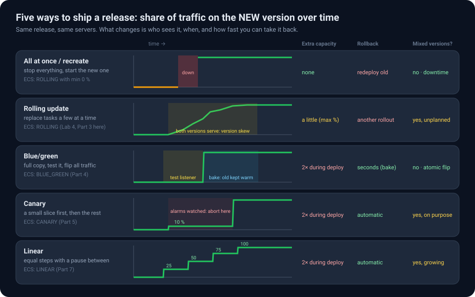

### When to use which (with real-life examples)

| Strategy | Use it when… | Real-life example | Avoid it when… |
|---|---|---|---|
| **All at once / recreate** | Two versions must never run side by side, and a minute of downtime is acceptable | A nightly batch worker; an internal tool during a maintenance window; a singleton that holds a database migration lock | Customers are online |
| **Rolling** (ECS `ROLLING`) | The change is backward compatible and stateless, and cost matters more than instant rollback | Most everyday microservice releases; Lab 4 | Old and new versions disagree about data, URLs or APIs (you will see why in Part 3) |
| **Blue/green** (`BLUE_GREEN`) | You want to test the complete new environment before customers see it, switch all traffic at once (no mixed versions), and roll back in seconds | A payments API; a major framework or runtime upgrade; anything with a "big switch" moment | You cannot afford 2× capacity during the deployment, or the app keeps state that two copies would fight over |
| **Canary** (`CANARY`) | The risk is in what only real users do, you have enough traffic for 5–10 % to mean something, and you have a metric that turns red when it goes wrong | A new checkout flow; a new recommendation model; a dependency upgrade with "unknown unknowns" | Low traffic (1 request a minute at 5 % tells you nothing), or no reliable alarm |
| **Linear** (`LINEAR`) | Load matters as much as correctness: caches need warming, connection pools need to grow, a downstream service needs time to scale | A search service with a cold cache; a release that changes database query patterns | You need it done in two minutes |

Three more patterns you will hear about, not built into ECS but often combined with the above:

- **Feature flags** separate *deploying* code from *releasing* a feature: ship the code dark, switch the feature on for 1 % of users in a config service, and switch it off without any deployment. The most common way large companies do canaries today.
- **Dark launch / shadow traffic**: copy real requests to the new version and throw away its answers. Great for performance tests of read-only services; dangerous for anything that writes.
- **A/B tests** look like canaries but answer a *business* question ("does the purple button sell more?"), not a *safety* question. They run for weeks, not minutes.

### The words for today

| Word | Meaning |
|---|---|
| **Service revision** | An immutable snapshot of "what the service should run": task definition, load balancer settings, network settings. Every deployment moves the service from a **source** revision (what runs now) to a **target** revision (what you asked for). |
| **Blue / green** | The two copies that run side by side during a deployment. Blue = source, green = target. They are just two **target groups**; after each deployment they swap roles. |
| **Production listener rule** | The ALB rule your customers hit (port 80). ECS changes its **weights**: blue 100/green 0 → 90/10 → 0/100. |
| **Test listener rule** | A second rule (port 8080 here) that points at the *green* copy only. Testers and automated checks use it before any customer does. |
| **Bake time** | Minutes after production traffic has moved during which ECS keeps the old copy running, so a rollback is a rule change, not a redeployment. |
| **Lifecycle hook** | Your code, or a pause, that ECS runs at a named stage. It can say "carry on", "roll back", or "ask me again in 30 s". |
| **Deployment alarm** | A CloudWatch alarm ECS watches during the deployment. If it fires, ECS rolls back by itself. |
| **Circuit breaker** | Lab 4's safety net: rolls back if new tasks keep failing to *start*. It knows nothing about whether they work. |

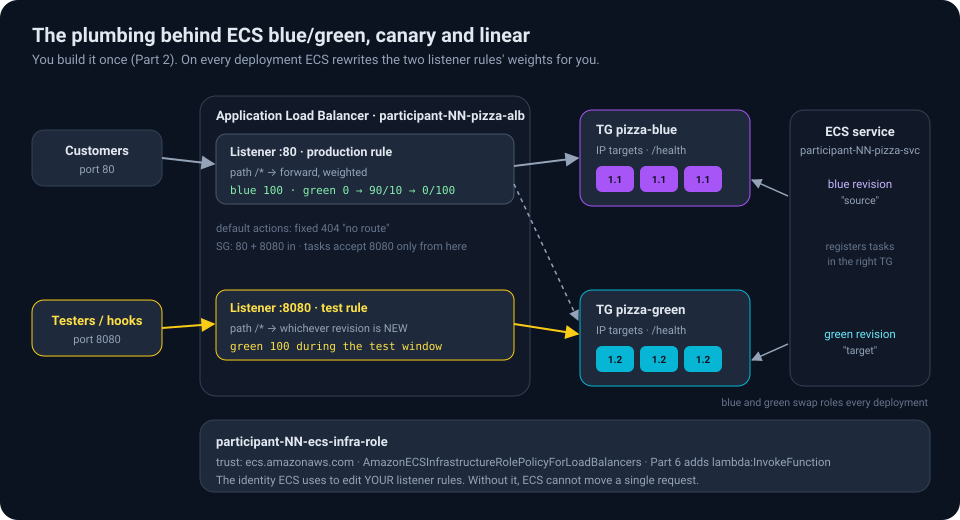

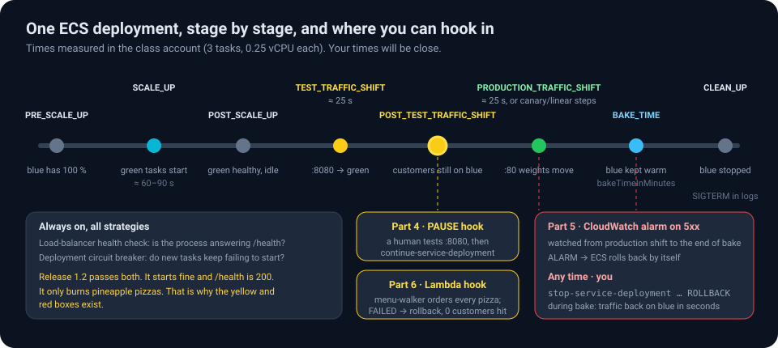

### The app: Galactic Pizza

One small Flask app, four releases, all pre-built by your instructor in the shared repository `pipeline-academy/galactic-pizza` (same account, so your tasks can pull them):

| Release | Name | What the team's release notes say |
|---|---|---|
| `1.0` | Grand Opening | Four pizzas, one wood-fired oven. Orange. |
| `1.1` | Saturn Rings | **New pizza**: Saturn Rings. Ovens upgraded, ~40 % faster. Purple. |
| `1.2` | Hyperdrive Dough | Bakes at 900 °C: orders 2–3× faster. *"All smoke tests green."* Cyan. |

Every response says **which release, which container, which AZ and which listener** baked it. Two pages make strategies visible:

| Page | What it is for |
|---|---|
| `/` | The shop. Order pizzas by hand; see which container baked each one. |
| `/rush` | **The rush-hour board.** Your browser orders ~10 pizzas a second through the load balancer and draws, live, which release answered, how many came back burnt (HTTP 500) or "not on the menu" (404), and the traffic share over the last six minutes. Keep it open in a tab for the whole lab. |
| `/api/order?pizza=…` · `/api/menu` · `/health` | JSON. `/health` answers 200 as long as the process runs. Remember that. |

> [!NOTE]
> **Read the code if you like** ([`lab6-ecs-advanced/app/app.py`](../lab6-ecs-advanced/app/app.py)). Like most real bugs, the one in 1.2 is not in a single wrong line. It is in how two reasonable-looking numbers meet. Whether you find it before the customers do is the point of the lab.

---

## Part 1 · Set up CloudShell

1. Open **CloudShell** (region Oregon). Download and unpack the lab kit, and tell your shell who you are (use your own number):

   ```bash
   cd ~ && curl -sLO https://varoonsahgal.github.io/cicdcg/downloads/lab6-kit.zip && unzip -o lab6-kit.zip -d lab6
   echo 'export NN=07' >> ~/.bashrc                 # ← YOUR number
   echo 'source ~/lab6/pizza.env' >> ~/.bashrc
   source ~/.bashrc
   pizza_vars
   ```

2. You now have four files in `~/lab6`:

   | File | What it does |
   |---|---|
   | `pizza.env` | Looks up every resource of this lab **by name** and exports it (`$ALB_DNS`, `$BLUE_TG`, `$PROD_RULE`, …). Re-run `source ~/lab6/pizza.env` whenever you create something; new tabs load it automatically. Also defines three helpers: `register 1.1` (new task-definition revision for a release, prints its ARN), `watch_deploy` (prints every stage of the current deployment until it ends or pauses) and `pizza_vars`. |
   | `taskdef.json` | The task definition template: 0.25 vCPU, 512 MiB, port 8080, logs to `/ecs/participant-NN-pizza`, `stopTimeout` 10 s. |
   | `menu_walker.py` | The Lambda hook for Part 6. |
   | `rush.py` | The rush-hour board for people who prefer a terminal (`python3 ~/lab6/rush.py`). |

> ✅ **Checkpoint** — `pizza_vars` prints `NN 07`, `P participant-07`, four subnets, and `None` for everything you have not built yet. That is correct.

> [!TIP]
> CloudShell disconnects after about 20 idle minutes and forgets your variables. Because `~/.bashrc` reloads `pizza.env`, a fresh tab is always ready; `pizza_vars` shows what it found.

---

## Part 2 · Lay the plumbing (once)

Blue/green, canary and linear all need the same plumbing: **one load balancer, two listeners, two target groups, one rule per listener, and a role that lets ECS edit those rules.** You build it once; ECS reuses it for every deployment.

### 2a · Two security groups

The load balancer accepts 80 (customers) and 8080 (testers) from the internet. The tasks accept 8080 **only from the load balancer**: nobody can bypass the ALB and hit a container directly. (Lab 4 opened tasks to the world; this is the grown-up version.)

```bash
aws ec2 create-security-group --group-name $P-pizza-alb-sg  --description "Lab 6 ALB: 80 prod, 8080 test" --vpc-id $VPC --query GroupId --output text
aws ec2 create-security-group --group-name $P-pizza-task-sg --description "Lab 6 tasks: 8080 from the ALB only" --vpc-id $VPC --query GroupId --output text
source ~/lab6/pizza.env
aws ec2 authorize-security-group-ingress --group-id $ALB_SG --ip-permissions \
  'IpProtocol=tcp,FromPort=80,ToPort=80,IpRanges=[{CidrIp=0.0.0.0/0}]' 'IpProtocol=tcp,FromPort=8080,ToPort=8080,IpRanges=[{CidrIp=0.0.0.0/0}]' --query Return
aws ec2 authorize-security-group-ingress --group-id $TASK_SG --protocol tcp --port 8080 --source-group $ALB_SG --query Return
```

> [!NOTE]
> In a real company the test port would be reachable only from the office VPN or from the CI system. It is open here so your browser can reach it.

### 2b · Two target groups: blue and green

Identical on purpose. Fast health checks (every 10 s, healthy after 2) and a 15-second deregistration delay keep deployments short enough for a lab; production values are usually 30 s and 300 s.

```bash
for c in blue green; do
  aws elbv2 create-target-group --name $P-pizza-$c --protocol HTTP --port 8080 --vpc-id $VPC --target-type ip \
    --health-check-path /health --health-check-interval-seconds 10 --healthy-threshold-count 2 --unhealthy-threshold-count 2 \
    --query 'TargetGroups[0].TargetGroupArn' --output text
done
source ~/lab6/pizza.env
for tg in $BLUE_TG $GREEN_TG; do
  aws elbv2 modify-target-group-attributes --target-group-arn $tg --attributes Key=deregistration_delay.timeout_seconds,Value=15 >/dev/null
done
```

### 2c · The load balancer, two listeners, two rules

Each listener's *default* action is a plain 404. The real routing lives in **one rule per listener** (`/*`, priority 10), because rules are what ECS knows how to reweight. Production starts on blue; the test rule points at green.

```bash
aws elbv2 create-load-balancer --name $P-pizza-alb --type application --subnets ${SUBNETS//,/ } --security-groups $ALB_SG \
  --query 'LoadBalancers[0].DNSName' --output text
source ~/lab6/pizza.env
for port in 80 8080; do
  L=$(aws elbv2 create-listener --load-balancer-arn $ALB_ARN --protocol HTTP --port $port \
      --default-actions 'Type=fixed-response,FixedResponseConfig={StatusCode=404,ContentType=text/plain,MessageBody=no route}' \
      --query 'Listeners[0].ListenerArn' --output text)
  TG=$([ $port = 80 ] && echo $BLUE_TG || echo $GREEN_TG)
  aws elbv2 create-rule --listener-arn $L --priority 10 --conditions Field=path-pattern,Values='/*' \
      --actions Type=forward,TargetGroupArn=$TG --query 'Rules[0].RuleArn' --output text
done
```

### 2d · Robot number three: the ECS infrastructure role

Lab 4 had two robots: the task execution role (pulls images, ships logs) and the task role (what your code may call). Moving traffic adds a third: **ECS itself needs permission to edit your load balancer's rules.**

```bash
cat > /tmp/ecs-trust.json <<'J'
{ "Version": "2012-10-17", "Statement": [ { "Effect": "Allow", "Principal": { "Service": "ecs.amazonaws.com" }, "Action": "sts:AssumeRole" } ] }
J
aws iam create-role --role-name $P-ecs-infra-role --assume-role-policy-document file:///tmp/ecs-trust.json --query Role.Arn --output text
aws iam attach-role-policy --role-name $P-ecs-infra-role --policy-arn arn:aws:iam::aws:policy/AmazonECSInfrastructureRolePolicyForLoadBalancers
```

### 2e · Cluster, log group

```bash
aws ecs create-cluster --cluster-name $CLUSTER --settings name=containerInsights,value=enabled --query cluster.status --output text
aws logs create-log-group --log-group-name /ecs/$FAMILY
aws logs put-retention-policy --log-group-name /ecs/$FAMILY --retention-in-days 7
source ~/lab6/pizza.env && pizza_vars
```

> ✅ **Checkpoint** — `pizza_vars` now shows an `ALB_DNS` ending in `.elb.amazonaws.com`, two security groups, two target-group ARNs (`…pizza-blue/…`, `…pizza-green/…`) and two `listener-rule/…` ARNs. The whole part takes under a minute of commands; the ALB itself needs 2–3 minutes to become *active*, which is fine: Part 3 starts with reading.

---

## Part 3 · Baseline: a rolling update, and what is wrong with it

### 3a · Open the shop on release 1.0

```bash
aws ecs create-service --cluster $CLUSTER --service-name $SVC --task-definition $(register 1.0) \
  --desired-count 3 --launch-type FARGATE \
  --network-configuration "awsvpcConfiguration={subnets=[$SUBNETS],securityGroups=[$TASK_SG],assignPublicIp=ENABLED}" \
  --load-balancers "targetGroupArn=$BLUE_TG,containerName=pizza,containerPort=8080" \
  --health-check-grace-period-seconds 15 \
  --deployment-configuration '{"strategy":"ROLLING","maximumPercent":200,"minimumHealthyPercent":100,"deploymentCircuitBreaker":{"enable":true,"rollback":true}}' \
  --query 'service.{name:serviceName,strategy:deploymentConfiguration.strategy}' --output table
aws ecs wait services-stable --cluster $CLUSTER --services $SVC && echo "open http://$ALB_DNS"
```

Stable in about 90 s. Open **`http://<ALB_DNS>`** in a browser tab and order a few pizzas. Each order names the container that baked it; refresh, and the page itself comes from a different container.

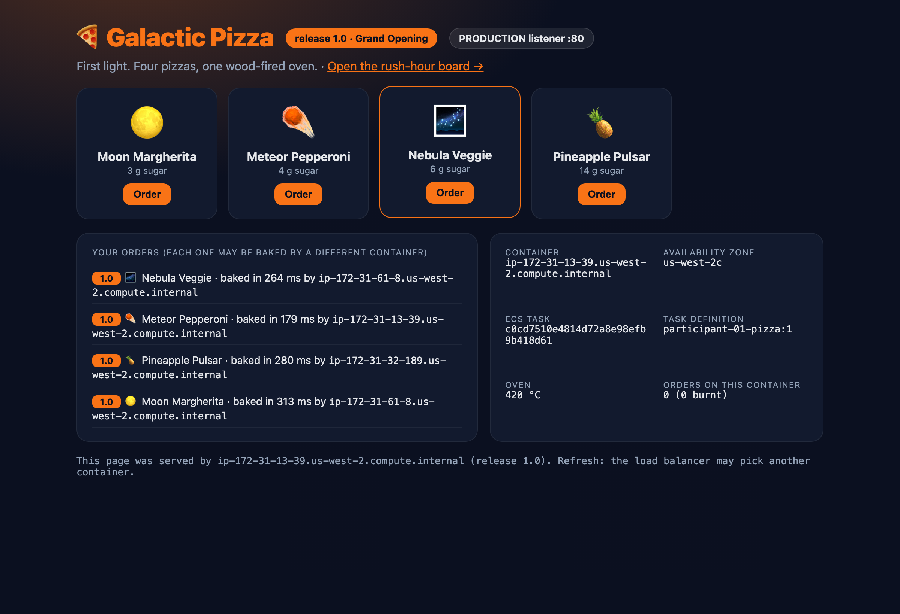

Now open a second tab on **`http://<ALB_DNS>/rush`** and press **▶ Start rush**. Leave this tab open for the rest of the lab: it is your monitoring dashboard, and screenshots of it are your proofs.

### 3b · Ship 1.1 with a rolling update

```bash
aws ecs update-service --cluster $CLUSTER --service $SVC --task-definition $(register 1.1) --query service.taskDefinition --output text
```

Watch the board for three or four minutes. **Before you read on:** what do you see in the middle of the rollout, and why are some orders yellow?

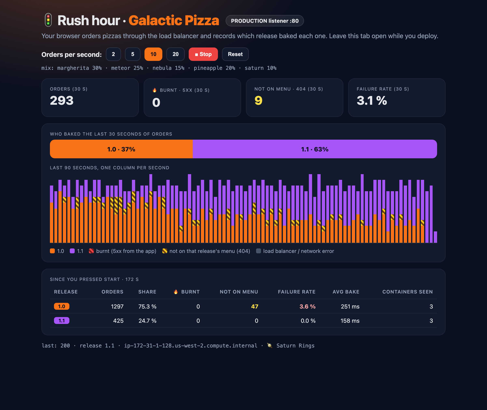

<details>
<summary>✅ What happened</summary>

Measured in the class account: the rollout took **3½ minutes**, and for about **90 seconds both releases served customers at the same time**, in a ratio nobody chose. The yellow hatching is **version skew**: the board learned about Saturn Rings from a 1.1 menu, ordered one, and the load balancer sent the order to a 1.0 container that has never heard of it (`404 not on the 1.0 menu`). In the class run that was 47 failed orders, all on 1.0.

This is exactly what happens in real life when a new front end calls a new API endpoint during a rolling deploy, or a new version writes a database field the old version cannot read.

Three things about rolling that the rest of this lab fixes:

1. **No control over who sees what.** The mix of versions is a side effect of how fast tasks start.
2. **No test before customers.** The first request to 1.1 was a customer's.
3. **Rollback = another rolling update**, another 3½ minutes, with the bad version in the mix the whole time.
</details>

> ✅ **Checkpoint** — The board shows 100 % 1.1, purple, no yellow. `aws ecs describe-services --cluster $CLUSTER --services $SVC --query 'services[0].deployments[].[taskDefinition,rolloutState]' --output text` shows a single COMPLETED deployment.

---

## Part 4 · Blue/green, with a human at the gate

### 4a · Re-plumb the service

Switching strategy is one `update-service`. The load-balancer block gains an **advanced configuration**: the alternate target group, the two rules ECS may edit, and the role it edits them with.

```bash
cat > ~/lab6/bluegreen.json <<J
{
  "cluster": "$CLUSTER",
  "service": "$SVC",
  "loadBalancers": [ {
    "targetGroupArn": "$BLUE_TG",
    "containerName": "pizza",
    "containerPort": 8080,
    "advancedConfiguration": {
      "alternateTargetGroupArn": "$GREEN_TG",
      "productionListenerRule": "$PROD_RULE",
      "testListenerRule": "$TEST_RULE",
      "roleArn": "$INFRA_ROLE"
    }
  } ],
  "deploymentConfiguration": {
    "strategy": "BLUE_GREEN",
    "bakeTimeInMinutes": 3,
    "maximumPercent": 200,
    "minimumHealthyPercent": 100,
    "deploymentCircuitBreaker": { "enable": true, "rollback": true }
  }
}
J
aws ecs update-service --cli-input-json file://$HOME/lab6/bluegreen.json \
  --query 'service.{strategy:deploymentConfiguration.strategy,bake:deploymentConfiguration.bakeTimeInMinutes}' --output table
watch_deploy
```

**Surprise:** changing the load-balancer configuration starts a deployment by itself, a blue/green deployment of the *same* release 1.1. Treat it as a free rehearsal and watch the stages scroll past:

```
20:57:28  IN_PROGRESS SCALE_UP None
20:58:29  IN_PROGRESS TEST_TRAFFIC_SHIFT None
20:58:57  IN_PROGRESS PRODUCTION_TRAFFIC_SHIFT None
20:59:19  IN_PROGRESS POST_PRODUCTION_TRAFFIC_SHIFT None
20:59:25  IN_PROGRESS BAKE_TIME None
21:02:24  IN_PROGRESS CLEAN_UP None
21:02:35  SUCCESSFUL None None
```

Five minutes, three of them bake time. The board stays 100 % purple throughout: same release, new containers. Now look at the production rule:

```bash
aws elbv2 describe-rules --rule-arns $PROD_RULE --query 'Rules[0].Actions[0].ForwardConfig.TargetGroups[].[TargetGroupArn,Weight]' --output text
```

**Green 100, blue 0.** The "green" target group is now production, and the next deployment will go to *blue*. The colours are just two buckets that take turns.

### 4b · Ship 1.2 with a pause before customers

Add a **PAUSE hook** at `POST_TEST_TRAFFIC_SHIFT`: after the new tasks are up and the test listener points at them, ECS stops and waits for a human.

```bash
aws ecs update-service --cluster $CLUSTER --service $SVC --task-definition $(register 1.2) \
  --deployment-configuration '{"strategy":"BLUE_GREEN","bakeTimeInMinutes":3,"maximumPercent":200,"minimumHealthyPercent":100,
     "deploymentCircuitBreaker":{"enable":true,"rollback":true},
     "lifecycleHooks":[{"targetType":"PAUSE","lifecycleStages":["POST_TEST_TRAFFIC_SHIFT"]}]}' \
  --query 'service.deploymentConfiguration.lifecycleHooks' --output json
watch_deploy
```

About 1½ minutes later `watch_deploy` stops with `⏸ paused at a PAUSE hook`. The console shows the same thing: ECS → your service → **Deployments** tab.

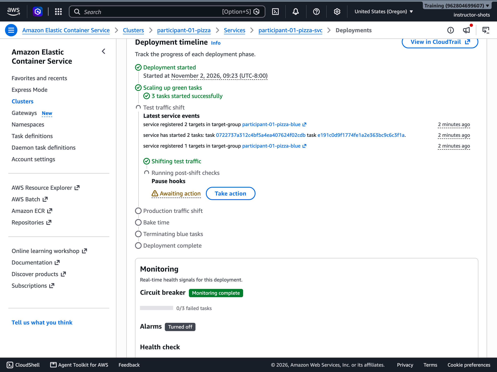

### 4c · Be the release manager

Right now there are **two shops**:

- `http://<ALB_DNS>` (production, port 80): still **1.1**, purple. Your rush board has not changed at all.
- `http://<ALB_DNS>:8080` (test listener): **1.2**, cyan, and only you know it exists.

Open the test listener in a third tab and do what the release manager does every Friday: order a **Moon Margherita** and a **Meteor Pepperoni**. Fast, hot, perfect.

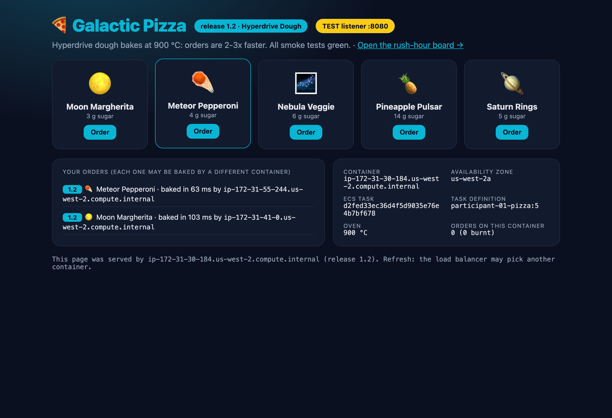

> [!NOTE]
> **Ordered something else and saw a fire?** Then you are a better tester than the release manager. Hold that thought; approve the release anyway (the shop's manager overrules you), and keep your observation for the postmortem. Part 6 turns exactly what you did into a robot.

### 4d · Approve

The pause is a *hook* with an ID. Continuing it lets ECS move production traffic:

```bash
DEP=$(newest)
HOOK=$(aws ecs describe-service-deployments --service-deployment-arns $DEP \
        --query 'serviceDeployments[0].lifecycleHookDetails[?status==`AWAITING_ACTION`].hookId | [0]' --output text)
aws ecs continue-service-deployment --service-deployment-arn $DEP --hook-id $HOOK --action CONTINUE
watch_deploy
```

(The console's **Take action → Continue** button does the same.) Within 30 seconds the board flips **all at once** from purple to cyan: no mixed versions, no version skew. Orders are visibly faster (~75 ms instead of ~155 ms)…

…and then the red starts.

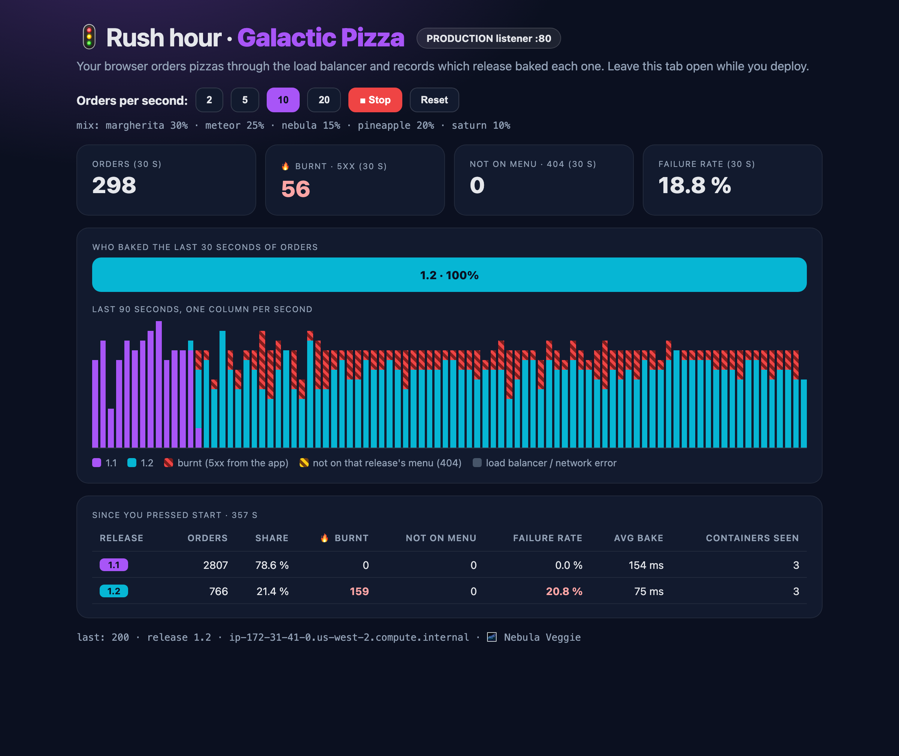

### 4e · Roll back, now

You are in **bake time**: the 1.1 tasks are still running, still registered, just weighted to 0. Roll back:

```bash
aws ecs stop-service-deployment --service-deployment-arn $(newest) --stop-type ROLLBACK
```

Watch the board.

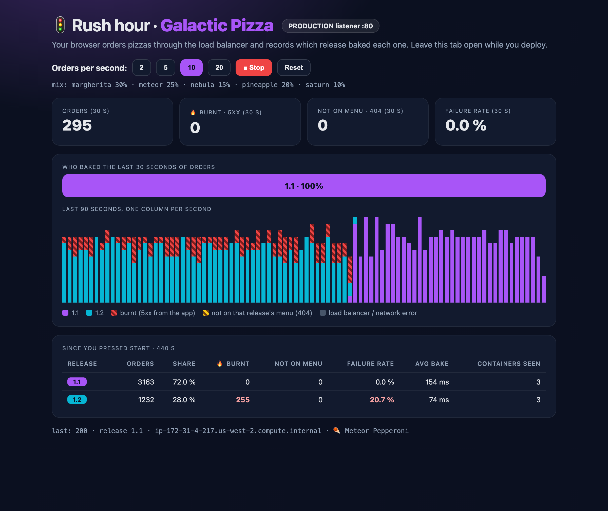

<details>
<summary>✅ What happened, and the postmortem</summary>

The board went from 100 % cyan to 100 % purple **within about six seconds**: a rollback during bake time is one rule-weight change, not a redeployment. ECS reports `ROLLBACK_SUCCESSFUL · Service deployment rolled back by user.` about two minutes later, when it has finished cleaning up the green tasks, but customers were safe long before that.

The burnt pizzas are all **Pineapple Pulsar**: `OVEN FIRE: 14 g of sugar at 900 °C caramelised and ignited`. 900 °C × 14 g crosses the oven's scorch point; every other pizza has 6 g or less.

**Postmortem, class run:** 1.2 served 100 % of production for 98 seconds; **255 pizzas burnt** (21 % of orders: every pineapple order).

| Question | Answer |
|---|---|
| Did the load-balancer health checks catch it? | No. `/health` answered 200 the whole time. |
| Did the circuit breaker catch it? | No. Every task started and stayed up: 0 failed tasks. |
| Did the test listener catch it? | No, because the test was a margherita and a pepperoni. The *capability* to catch it was there; the test was not. |
| Who noticed? | A human, watching a dashboard. On a Friday night that human might be at dinner. |
| What went right? | Blue/green made the rollback take seconds, and nobody saw a mix of versions. |

**Action items** (this is how real postmortems end): (1) limit how many customers a new release can reach before it has proved itself; (2) let a machine watch the error rate and roll back without waiting for a human; (3) automate the test the release manager skipped. Parts 5, 6 and 7 are those three action items.
</details>

> ✅ **Checkpoint** — The board is 100 % 1.1 again. `aws ecs describe-service-deployments --service-deployment-arns $(newest) --query 'serviceDeployments[0].[status,statusReason]' --output text` → `ROLLBACK_SUCCESSFUL  Service deployment rolled back by user.`

---

## Part 5 · Canary, with an alarm that rolls back by itself

**Action item 1 and 2.** The team has not fixed 1.2 yet, but they want to prove the new safety net works. Deliberately deploying a known-bad release to test your defences is a real practice: a **game day**.

### 5a · An alarm that means "pizzas are burning"

The ALB counts every 5xx your containers return. Five or more in one minute = alarm.

```bash
LB_DIM=$(echo $ALB_ARN | cut -d/ -f2-)        # app/participant-NN-pizza-alb/1234abcd…
aws cloudwatch put-metric-alarm --alarm-name $ALARM \
  --alarm-description "Galactic Pizza: 5 or more HTTP 5xx from the containers in one minute" \
  --namespace AWS/ApplicationELB --metric-name HTTPCode_Target_5XX_Count --dimensions Name=LoadBalancer,Value=$LB_DIM \
  --statistic Sum --period 60 --evaluation-periods 1 --threshold 5 --comparison-operator GreaterThanOrEqualToThreshold \
  --treat-missing-data notBreaching
aws cloudwatch describe-alarms --alarm-names $ALARM --query 'MetricAlarms[0].StateValue' --output text
```

> [!WARNING]
> **Your new alarm will probably say `ALARM` at first.** ALB metrics arrive a few minutes late, so the alarm is still looking at the burnt pizzas from Part 4. In the class run it stayed in ALARM for five minutes after the last fire. **Wait until it says `OK`** before you deploy (re-run the last command every minute; read 5b meanwhile). Starting an alarm-guarded deployment while the alarm is already firing is a classic own goal.

### 5b · Why these numbers?

`canaryPercent: 10` sends one order in ten to 1.2. At the board's ~10 orders per second that is one per second, and 20 % of the mix is pineapple, so about **12 fires a minute**: comfortably over the threshold of 5. If your shop got one order a minute, a 10 % canary would need hours to see a single pineapple, and that is the real-life limit of canaries: **they need traffic and a metric**.

`canaryBakeTimeInMinutes: 5` is how long 1.2 must survive at 10 % before ECS sends it everyone. `bakeTimeInMinutes: 2` keeps 1.1 warm for two more minutes after that.

### 5c · Game day: ship 1.2 as a canary

```bash
aws ecs update-service --cluster $CLUSTER --service $SVC --task-definition $(register 1.2) \
  --deployment-configuration '{"strategy":"CANARY","bakeTimeInMinutes":2,"maximumPercent":200,"minimumHealthyPercent":100,
     "canaryConfiguration":{"canaryPercent":10,"canaryBakeTimeInMinutes":5},
     "deploymentCircuitBreaker":{"enable":true,"rollback":true},
     "alarms":{"alarmNames":["'$ALARM'"],"enable":true,"rollback":true},
     "lifecycleHooks":[]}' \
  --query 'service.deploymentConfiguration.{strategy:strategy,canary:canaryConfiguration,alarms:alarms.alarmNames}' --output json
watch_deploy
```

`"lifecycleHooks":[]` removes the pause from Part 4: this time nobody approves anything. **Do not touch anything until `watch_deploy` returns.** Watch the board.

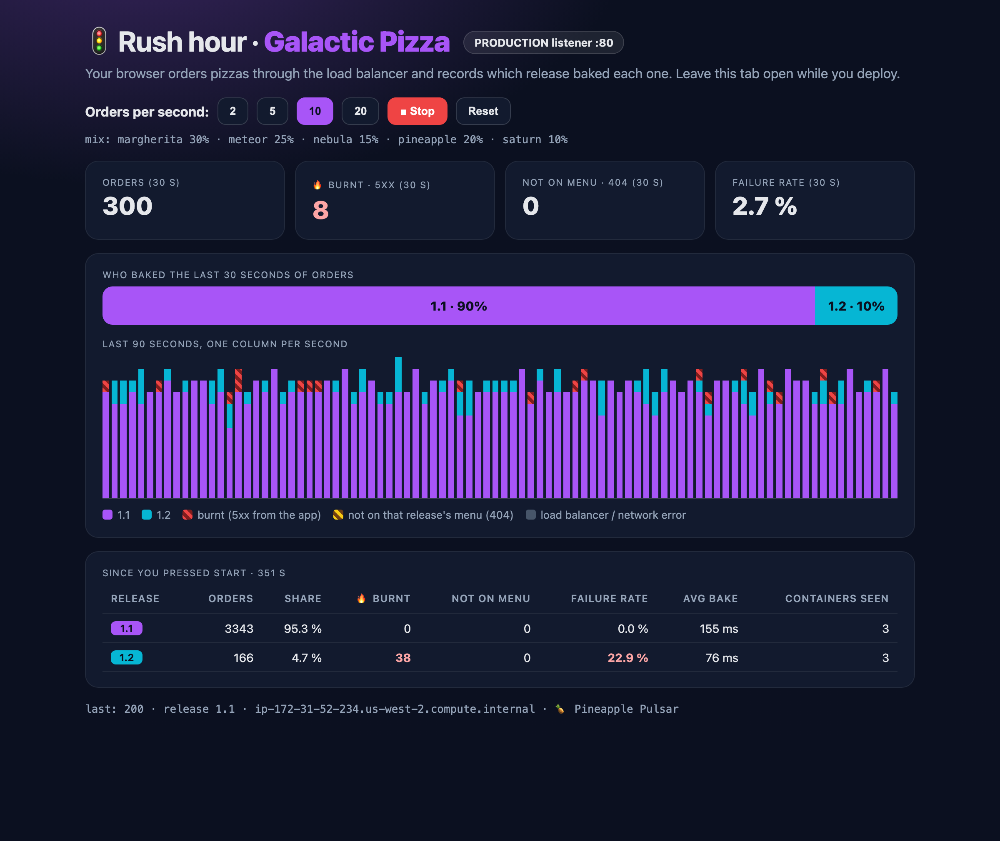

<details>
<summary>✅ What happened</summary>

Class run, timestamps from `watch_deploy` and the alarm history:

```
09:42:19  IN_PROGRESS PRODUCTION_TRAFFIC_SHIFT None                      ← 10 % to 1.2
          (alarm: OK → ALARM at 09:45:31)
09:46:03  ROLLBACK_IN_PROGRESS PRODUCTION_TRAFFIC_SHIFT Service deployment rolled back because of one or more active alarms.
09:47:15  ROLLBACK_SUCCESSFUL None Service deployment rolled back because of one or more active alarms.
```

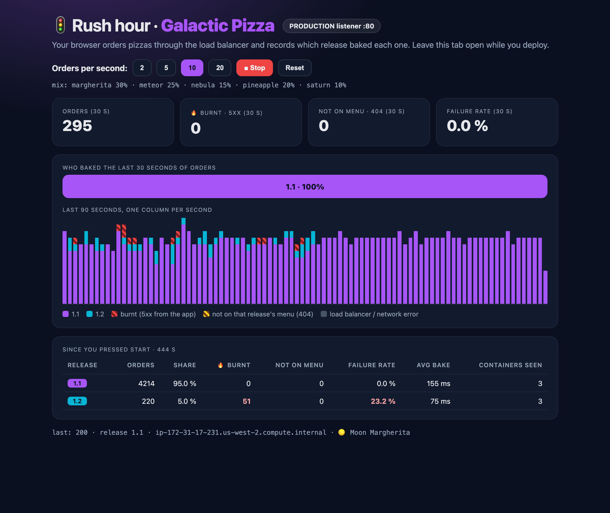

Nobody pressed anything. The console tells the whole story in two lines: **Circuit breaker: 0/3 failed tasks** (the containers were perfectly healthy) and **Alarms: Triggered 1/1**.

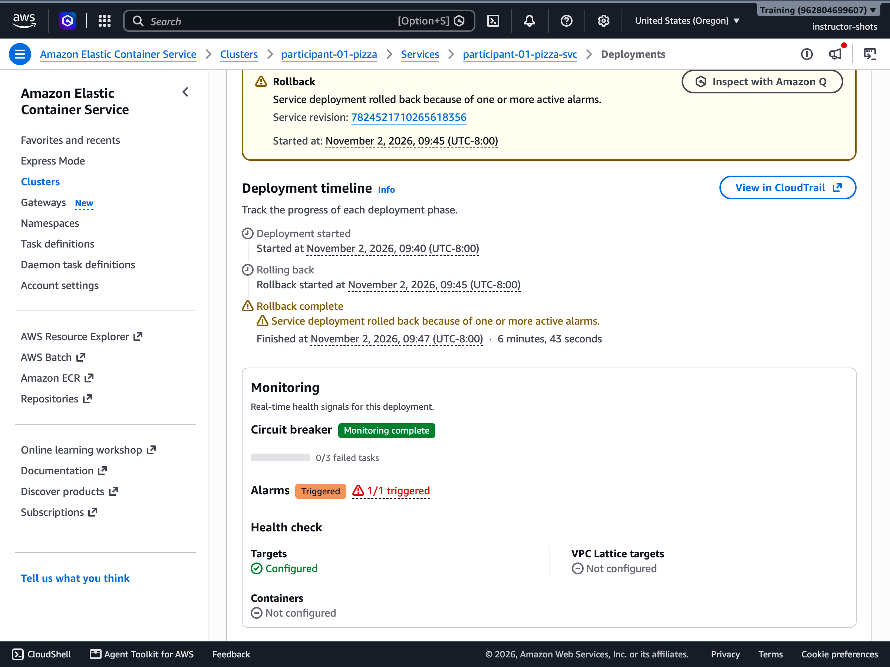

| | Part 4 · blue/green, human watching | Part 5 · canary + alarm |
|---|---|---|
| Share of customers on 1.2 | 100 % | 10 % |
| Who noticed | a human | CloudWatch |
| Time until rollback started | 98 s (because you were watching) | 3 min 44 s |
| **Burnt pizzas** | **255** | **51** |

Notice the honest number: the alarm took **over three minutes**. ALB metrics are published per minute and arrive a minute or two late, and the alarm needs a full one-minute datapoint over threshold. A canary trades *speed of detection* for *size of blast radius*. With the human away at dinner, Part 4 would have burnt pizzas until someone came back. Part 5 burns ~13 a minute for three minutes, and then stops, every time, at 3 a.m. too.
</details>

> [!NOTE]
> **The alarm counts every 5xx from every target behind the ALB, including test-listener traffic.** That is fine here, but in production you would alarm on a ratio (5xx ÷ requests), and keep heavy automated testing off the production alarm's metric.

---

## Part 6 · An automated gate: a Lambda hook that tests every pizza

**Action item 3.** In Part 4 the test listener could have caught 1.2 before any customer. It did not, because a human chose what to test. A **Lambda lifecycle hook** makes the test a robot that never skips a pizza.

### 6a · Read the robot

`~/lab6/menu_walker.py` (abridged):

```python
def handler(event, context):
    base = event["hookDetails"]["testUrl"]                 # we pass  http://<ALB_DNS>:8080  in the service config
    status, menu = get(f"{base}/api/menu")                   # ask the NEW release what it sells
    for _ in range(3):                                       # each pizza 3×: there are 3 green tasks
        for pizza in menu["menu"]:
            code, body = get(f"{base}/api/order?src=menu-walker&pizza={pizza}")
            ...
    return {"hookStatus": "FAILED" if failures else "SUCCEEDED"}
```

ECS calls it at `POST_TEST_TRAFFIC_SHIFT` (the same moment you were paused at in Part 4). It must answer `SUCCEEDED` (carry on), `FAILED` (roll back) or `IN_PROGRESS` (ask me again in 30 s, for long tests).

### 6b · Give it an identity, deploy it, and let ECS call it

Two identities: the Lambda's own (may write its logs, nothing else), and permission for ECS to invoke **exactly this function**, added to the infrastructure role ECS already uses.

```bash
cat > /tmp/lambda-trust.json <<'J'
{ "Version": "2012-10-17", "Statement": [ { "Effect": "Allow", "Principal": { "Service": "lambda.amazonaws.com" }, "Action": "sts:AssumeRole" } ] }
J
aws iam create-role --role-name $P-menu-walker-role --assume-role-policy-document file:///tmp/lambda-trust.json --query Role.Arn --output text
aws iam attach-role-policy --role-name $P-menu-walker-role --policy-arn arn:aws:iam::aws:policy/service-role/AWSLambdaBasicExecutionRole
sleep 10                                                   # a brand-new role takes a few seconds before Lambda accepts it
cd ~/lab6 && zip -q -FS menu_walker.zip menu_walker.py && cd ~
aws lambda create-function --function-name $P-menu-walker --runtime python3.12 --handler menu_walker.handler \
  --role arn:aws:iam::$ACCT:role/$P-menu-walker-role --zip-file fileb://$HOME/lab6/menu_walker.zip --timeout 60 \
  --query '[FunctionName,State]' --output text
aws lambda wait function-active-v2 --function-name $P-menu-walker
aws iam put-role-policy --role-name $P-ecs-infra-role --policy-name invoke-menu-walker --policy-document '{
  "Version": "2012-10-17",
  "Statement": [ { "Effect": "Allow", "Action": "lambda:InvokeFunction", "Resource": "'$HOOK_FN'" } ] }'
```

### 6c · Try it by hand first

Point it at **production** (1.1, healthy). It should pass:

```bash
aws lambda invoke --function-name $P-menu-walker --cli-binary-format raw-in-base64-out \
  --payload '{"lifecycleStage":"MANUAL_TEST","hookDetails":{"testUrl":"http://'$ALB_DNS'"}}' /tmp/out.json >/dev/null && cat /tmp/out.json; echo
aws logs tail /aws/lambda/$P-menu-walker --since 5m --format short | grep release
```

→ `{"hookStatus": "SUCCEEDED"}` and `{"release": "1.1", "ordered": 15, "ok": 15, "failures": []}`.

### 6d · Game day #2: canary + alarm + gate

The deployment configuration is getting long, so it lives in a file now. Same canary and alarm as Part 5, plus the hook (with a 5-minute timeout: a hook that never answers rolls back):

```bash
cat > ~/lab6/canary-gated.json <<J
{
  "strategy": "CANARY",
  "canaryConfiguration": { "canaryPercent": 10, "canaryBakeTimeInMinutes": 5 },
  "bakeTimeInMinutes": 2,
  "maximumPercent": 200,
  "minimumHealthyPercent": 100,
  "deploymentCircuitBreaker": { "enable": true, "rollback": true },
  "alarms": { "alarmNames": ["$ALARM"], "enable": true, "rollback": true },
  "lifecycleHooks": [ {
    "targetType": "AWS_LAMBDA",
    "hookTargetArn": "$HOOK_FN",
    "roleArn": "$INFRA_ROLE",
    "lifecycleStages": ["POST_TEST_TRAFFIC_SHIFT"],
    "hookDetails": { "testUrl": "http://$ALB_DNS:8080" },
    "timeoutConfiguration": { "timeoutInMinutes": 5, "action": "ROLLBACK" }
  } ]
}
J
aws cloudwatch describe-alarms --alarm-names $ALARM --query 'MetricAlarms[0].StateValue' --output text   # must be OK
aws ecs update-service --cluster $CLUSTER --service $SVC --task-definition $(register 1.2) \
  --deployment-configuration file://$HOME/lab6/canary-gated.json --query 'service.deploymentConfiguration.strategy' --output text
watch_deploy
```

<details>
<summary>✅ What happened</summary>

```
14:00:52  IN_PROGRESS SCALE_UP None
14:02:18  IN_PROGRESS TEST_TRAFFIC_SHIFT None
14:02:49  ROLLBACK_IN_PROGRESS PRODUCTION_TRAFFIC_SHIFT Service deployment rolled back because POST_TEST_TRAFFIC_SHIFT lifecycle hook(s) failed.
          Lifecycle hook target arn:aws:lambda:us-west-2:…:function:participant-NN-menu-walker returned FAILED status.
14:03:58  ROLLBACK_SUCCESSFUL …
```

The robot's own report (`aws logs tail /aws/lambda/$P-menu-walker --since 10m --format short | grep release`):

```
{"release": "1.2", "ordered": 15, "ok": 12, "failures": ["pineapple-pulsar: HTTP 500 OVEN FIRE: 14 g of sugar at 900 °C caramelised and ignited", …]}
```

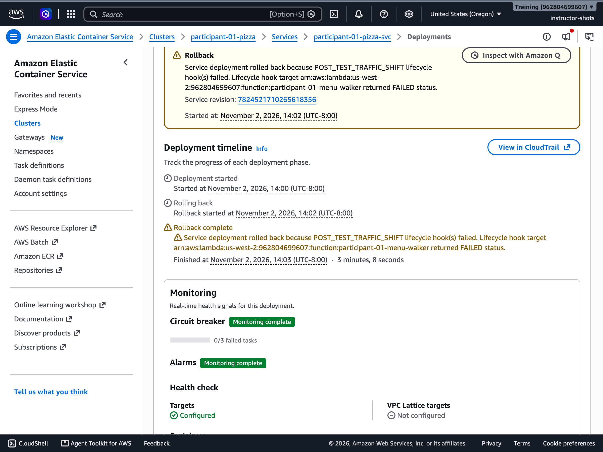

And the board, which only ever sees production:

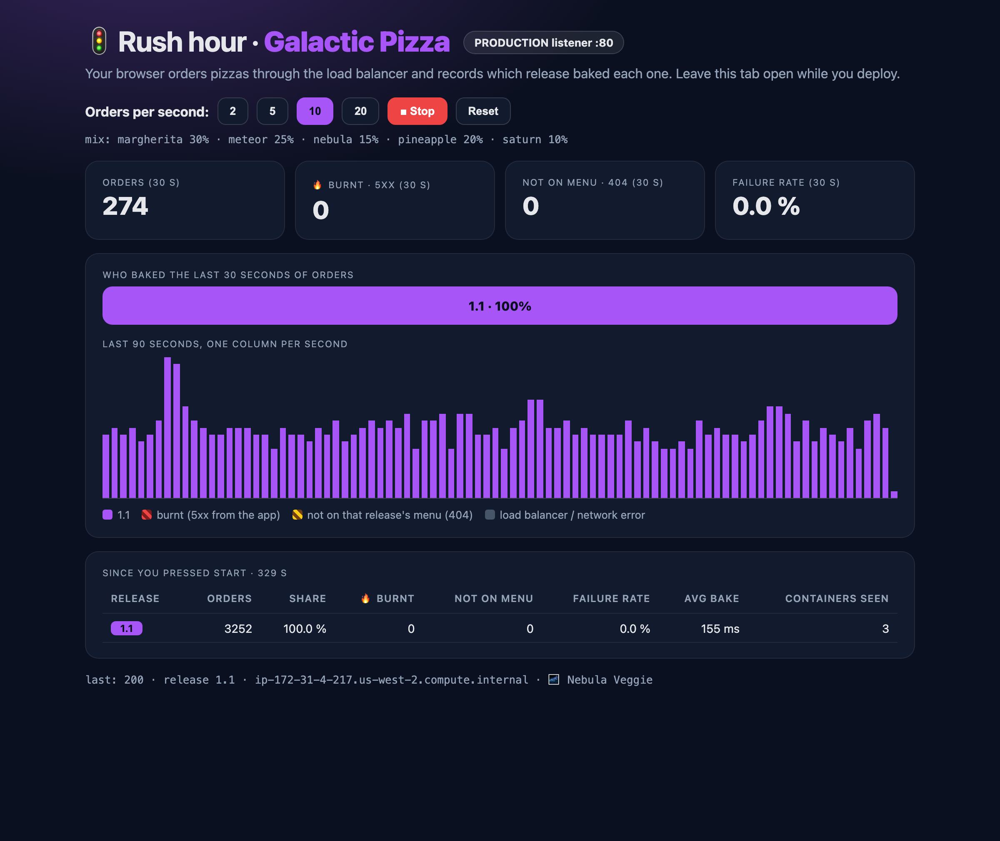

**3,252 orders, 100 % on 1.1, zero burnt.** Not one customer was offered release 1.2. Compare the three runs of the same bad release: **255 → 51 → 0**.

**But do not stop here.** The walker caught 1.2 because pineapple is *on the menu*: it knew what to test. Tomorrow's bug will be one the walker does not know about, and that is why the canary and the alarm stay switched on behind it. Gates catch the known; canaries catch the unknown.
</details>

---

## Part 7 · Ship the fix, linearly, with every net armed

The kitchen team finally ships **1.3 "Lower Rack"**: same 900 °C speed, sugary pizzas bake on a cooler rack. This time the team wants a slow, steady ramp so the new ovens warm up gradually: **25 % every minute**.

```bash
sed -e 's/"strategy": "CANARY"/"strategy": "LINEAR"/' \
    -e 's/"canaryConfiguration": { "canaryPercent": 10, "canaryBakeTimeInMinutes": 5 }/"linearConfiguration": { "stepPercent": 25, "stepBakeTimeInMinutes": 1 }/' \
    ~/lab6/canary-gated.json > ~/lab6/linear-gated.json
grep -E 'strategy|linear' ~/lab6/linear-gated.json
aws ecs update-service --cluster $CLUSTER --service $SVC --task-definition $(register 1.3) \
  --deployment-configuration file://$HOME/lab6/linear-gated.json --query 'service.deploymentConfiguration.linearConfiguration' --output json
watch_deploy
```

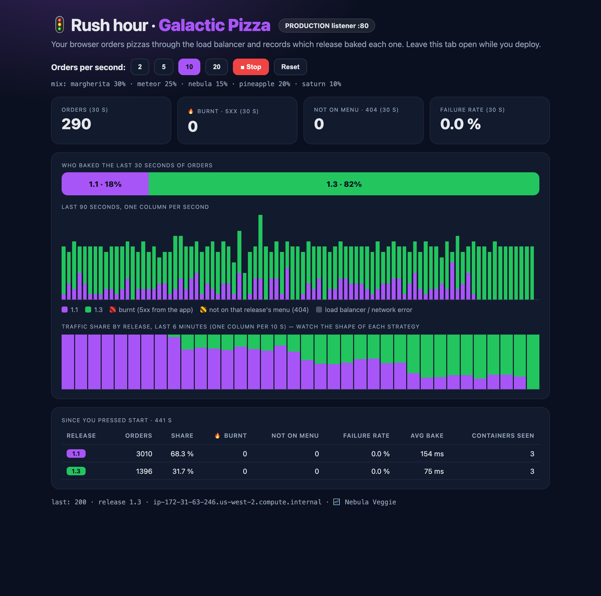

<details>
<summary>✅ What happened</summary>

Three safety nets, three green lights:

1. **The gate:** the walker ordered all 15 pizzas through the test listener → `{"release": "1.3", "ordered": 15, "ok": 15, "failures": []}` → `SUCCEEDED`.
2. **The ramp:** production moved 25 → 50 → 75 → 100 % with a minute between steps (4 min 43 s in the class run). The bottom chart on the board draws the staircase.
3. **The alarm** watched every step and the two-minute bake, and stayed `OK`.

Whole deployment: about 9½ minutes, against 5 for blue/green and 3½ for rolling. That is the price of linear: **time**. You pay it when the risk is load (cold caches, connection storms, a downstream database), not when it is correctness.

Then look at what the old tasks said on their way out:

```bash
aws logs tail /ecs/$FAMILY --since 15m --format short --filter-pattern '"sigterm"'
```

Three lines like `{"event": "sigterm", "release": "1.1", "orders": 6039, "uptime_s": 62366, …}`: ECS deregistered each old task from the target group, waited the 15-s deregistration delay so in-flight orders could finish, then sent SIGTERM. The app logged it and exited cleanly within its 10-s `stopTimeout`.
</details>

> ✅ **Checkpoint** — The shop is green and says **release 1.3 · Lower Rack**; Pineapple Pulsar bakes in ~75 ms without a fire. `aws ecs describe-services --cluster $CLUSTER --services $SVC --query 'services[0].deploymentConfiguration.strategy' --output text` → `LINEAR`.

---

## Part 8 · Challenges

Pick any. Each one has a measured answer.

### Challenge A · 📊 The release scorecard (Logs Insights)

Every order is one JSON log line (`event`, `release`, `pizza`, `status`, `bake_ms`, `listener`). Without opening a single log stream, produce one table: orders, burnt, not-on-menu and burn rate **per release**, for the whole lab.

<details>
<summary>💡 Hint</summary>

CloudWatch → **Logs Insights** (or **Log Analytics**) → log group `/ecs/participant-NN-pizza` → last 3 hours. JSON fields are discovered automatically; `sum(status = 500)` counts the true cases.
</details>

<details>
<summary>✅ Solution</summary>

```
filter event = "order"
| stats count(*) as orders, sum(status = 500) as burnt, sum(status = 404) as not_on_menu,
        round(100 * sum(status = 500) / count(*), 2) as burnt_pct by release
| sort release
```

Class run (part of the afternoon): `1.1 · 9861 orders · 0 burnt` · `1.2 · 15 · 3 · 20 %` (the walker's 15 test orders) · `1.3 · 4392 · 0`. Add `listener` to the `by` clause to separate test-listener traffic from customers.
</details>

### Challenge B · 🛑 Graceful shutdown, second by second

When blue is retired, what happens to an order that is in the oven at that moment? Put the following in the right order and say which setting controls each wait: *SIGTERM sent* · *target marked draining, no new requests* · *SIGKILL if still alive* · *in-flight requests finish* · *container exits 0*.

<details>
<summary>✅ Solution</summary>

1. Target deregistered → **draining**, the ALB sends it no new requests.
2. In-flight requests finish, up to the **deregistration delay** (15 s here; AWS's default is 300 s, far too long for most web apps).
3. ECS sends **SIGTERM**. The app logs `"event": "sigterm"` and exits 0 two seconds later (see `on_sigterm` in `app.py`).
4. If the container were still alive after **`stopTimeout`** (10 s in our task definition, default 30 s, Fargate max 120 s), ECS would send **SIGKILL**.

Why the Dockerfile uses `CMD ["python", "app.py"]` and not `CMD python app.py`: the shell form puts `/bin/sh` in front as PID 1, and `sh` does not pass SIGTERM on. Your app would never hear it and would be SIGKILLed after `stopTimeout`, mid-order.
</details>

### Challenge C · 💸 Fargate Spot: cheaper capacity, with a floor

Fargate Spot runs the same tasks on spare capacity for up to ~70 % less, but AWS can take a task back with a two-minute warning. Make the service keep **one task on regular Fargate no matter what**, and put the rest mostly on Spot. Then check where each task landed.

<details>
<summary>✅ Solution</summary>

```bash
aws ecs put-cluster-capacity-providers --cluster $CLUSTER --capacity-providers FARGATE FARGATE_SPOT \
  --default-capacity-provider-strategy capacityProvider=FARGATE,weight=1
aws ecs update-service --cluster $CLUSTER --service $SVC --force-new-deployment \
  --capacity-provider-strategy capacityProvider=FARGATE,base=1,weight=1 capacityProvider=FARGATE_SPOT,weight=3
watch_deploy        # a full deployment with your current strategy (LINEAR: ~10 min)
aws ecs describe-tasks --cluster $CLUSTER --tasks $(aws ecs list-tasks --cluster $CLUSTER --service-name $SVC --query taskArns --output text) \
  --query 'tasks[].[capacityProviderName,lastStatus]' --output text
```

`base=1` = the first task always goes to FARGATE; after that, tasks split 1 : 3. With three tasks the class run got `FARGATE, FARGATE, FARGATE_SPOT`: placement is "roughly" by weight, not exact for small counts. Switching from launch type to capacity providers requires `--force-new-deployment`, which runs through your deployment strategy like any other release.

When is Spot a bad idea? When a two-minute warning is not enough to drain (long uploads, WebSockets), or when *all* tasks could be reclaimed at once and you have no base on regular Fargate.
</details>

### Challenge D · 🕶️ Dark launch to employees: test listener on port 80, by header

Real companies rarely publish a test *port*. They route staff to the new release on the normal URL with a header or cookie. Make requests with `X-Pizza-Tester: yes` on **port 80** reach the green copy during the test window, while everyone else stays on blue.

<details>
<summary>💡 Hint</summary>

Create a second rule on the **port-80** listener with a higher priority (lower number) than the production rule and an `http-header` condition, then give its ARN to the service as `testListenerRule`. Then deploy something with a PAUSE hook and test with and without the header.
</details>

<details>
<summary>✅ Solution &amp; a gotcha we hit</summary>

```bash
PROD_L=$(aws elbv2 describe-listeners --load-balancer-arn $ALB_ARN --query 'Listeners[?Port==`80`].ListenerArn' --output text)
HDR_RULE=$(aws elbv2 create-rule --listener-arn $PROD_L --priority 5 \
  --conditions 'Field=http-header,HttpHeaderConfig={HttpHeaderName=X-Pizza-Tester,Values=[yes]}' \
  --actions Type=forward,TargetGroupArn=$GREEN_TG --query 'Rules[0].RuleArn' --output text)
aws ecs update-service --cluster $CLUSTER --service $SVC \
  --load-balancers "targetGroupArn=$BLUE_TG,containerName=pizza,containerPort=8080,advancedConfiguration={alternateTargetGroupArn=$GREEN_TG,productionListenerRule=$PROD_RULE,testListenerRule=$HDR_RULE,roleArn=$INFRA_ROLE}" \
  --deployment-configuration '{"strategy":"BLUE_GREEN","bakeTimeInMinutes":1,"maximumPercent":200,"minimumHealthyPercent":100,"lifecycleHooks":[{"targetType":"PAUSE","lifecycleStages":["POST_TEST_TRAFFIC_SHIFT"]}]}'
watch_deploy        # pauses; this deployment still tests on :8080 (see the gotcha below). Continue it as in Part 4d.
# then deploy a different release, e.g. 1.1, and test while it is paused:
aws ecs update-service --cluster $CLUSTER --service $SVC --task-definition $(register 1.1) >/dev/null; watch_deploy
curl -s http://$ALB_DNS/api/order?pizza=margherita | python3 -c 'import sys,json;print("plain:      ", json.load(sys.stdin)["release"])'
curl -s -H 'X-Pizza-Tester: yes' http://$ALB_DNS/api/order?pizza=margherita | python3 -c 'import sys,json;print("with header:", json.load(sys.stdin)["release"])'
```

During the second deployment's pause, plain requests get the **current production** release and requests with the header get the **release being deployed** (class run: `plain: 1.1 · with header: 1.3`). That is a dark launch: same URL, chosen people. Continue or roll back as in Part 4.

**Gotcha, measured:** the update that *changes* `testListenerRule` is itself a deployment, and it still uses the **old** test rule. The new header rule only takes over from the **next** deployment. Load-balancer settings belong to the service revision being deployed *to*, and ECS moves traffic with the rules of the revision it is deploying *from*. If your first test shows the header doing nothing, deploy once more.
</details>

### Challenge E · 📈 Auto scaling, and which metric to trust

Add target-tracking auto scaling (3 to 6 tasks). Then answer: why is `ALBRequestCountPerTarget` (the most natural metric for a web shop) awkward with blue/green?

<details>
<summary>✅ Solution</summary>

```bash
aws application-autoscaling register-scalable-target --service-namespace ecs --resource-id service/$CLUSTER/$SVC \
  --scalable-dimension ecs:service:DesiredCount --min-capacity 3 --max-capacity 6
aws application-autoscaling put-scaling-policy --service-namespace ecs --resource-id service/$CLUSTER/$SVC \
  --scalable-dimension ecs:service:DesiredCount --policy-name $P-cpu50 --policy-type TargetTrackingScaling \
  --target-tracking-scaling-policy-configuration '{"TargetValue":50,"PredefinedMetricSpecification":{"PredefinedMetricType":"ECSServiceAverageCPUUtilization"},"ScaleOutCooldown":60,"ScaleInCooldown":120}'
```

Application Auto Scaling creates two CloudWatch alarms for you (`…AlarmHigh…` and `…AlarmLow…`).

`ALBRequestCountPerTarget` is measured **per target group**, and you have to name one in the policy. With blue/green the live target group changes every deployment, so a policy pinned to "blue" goes blind half the time. Options: scale on CPU or memory (what we did; our pizza oven mostly *sleeps*, so CPU stays low and you will not see a scale-out from the rush board), scale on a custom metric that sums both target groups, or use step scaling on the load balancer's total `RequestCount`. Picking the metric is the real design work in auto scaling.
</details>

### Challenge F · 🧭 Pick the strategy (no AWS needed)

For each, choose a strategy and say what you would alarm on.

1. A tax-calculation API used by 40 customers, each sending a few requests a day.
2. The checkout page of a shop doing 2 000 orders a minute, new payment provider.
3. A search service whose new version ships with an empty cache.
4. A nightly report generator.
5. A new database schema the old version cannot read.

<details>
<summary>✅ One good set of answers</summary>

1. **Blue/green with a test gate** (automated tests on the test listener, then a human approval). A canary is useless at this traffic: 10 % of a few requests a day tells you nothing.
2. **Canary** at 1–5 %, alarm on payment-error *ratio* and latency, short bake, automatic rollback. High traffic makes small percentages meaningful fast.
3. **Linear** in small steps (10 % every few minutes) so the cache fills under growing load; alarm on latency (p99), not just errors.
4. **All at once.** Nobody is waiting on it; keep it simple.
5. **None of them alone.** Mixed versions or a rollback would break. Use *expand and contract*: release A adds the new column and writes both; release B reads the new one; release C stops writing the old one. Each release is then backward compatible and any strategy works.
</details>

### Challenge G · 🧰 ECS-native vs CodeDeploy-powered blue/green

Before 2025, blue/green on ECS meant handing the service to CodeDeploy (`deploymentController: CODE_DEPLOY`, an `appspec.yml` for ECS, `CodeDeployDefault.ECSCanary10Percent5Minutes`, …). Many companies still run it. Using the [ECS documentation](https://docs.aws.amazon.com/AmazonECS/latest/developerguide/deployment-type-blue-green.html), list three differences you would care about if you inherited such a service.

<details>
<summary>✅ Some differences</summary>

- **Where it is configured:** native = one `deploymentConfiguration` on the ECS service; CodeDeploy = an application, a deployment group and an appspec, in a second service with its own role and console.
- **How you deploy:** native = `update-service`, like any rolling deploy, so every tool that already updates ECS works; CodeDeploy = `create-deployment` with a revision, and plain `update-service --task-definition` is refused.
- **Hooks:** both call Lambda functions, but CodeDeploy hooks report back with `PutLifecycleEventHookExecutionStatus`, while native hooks simply return `hookStatus`. Native also has PAUSE hooks and Service Connect support.
- **Linear/canary:** both have them; CodeDeploy uses predefined or custom deployment configurations, native uses `canaryConfiguration` / `linearConfiguration` on the service.
</details>

---

## Part 9 · Clean up (order matters)

Run this as one block. The service must go before the target groups, the load balancer before its security group, and Fargate's network interfaces take a minute to disappear.

```bash
aws application-autoscaling deregister-scalable-target --service-namespace ecs --resource-id service/$CLUSTER/$SVC \
  --scalable-dimension ecs:service:DesiredCount 2>/dev/null                                   # only if you did Challenge E
aws ecs delete-service --cluster $CLUSTER --service $SVC --force --query service.status --output text
aws ecs wait services-inactive --cluster $CLUSTER --services $SVC
aws elbv2 delete-load-balancer --load-balancer-arn $ALB_ARN && aws elbv2 wait load-balancers-deleted --load-balancer-arns $ALB_ARN
aws cloudwatch delete-alarms --alarm-names $ALARM
aws lambda delete-function --function-name $P-menu-walker
aws logs delete-log-group --log-group-name /ecs/$FAMILY
aws logs delete-log-group --log-group-name /aws/lambda/$P-menu-walker
for td in $(aws ecs list-task-definitions --family-prefix $FAMILY --query taskDefinitionArns --output text); do aws ecs deregister-task-definition --task-definition $td >/dev/null; done
aws ecs delete-cluster --cluster $CLUSTER --query cluster.status --output text
sleep 60   # the target groups and the tasks' network interfaces take a minute to let go
for tg in $BLUE_TG $GREEN_TG; do until aws elbv2 delete-target-group --target-group-arn $tg 2>/dev/null; do echo "target group still in use, retrying"; sleep 15; done; done
aws ec2 delete-security-group --group-id $TASK_SG >/dev/null && aws ec2 delete-security-group --group-id $ALB_SG >/dev/null && echo "security groups deleted"
```

If the last line says *DependencyViolation*, wait another minute and run it again. (Measured: the whole block takes about five minutes, most of it waiting for the service to drain and the load balancer to go.) The two IAM roles (`participant-NN-ecs-infra-role`, `participant-NN-menu-walker-role`) stay; students cannot delete roles in this account, and the instructor removes them.

> ✅ **Checkpoint** — `source ~/lab6/pizza.env && pizza_vars` shows `None` for the ALB, both target groups and both rules.

---

## Part 10 · What you learned

- Most outages are **changes**. A deployment strategy decides **blast radius**, **time to detect** and **time to recover**, and you can measure all three.
- **Rolling** is cheap and simple, but serves two versions in an unplanned mix (**version skew**) and rolls back slowly.
- **Blue/green** tests the complete new copy behind a **test listener**, flips traffic atomically, and keeps the old copy warm during **bake time** so rollback takes seconds.
- **Canary** limits who meets a new release; it only works with **enough traffic and an alarm** that means "customers are hurting". Detection on ALB metrics takes minutes, not seconds.
- **Linear** spends time to protect capacity: caches, pools, downstream services.
- **Health checks and circuit breakers** see "process up" and "task started". Business errors (burnt pizzas, failed payments) need **alarms** and **tests**.
- **Lifecycle hooks** turn the manual test into a robot (`SUCCEEDED` / `FAILED`) or a deliberate pause for a human. Gates catch the known; canaries catch the unknown. Use both.
- ECS needs a **third identity**, the infrastructure role, to move your traffic; Lambda hooks need a fourth (the function's own).
- Graceful shutdown is a chain: **deregistration delay → SIGTERM → stopTimeout → SIGKILL**, and exec-form `CMD` is what lets your app hear it.

### Quiz yourself

<details>
<summary>1. Release 1.2 passed every health check and the circuit breaker never tripped. Why not, and what would have to change for the circuit breaker to catch it?</summary>

The circuit breaker counts tasks that fail to start or fail health checks. 1.2's tasks started fine and `/health` answered 200; only `/api/order?pizza=pineapple-pulsar` failed. For the breaker to catch it, the bug would have to break startup or `/health`. Making `/health` call the oven would be tempting but dangerous: a health check that depends on business logic can take the whole fleet out of service for one bad pizza. Use alarms and hooks for business errors.
</details>

<details>
<summary>2. In Part 4 the rollback took six seconds; in Part 3 a rollback would have taken about 3½ minutes. Where does the difference come from?</summary>

During blue/green bake time the old tasks are still running and registered in their target group; rollback is just setting the production rule's weights back to 100/0. A rolling deployment has already stopped the old tasks, so "rollback" means starting new ones from the old task definition and waiting for their health checks.
</details>

<details>
<summary>3. Your canary alarm needed 3 minutes 12 seconds. Name two ways to make detection faster, and the price of each.</summary>

(a) Alarm on a faster signal: the app's own metric or a log metric filter with 10-second high-resolution metrics, at the price of more noise and cost. (b) Run the Lambda hook at `PRODUCTION_TRAFFIC_SHIFT` (invoked at every canary/linear step) and have it query error counts directly, at the price of writing and owning that code. (c) A lower threshold catches sooner but pages you for every blip. Also a bigger canary percentage gives more signal per minute, at the price of a bigger blast radius.
</details>

<details>
<summary>4. Why did changing the load-balancer configuration in Part 4a start a deployment, and why did the header rule in Challenge D only work one deployment later?</summary>

Load-balancer settings are part of the **service revision**. Changing them creates a new target revision, and getting there is a deployment. During that deployment ECS routes traffic with the source revision's rules, so a new test rule only takes effect once its own revision is the source of the next deployment.
</details>

<details>
<summary>5. The walker caught 1.2 with zero customers affected. Why keep the canary and the alarm?</summary>

The walker only tests what it knows to test (every pizza, one at a time, empty shop). Real customers bring combinations, volumes, payloads and timing the walker never tries. The gate removes the known failures cheaply; the canary and the alarm limit the damage of the unknown ones. Defence in depth.
</details>

<details>
<summary>6. Blue/green needs twice the capacity during a deployment. When is that a real problem on Fargate, and when is it not?</summary>

On Fargate you pay per task-second, so 2× for five minutes costs a few cents; it is rarely the problem. It becomes one with account quotas (vCPU limits for large services), very large services, or EC2-backed clusters that need spare instances. It is also a problem for anything that must not run twice at the same time (a singleton consumer, a scheduled job).
</details>

**Done.** You have shipped one container with every strategy ECS offers. Back to the [handout](../docs/index.html) for the wrap-up, or compare with Lab 5, where Kubernetes calls the same ideas a rolling update, readiness and a Service.
